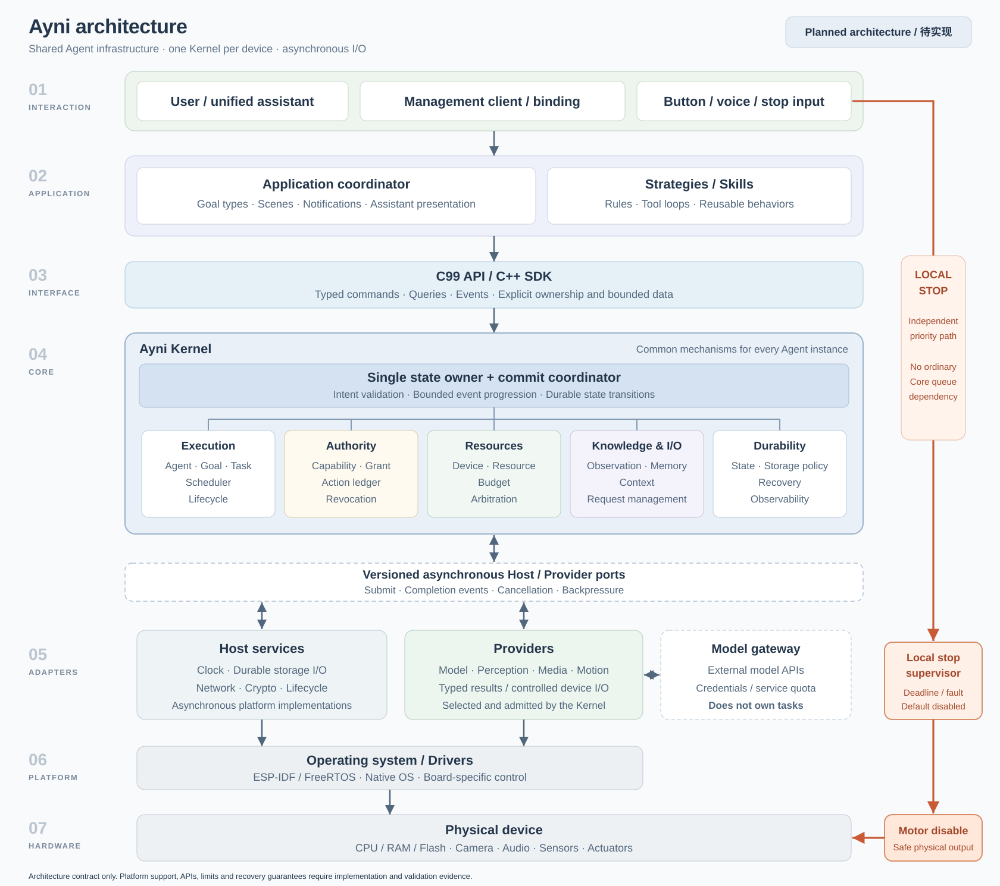

# Ayni

[中文](README.md) · English

**A general-purpose native AgentOS: Agents share task, authorization, resource, call, and recovery mechanisms, and use host capabilities through public contracts.**

> M1 delivers Native Core, the simulator and C/C++ SDK (experimental ABI 0.52, storage schema 8), including the single-assistant CLI, text/tool calls, memory and calendar, authorization and recovery. Desktop E1–E4 evidence is indexed in the [Core Alpha report](reports/core/m1-core-alpha.md). The general safety-critical branch target is now ≥80% (ADR-0088); historical measurements retain their original scope. Schema 3 strict rejection closes the storage-compatibility question (ADR-0082, #106). M2 is deferred. Full MA-038, ESP32 storage/hardware validation and real-model multi-turn use await further work. AP-04/AP-06 resource mapping and Native/Sim application reuse are undergoing [foundation acceptance](reports/core/foundation-acceptance.md). The rest of this README describes the design; see the [development guide](docs/development.md), [CLI guide](targets/native_cli/README.md) and [examples](examples/README.md).

AP-02/AP-03 are delivered. AP-05 adds Task-owned managed actions/subscriptions, fixed-function controls, scalar-source validation, and software SDK examples; normal validation and independent review are recorded in [#116](https://github.com/RobotSe7en/ayni/pull/116) (ADR-0086). Complete the general foundation first, then run ESP32-S3, Linux system, and other platform experiments. No camera, microphone, motor, or other specific device is required. The [foundation implementation and experiment plan](docs/architecture/foundation-and-experiment-plan.md) defines packages, dependencies, and completion gates; see the [main plan](docs/ayni_v1.0.md) for the full design (both in Chinese). The assistant is an example application, and ESP32-S3 peripherals form an experimental configuration.

## Architecture

Ayni defines its architecture around its own task, authorization, resource, and recovery requirements. It provides a portable C++17 Core, a C99-compatible API, and a C++ wrapper for desktop and constrained environments. Foundation development uses Native/Sim and software capabilities; later ESP32-S3 and Linux experiments independently select the capabilities they need.

Ayni's domain contracts govern tasks, authorization, and execution; external ROS 2, MHS, and MCP protocols connect through adapters, which normally absorb field changes, while new execution semantics require versioned evolution and may change Core.

| Layer | Responsibilities and function abstractions |
|---|---|
| Applications, Coordinator, strategies, and Skills | Define reminders and observation workflows, route user requests, select Agents, and compose bounded work; rules, Tool Loops, and planners remain above the Kernel |
| C API / SDK | Submit typed intents or commands, query snapshots, and register goal types and capabilities, while preserving common authorization, error, and lifecycle semantics |
| Shared Kernel services | Eight modules split by invariant owner, with entity-named subdirectories: `kernel` (entry, orchestration, and output gating), `work` (Agents, Goals, Tasks, calls, and the action ledger), `authority` (principals, Grants, and Scenes), `resources` (admission, leases, and permits), `knowledge` (observations, memory, and context), `catalog`, `durability`, and `foundation` |
| Async execution and platform services | Hosts supply clocks, storage, networking, and lifecycle services; Providers implement models, perception, media, and actions |
| Local control and stopping for physical execution | When such capabilities are enabled, controllers execute within admitted envelopes under renewable permits, with an independent stop chain and hardware disable; hosts without actuators need not assemble this stack |
| OS, drivers, and hardware | Reuse existing OS scheduling; Drivers access hardware as needed; physical stop-chain clocks, interrupts, and timeouts are measured in the applicable experiment |

A Skill is a reusable application workflow; a Capability is a system-validated execution contract; a Provider implements an execution interface; a Driver accesses hardware. New applications, models, and hardware should enter through registration and adapters. Changes to authorization, recovery, or resource semantics still require contract versions and tests.

## Core responsibilities

The Kernel owns the logical state of Agent instances, Goals/Tasks, authorization, action records, resources, and memory. Each device has one logical state owner, advanced through bounded events and `step` calls. Networking, Flash, model calls, and device operations use asynchronous interfaces.

Key design constraints include:

- Define consistent commit and recovery boundaries across trigger cursors, Tasks, budgets, and action records. Durable-acceptance replies, external events, and side-effect dispatches are released only after their commit enters the durable prefix. On a storage write failure, the Kernel enters a restricted fence, stops new outputs and permit renewal, and reuses the restart recovery path.
- Persist a possible-dispatch barrier before requests with side effects. Uncertain outcomes enter `RESULT_UNKNOWN` for authoritative queries or human resolution; recovery must not blindly replay actions.
- Validate principals, Grants, arguments, resources, runtime limits, observation freshness, and deadlines. Models propose; the local Kernel controls execution.
- When managed physical actuators are connected, they run only under short, actively renewed permits issued by the control domain's authority owner. Revocation, restarts, calibration invalidation, emergency-stop reset, and network partitions invalidate old permits; worst-case stop bounds are measured term by term.
- Bound media, queues, context, Tasks, and storage. Resource cancellation, timeout, and stopping require explicit release or quarantine states.

Business completion rules, planning, model inference, perception algorithms, codecs, TLS, and motor control belong in applications, Hosts, Providers, or Drivers. The first release uses trusted built-in code, with authorization guarantees at managed entry points. Isolation against arbitrary native code on ESP32 requires separate future validation. Model, VLA, and external-message outputs are untrusted data; pure-function strategy interfaces are not a security boundary; ROS, MHS, and MCP adapters run as permission-restricted processes, and executor-side permit checks are the final line of defense.

## Agreed semantics of the assistant example

These rules apply to the selected assistant application and its enabled capabilities; other Ayni deployments need not include that application or its peripherals.

1. **Shared assistant profile:** Agents receive explicit access to a common assistant profile. Agent memory remains private by default; sharing requires authorization.
2. **One owner:** v0.1 has a single device owner. Push-button voice requests use existing authorization; sensitive operations such as adding permissions require confirmation through the bound management client.
3. **Pausing the assistant:** Accepted reminders remain active. New autonomous observation, reflection, and motion are paused, and related in-flight work is brought to a stop or checkpoint. Pause, cancellation, and emergency stop have distinct meanings.
4. **Forgetting:** Deleted memory cannot be used again. In-flight results and derived content that depend on it are invalidated. Data already sent to a model remains subject to the upstream retention policy.
5. **Reminder completion:** A reminder completes after successful presentation through the user's selected method, without requiring acknowledgement for ordinary reminders. Creating a notification record or queuing output alone does not count as success; failures remain pending.

The former wheeled-assistant plan's local web UI, voice, vision, and short motions remain optional application/experiment configurations. Selecting that configuration retains its authorization, privacy, hardware-budget, and stopping requirements; the whole device experience is no longer a prerequisite for a general AgentOS release.

## Three versioned contracts

| Contract | Compatibility boundary |
|---|---|
| Core—Host / native SDK | ABI major/minor versions, structure size, and feature bits (0.x minor versions must match exactly); no STL types, exceptions, or OS handles across the ABI |
| Management and device protocols | Protocol major/minor versions, capability versions, and feature negotiation; shared domain semantics with authentication and local authorization checks |
| Persistent storage | Schema, record, and migration versions; migration, corruption recovery, and firmware rollback are validated together |

These contracts evolve independently and remain aligned through domain definitions and conformance fixtures. The current experimental C ABI is 0.47 and storage schema is 3; see [M1 progress](reports/core/m1-progress.md) for implementation and evidence. Unimplemented interfaces remain drafts. Message IDs, operation IDs, and local request epochs serve different purposes, and each message kind has exactly one idempotency key. Node authentication must be complemented by evidence binding the node to the calling principal. The protocol makes no universal exactly-once execution guarantee.

## Optional embodied profiles and adapters

Execution permits, control sessions, stop bounds, and motion-outcome phases govern enabled physical execution capabilities. The optional `EMBODIMENT_V1` profile adds robot-specific types for space and time, state, trajectories, and model candidates, negotiated by feature and governed by the three versioned contracts. Software-only hosts need no physical control stack, and ordinary deployments need no ROS dependency.

| Contract | Planned boundary |
|---|---|
| Observations and robot state | Specify frames, clock domains/epochs, units, calibration versions, and `RobotState`; tf2, URDF, perception, and coordinate transforms remain in Providers or bridges |
| Control authority and local execution | `ControlAuthority` declares control modes and command interfaces on top of the base execution permit; epochs, command sequences, and maximum command age are checked by the executor, local control sessions are bounded and subject to interlocks, and local controllers run real-time loops |
| Motion outcomes and models | The accepted, executed, stop-confirmed, and goal-verification phases of `MotionOutcome` are base contracts, and the profile adds pose and joint verification evidence; VLA outputs are candidates that can execute only inside an admitted control session after executor permit and envelope checks |

The ROS 2 Bridge remains outside Core and maps Topics/Services/Actions to `subscription/unary/action`. Imports and exports use existing managed entry points. The Bridge records ROS goal UUID mappings; acceptance, cancellation responses, and QoS alone do not establish durable deduplication, authorization, or physical stopping. Selecting this adapter requires validation of DDS-Security, Ayni Grants, resources, and recovery, with an explicit supported version and subset. Linux system experiments require neither ROS nor ESP32; ROS, peer, and micro-ROS work have independent entry conditions.

As of 2026-10-18, MHS (Model Hardware Standard) remains a research preview; see the [official introduction](https://www.anthropic.com/news/model-hardware-standard-research-preview) and [preview portal](https://www.modelhardwarestandard.com/). Adaptation requires a specific, actionable specification, lawful access, licensing, and test fixtures; any SDK used must have a pinned version. Current compatibility is not claimed. Import/export must use the same authorization, schema validation, and execution entry points. Arbitrary generated code must not be deployed directly to the MCU, and MHS code files are accepted only for the subset convertible into bounded Procedure data.

## Roadmap and validation

| Stage | Target and gate |
|---|---|
| Existing M0/M1 baseline | Actual Native Core, simulator, SDK, E1–E4, and AP-00/AP-01 evidence; the general foundation is not yet complete |
| General foundation | AP-02 inputs/results, AP-03 registration/discovery, AP-04 instance validation, AP-05 long operations/subscriptions, AP-06 SDK/application reuse, and their contracts and regressions |
| Platform experiments | After the foundation gate, independently validate ESP32-S3, Linux systems, and other Hosts using their chosen minimal capabilities; report resources, operation, and limitations separately |
| Optional capability/application experiments | Voice, vision, motion, management, OTA, the wheeled assistant, or user trials as selected; their applicable guarantees and acceptance requirements remain |
| Optional protocol/peer extensions | MCP/ROS/MHS, peer, full MA-038, further systems, and isolation according to actual needs and independent entry conditions |

E1 checks multiple Agents sharing system services. E2 checks restarts at critical action stages. E3 checks replacing a model or compatible strategy after restart. E4 checks bounded composition, subscription dependencies, and semantic upgrades/rollback. Foundation development continues to run Native/Sim fixtures and existing regressions; later platform experiments check common contracts and selected capabilities, with separate evidence for real OTA, devices, and endurance.

Planned extension examples include `new_hardware`, `new_model`, `new_strategy`, and `composite_workflow`. A new composite application must work through public interfaces without changing Kernel source.

R1 is an extension conformance suite. R1.a checks Mock profile contracts, R1.b checks a selected ROS Bridge/simulation, and R1.c depends on MHS specifications, access, licensing, and fixtures. Disabled extensions do not block the foundation; claims of support require the applicable R1 results. Platform or Mock results do not substitute for real-device evidence.

Build, simulation, system integration, hardware functionality, and endurance results are reported separately. Linux Native/Sim E1–E4 and SDK evidence is indexed in [M1 progress](reports/core/m1-progress.md) and the [Core Alpha report](reports/core/m1-core-alpha.md). Further foundation interfaces, Linux system integration, and ESP32 experiments remain future work. Commands, directories, and APIs not marked as implemented remain proposed.

## Contributing and acknowledgements

Read [AGENTS.md](AGENTS.md) and the [implementation plan](docs/ayni_v1.0.md) before contributing. Contract, migration, and material semantic changes need corresponding ADRs (see [docs/adr/](docs/adr/README.md)) and validation evidence. Code, logs, and public firmware must not contain private media, vendor API keys, or reusable device credentials.

The architecture diagram's visual presentation references [AIOS](https://github.com/agiresearch/AIOS); its components, layers, and contracts follow Ayni's own design. Thanks to the durable execution, device, protocol, and embedded projects listed in the plan's appendix. References acknowledge research; they do not imply integration, compatibility, or upstream endorsement. A project license has not yet been selected. Dependency selection and any source reuse require review of the relevant licenses.
