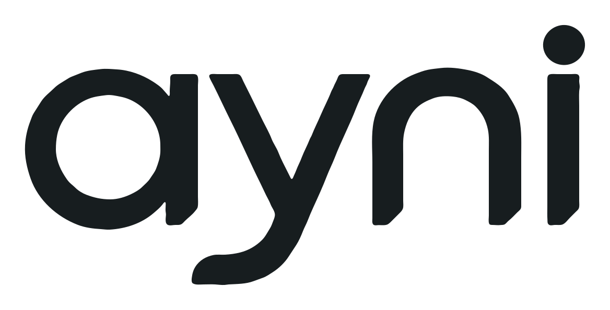
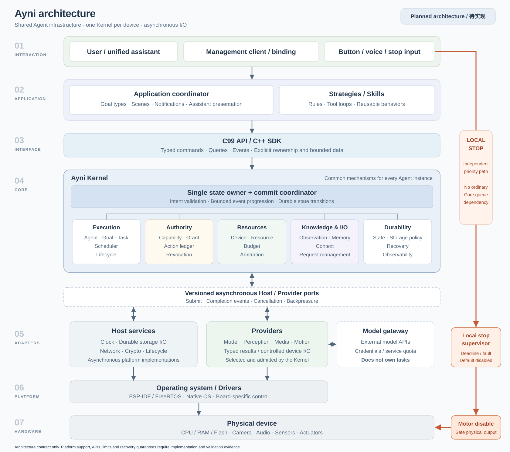

<p align="center">
  <picture>
    <source media="(prefers-color-scheme: dark)" srcset="docs/assets/ayni-logo-inverse.svg">
    
  </picture>
</p>

<p align="center">
  <strong>Agent 共用系统，能力按需接入。</strong>
</p>

<p align="center">
  <a href="https://github.com/RobotSe7en/ayni/actions/workflows/ci.yml"></a>
  <a href="docs/development.md"></a>
  <a href="include/ayni/ayni.h"></a>
</p>

<p align="center">
  <a href="#快速开始">快速开始</a> |
  <a href="#架构">架构</a> |
  <a href="#文档">文档</a> |
  <a href="examples/README.md">示例</a> |
  <a href="README.en.md">English</a>
</p>

**Ayni** 是通用原生 AgentOS。在宿主操作系统之上，它为多个 Agent 提供共用的任务、授权、资源、调用、记忆与恢复机制，通过公开契约接入软件、模型服务或设备能力。

可移植 C++17 Core 管理系统状态，规则与 ToolLoop 决定如何推进工作，Host 和 Provider 提供异步服务。桌面助理与 ESP32-S3 触屏实验复用这套基础；具体应用、模型和外设由部署选择。

> **当前状态：** 通用基础与独立源码 SDK 已交付，Native/Sim 软件验证见[基础报告](reports/core/foundation-acceptance.md)和[独立接入报告](reports/core/independent-consumption.md)。当前分支实验性 C ABI 为 **0.62**，Core storage schema 为 **12**（独立未决操作账本、QUERY/ACK 与落盘后审计见[ADR-0115](docs/adr/0115-unknown-operation-history-and-work-retirement.md)；异步界面、通用独立操作及参数反射见[ADR-0114](docs/adr/0114-async-ui-streaming-control-and-parameterized-reflex.md)）。ESP32 触屏 Wi-Fi/语音实验独立推进；完整硬件停止链与耐久验收仍未完成。

## 核心理念

**1. 多个 Agent，共用一套系统机制。**
Kernel 统一持有 Agent、Goal、Task、授权、资源和恢复状态，由单一逻辑所有者通过有界 `step` 推进。模型、网络、存储和设备 I/O 在异步边界执行。

**2. 能力具有可校验的契约。**
能力声明类型化输入、结构结果、版本及执行属性。可信配置注册能力，Task 按权限发现和查看目录，通过 Binding 选择具体实现；发现能力不会自动获得执行权限。

**3. 执行权由本机治理。**
模型提出调用建议，Kernel 检查主体、Grant、参数与资源。记忆默认私有，共享与外发须明确授权。当前权限保证覆盖可信内置代码使用的受管理入口，任意原生代码的强隔离仍属后续工作。

**4. 持久接受与副作用有明确边界。**
持久接受回复与副作用派发受到提交屏障约束；结果不确定进入 `RESULT_UNKNOWN`，通过权威查询或人工处理。恢复重建状态，不盲目重演旧动作。

**5. 容量与生命周期显式管理。**
队列、任务、上下文和存储都有容量约束；调用支持 unary、action、subscription，明确取消、超时、背压与释放。长期目标和单次任务分别管理。

**6. 同一 Core，按部署组合能力。**
C99 API、C++17 封装和源码 SDK 支持独立工程接入，`runtime/` 选择并装配 Host、Provider 与应用。纯软件部署即可运行；启用物理执行能力时，另须满足许可、联锁与独立停止契约。

## 快速开始

以下使用 Linux Native 开发环境与 Mock 模型，无需 API Key。已验证工具链、依赖版本及其他构建方式见[开发指南](docs/development.md)。

### 构建并启动

准备 C++17 工具链、CMake、Ninja、Python、libcurl 和 SQLite 开发包：

```sh
sudo apt-get install -y build-essential cmake ninja-build python3 git \
    libcurl4-openssl-dev libsqlite3-dev

git clone https://github.com/RobotSe7en/ayni.git
cd ayni

# 先检查可用内存、swap、CPU 和其他任务，再按资源预算调整并行度。
export CMAKE_BUILD_PARALLEL_LEVEL=2
export CTEST_PARALLEL_LEVEL=2

cmake --preset native-debug
cmake --build --preset native-debug --target ayni
./build/native/targets/native_cli/ayni --mock
```

首次配置会下载锁定版本的依赖；离线配置方法见开发指南。CLI 默认使用用户私有配置和数据目录。

### 完成一次对话

首次运行尚无授权。在 CLI 中为 Mock 对话授予模型与摘要权限，再输入文字：

```text
/grant model
/wait
/grant summary
/wait
你好
/wait
/conversation
/quit
```

`/wait` 等待当前可推进的工作与保存完成，`/quit` 正常关闭。真实模型通过 OpenAI-compatible Provider 接入；配置文件、环境变量密钥、权限和其他命令见 [CLI 说明](targets/native_cli/README.md)。

### 运行公开示例

```sh
cmake --build --preset native-debug --target \
    ayni_example_new_hardware ayni_example_new_model \
    ayni_example_new_strategy ayni_example_composite_workflow \
    ayni_example_managed_operations
ctest --preset native-debug -R '^Examples\.'
```

示例覆盖模拟硬件接入、loopback 模型服务、新策略、组合工作流和受管长操作；均无需真实模型凭据或设备。完整说明见[公开 SDK 与接入示例](examples/README.md)。

## 架构



图中包含规划中的扩展；实现与验证范围以公开契约和交付报告为准。

| 层级 | 职责 |
|---|---|
| 应用与策略 | 助理、软件工作流、目标类型、规则与 ToolLoop，定义业务行为和工作推进方式 |
| C API / C++ SDK | 提交类型化命令、查询快照、注册能力，保持统一的权限、错误和生命周期语义 |
| 共享 Kernel | `kernel`、`work`、`authority`、`resources`、`knowledge`、`catalog`、`durability`、`foundation`，各自持有对应不变量 |
| Host 与 Provider | Host 提供时钟、存储和生命周期等平台服务；Provider 实现模型、软件作业、事件流或设备调用 |
| 本地控制与停止 | 为启用的物理执行能力校验许可、限值与联锁，提供独立停止路径；实际停止保证须有硬件证据 |
| 宿主 OS 与驱动 | 负责线程调度、系统 I/O 和具体硬件访问 |

`runtime/` 是组合根，选择部署并装配具体组件。Core 保持平台无关；业务策略、网络、模型 SDK 和驱动留在边界。Skill 表达可复用工作流，Capability 声明执行契约，Provider 实现能力，Driver 访问硬件。

ABI、管理/设备协议与存储 schema 独立演进。0.x ABI 次版本须完全匹配；当前存储拒绝不支持的旧 schema 并保留原目录，迁移与回退边界见[开发指南](docs/development.md)。

## 项目结构

```text
core/              可移植 Kernel，按状态与不变量属主拆分
include/ayni/      公开 C API、C++ 封装与草案接口
contracts/         版本化契约与测试追踪矩阵
strategies/        规则、ToolLoop 等工作推进策略
applications/      助理、软件工作流和验证应用
hosts/             Native、Sim、ESP-IDF 平台服务与共用存储
providers/         模型、软件作业、Shell、呈现等能力实现
runtime/           部署选择、组件装配与共同运行时
control/, safety/  受许可执行与独立停止机制
targets/           Native CLI、模拟器和固件入口
experiments/       独立平台与应用实验
examples/          公开 SDK 接入示例
tests/             单元、契约、集成与独立消费者验证
docs/, reports/    设计、ADR、开发说明与验证证据
```

## 实现与路线

| 范围 | 状态与证据 |
|---|---|
| Native Core、模拟器、C/C++ SDK | 已交付；历史 E1～E4 验证见 [Core Alpha Native 报告](reports/core/m1-core-alpha.md) |
| 通用能力基础 | 类型化输入/结果、发现与绑定、多实例资源映射、长操作与订阅已交付，见[基础报告](reports/core/foundation-acceptance.md) |
| 独立源码 SDK 与共同应用 | 已交付；只读隔离导入、Native 共同程序及最小正常重开通过，ESP32-S3 独立编译/链接通过，见[独立接入报告](reports/core/independent-consumption.md) |
| ESP32 触屏 Wi-Fi/语音 | 独立实验已实施；完整 128K 上下文峰值、60 秒电机动作与通用硬件停止链仍未验收，见[实验说明](experiments/esp32_wifi_chat/README.md) |
| 后续平台与扩展 | Linux 系统集成、视觉、OTA、MCP/ROS/MHS、跨节点及完整 MA-038 按独立条件安排，见[实施计划](docs/ayni_v1.0.md) |

Native/Sim、固件编译、实机功能与耐久结果分别记录。各平台按所需能力独立实验；Linux 不依赖 ESP32 或 ROS。最新交接入口见 [M1 进度](reports/core/m1-progress.md)。

## 文档

- [开发指南](docs/development.md)：工具链、依赖、构建、测试与 CI。
- [Native CLI](targets/native_cli/README.md)：对话、权限、模型、记忆与提醒。
- [公开示例](examples/README.md)与[独立工程接入](tests/portability/README.md)：扩展能力、替换实现和复用 SDK。
- [公开契约](contracts/README.md)与[测试追踪](contracts/traceability.md)：接口保证及验证范围。
- [基础与实验计划](docs/architecture/foundation-and-experiment-plan.md)、[完整实施计划](docs/ayni_v1.0.md)与 [ADR](docs/adr/README.md)：设计、顺序和决策依据。
- [Logo 资源](docs/assets/ayni-logo.svg)：[反白 SVG](docs/assets/ayni-logo-inverse.svg) · [原始 PNG](docs/assets/ayni-logo.png)。

## 参与与致谢

贡献前请阅读 [AGENTS.md](AGENTS.md) 与[开发流程](docs/workflow.md)。契约或兼容语义变化应同步相关 ADR、测试与文档；凭据通过运行时配置。

README 的组织参考 [dagent](https://github.com/RobotSe7en/dagent)。架构图的视觉表达参考 [AIOS](https://github.com/agiresearch/AIOS)，组件和契约依据 Ayni 自身设计；更多研究资料见实施计划附录。引用表示研究与致谢，不代表集成、兼容或上游背书。

## 许可证

项目许可证尚未确定，将在首次公开发布前决定；依赖和源码复用按各自许可证审查。
