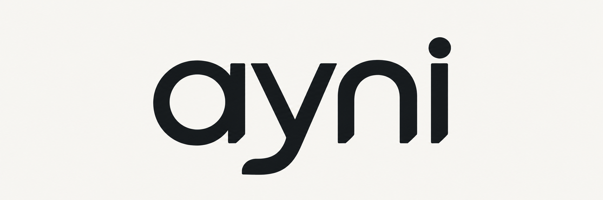
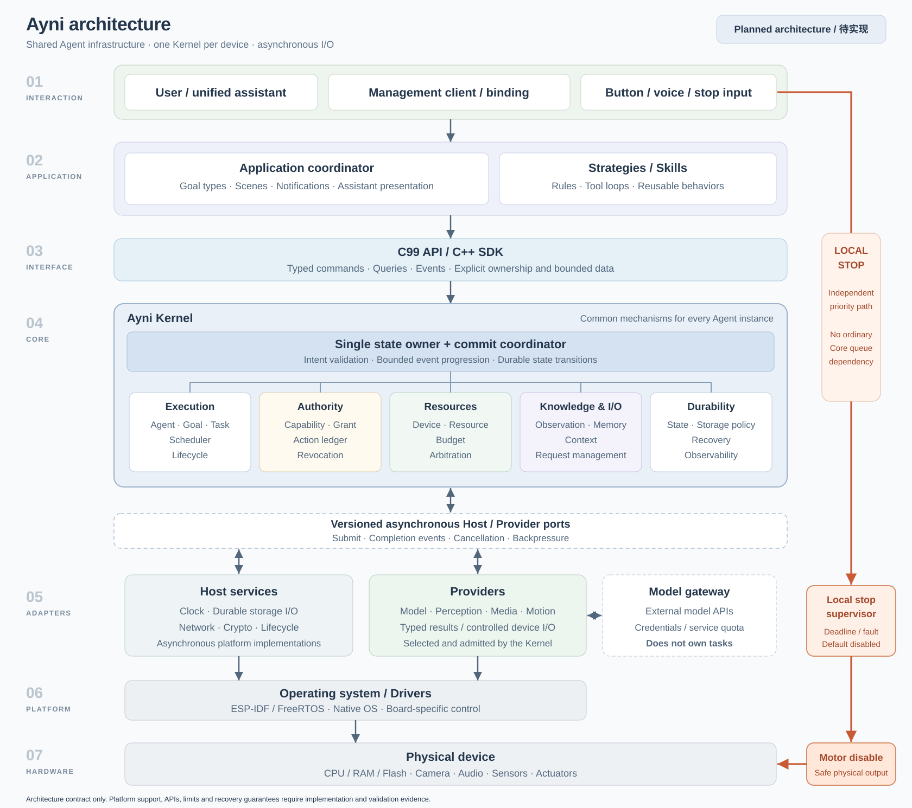

<p align="center">
  
</p>

<h3 align="center">基于 C++17 与 C99 的通用原生 AgentOS</h3>

<p align="center">
  <strong>Agent 共用系统，能力按需接入。</strong><br>
  面向多 Agent 软件与嵌入式系统的可移植内核——本地授权治理、有界内存、类型化能力契约与崩溃安全恢复，覆盖从 Linux 宿主到 ESP32-S3 微控制器。
</p>

<p align="center">
  <a href="https://github.com/ayni-org/ayni-os/actions/workflows/ci.yml"></a>
  <a href="LICENSE"></a>
  <a href="docs/development.md"></a>
  <a href="include/ayni/ayni.h"></a>
  <a href="contracts/storage/records.md"></a>
</p>

<p align="center">
  <a href="README.md">English</a> ·
  <strong>简体中文</strong>
</p>

<p align="center">
  <a href="#为什么选择-ayni">为什么选择 Ayni</a> ·
  <a href="#核心能力">核心能力</a> ·
  <a href="#快速开始">快速开始</a> ·
  <a href="#架构设计">架构设计</a> ·
  <a href="#实现与路线">实现与路线</a> ·
  <a href="#文档导航">文档</a>
</p>

---

**Ayni** 是面向多 Agent 共享运行的**通用原生 AgentOS**。运行在宿主操作系统之上，它通过无异常、无 RTTI 的可移植 **C++17 Core**，配合 **C99 ABI** 与 **C++17 SDK**，统一管理 Agent 生命周期、目标、任务、授权、资源准入、私有记忆与持久化恢复。

Ayni 不把任务、记忆或硬件执行权交给提示词或外部模型服务：**模型只提出建议，本机 Kernel 负责裁决、准入、持久提交与恢复。** 软件作业、模型 API、事件流或可选物理设备均通过版本化的类型契约按需接入。同一套 Core 既可运行纯软件的 Linux Native 部署，也支持 ESP32-S3 等资源受限嵌入式实验。

> [!NOTE]
> **当前基线（实验性 C ABI 0.62 / Core Storage Schema 12）：** 通用基础能力与独立源码 SDK 已交付，Native/Sim 软件验证见[基础验收报告](reports/core/foundation-acceptance.md)与[独立接入报告](reports/core/independent-consumption.md)。近期演进完成了独立未决操作账本、`QUERY`/`ACK` 对账与落盘后结案审计（[ADR-0115](docs/adr/0115-unknown-operation-history-and-work-retirement.md)），以及异步界面解耦、流式控制会话与参数反射规则（[ADR-0114](docs/adr/0114-async-ui-streaming-control-and-parameterized-reflex.md)）。ESP32-S3 触屏 Wi-Fi/语音实验独立推进；完整硬件停止链与耐久验收仍未完成。

## 为什么选择 Ayni

大多数 AI Agent 框架属于上层编排脚本：权限靠提示词约束，状态散落在进程内存，发生故障后容易盲目重试或丢失副作用。Ayni 从**系统工程与操作系统内核**视角解决多 Agent 运行问题：

| 维度 | 常见 Agent 框架 | Ayni AgentOS |
|---|---|---|
| **执行模型** | 阻塞在模型与工具 I/O 上的编排循环 | 单逻辑所有者有界 `step()` 内核，Host 与 Provider 异步执行 I/O |
| **权限与安全** | 提示词软约束，工具全局可见 | 本机主体、Grant 与 Scope 强校验，显式人工审批与即时撤销 |
| **副作用与恢复** | 崩溃后盲目重试或重复执行外部动作 | 持久提交屏障、幂等命令、独立 `RESULT_UNKNOWN` 账本（`QUERY`/`ACK`），绝不盲目重演 |
| **记忆与隐私** | 共享全局上下文，隐式外发数据 | 默认私有记忆、共享与外发独立授权、来源追踪与删除 lineage |
| **开销与可移植性** | 重型运行时与无界堆分配 | 无异常/无 RTTI 的 C++17 Core，调用方持有对齐 arena，可移植至 Linux、Sim 与 ESP32-S3 |
| **能力契约** | 松散的字符串/JSON 工具封装 | 版本化类型契约、按权限过滤的目录发现、多实例资源绑定、unary/action/subscription 全生命周期 |

## 核心能力

- **单逻辑所有者可移植内核（`core/`）**
  Kernel 统一持有 Agent、Goal、Task、授权、资源、记忆和恢复状态，由单一逻辑所有者通过有界 `step` 推进。Core 自身不动态分配堆内存（`ayni_kernel_memory_requirements`），所有模型、网络、存储和设备 I/O 均在异步边界执行，支持 `-fno-exceptions -fno-rtti`。

- **可校验的类型化能力与受限目录发现**
  能力声明有界类型输入、结构化结果、单位、版本及执行属性。可信配置在启动期注册能力；Task 仅按权限发现和查看目录，并通过 Binding 精确选择实现及实例资源映射。**发现能力不会自动获得执行权限。**

- **本机治理与默认私有记忆**
  模型提出调用建议与长期目标；本机 Kernel 核验主体、Grant、参数范围、运行限制与资源配额。缺权合法工作进入 `PROPOSED` 待批状态而非静默失败。记忆默认私有，读取、共享与远程外发分别授权，并保留删除依赖。*（当前权限保证覆盖可信内置代码经受管理入口的执行；针对任意原生代码的强隔离仍属后续工作。）*

- **提交屏障、崩溃恢复与独立未决操作账本**
  持久接受回执与外部副作用派发受 WAL 提交屏障与双槽快照门控。结果不确定的外部调用进入 `RESULT_UNKNOWN`，在工作退休时迁入独立 `OperationLedger`，避免历史未决项长期占满活跃工作容量，直到通过只读 `QUERY` 对账或人工 `ACK` 结案。恢复重建一致状态，不盲目重演旧动作。

- **显式生命周期、流式控制与可选物理安全**
  支持 `unary` 调用、可取消长操作 `action` 与带租期续租的 `subscription`，具备有界队列、期限与背压规则；长期 Goal 与单次 Task 分离管理。纯软件部署无需任何硬件栈；启用物理执行能力时，由本地许可门（`control/permit_gate/`）、包络、联锁、流式 `ControlLoop`、参数反射规则与独立停止路径共同约束。

- **独立源码 SDK 与 OpenAI 兼容模型接入**
  提供 C99 ABI（`include/ayni/ayni.h`）与无异常 C++17 封装（`include/ayni/ayni.hpp`），内置共享 `ToolLoop`、OpenAI 兼容 Chat/Responses Provider 及经过只读隔离导入验证的独立源码 SDK。

## 快速开始

以下使用 Linux Native 开发环境与内置 **Mock 模型**，**无需 API Key 或任何硬件**。已验证工具链、依赖版本、离线配置与 Sanitizer 预设见[开发指南](docs/development.md)。

### 1. 构建并启动 Native CLI

安装 C++17 工具链、CMake（≥ 3.22）、Ninja、Python 3、libcurl 和 SQLite 开发包：

```sh
sudo apt-get install -y build-essential cmake ninja-build python3 git \
    libcurl4-openssl-dev libsqlite3-dev

git clone https://github.com/ayni-org/ayni-os.git
cd ayni-os

# 先检查可用内存、swap、CPU 和其他任务，再按资源预算设置并行度。
export CMAKE_BUILD_PARALLEL_LEVEL=2
export CTEST_PARALLEL_LEVEL=2

cmake --preset native-debug
cmake --build --preset native-debug --target ayni
./build/native/targets/native_cli/ayni --mock
```

首次配置会下载锁定版本的依赖（GoogleTest、yyjson；离线方式见[开发指南](docs/development.md#离线配置-googletest)）。CLI 默认使用当前用户的私有 XDG 目录（`~/.config/ayni`、`~/.local/share/ayni`）。

### 2. 完成一次受控对话

全新安装默认**没有任何授权**（默认拒绝）。在 CLI 中为 Mock 对话显式授予模型与摘要权限，再开始对话：

```text
/grant model
/wait
/grant summary
/wait
你好
/wait
/conversation
/quit
```

`/wait` 等待当前可推进的工作与持久化保存完成，`/quit` 执行正常关闭。你也可以直接输入消息，用 `/goals` 查看待批目标，再用 `/approve <goal-id>` 逐项批准。

<details>
<summary><strong>接入真实 OpenAI 兼容模型（可选）</strong></summary>

创建 `~/.config/ayni/config`（配置文件中绝不写密钥值，只填写环境变量名）：

```ini
provider=openai
base_url=https://api.deepseek.com
model=deepseek-chat
key_environment=AYNI_LLM_API_KEY
```

导出环境变量并去掉 `--mock` 启动：

```sh
export AYNI_LLM_API_KEY="your-api-key"
./build/native/targets/native_cli/ayni
```

更多上下文窗口配置、时区规则、记忆命令（`/memory`）、提醒（`/remind`）、确定性 `/stop` 及 `/unresolved` 账本命令见 [Native CLI 说明](targets/native_cli/README.md)。

</details>

### 3. 运行公开 SDK 示例

```sh
cmake --build --preset native-debug --target \
    ayni_example_new_hardware ayni_example_new_model \
    ayni_example_new_strategy ayni_example_composite_workflow \
    ayni_example_managed_operations
ctest --preset native-debug -R '^Examples\.'
```

五个示例仅依赖 `include/ayni/` 公开头文件，无需真实模型凭据或物理设备：

| 可执行目标 | 演示内容 |
|---|---|
| `ayni_example_new_hardware` | 模拟触觉按钮 `SubscriptionProvider` 与规则（启动 ACK、事件样本、租期续租/取消、停止确认） |
| `ayni_example_new_model` | 基于本地回环 HTTP 的第二 OpenAI 兼容模型，演示独立 Binding、目标地址与显式 Grant |
| `ayni_example_new_strategy` | 自定义 `LocalInput` 规则策略，不修改 Core 完成持久化 Task |
| `ayni_example_composite_workflow` | 采集 → 模型 → 停止 → 呈现组合工作流及来源校验 |
| `ayni_example_managed_operations` | 同 Task 并发可取消分块求和 `action` 与 I64 事件 `subscription`，同时验证 Sim 与 Native 存储 |

<details>
<summary><strong>运行模拟器与独立源码 SDK 可移植性验证</strong></summary>

```sh
# 构建并运行生命周期模拟器
cmake --build --preset native-debug --target ayni-sim
./build/native/targets/simulator/ayni-sim

# 运行只读隔离的独立源码 SDK 消费者（不依赖 SQLite/libcurl）
python3 tests/portability/run_native.py --source . --source-revision "$(git rev-parse HEAD)"
```

详见[公开 SDK 示例](examples/README.md)与[独立工程接入说明](tests/portability/README.md)。

</details>

## 架构设计



*图中包含规划中的扩展；实际实现与验证范围以公开契约和交付报告为准。*

### 分层职责

| 层级 | 职责 |
|---|---|
| **应用与策略** | 助理、软件工作流、目标类型、规则与 `ToolLoop`，定义业务行为并推进工作 |
| **C99 API / C++17 SDK** | 提交类型化命令、查询快照、注册能力，保持统一的权限、错误与生命周期语义 |
| **共享内核（`core/`）** | 八个按不变量属主划分的模块，保持严格无环依赖方向（见下文） |
| **Host 与 Provider** | Host 提供时钟、持久存储、生命周期等平台服务；Provider 实现模型、软件作业、事件流或设备调用 |
| **本地控制与停止** | 为启用的物理执行能力校验许可、限值与联锁，提供独立停止路径（物理保证须有硬件证据） |
| **宿主 OS 与驱动** | 负责线程调度、系统 I/O 与具体硬件访问 |

### Core 依赖方向

Core 保持完全平台无关，由 `tools/check_deps.py` 与 CMake 层级检查（`tools/architecture.json`）强制保证无环依赖：

```text
kernel ──▶ work ──▶ { authority, resources, knowledge } ──▶ catalog ──▶ durability ──▶ foundation
```

- **`runtime/` 是唯一组合根：** 负责选择部署 Profile 并装配具体 Host、Provider、策略与应用；业务逻辑、网络栈、模型 SDK 和硬件驱动均留在 Core 之外。
- **清晰的抽象分工：** **Skill** 表达可复用工作流，**Capability** 声明执行契约，**Provider** 实现能力，**Driver** 访问硬件。
- **独立版本演进：** C ABI（`0.62`）、管理/设备协议与 Core 存储 schema（`12`）各自演进。ABI `0.x` 次版本须完全匹配；存储拒绝不支持的旧 schema 并保留原目录，迁移与回退边界见[开发指南](docs/development.md)。

## 项目结构

```text
core/              可移植 C++17 Kernel，按不变量属主拆分为八个模块
include/ayni/      公开 C99 ABI 头文件、C++17 生命周期封装与草案接口
contracts/         版本化领域/Host/线协议/存储契约与测试追踪矩阵
strategies/        规则、ToolLoop 等工作推进策略
applications/      助理协调器、软件工作流与夹具应用
hosts/             Native、Sim、ESP-IDF 平台服务与共用存储引擎
providers/         OpenAI 兼容模型、软件作业、Shell、呈现与 Mock 能力实现
runtime/           组合根：部署选择、共享交互会话与独立操作会话运行时
control/           受许可本地执行门（control/permit_gate；safety/ 规划中）
targets/           Native CLI（ayni）、模拟器（ayni-sim）与 ESP32 诊断入口
experiments/       独立平台与应用实验（如 ESP32-S3 Wi-Fi/语音触屏）
examples/          五个公开 SDK 独立接入示例
tests/             单元、契约、集成、故障注入与可移植性验证测试
docs/, reports/    架构计划、ADR、开发指南与验证证据
```

## 实现与路线

Ayni 遵循**基础先于平台实验**路线（[ADR-0083](docs/adr/0083-general-foundation-before-platform-experiments.md)）：先完成并验收通用 AgentOS 基础能力，再独立推进各平台实验。各平台互不前置——Linux 系统集成不依赖 ESP32 或 ROS。

| 范围 | 状态与验证证据 |
|---|---|
| **Native Core、模拟器与 C/C++ SDK** | **已交付** — 历史 E1～E4 Native/Sim 故障注入与恢复证据见 [Core Alpha Native 报告](reports/core/m1-core-alpha.md) |
| **通用能力基础** | **已交付** — 类型化输入/结果、受限发现、多实例资源映射、受管长操作与订阅；见[基础验收报告](reports/core/foundation-acceptance.md) |
| **独立源码 SDK 与共同应用** | **已交付** — 只读隔离导入、Native 共同程序及最小正常重开通过，ESP32-S3 独立编译/链接通过；见[独立接入报告](reports/core/independent-consumption.md) |
| **低时延控制与独立未决账本** | **已实现（ABI 0.62 / Schema 12）** — 独立 `OperationLedger`（`QUERY`/`ACK`/落盘后审计）、异步界面、流式 `ControlLoop` 与参数反射；便携软件检查与 ESP 固件编译通过（[ADR-0114](docs/adr/0114-async-ui-streaming-control-and-parameterized-reflex.md)、[ADR-0115](docs/adr/0115-unknown-operation-history-and-work-retirement.md)） |
| **ESP32-S3 触屏 Wi-Fi/语音** | **独立实验** — 位于 `experiments/esp32_wifi_chat/`；完整 128K 上下文峰值、60 秒电机动作、板端时延及通用硬件停止链与耐久仍未验收（[实验说明](experiments/esp32_wifi_chat/README.md)） |
| **后续平台与扩展** | **规划中** — Linux 系统服务集成、视觉、生产 OTA、MCP / ROS 2 / MHS 适配、多节点协作（`MA-038`），各自按独立条件进入（[实施计划](docs/ayni_v1.0.md)） |

Native/Sim 运行、固件编译、实机功能与耐久结果均分别记录。最新交接状态见 [M1 进度](reports/core/m1-progress.md)。

> [!IMPORTANT]
> **公开仓库历史说明（[ADR-0116](docs/adr/0116-apache-license-and-public-copy.md)）：** 本公开仓库（`ayni-org/ayni-os`）保留原项目的完整 Git 提交历史。报告中指向 `RobotSe7en/ayni` 的历史 PR 和 CI 证据仍保存在原私有仓库，访问需要相应权限；它们未随 Git 推送迁移。

## 文档导航

- **[开发指南](docs/development.md)** — 已验证工具链、锁定依赖、CMake 预设、Sanitizer 与 CI 说明。
- **[Native CLI 说明](targets/native_cli/README.md)** — 交互对话、授权、OpenAI 兼容配置、私有记忆、提醒与 `/unresolved` 命令。
- **[公开 SDK 示例](examples/README.md)** 与 **[独立工程接入](tests/portability/README.md)** — 扩展能力、替换 Provider 与嵌入源码 SDK。
- **[公开契约](contracts/README.md)** 与 **[测试追踪矩阵](contracts/traceability.md)** — 逐条接口保证与对应测试。
- **[基础与实验计划](docs/architecture/foundation-and-experiment-plan.md)**、**[完整实施计划](docs/ayni_v1.0.md)** 与 **[ADR 索引](docs/adr/README.md)** — 设计思路、顺序与架构决策记录。
- **[Logo 资源](docs/assets/ayni-logo.svg)** — [反白 SVG](docs/assets/ayni-logo-inverse.svg) · [不透明 PNG](docs/assets/ayni-logo.png)。

## 参与与致谢

贡献前请阅读 **[AGENTS.md](AGENTS.md)** 与**[开发流程](docs/workflow.md)**。

- 契约、ABI 或兼容语义变化应同步更新相关 ADR、测试与文档。
- 切勿在提交或日志中写入凭据、API Key 或私有媒体；密钥统一通过运行时配置提供。
- 提交 PR 前请运行 `git diff --check`、`python3 tools/check_deps.py` 与 `python3 tools/check_contracts.py`。

README 的组织参考 [dagent](https://github.com/RobotSe7en/dagent)。架构图的视觉表达参考 [AIOS](https://github.com/agiresearch/AIOS)，组件、不变量与契约均依据 Ayni 自身设计；更多研究资料见实施计划附录。引用表示研究与致谢，不代表集成、兼容或上游背书。

## 许可证

Copyright 2026 Ayni contributors.

除另有声明的第三方组件与资源外，本项目的代码和文档采用 **[Apache License 2.0](LICENSE)**，版权声明见 [NOTICE](NOTICE)。第三方许可证及来源见 [THIRD_PARTY_NOTICES.md](THIRD_PARTY_NOTICES.md)。
