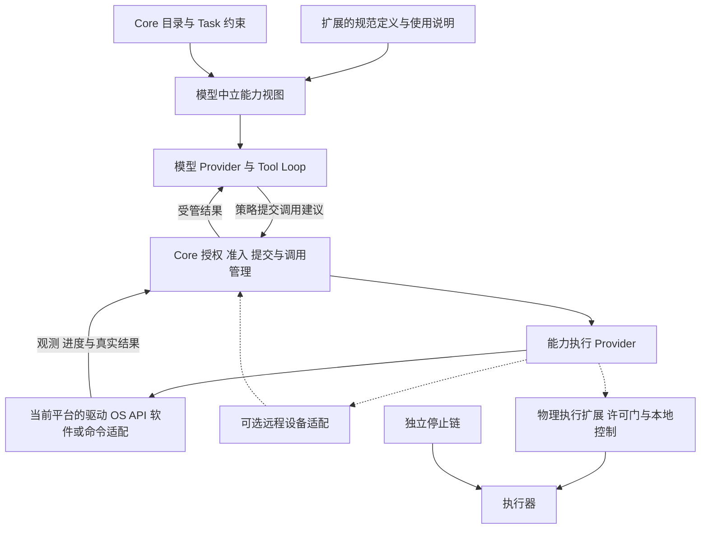

# Ayni 通用能力架构与实施计划

- **状态**：通用架构与工作包说明；基础能力优先、实验后置的路线已由用户确认，类型、兼容等其余待决见第 14 节。
- **日期**：2026-10-29。
- **用户已确认方向**：2026-10-29 明确 Ayni 是通用原生 AgentOS，先完成基础通用能力，再开展 ESP32-S3、Linux 系统等实验。宿主自行选择设备与能力，本机优先、远程可选；语音、视觉和运动不构成系统必装项。
- **实现基线**：初次讨论基线为 main `c9f7ad0`（ABI 0.45 / schema 2），下文旧源码行号只作历史定位；AP-00/AP-01 及 #108/#109 修复已交付 ABI 0.47 / schema 3，当前证据见 [M1 进度](../../reports/core/m1-progress.md)。
- **设计关系**：[ADR-0081](../adr/0081-capability-centered-agentos-evolution.md)、[ADR-0083](../adr/0083-general-foundation-before-platform-experiments.md)；现行次序、基础完成条件和实验安排统一见[基础能力实施与实验计划](foundation-and-experiment-plan.md)。本文件保留架构职责和 AP 工作包定义；AP 不替换历史 MA 编号。
- **本次授权**：初次三方讨论及两方补充按原授权完成；本轮用户要求两位子智能体讨论并同步文档，明确基础能力实施计划与后置实验计划。本轮不启动后续代码、平台实验、硬件、付费 API 或新的故障/变异专项。
- **配套细化**：[能力发现 协议适配与现有代码处置计划](capability-discovery-and-adapters.md)记录候选采纳流程、外部协议支持门槛、逐文件保留/迁移/舍弃条件和最小新增模块。

2026-10-29 实施补充：AP-00/AP-01 的实际交付范围与验证见[实施清单](ap00-ap01-implementation.md)及 #105/#106/#107；本文件其余发现、typed 协议、长操作与 adapter 分期仍为规划，不据此声称已实现。

## 1 目标与完成标准

Ayni 面向跨平台、跨设备的原生通用 AgentOS，优先让每个部署使用当前平台的本机设备与软件能力。每个部署复用同一套 Core，通过公开能力契约使模型在 Tool Loop 中发现能力、理解用途和使用方法、提出调用、观察进度与结果，再决定下一步。网络控制远程设备是可选扩展。Core 管理工作、授权、资源、调用与恢复；能力提供者完成实际操作。

宿主不必配备摄像头、麦克风、扬声器、电机或其他特定外设。只有软件能力的部署也应完整成立。基础完成条件以通用契约和公开接入路径为准；ESP32-S3、Linux 和实际设备组合在基础完成后检验可移植性与平台边界，不能反向规定所有宿主的能力集合。当前 Native/Sim 的日常开发与回归继续进行，不等同于后续 Linux 系统集成实验。

设备驱动不必由 Ayni 开发或统一管理。扩展可以使用芯片驱动、操作系统 API、现成 SDK、软件库或外部协议。仓库可以提供常用适配器，但它们通过与外部扩展相同的公开接口接入，不获得 Core 私有访问权。

能力接入的完成标准是：开发者提供版本化能力定义、使用说明、实现声明和执行端口，在可信部署中注册；模型能够获得正确且受约束的工具视图，调用经原有治理路径执行并返回真实结果。新增普通能力或更换同语义实现，通常只修改扩展和部署配置，不修改 Core、通用 Tool Loop 或模型厂商适配器中的业务分支。

通用性允许系统契约演进。新需求若改变授权、资源、取消、执行或恢复保证，应明确修改领域契约、ABI 和相关验证，不把它藏进不透明文本或万能工具。

### 1.1 当前平台优先

本机能力经驱动、OS API、软件库或受管命令适配直接执行，例如 ESP32 使用本板屏幕/麦克风，Linux 使用本机文件/摄像头，手机使用本机平台服务。它们不必先发布为网络服务，也不以远程设备协议、中心网关或第二台运行 Ayni 的设备为前提。同机 IPC 或 ROS 后端仍可服务本机能力，本机与远程按实际执行目标区分，不按接口名称推断。

“类似直接执行命令”表示调用路径直接连接本平台实现。命令式扩展也要注册能力与参数语义，声明结果/退出状态、输出上限、超时和取消行为；不另开绕过统一授权、资源与调用记录的 Shell 路径。

发现视图说明能力的实际执行位置和目标，优先呈现当前平台允许使用的本机能力。远程条目由显式配置和授权加入，调用仍绑定确切目标。本机优先是部署与新工作选择策略，不改变已接受调用的 Binding；本机不可用不自动改投远程设备。

设备使用位置与模型推理位置分别决定。云端模型可以经本机 Ayni 的 Tool Loop 使用本机设备，本机优先不要求在 ESP32 等平台运行大模型推理。后续验收先证明本机能力完整可用，再按需求扩展网络控制。

## 2 范围与现有证据

### 2.1 已有机制与接入缺口

下表区分已实现机制与本计划目标。缺口是扩展限制，不据此认定现有 Native 行为回归。

| 范围 | 当前实现与证据入口 | 本计划需要补齐的部分 |
|---|---|---|
| Core 治理 | 八模块、单 owner、异步推进、提交协调；[Core 模块](../../core/README.md) | 保留机制，以公开契约扩展，不新建另一套 Agent 运行时 |
| 设备目录 | [device_catalog.h](../../core/catalog/device/device_catalog.h)，第 9 行起仅有 ID 与父关系 | 用途、角色、说明和实例语义；纯软件能力不强制设备树 |
| 资源协调 | [resources.h](../../include/ayni/resources.h)、ADR-0042/0046/0047 | 能力实例与部署资源的清晰关联；多实例场景需评估绑定演进 |
| 调用路径 | [calls.h](../../include/ayni/calls.h)、[调用契约](../../contracts/domain/calls_and_bindings.md) | 复用 unary/action/subscription，不另造模型专用执行账本 |
| 输入与结果 | `calls.h` 第 57、69 行：授权 fields 加 UTF-8 text，结果为文本或模型工具提议 | 通用业务参数和结构化结果尚无完整 typed 契约 |
| 授权字段 | [authority.h](../../include/ayni/authority.h)、ADR-0029 | 现有有限扁平授权域不能直接冒充完整业务 Schema |
| 模型工具 | `calls.h`、[call_tools.cpp](../../core/kernel/service/call/call_tools.cpp)、#107/#108 | AP-01 已交付扩展 Usage 与 Core 权威工具视图配对；typed 业务参数与受限发现仍待后续 |
| 模型序列化 | [protocol.cpp](../../providers/openai_compat/protocol.cpp)、#107 | 已合并完整用法说明并保留 `tool_N` / `field_N` 精确回译；AP-02 迁移业务 codec，不再把 binding ID 说明列为当前缺口 |
| 工具规模 | [ADR-0054](../adr/0054-typed-tool-calls.md) | 当前 GoalType 允许列表至多 8 项、禁止订阅；更大目录和工具窗口需正式演进 |
| 资源绑定 | `calls.h` 第 154 行起；[binding_registry.cpp](../../core/catalog/binding/binding_registry.cpp) 第 83 行起 | 当前具体资源与实现特性固定在 Capability 契约中，迁移不能当作结构整理 |
| 应用复用 | [assistant_state.h](../../runtime/native_node/assistant_state.h)、[assistant_commands.cpp](../../runtime/native_node/assistant_commands.cpp) | 通用对话和停止编排绑定 NativeNode/文件存储，第二平台前应提取真实共用部分 |
| 媒体 | [media.h](../../include/ayni/media.h)、[媒体契约](../../contracts/domain/observations_and_media.md) | 现有引用单对象上限 65,536 B，真实媒体存储和通用媒体调用尚未闭环 |
| ESP32 | [esp_idf_node.cpp](../../runtime/esp_idf_node/esp_idf_node.cpp)、[esp_idf_host.cpp](../../hosts/esp_idf/esp_idf_host.cpp) | 只有 Hello create/destroy，未提供启动所需的存储端口；Native 模型 Provider 不能直接当 ESP 实现 |
| 外部互操作 | 原计划 §3.7、[ADR-0070](../adr/0070-typed-multinode-normal-profile.md) | typed 多节点正常子集不等于生产 peer 协议；MCP、ROS、MHS 各有独立门槛 |

`call_tools.cpp` 第 90 行起构造的是 Goal 保存的授权需求上限与允许列表的稳定视图，不是对当前每条 live Grant 的重新裁剪。实际提交和派发仍会复核权限。后续发现接口若承诺实时隐藏已撤权能力，必须另行定义并实现，不能写成已有保证。

### 2.2 保留边界

保留 C++17 Core、C99 公共 API、显式状态、有限容量、无异常和 RTTI、调用方 arena、单逻辑 owner、可靠完成、持久派发屏障和未知结果处理。保持三类系统版本独立：本地 ABI、线协议、持久格式；能力自身的语义版本和 Schema 修订作为契约引用，不合并成一个全局版本。

首期继续可信代码、CONFIGURING 注册、启动冻结。运行中健康变化不是目录热修改；网络发现不是自动信任或安装；公开扩展接口不等于动态链接、任意生成代码执行或原生插件沙箱。通用 OS 内核、无限制 Shell、通用配置 DSL、自动跨节点接管均不是本次架构演进的前提。

## 3 术语与对象关系

| 术语 | 含义与边界 |
|---|---|
| Platform / Host 环境 | OS、SDK、工具链及系统能力，例如 ESP-IDF、Linux、Android。板型不同不必对应不同 Host |
| 部署节点 | 一份 Kernel 及其 owner、存储和运行环境；是架构术语，本计划不新增同名 ABI 类型 |
| Device / Component | 可选的受信任设备身份与结构关联，沿用现有接口；不强制软件服务伪造物理设备 |
| CapabilityDefinition | 能力的稳定语义、参数和结果类型、单位及执行行为定义 |
| UsageMetadata | 用途、参数解释、使用顺序、示例和结果说明；引用精确契约版本，不授予权限 |
| ProviderOffer | 某实现声明可以提供的能力及支持特性；模型 Provider 与工具执行 Provider 都使用 Provider 机制，但职责不同 |
| Binding | 可信部署选定的能力、实现、端点、外发目的地及有效执行约束 |
| Resource | 占用、容量、冲突与隔离的协调单位，可为模型槽、采集通道或运动控制域 |
| Grant / Scope | 谁在何种范围内可使用能力；业务 Schema 有效不等于已授权 |
| ToolView | 某 Task 的某次模型请求所用的能力视图，含精确身份映射、说明与允许参数；不是授权令牌 |
| Observation / MediaRef | 带来源、时间、质量、归属和有效期的事实或媒体引用；不恢复旧句柄，不把模型推断当物理测量 |

树莓派与 Linux 电脑可以复用 Host，选择不同设备后端和容量。机器人是应用、感知、运动、控制及停止的部署组合；可以含多个节点，但每个控制域只有明确的 authority owner。手机移植还需要平台权限与生命周期适配，不能仅凭 Core 能编译就宣称支持持续后台运行。

## 4 架构与依赖方向

### 4.1 运行时调用路径

下图表示运行时调用与数据流。Core 经注入的公开端口调用实现，不编译依赖这些具体组件。虚线表示按部署选用的扩展；物理许可门、控制器与独立停止链仅适用于接入相应物理执行能力的部署。

模型负责高层选择与步骤，连续采样、媒体传输和控制周期由本地实现推进。无需把每一帧、每个音频样本或 PWM 周期变成模型调用。

### 4.2 模块职责与排除项

| 模块 | 独占职责与状态或资源 | 不承担的职责 |
|---|---|---|
| `core/catalog` | 已接受的有界描述、身份、版本、绑定与交叉引用 | 设备探测、驱动初始化、下载说明、任意 Schema 解释器 |
| `core/authority` | Principal、Grant、Scope、撤销与授权事实 | 厂商认证协议、自然语言说明解释 |
| `core/resources` | 健康报告后的准入状态、全组占用、公平等待、许可与隔离 | 总线寄存器、设备线程锁、媒体字节 |
| `core/work` | Goal/Task/Call、稳定步骤身份、调用与动作结果及恢复事实 | 产品业务流程和模型策略 |
| `core/knowledge` | Observation/Memory/Context 的归属、有效性、来源与依赖 | 原始媒体采集、模型推理、业务摘要算法 |
| `core/kernel` | 公开入口、单 owner、跨模块 transition、提交与输出门控 | 新增一份能力路由、权限或设备状态副本 |
| `core/durability`、`foundation` | 持久机制与内部基础类型 | 选择部署或定义设备业务 |
| `hosts` | Kernel 的时钟、唤醒、同步、异步 journal/snapshot 等系统基础；拥有自身系统句柄 | 把每种外设和 Agent 工具塞进 Host 表 |
| `providers` | 受管请求适配、异步后端执行、输入副本和 completion 借用 | 调度另一套 Task、扩大 Grant、直接修改 Core、暗中编排独立副作用 |
| 模型 Provider | 模型协议请求编码、响应解码、工具别名映射 | 手写各设备用途、权限规则和业务参数限制 |
| `drivers` 与平台后端 | 芯片/OS/SDK I/O、设备句柄、局部同步、缓冲及实际设备状态 | 跨能力资源准入、Goal/Grant 决策 |
| `control`（物理执行部署选用） | 有效许可内的本地过程、包络校验与控制 | 扩大许可范围、依赖模型维持停止 |
| `safety`（物理执行部署选用） | 停止锁存、联锁、心跳/租期监督及失能路径 | 依赖 Core、网页或普通队列空位 |
| `strategies` | 规则、Tool Loop、规划与有界决策 | 私自 I/O、直接持驱动锁、建立另一套执行路径 |
| `applications` | 对话、提醒、观察等目标、提示词、完成条件和跨能力组合 | 选择某款板、某个 Host 或某家模型 SDK |
| `runtime` | 唯一跨组件选择、端口注入、注册、容量配置和创建/关闭顺序 | 持有规范语义、重新实现应用或设备算法 |
| `targets`、`ui` | 启动/打包入口、交互和展示 | 直接装配具体组件或修改 Core 私有状态 |
| `protocol`、`sdk` | 线格式/生态映射与公开调用便利性 | 第二份领域校验器或独立权限/恢复账本 |

Host journal 与 Agent 可调用的文件服务即使复用一个底层库，也要分开入口和权限。OS/设备权限与 Ayni Grant 取交集，不能为工具成功而绕过平台拒绝。驱动局部锁只解决线程安全，不代替 Core 的长期资源协调。

### 4.3 编译与构建约束

沿用 `kernel → work → {authority, resources, knowledge} → catalog → durability → foundation`，同层模块不横向耦合。应用、策略、Provider 和 Host 只使用公开契约；Core 不包含它们或厂商 SDK 的头文件。跨组件具体装配只在 runtime，targets 只启动 runtime；control/safety 保持无 Core 依赖。

能力描述 helper 初期保持局部。出现第二个真实消费者后，才依据共享内容提取 SDK 辅助库；不预建通用插件框架、全局 ServiceLocator 或仅转发调用的空层。若增加公开设备端口或构建目标，先在 [architecture.json](../../tools/architecture.json) 和相应 CMake 规则中登记依赖。头文件检查、链接图检查、运行时 ownership 和测试依赖分别验证，不能互相替代。

## 5 公开能力描述与单一来源

### 5.1 声明组成

扩展以一份规范声明为来源，派生或精确关联机器描述、授权字段投影、模型工具 Schema 和文档引用。以下是逻辑内容，不选定文件格式、IDL 或当前 C 结构布局。

| 内容 | 必需语义 | 属主 |
|---|---|---|
| 能力身份 | 稳定 ID、语义版本、输入/结果 Schema 引用 | 规范定义；Core 保存已接受的有界投影 |
| 参数与结果 | 稳定字段 ID、语义名、类型、单位、范围、presence/缺省、大小上限 | 规范定义与共用校验机制 |
| 调用行为 | unary/action/subscription、副作用、幂等、查询权威、取消、期限 | 规范行为与实现 offer；有效契约必须匹配消费者要求 |
| 使用说明 | 用途、参数解释、步骤、示例、结果/错误含义、语言和来源 | 扩展的有界只读说明存储 |
| 对象关联 | 可选 Device/Component、角色、实际本机/远程执行位置和能力实例关联 | 可信部署目录；位置等信息有披露边界，不按模型输出改变路由 |
| 实现声明 | Provider ID/版本、支持能力、格式、并发和生命周期端口 | 能力实现 |
| 绑定 | 能力与实现选择、端点、目的地及部署约束 | runtime 提供、Core 校验并保存 |
| 可用性信息 | 当前健康/占用/校准/观测引用和时间 | 对应事实属主；视图只读投影 |

说明正文与媒体字节留 Core 外。Core 保存执行必须理解的权威事实，不为长篇用法建立热路径存储。说明按 Capability/Binding 精确版本和字段 ID 关联；文档修订改变解释时，不得偷偷改动旧契约的参数含义。

强制约束不能只存在于自然语言。单位、参数范围、外发目的地、执行目标及安全上限由结构化契约和准入执行；说明引用这些事实，不能维护另一份可执行限值。外部设备标签、README 和观测均标记来源，作为数据进入上下文，不自动升级为 system 指令。

### 5.2 业务参数与授权字段

业务 Schema 回答“请求是否合法”，Scope 回答“当前主体是否有权执行这个请求”，两者保持不同职责。通过稳定 field_id 将目标设备、外发目的地、时长、速度、数量、媒体归属/用途等影响作用范围的参数关联到授权域；不得藏在 text 内由 Provider 再解释。

用户 2026-10-29 已选择首版支持有界嵌套对象、列表、浮点和精确十进制，连同整数、布尔、枚举/标识符及 UTF-8 文本；不引入任意 union 或完整 JSON Schema。浮点近似与精确十进制分开声明，权限比较只用整数/精确十进制；列表须逐项由同一完整授权覆盖，空授权列表拒绝，关系/跨列表/总量规则后续独立扩展。设计及消费者清单见 [AP-02 设计](ap02-typed-capability-design.md)和 [ADR-0084](../adr/0084-typed-capability-values-and-authority-projection.md)。媒体引用仍在 AP-08 定义；未知字段、未支持类型、单位不符、超界明确拒绝，不静默裁剪或换算。

可选业务字段须有显式缺失与缺省语义。缺省在授权与持久接受前规范化；授权投影字段仍有明确具体值，不因省略扩大权限。用于授权、规范摘要、持久记录及 Provider 执行的输入应来自同一个规范化请求。模型 JSON、原生 C 输入和未来网络解码都进入同一语义校验路径；格式解析与边界形状校验不算另一份业务规则。

现有授权域有限类型和字段数保持，超出其表达能力的新语义须先扩展契约，不能宣称任意业务 Schema 都能自动生成正确授权。IDL 与线格式继续按 ADR-0009 选择；本计划不预选 Protobuf、CBOR 或自定义生成器。

### 5.3 资源与实现差异

AP-01 继续使用现有 Capability 契约中的逻辑资源 ID，避免为了补说明立即改 ABI 和历史调用恢复。基础阶段用同能力的两个纯软件实例或模拟端点，检验精确路由、独立资源和实现替换；双屏、双音频端点只是可选的平台实验，不是这一检查的前置。

AP-04 本轮已由用户 2026-10-30 选择窄 Binding 资源映射：逻辑组与其他约束不变，接受调用保存有效实际组；见[本包设计](ap06-ap04-foundation-design.md)与 ADR-0087。以下完整职责拆分仍是候选，不能据此声称已实施。

长期候选是：Capability 保存稳定语义，ProviderOffer 声明实现特性，Binding 解析为不可变有效执行契约及资源组。Core 在启动、接受和派发时校验这个有效契约，并为历史 Call 保留原选择与必要约束。不能只把资源字段挪到 Binding 后删掉匹配检查。该变化受 D06/D07 约束，不是本次已批准的新规则。

## 6 注册协议与生命周期

### 6.1 首期可信注册

注册 API 与设备探测分开。runtime 选择可信扩展，扩展提供声明和端口；探测只产生候选。首期注册流程为：

1. runtime 分配明确有界的 Host、扩展、说明存储、媒体池和 Kernel 内存，建立生命周期关系。
2. 在 CONFIGURING 注册规范能力、实现 offer、可选对象/组件、资源、说明引用和 Binding。可由一个公开辅助入口完成配对，但内部复用已有注册和校验机制。
3. 单项注册先校验形状、版本、重复、容量、字段映射和回调；失败不污染现有目录。组合 helper 若声称全有或全无，须暂存校验后发布或重建尚未启动的配置；不能在不支持回滚的旧 API 上假装原子。
4. 在 CONFIGURING 完成说明配对校验，并按实际需要初始化/探测后端，由 owner 报告已有证据支持的资源健康；可能阻塞的初始化放在 step/注册回调之外。资源初始 OFFLINE，注册成功本身不证明在线或已授权。初始化未完成的资源继续 OFFLINE，不必为它阻塞 Kernel 启动。
5. 调用 `ayni_start` 统一解析 Core 目录交叉引用、核对能力/实现/端点/资源和消费者要求；校验失败仍留 CONFIGURING，成功则直接进入 RECOVERING，由 owner 的 `ayni_step` 推进至 RUNNING，不存在另一个启动恢复 API。RECOVERING 不接受健康修改；此时后端完成的探测结果先留在后端有界通道，owner 到 RUNNING 后再报告。
6. 进入 RUNNING 后通过同一受管入口接受工作；未完成初始化的能力按实际健康继续等待或拒绝。说明、ctx 和函数表所引用的对象保持到约定的 quiesce/destroy/close 时点。

规范声明与只读说明可以由扩展一起交付，便于接入；不要求每个芯片、物理零件都建立 Provider 类。已有能力的新实现只提供 offer、实例差异和后端，不重写能力定义。

### 6.2 运行中变化与失败

健康、忙碌、观测和租期是运行事实；目录身份、Schema 和路由是冻结契约。掉线不能悄悄移除在途调用或归还借用，重新在线不能解除执行器隔离。能力不支持、容量耗尽、初始化部分失败均报告分类状态，不能伪装成功或回退到另一设备。

动态注册、热卸载和未知代码装载保持后续独立门槛。若未来需要热修改，应先定义目录代际、已接受调用保留、撤销、排空、代码/ctx 存活和回滚；首期不以增加一组 register/unregister 函数代替该设计。

### 6.3 原生与协议来源的候选采纳

具体 backend/adapter 在 step 外进行 OS 枚举、board manifest + probe、MCP 列举或 ROS graph 观察，只输出有界候选。可信 runtime 配置流程配对规范与使用说明、确认实际目标/身份和共享资源后，在 CONFIGURING 复用已有注册。候选不是第二目录或权限表；可信规则可自动采纳匹配项，不必每个设备都人工确认。

运行中新身份待后续受控配置采纳，原设备健康变化不改 Schema/路由。路径或外部接口名不能单独证明同一物理设备；配置重建须保留历史 Call 的原绑定/契约和恢复限制，不能清账后换目标。软件候选采纳及可选摄像头纵切、插拔与借用边界见[配套计划第 2 节](capability-discovery-and-adapters.md#2-从候选发现到模型使用)。

## 7 能力发现与模型视图

### 7.1 四种状态分别表达

“已注册”“允许披露”“Task 可请求”“现在可准入”分别回答不同问题。发现策略先检查主体/Task/目标允许范围及元数据披露权限；忙碌或暂时离线可以提供有时间的 availability 信息，不能靠永久隐藏能力掩盖排队状态。工具视图永不代替提交和派发复核。

AP-01 延续当前保存的 Goal 上限和至多 8 个非订阅工具，不声称实现 live Grant 重裁。AP-03 定义新发现查询的授权时点、快照范围、撤权失效和信息披露；D03 未定前不新增“存在但无权调用”的公开目录。

### 7.2 有界发现流程

目标流程为：已注册目录 → 主体/Task 允许的摘要 → 按需读取说明 → 本轮工具窗口 → 模型提议 → 精确绑定解码 → 普通请求准入。列举和说明读取不产生 Grant，不扩 Goal 允许列表，也不允许模型用任意 ID 调用隐藏工具。

分别限制目录容量、Task 允许能力数、发现页条目/字节、说明字节、每轮工具数、结果提议数、在途调用和媒体字节。当前固定允许列表与 bitmask 必须在支持大目录之前演进；“目录大于工具窗口”是 AP-03 的目标，不是当前能力。

分页 cursor 绑定目录修订、主体/Task 范围和必要授权前沿；目录或权限变化使 cursor 明确失效或重新验证，不让下一页泄露另一范围。稳定排序与版本化引用支持复现。超过上下文预算时按需读取详情或显式拒绝；不能截断必需字段、单位或 Schema 后继续外发。

内部资源目录与 MCP 的 resource 文档概念不同。内部占用单位不因外部同名词而变成可读 URI；能力说明、媒体或文件等内容通过单独受管接口读取。

### 7.3 AP-01 已交付的视图构造

现有 `tool()` 回调只在模型 Provider 的 `submit` 内、在其线程上有效（`calls.h` 第 317 行起）。AP-01 采取下列落点，不在策略 `decide` 中调用或保留此回调：

1. runtime 注入扩展拥有的只读、版本化说明访问端口。静态说明在 step 外预先准备，端口只读内存、有界且非阻塞，不执行文件/网络 I/O 或未声明的 Core 重入。语义仍归扩展，runtime 仅连接生命周期。
2. 模型 Provider 在 submit 内取得 Core 提供的 Binding/Capability/字段约束；纯有界 helper 按精确 ID/版本/field_id 关联说明，生成模型中立视图。
3. 机器字段、单位、取值域和路由以 Core 提供内容为权威；说明只附用途，不增加工具或参数范围。必需说明缺失和版本失配按 D02 明确处理，不静默换说明。
4. 在 submit 返回前，将本轮视图和别名映射复制到 Provider 自有请求槽。worker 只使用副本，不访问 Core 回调、栈视图或 owner 状态。
5. 模型 Provider 编码厂商格式并解码响应。可以保留 `tool_N` / `field_N`，重点是完整语义；改名时同步解码映射，不能只改展示名称。

helper 先局部实现协议无关的 join，不含屏幕、电机或软件业务分支；第二个真实模型 codec 消费者出现后再提取 SDK。后续若要由 ToolLoop 直接构造，须正式提供 Task-scoped 只读快照或其他有界端口，单列 ABI 和生命周期变化。

AP-01 仅合并静态说明。AP-03 若需加载未驻内存的详情，走后续定义的异步受管读取，不在 submit 临时加载。未来 live 状态由 owner 准备的快照或可信观测提供，带 boot/generation/采集时刻和有效期；不能再建立一份可变健康权威。

设备角色、位置、使用说明和观测本身也可能是私密信息。外发给所选模型目的地的内容受 Task 范围、数据目的和外发许可约束；切换模型服务不自动继承披露权限。

## 8 能力调用协议

### 8.1 身份与请求信封

以下为逻辑信封职责，不规定最终线格式，也不把当前 ABI 尚无的业务字段写成已支持。

| 身份或内容 | 作用与存活范围 |
|---|---|
| Agent/Task 上下文 | 由受管会话/策略确定，模型或远端自报 ID 不能建立身份 |
| capability、binding 及版本 | 绑定确切契约、实现、端点和允许目的地；接受后不静默改路由 |
| `step_key` | Task 内稳定步骤键，不能用每次重试的新键绕过次数与容量限制 |
| `logical_call_id`、`operation_id` | 由 Core 管理的调用与副作用身份；保存到共同工作事实 |
| `(boot_epoch, request_id)` | 一次传输尝试身份，不与逻辑调用或远端操作混用 |
| 模型 tool call ID / alias | 本次模型请求的协议配对信息；映射到精确 Binding 版本，不能作为执行幂等键 |
| 规范输入与依赖 | 完整业务输入、授权投影和 Observation/MediaRef 依赖；授权与执行使用一致解释 |
| deadline 与取消属性 | 本机时钟域内有界期限；期限届满不证明远端未执行或借用已归还 |
| 订阅身份 | Task-owned subscription、boot/generation/sequence，不能与 Provider 私有句柄混用 |

### 8.2 唯一执行路径

1. 模型产生调用建议；ToolLoop/策略经公开 stager 立即复制输入，按普通 REQUEST_CALL 提交。模型 Provider 不直接调用设备 Provider。
2. Core 校验 Task、精确版本、规范输入、授权范围、外发和依赖，持久接受稳定调用身份，并按既有规则记录运行次数。
3. 所需资源整组准入，保存 PREPARED；持久化 DISPATCHING 屏障后，以 fresh time 再验权限、撤销、依赖、资源、期限及执行许可。
4. 非阻塞调用 Provider.submit。确定拒绝、已受理、受理未知三种返回保持区别；后两种均可能产生效果且保留在途责任。
5. worker 经可靠邮箱回送进度、取消控制和终态。owner 校验、提交结果与工作进度后确认消费；结果满足持久前缀后才能支持后续外发或呈现。
6. 向原 Task 返回分类状态、结构化结果、effect、进度或引用；模型依据真实结果继续，不能把“请求已入队”解释成“设备已完成”。

复用现有 QUEUED、PREPARED、DISPATCHING、IN_PROGRESS、FINISHED、RESULT_UNKNOWN；终态、业务效果、物理停止和目标验证分别表达，避免用多个无关布尔量拼隐式状态机。

### 8.3 调用形态与模型操作

| 形态 | 模型交互目标 | 后端与系统要求 |
|---|---|---|
| unary | 一次请求得到结果，例如读取或一次采集 | 异步也必须归还终态；有外发/计费时保留相应副作用事实 |
| action | 提交长过程，按需观察进度/结果或请求取消 | 操作引用归原 Task；进度可合并，终态和取消控制不能被覆盖 |
| subscription | 打开采集、等待有效样本、读取最新值、关闭 | 由 Core 管理 Task 所属租期和代际，系统续租，停止后旧尾部不得再被使用 |

当前模型 allowlist 仍禁止 subscription。用户 2026-10-30 已选择 AP-05 保留四个固定工具，在 `ayni_call_capability` 内扩展启动、读取、等待、取消和关闭，引用限原 Task；最终文字答复结束 Task 并收尾，持续工作显式等待。消费者与待实现接口见 [AP-05 设计](ap05-managed-operations-design.md)、ADR-0086。不能注册普通 Provider 回调 Core 开关订阅，固定入口仍须检查精确 Binding、原权限和调用生命周期。

一次采集可以先实现为 unary；持续采集必须声明资源、有限租期、样本新鲜度、gap 和关闭。等待模型不应导致逐帧积压；重要变化由受管事件唤醒，模型读取有限结果，不靠高频轮询维持租约。

### 8.4 线程 借用 背压与关闭

owner 调用 submit/cancel/query/renew，禁止阻塞 I/O 和未声明重入。回调输入仅借用到返回；需要保留的内容由实现复制。非 ISR worker 只能使用公开投递端口；中断先进入驱动本地的有界通道，不能直接调用非 ISR Core API。

受理前预留完成容量。进度与高频样本按各自契约合并或报告 gap；取消、终态、停止及存储完成保持独立可靠路径。Provider 不能挤占 Host 存储控制槽。容量不足返回明确背压，不淘汰活操作，不将原始错误、凭据或私有媒体写入日志。

取消受理、取消端口拒绝、操作超时都不归还原 completion 投递借用。成功的 terminal post 结束该 attempt 的投递借用；回执形状/大小校验错误仍欠终态，过期/重复可靠 post 则按 INVALID_STATE 拒绝，不能概括为失败后一律重试。具体适配见[配套计划第 3.2 节](capability-discovery-and-adapters.md#32-取消不等于收到最终响应)。生产者必须等最后一次 post 返回才算结束投递。Core 邮箱槽另须等 owner 业务 transition 消费并 ACK 后才释放，Provider 不等待一个未公开的消费 ACK。

关闭停止新准入、请求取消并排空回执；物理执行能力另须请求并确认实际停止。涉及物理执行而未证实停止时，保持资源隔离及执行/停止组件存活，隔离不能代替销毁前的停止条件。满足既有关闭条件、确认最后一次 post 返回并 quiesce/join 全部生产者后，才销毁 Core、按依赖逆序释放上下文。无法证明所需停止或生产者结束时保持 BUSY/UNKNOWN 与对象存活，不伪造关闭成功。

### 8.5 恢复与远端调用

RESULT_UNKNOWN 不自动重试，不换 Provider 或 operation ID 掩盖未知。恢复保留原契约、路由和输入；已完成步骤不重复，未派发工作重新准入，不兼容历史保留并暂停或明确拒绝。查询必须关联原 operation；普通 NOT_FOUND、网络断开、模型声称成功均不是权威未执行或物理停止证据。

远端 Provider 可提供同一能力语义，但还需认证节点到主体的绑定、接收端本机授权、去重/查询证据、取消和分区行为。单调 deadline 须在接收端本地锚定，不跨节点直接比较时钟值。协议适配不建立第二个 Task 所有者，也不承诺本地与远端传输天然等价。

## 9 媒体与物理执行边界

本节为选用相应能力时的扩展约束，不构成基础 AgentOS 必须实现 ASR、TTS、视觉或运动的清单。通用取消、期限、撤权、结果未知与关闭机制仍属于基础；既有物理许可和停止契约在相关能力启用时保持原保证。

### 9.1 数据面

音频、图像等字节由外部有界媒体存储/设备后端持有，Core 管理引用及其工作依赖。真实媒体契约需定义格式、采样率/通道/尺寸、字节预算、读取/保留/释放、并发使用、到期、取消、删除和外发；引用不是持有即授权的凭据。

AP-08 决定短对象、分段或流式形式，先核对现有 64 KiB 真实限制及所有读取消费者，不只提高常数。若使用分段，声明序号、结束、gap、背压和缓冲回收；网络慢不能无限占内存。媒体不默认写入 journal，重启不能恢复旧 RAM 引用为有效。

ASR、文本模型、TTS 和播放分别声明能力、外发目的地、费用/资源和结果。应用/策略组织需独立授权、取消或恢复的步骤；组合 Provider 不得隐藏子步骤的外发、计费和资源约束。纯本地确定过程可在声明包络中封装，不发展成另一套工作流引擎。

### 9.2 执行与停止

运动能力保持唯一控制域 owner、短租约许可、控制包络、独立本地停止。Core 做准入，control 每周期守约，safety 可独立失能。Provider 终态、停止确认和目标达成各有证据，PWM 为零或模型判断不能冒充机械停止。

未经验证的 Gold-P164 接口、功放接线和停止硬件不能被能力说明“声明”为已可用。新物理能力先有 Mock/本地许可契约验证，再在明确授权和板级条件满足后做真实输出。发现外部控制接口不自动开放旁路命令。

## 10 公开 SDK 与扩展交付

新能力扩展最小交付包括：规范定义和版本、语义说明及示例、Provider offer 与执行端口、可选对象/资源关联、明确初始化和排空规则、正常 conformance 用例。复用同一能力的新后端只补实现、支持范围与部署差异。

SDK 负责少量有语义价值的配对注册、类型初始化、生命周期辅助和结果访问，底层 C99 API 仍为权威。注册 helper 不隐藏错误、不私自创建 Grant，也不把不支持的组合降级成近似成功。用户通过文档和公开示例接入，不需读 Kernel 私有头。

不为每个标准库调用建 wrapper，不要求一个芯片对应一个抽象类，不要求完整工厂层级。真实硬件/OS 边界需要窄端口；多个消费者共享同一稳定概念时才提取公共代码。

## 11 外部协议与平台扩展

| 接入 | 可参考或映射的内容 | 必须保留的 Ayni 边界 |
|---|---|---|
| MCP | 工具名称/说明/输入输出 Schema、列举和结果 | 版本化导入/导出；本机授权/资源/账本不被外部 tool annotations 取代 |
| ROS 2 | Topic → 观察/订阅，Service → 短调用，Action → 有进度的过程 | 单位/frame/类型/QoS 显式映射，goal UUID 关联原 operation，取消和物理停止分离 |
| MHS | 设备发现、自描述、状态、标准操作与过程的设计思路 | 公开研究预览不提供足够的完整实现依据；取得规范/访问/许可/夹具后再谈兼容 |
| peer 协议 | 远程能力选择、认证、去重、查询与断连 | ADR-0009、完整 MA-038 和独立协议验收，原 M5 仅作历史索引；不由 typed 仿真子集推定完成 |
| 新 Host | 同一 Core + 新系统端口/设备后端/启动入口 | 平台权限、容量、生命周期与相同能力夹具验证，禁止复制 Core |

MCP 软件接入与 ROS 后端是基础完成后按需求安排的独立适配，不互为前置，也不是 Linux 系统实验的必需组件。ROS 可选同机 Linux 模拟验证，不依赖 ESP32-S3 实验通过。本机外部服务、直接连接远程第三方端点、Ayni Kernel peer 分别规定支持条件；直接远程 MCP/ROS 不要求对端运行 Ayni，但须另定认证、控制权、外发、UNKNOWN/查询及适用的物理许可/停止门槛，不由本计划自动开放。Kernel peer 仍须取得 ADR-0009、完整 MA-038 和独立协议验收证据；历史 M5 编号不再引入无关轮式产品前置。新模型 codec 可先用本地协议夹具验证，不必依赖付费服务。

协议 adapter 可以在一个实际交付模块提供候选发现和 Provider/IPC 边界，内部封装 client/连接与请求关联；不为目录对称增加空转发层。MHS 语义资料若经 MCP 执行，复用同一调用链。MHS 规范条件不足不阻塞 Ayni 自有公开契约，也不允许把本计划字段称为 MHS 标准字段。具体版本、Schema 子集、ROS 映射和无最终响应的取消收口见[配套计划第 3～6 节](capability-discovery-and-adapters.md#3-mcp-接入计划)。

原生本机能力是主路径，MCP/ROS 可以作为本机适配方式，远程设备与 peer 是可选后续路径。未启用远程后端时，本机注册、发现、调用、结果和关闭仍须完整工作；网络控制的实施不作为本机纵切前置。此优先级不删除原计划中对远程支持声明的验收要求。

Linux x86 与树莓派可检验同 Host 下的硬件和 ISA 移植；ESP-IDF 与 Linux 可检验不同 Host。手机须验证系统权限、前后台和暂停/恢复，机器人须额外验证控制域与停止。源码可编译、启动可运行、功能通过、恢复通过和耐久通过分别报告。

## 12 变化场景与模块边界验收

| 变化场景 | 应变化的主要范围 | 验收方法与不应发生的耦合 |
|---|---|---|
| 当前平台直接使用本机能力 | 本机 Provider/驱动/OS API/命令适配与部署配置 | 未启用远程设备后端也能完成注册、发现、调用、结果和关闭；无中心网关前置 |
| 加一个软件工具与一个模拟硬件能力 | 扩展定义/说明/执行、runtime 允许列表和绑定 | 模型通过注册内容理解并调用；不改 Core/通用 Loop/厂商业务分支 |
| 换一个模型协议实现 | 模型 Provider、传输配置与目的地授权 | 两个本地 codec 得到语义等价视图和结果；不复制设备知识 |
| 换同语义屏幕 | 驱动/后端、实例差异与 Binding | 保持同一能力 fixture，业务与 Kernel 不知芯片型号 |
| 同能力连接两个输出实例 | 实例绑定与资源，必要时 AP-04 | 精确路由、独立占用和旧调用不重绑；检验现有固定资源限制 |
| 替换持久化 Host | Host 存储实现和 runtime | 同 Core 提交/恢复语义；应用不操纵 Host 日志细节 |
| 新增 ESP-IDF / 其他 Host | 系统端口、容量、设备后端、runtime/target | 共享能力定义与测试；不复制业务或建平台分支 Kernel |
| 加入机器人或 ROS | 运动/协议扩展、control/safety、部署 | Core 无 ROS/DDS/电机 SDK 依赖；外部取消不冒充已停 |
| 大目录与按需工具 | 有界目录查询、可见策略和工具窗口 | 不泄露未允许条目，不借发现扩大 Goal 授权，不无限增加 prompt |
| 显式加入远程设备 | 远程 Provider/协议适配、可信目标和授权配置 | 模型可区分执行位置；既有本机调用不重绑，本机不可用不隐式改投远程 |

现有代码逐项处置见[配套计划第 7 节](capability-discovery-and-adapters.md#7-现有代码保留-替换-迁移与舍弃条件)：保留 Core、调用/资源机制、Mock/实验/SDK、平台实现；渐进替换 binding ID 说明、总提示词工具文法和 Native 应用编排耦合。旧格式/parser/入口须在替代路径、消费者迁移、兼容决定与验证齐备后才可删除，本次不执行生产迁移。

## 13 实施顺序与交付工作包

### 13.1 依赖与进入条件

用户已确认先完成基础通用能力，再开展 ESP32-S3、Linux 系统等实验。详细实施步骤、现有缺口、基础完成条件和各实验的证据要求统一由[基础能力实施与实验计划](foundation-and-experiment-plan.md)维护；下表只说明 AP 包与该路线的对应关系，不另设一条设备产品路线。AP-00/AP-01 已交付；其余包的代码实施与实验启动仍按后续安排进行。

基础工作先盘点既有机制与证据，再推进 AP-02，继而 AP-03/AP-05；AP-06 可提前整理边界，在新接口迁移后收尾。AP-04 的多实例验证纳入基础完成检查，是否改 Binding 以证据为准。Native/Sim 与本地模型协议夹具是基础开发验证手段，不要求采购、真实设备输出或付费模型。

| 包 | 所属范围与交付内容 | 依赖及进入条件 | 完成定义 |
|---|---|---|---|
| AP-00 | 已交付：契约边界、清理及存储统一 | ADR-0082；#105/#106 | 当前格式和公开入口有证据；不把此包兼容例外延续到后续包 |
| AP-01 | 已交付：能力语义说明、精确映射、submit 内中立视图 | AP-00；D02；#107/#108 | 软件与模拟设备经既有治理路径自描述；仍保留 fields+text、8 工具及非订阅限制 |
| AP-02 | 基础：有界 typed 业务输入/结果、规范 codec、授权投影 | AP-01；D04/D07；ABI、调用记录、Scope、模型 codec 消费者分析 | 同一规范请求用于授权和执行，错误/缺省/结果一致，契约/测试/版本同步 |
| AP-03 | 基础：配置期候选采纳、受限目录、说明读取、分页与工具窗口 | AP-02 所用输入；D03/D05；候选夹具可提前独立准备 | 大于单轮窗口的目录有界可用；候选不授信，发现不扩权，过期 cursor 明确处理 |
| AP-04 | 基础验证：同能力多实例的精确绑定；必要时演进契约 | 两软件实例或模拟端点；仅修改契约时需 D06/D07 | 精确路由、独立/共享资源和旧 Call 不重绑有公开场景证据；已有机制满足时记录结论，不为改接口而改接口 |
| AP-05 | 基础：action 与 Task-owned subscription 的模型控制映射 | AP-01/AP-02；D09；可与 AP-03 独立交付 | 软件长任务/事件流即可验证受管开/读/等待/关、取消、终态和回收；无 Provider 回调 Core 旁路 |
| AP-06 | 基础：SDK、扩展接入、共用应用边界与示例 | AP-01；可提前准备，按所用新接口完成迁移 | Native/Sim 通过公开路径复用扩展与应用；助理保留产品规则但只是应用样例，不强制所有部署使用 |
| AP-07 | 平台实验：ESP32-S3 异步 Host、网络适配、小容量配置 | 基础完成；板级条件和实验范围明确；历史 MA-007/024 作为实现索引 | 同一 Core 启动/关闭、选定软件或本板能力和共同契约通过，实测容量/栈/延迟；不要求语音、视觉或电机 |
| AP-08 | 可选实验扩展：真实媒体存储/传递及 capture、ASR/TTS/playback | 基础完成；D08；所用 Host/设备可用，ESP 路径依赖 AP-07 | 仅声明所选能力，字节生命周期、外发、取消和真实结果有证据；不作为所有 Host 的必装项 |
| AP-09 | 可选实验扩展：运动、本地控制与独立停止 | 基础完成；所用平台/执行器可用，D11 与真实输出授权 | 相关许可、校准、联锁、物理停止和目标验证有分项证据；不将原轮式产品门槛施加于无执行器部署 |
| AP-10a | 可选协议适配：MCP 软件工具导入/导出 | 基础完成及所需子集；D10；导入/导出可分别交付，远程另列条件 | 版本/子集、授权/调用/结果可核查；不依赖 ROS、电机、ESP32-S3 或 Ayni peer |
| AP-10b | 可选协议实验：同机 ROS Provider/Bridge 与模拟后端 | 基础完成；所用 Linux 环境、D10 和适用 R1 条件 | 消息/单位/Action 映射有证据，取消不冒充停止；不依赖 ESP32-S3 实验或轮式产品集成 |
| AP-11a | 平台实验：Linux 实际 OS 集成及后续 Host/ISA 复用 | 基础完成；选定 OS/SDK、能力范围及环境；手机另需 D12 | Linux 权限/进程或服务生命周期/真实本机软件能力与共同契约有证据，区别于已有 Native/Sim 开发测试；更多平台各自报告 |
| AP-11b | 可选协议实验：Ayni peer 与跨节点能力 | 基础完成；ADR-0009、完整 MA-038 及独立协议条件 | 身份/授权/时限/去重/查询/分区有独立证据；不改变 Task owner，不依赖轮式产品发布 |

基础完成后的 ESP32-S3、Linux 和其他平台实验按各自目标安排，互不作为前置；不同 Host 可选择不同能力组合，通过共同契约检查系统语义。原 M2/M3/M4 和 v0.1 的轮式助理条目仅保留为历史实验/产品方案索引，不再作为通用 AgentOS 完成条件；选择开展相应实验时，仍须取得所声明能力对应的真实证据。

各包的具体新增代码属主、旧实现删除门槛及正常夹具见[配套计划第 6～8 节](capability-discovery-and-adapters.md#6-跨协议共同契约与状态属主)。直接远程第三方支持作为 AP-10a/b 独立子项，不与 AP-11b peer 混为一项；本机路径先独立交付。

### 13.2 每包交付要求

每包默认一个完整 feature PR，focused commits 组织前置整理、契约、实现和测试。独立边界或审查复杂度确实需要时才拆分；约 1,500 行生产改动是审查提示，不是固定拆分阈值。

实施前列出现有调用方、Provider、模型 codec、SDK、持久 reader/writer 和部署配置影响。新增 ABI/存储语义须有 ADR、兼容/迁移或显式拒绝规则、回退方式；三类版本分别更新。共享定义/校验不得复制到每个 adapter，删除的仍有效注释应保留，Kernel 新字段写明唯一属主。

先相关正常测试、作者设计自查、draft PR 和适用独立审查；ready 后按工作流运行 CI。未明确恢复的新故障/恢复专项与变异活动继续暂停，既有测试保留。发布需要但尚未取得的恢复证据明确记未验证，不能通过改文档降低门槛。

## 14 待用户决策

用户已确认通用原生 AgentOS 定位、本机优先/远程可选，以及先基础通用能力、后平台实验的次序（ADR-0083）；随后明确 D04/D07 的 AP-02 类型、数值、列表授权和直接升级选择（ADR-0084）。表中未标已定的建议仍是候选，各实验组合在启动前选择；不推定披露、真实控制或未来包兼容已获批准，已有静态可信注册、可信代码及适用的独立停止边界继续生效。

| ID | 需要决定的事项与最晚时点 | 推荐项与理由 | 其他可选项及代价 |
|---|---|---|---|
| D01 | **已定**：通用 AgentOS；基础能力先完成，ESP32-S3/Linux 等实验后置（用户 2026-10-29） | 宿主不要求固定设备/能力；基础先以 Native/Sim 验证，平台实验各自选择组合且互不依赖 | 各实验所用 OS/板型/能力、实际启动和发布组合仍须另行安排；不重问已确认的定位与总次序 |
| D02 | **已定**：自描述完整性（用户 2026-10-29） | 说明缺失/错版本在外发前拒绝；不保留旧说明或 legacy 回退，全部受影响消费者一起迁移 | 不采用隐式最小描述或兼容开关；实际实现见 ADR-0082 与实施清单 |
| D03 | 能力存在性、说明披露与撤权后发现行为；AP-03 前 | 仅披露任务策略允许且经当前查询授权检查的条目，拒绝结果分类返回；旧视图始终不能授权 | 允许公开摘要及申请入口更易发现但会暴露设备/服务存在；owner 可见与 Agent 可见须分开 |
| D04 | **AP-02 已定**：有界对象/列表/嵌套及浮点/精确十进制；默认在授权前规范化 | 用户确认；类型与授权边界见 ADR-0084、AP-02 设计 | 并不批准完整 JSON Schema、关系/总量授权或无界容量，生产实现尚未交付 |
| D05 | 大目录、Goal 能力上限和单轮工具窗口；AP-03 前 | 分开注册目录、Task 允许集合、每轮窗口的限额，发现不扩权；用量测选择正数预算 | 仅保留当前 8 项可先交付但不是大目录支持；直接全量发送增加内存和外发成本 |
| D06 | 资源/实现特性是否迁 Binding；AP-04 确有契约缺口时 | 先用两个软件实例或模拟端点验证既有机制，再按证据决定独立演进 | 多实例验证属于基础检查；未证明需要迁移时不预造新绑定层，真实双屏/音频不作前置 |
| D07 | **AP-02/AP-03/AP-05 分别已定**：各包直接升级 ABI/必要存储格式、全仓消费者重编译，拒旧保留目录，无 reader/迁移器 | 各包用户确认；回退使用原二进制与原目录，见 ADR-0084/0085/0086 | 未来破坏性包仍逐包明确兼容规则，不能继承为永久授权 |
| D08 | 语音/视觉保留、上传与模型目的地；AP-08 前 | 临时媒体、按用途和目的地分别授权，capture/ASR/TTS/playback 独立能力 | 持久保存或默认上传需另定保留/删除和费用；本地处理需相应 Provider 与资源证据 |
| D09 | **已定（用户 2026-10-30）**：四工具内扩展同 Task 的长操作/订阅控制，最终答复结束并收尾；见 ADR-0086 | ayni_call_capability 承载受管启动/读/等待/取消/关闭；每 Task 同时一个 action，可并存模型和订阅；系统管租约，先验软件场景 | 未选择新增控制工具、阶段答复或多 action 并行；任意 Provider 句柄和回调 Core 的开关旁路不采纳；本次设计不代表功能已交付 |
| D10 | 首个协议、版本/transport、Schema/结果子集、导入/导出范围，ROS 类型/QoS 及直接远程支持；AP-10 相应子项前 | 本机 MCP 与同机 ROS 分开交付；逐项冻结支持范围及原 MA 路线调整。直接远程若需要，另定认证、控制权、目标/外发与查询/停止证据门槛 | 同期推进增加协议矩阵；第三方远程不强制实现 Ayni peer，也不因可连接就开放。MHS 等规范条件，不作自有契约前置 |
| D11 | 真实电机输出与停止验收；AP-09 前 | 先核对 Gold-P164、电源/使能和本地停止证据，明确授权后验证 | 继续 Mock 可以完善协议但不构成物理验收 |
| D12 | 手机具体 OS/SDK 与生命周期目标；手机实施前 | 以本机 Kernel 使用本机能力为原生平台目标，明确权限和前后台行为 | 只做管理客户端可阶段交付，但不算手机原生 AgentOS 验收；不同形态不能统一假定永久运行 |

用户 2026-10-29 已选择统一 schema 3 并严格拒绝未知记录/版本/标志（ADR-0082），已由 #106 交付，原 optional 扩展待决项关闭。旧 schema 2 实现和证据保留历史含义；完整 MA-038 的服务 Task 等其余待决保持原状态。

## 15 验证计划与证据等级

### 15.1 正常行为与边界验证

| 场景 | 需要证明的公开行为 | 适用工作包 |
|---|---|---|
| 当前平台能力 | 模型可使用本机注册的设备/软件，执行位置清楚；未启用远程后端仍完整可用 | AP-01/AP-07/AP-11a |
| 新增软件与模拟硬件能力 | 用法来自扩展描述；模型得到正确字段语义，调用回原 Task | AP-01/AP-06 |
| 两种模型 codec | 相同规范契约产生等价约束；别名换序、冲突和精确版本不重路由 | AP-01/AP-06 |
| Schema 与授权投影 | 选填/默认/未知字段处理一致；授权与 Provider 看同一规范参数 | AP-02 |
| 目录分页与外发 | 当前授权过滤、cursor 失效、说明预算和目标模型披露范围可验证 | AP-03 |
| 多实例资源 | 两软件实例或模拟端点精确选择、独立或共享占用符合声明；真实外设另属实验 | AP-04 |
| 三形态 | 接受/进度/终态和真实效果分离；正常取消/关闭、订阅 WAIT 与新鲜样本可用 | AP-05 |
| 借用与容量 | 输入复制、有限在途、明确 BUSY、最后 post 返回后释放上下文 | 所有异步扩展 |
| 媒体组合 | 引用格式、归属、期限、读取/释放和目的地授权；不靠任意路径或 URL | AP-08 |
| 跨平台 | 基础完成后，所选平台使用同一 Core/公共契约；共同软件能力夹具与各自实际系统集成证据分别记录 | AP-07/AP-11a |
| 架构依赖 | 头文件/链接图无环，Core 无平台依赖，公开 ABI 无 STL/OS 句柄 | 所有生产包 |

未来需要的故障、晚到竞态、断电、存储损坏、远端分区及物理停止失效验证，按对应工作包形成验收清单并等待授权。当前只列要求，不执行新专项；正常测试不能替代这些证据，已有 E1–E4 也不自动覆盖新 ABI/后端。

### 15.2 资源与性能

实施者在构建/测试前检查主机内存、swap、CPU 和其他任务，设置明确正数并行度和必要容器限额；计入其他代理与容器，保留桌面余量。运行中监测压力，不用 CPU 数量直接选择并行度。

部署预算分别测量 Core arena、说明/工具视图、Provider 请求槽、模型协议/TLS、媒体池、内部/DMA RAM、PSRAM 和栈。每类池写明耗尽行为；SDK helper、发现和 view merge 的上界由容量推导并实测。Native 历史 arena 不作为 ESP32 内存结论。

单 owner step 时间、输入延迟、资源等待、模型外发前的视图构建及控制停止分别测量。预算和配置在相应实施前冻结，不以模型响应时间代替本地时限，也不将一次最大观测当 WCET。

通用覆盖目标为 Core 行 ≥75%、安全关键分支 ≥80%；用户 2026-10-30 统一弃用原90%目标，见 ADR-0088。历史结果保留当时范围与门槛。文档改动只要求契约/diff/计划一致性，不为计划提交运行构建矩阵或重新采集覆盖。

## 16 文档 契约与变更管理

本计划的通用定位与基础先行顺序按用户决定及 ADR-0083 生效；具体新接口仍为提议，现有 ABI/schema、实现与历史证据不因文档调整改变。原轮式产品计划转作可选实验方案，不再控制 AgentOS 基础完成或 Linux 等平台实验。接受具体接口决策后再同步正式契约、公开头与追踪矩阵，保持旧 ADR 历史；本轮只修改文档，不启动平台实验或新测试专项。

新领域契约采用仓库已有条目体系并引用实际存在且验证相应行为的测试；本计划不预造已实现条款或测试名。版本和能力声明与证据一起维护，不把目录存在、固件编译或 Mock 通过写成硬件支持。

每包 Review 分别检查：仍成立的删注释、新 Kernel 字段属主、重复公式/校验、裸数字；同时检查模块放置、抽象层级、调用链、跨平台依赖与不必要泛化。命令、测试数和 CI 入口集中 PR，状态文档只保留完成/下一步/待决。

## 17 三方讨论形成的共识与取舍

讨论角色为架构与模块边界、能力描述与发现、调用生命周期与执行约束。三方分别只读检查现有实现，交叉讨论以下问题后形成技术共识；用户决策仍以第 14 节为准。

| 讨论问题 | 共识 | 未采纳方案及原因 |
|---|---|---|
| 通用 AgentOS 是否要统一实现驱动 | 对外统一能力契约，底层实现由扩展提供，常用适配器可随仓库交付 | 万能 DeviceManager/Host 会混合系统基础、业务和硬件变化 |
| 设备与软件是否两套框架 | 共用能力/调用/授权；物理关联可选，执行特性明确区分 | 软件伪造设备树增加无用实体；统一自由命令又丢失类型与约束 |
| 自描述是否归模型厂商 | 规范与说明归能力扩展，模型 Provider 只消费并编码 | 每厂商维护设备知识会重复、漂移且妨碍替换模型 |
| AP-01 合并器放哪里 | 在 submit 生命周期内同步构造并复制，helper 先局部 | 最初考虑直接放策略 decide，但现有工具回调不允许该作用域，已修正 |
| 是否先造完整 Schema 框架 | 先现有描述纵切，再有界 typed 请求/结果与授权映射 | 完整 JSON Schema/DSL 增加 MCU 负担，不能代替领域权限 |
| 是否立即迁资源到 Binding | 首期保留逻辑资源，真实多实例证据后独立演进 | 直接挪字段会破坏精确恢复和 ABI，范围超过描述增强 |
| 是否复制通用工具执行器 | 复用 Call/ActionRecord/邮箱和 Task 生命周期 | 第二账本或 Provider 调 Provider 会绕过治理和恢复 |
| 是否一步完成所有平台/协议 | Native 契约纵切后按独立进入门槛推进，MCP/ROS 与其他 Host/peer 分别依赖 | 把所有路线串成前置会阻塞最小功能，也会混淆硬件与协议证据 |

用户随后要求两位子智能体补充讨论。协议/发现与代码处置两方核查源码并交叉确认，形成[配套计划第 9 节](capability-discovery-and-adapters.md#9-两位子智能体讨论共识)的共识：发现只产候选；复用静态注册与调用链；同物理对象共资源、健康单 owner；区分本机/第三方远程/peer；按消费者与证据渐进替换旧职责。本补充不将新内容追认为原三方已执行的协议验证。

本轮用户要求再次由两位子智能体讨论并同步计划。主计划与架构计划两方交叉确认：AP-02/AP-03/AP-05/AP-06 构成待补基础主线，AP-04 多实例场景验证纳入基础检查但接口演进须有证据；ESP32-S3 和 Linux 实验在基础完成后各自开展；语音、视觉、运动、MCP/ROS/peer 均按需求选择。此共识落实用户的通用定位与顺序决定，不代替尚未选择的类型、兼容和实验组合。

## 18 参考资料与适用范围

以下一手资料于 2026-10-29 核查。外部协议仅作为边界和交互设计依据，Ayni 的授权、工作 ownership 与持久恢复保证仍由自身契约定义。

| 资料 | 可参考内容 | 范围 |
|---|---|---|
| [Anthropic MHS 介绍](https://www.anthropic.com/news/model-hardware-standard-research-preview)、[官网](https://www.modelhardwarestandard.com/) | 设备发现、自描述、操作及过程 | 仍为研究预览；不据此推定完整 Schema、SDK 许可或兼容性 |
| [MCP Tools 2026-07-28](https://modelcontextprotocol.io/specification/2026-07-28/server/tools)、[Resources](https://modelcontextprotocol.io/specification/2026-07-28/server/resources) | 工具说明/Schema/发现，内容资源访问 | 外部格式和协议版本不进入 Core 私有布局；annotations 不是本机权限 |
| [ROS 2 Actions 设计](https://design.ros2.org/articles/actions.html) | Topic/Service/Action 区分，goal/result/feedback 与取消 | 不提供 Ayni 的 Grant、持久去重和物理停止保证 |
| [ADR-0008](../adr/0008-core-modules-by-invariant-owner.md)、[ADR-0010](../adr/0010-composition-root-and-targets.md)、[ADR-0011](../adr/0011-build-layout-and-dependency-checks.md) | 不变量属主、组合根和依赖检查 | 保留现有八模块；历史 budget 模块按 ADR-0042 已取消 |
| [ADR-0045](../adr/0045-unified-call-state.md)、[ADR-0046](../adr/0046-resource-topology-and-conflict-domains.md)、[ADR-0054](../adr/0054-typed-tool-calls.md) | 调用、资源、工具提议及授权上限 | 现有机制复用；新描述/发现/Schema 尚待实施 |

## 附录 当前 ESP32 板级输入

以下来自用户 2026-10-29 提供的信息，是后续部署与适配分析输入，不是本次采集的板级验证证据。能力契约不固定这些 GPIO。

| 组件 | 用户提供的信息 | 后续核对 |
|---|---|---|
| 主控 | ESP32-S3 N16R8，标称 16 MB Flash / 8 MB PSRAM；历史 ESP-IDF 6.0.3 | 实际容量、内部堆、分区和栈；仓库同版本只交付过骨架编译 |
| LCD | 240×320、ST7789 兼容；SCK12/MOSI11/CS10/DC9/RESET8/MISO7 | 芯片身份、方向、初始化参数和实际显示限制 |
| 触摸 | FT6336U 兼容；SDA17/SCL18/RST21/INT16，地址 0x38 | 芯片身份、坐标/方向与输入事件 |
| 麦克风 | INMP441；SCK15/WS13/SD14，3.3 V、L/R 接 GND | 采样与实际数据格式、资源和录放并发 |
| 功放/扬声器 | 历史资料为 MAX98357A，曾完成本地录放 | GPIO、供电和当前连接从旧工程核对，不猜测 |
| 网络 | 内置 Wi-Fi；屏幕旧工程曾联网、校时、天气 | 当前部署网络/时间/证书和受管入口，不据旧工程证明 Ayni 支持 |
| 电机驱动 | Gold-P164 曾单测，输出未验证成功；本次 PWM 测试未接电机 | 接口、供电、使能与停止证据；未验证不开放运动 |

旧 [GPIO 候选表](../../reports/hardware/m0/gpio-candidates.md) 将 GPIO14/21 分给电机，与当前麦克风/触摸冲突，摄像头候选也与 LCD 等重叠。后续 runtime 选择新的板级配置，保留旧表的历史候选含义；不能把不同工程的引脚或模块成功记录拼成同时可用结论。

2026-10-29 历史实施授权：AP-00/AP-01 包含废弃入口清理、代码迁移与局部重构，并统一 schema 3、严格拒绝未知记录/版本/标志；该次必要故障/恢复验证已随包结束，见[实施清单](ap00-ap01-implementation.md)及 ADR-0082。当前后续顺序按 ADR-0083 与[基础能力实施与实验计划](foundation-and-experiment-plan.md)；本轮文档修订不启动平台实验、硬件或变异。
