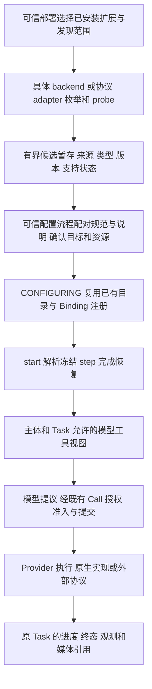

# 能力发现 协议适配与现有代码处置计划

- **状态**：架构提议与迁移计划，不是已实现接口或删除清单的执行授权。
- **日期**：2026-10-29。
- **关系**：补充[通用能力架构与实施计划](capability-centered-agentos-plan.md)第 6、11～14 节及 [ADR-0081](../adr/0081-capability-centered-agentos-evolution.md)，沿用其中 AP 工作包和 D 决策编号。
- **基线**：main `c9f7ad0`，实验性 C ABI 0.45 / storage schema 2；以下源码位置用于核查当前事实。
- **讨论**：按用户要求，由协议与发现、代码处置两位子智能体分别核查并交叉讨论。共识见第 9 节。本轮只修改文档，不新增或删除生产代码，不启动 M2、硬件或新的测试专项。

## 1 总体结论与三个边界

Ayni 定义公开的能力描述、可信注册、受管发现和调用契约。已经存在的驱动、OS 服务、软件、MCP server、ROS 节点均可成为能力实现的来源；Ayni 不必接管它们的驱动安装与内部调度。只有注册方式不足以完成接入，还要补齐模型用法、授权映射、资源、结果、取消及未知效果的语义。

优先使用当前平台能力。按实际执行目标区分以下三种部署，不能仅凭协议名称判断本机或远程：

| 部署 | 示例 | 接入条件 |
|---|---|---|
| 本机实现或外部服务 | 本板驱动、本机库/受管命令、stdio MCP、服务本机设备的 ROS | 本机可信配置、OS 权限、能力与 Provider 契约；不要求第二台 Ayni 或网络网关 |
| 直接连接远程第三方端点 | 显式配置的远程 MCP HTTP server、远程 ROS 执行端 | 独立冻结端点认证、目标/外发范围、控制权、期限、查询及 UNKNOWN 语义；物理操作另需许可门和执行端本地停止证据。对端不必运行 Ayni |
| Ayni Kernel peer | 电脑与 ESP 上的两个 Kernel 协作 | 原 [ADR-0009](../adr/0009-idl-and-local-api-encoding.md)、完整 MA-038 和 M5 的 peer 门槛；不能由 typed 仿真推定完成 |

第二类不一概等待第三类；本次也不批准提前实现它。原计划跨电脑/ESP 的 Ayni Bridge 路线仍保留原阶段条件。本机不可用不隐式改投远程，已接受 Call 不更换目标。

## 2 从物理发现到模型使用

### 2.1 统一接入流程

以下 Candidate、说明配对和发现端口是后续提案的逻辑内容，当前公开头没有完整的自描述注册结构。

存在两种不同的“发现”：backend 发现外部候选，模型从已接受目录发现允许使用的能力。候选不自动进入模型视图，不创建 Principal/Grant，也不成为第二份权威目录。可信配置策略可以自动采纳满足既定规则的候选，不要求每插一个设备都由用户手工批准；未知来源、未知实现或不支持的契约保持未注册并给出原因。

| 阶段 | 唯一属主及输出 | 不能暗中完成的事 |
|---|---|---|
| 枚举/probe | 具体 backend/adapter 拥有候选缓冲、外部游标和探测句柄；输出有界事实 | 不在 Kernel step/注册回调内阻塞，不下载或装载未知驱动 |
| 准备与采纳 | 可信 runtime 配置流程选择来源、目标、规范/用法版本、资源关联与健康报告者 | 不从外部提示词或 annotations 推导 Grant，不自己维护一套目录状态 |
| 正式注册 | 复用 Core 已有 Device/Component、Resource、Capability、Provider、Binding 校验 | 不绕过 exact contract，不声称多个旧 API 已有组合回滚 |
| 模型发现 | 受管摘要/说明/窗口，按主计划 D03、D05 逐步演进 | 不扩 Task 允许集合；视图不是调用许可 |
| 执行 | Provider 保有后端会话与 completion 借用；Core 保有调用/授权/资源事实 | 不自建调用账本、热换 endpoint，或让 Provider 回调另一套 Core 工作流 |

候选至少表达来源配置身份、实际执行位置/目标、外部接口身份与类型、协议/Schema 修订、观测时间或代际、支持/拒绝原因。具体类型和上限在对应工作包冻结。候选缓存满、分页超限、说明缺失或版本不支持均明确返回状态，不能截掉必需约束后继续注册。

### 2.2 新增一台摄像头的纵切

1. **系统可见**：Linux/树莓派由已安装的具体摄像头 backend 使用 OS 枚举与 probe；设备节点、格式和访问权限只是原始事实。ESP 板载设备通常由 board manifest 声明总线/引脚，再由可信驱动 probe，不假定存在通用自动枚举。未装 backend、缺驱动或芯片身份未确认时报告不支持/待核验。
2. **能力有意义**：扩展提供版本化的“列能力/采集/观察”等规范与使用资料，配对设备格式、分辨率、单位、结果和限制。OS 不会自动生成模型的使用方法。已有同语义摄像头只补实例差异，不把每款芯片说明复制进模型 Provider。
3. **确定对象**：可信配置将候选关联到 Device/Component（确有物理关联时）、同一物理 Resource 和所选 Binding；资源使用共享还是独占模式依实际契约决定。设备身份、外部接口名、Capability ID、endpoint 与模型 alias 分开。`/dev/videoN`、MCP tool name、ROS namespace 或 server 自报名称都不能单独证明稳定物理身份。
4. **配置期采纳**：先完成配对/容量检查，再复用现有注册，初始化在 step 外进行。资源初始 OFFLINE；owner 只按真实 probe 证据报告健康。`ayni_start` 成功进入 RECOVERING，再由 `ayni_step` 至 RUNNING；恢复期间完成的探测留后端有界通道，不能此时修改健康。
5. **模型可发现与调用**：Task 的受约束工具视图给出用途、参数、结果、实际目标和可用性时间。模型提出采集，经正常授权/资源准入及派发屏障执行。若要读取图像、给模型看或上传，分别受 AP-08 的媒体引用、目的地和用途规则约束；发现摄像头不触发自动拍摄或上传。
6. **运行中插拔**：新身份先作为候选待后续配置采纳；已注册设备拔出只更新健康/通道，不换成另一摄像头。只有可信匹配确认同一实例，才按 probe 证据更新相应健康。重新 ONLINE 不解除执行器隔离，隔离仍按原契约独立解除。路径被复用不能冒充原目标。

首个“候选枚举与可信采纳”夹具可以早于真实图像数据面交付，但只能证明配置/身份/资源关联。它不构成 capture 或视觉能力支持。真实摄像头与音频数据面仍依赖 AP-02/AP-08，ESP 路径还需 M2 恢复和板级核对。

纯软件能力同样来自可信安装扩展或显式配置；不把所有可执行文件、Shell 命令或开放网络端口自动转换成模型工具。

### 2.3 注册冻结与存活规则

当前 [DeviceCatalog](../../core/catalog/device/device_catalog.h)第 9～30 行只拥有身份与父关联；[resources.h](../../include/ayni/resources.h)第 132 行起和 [calls.h](../../include/ayni/calls.h)第 373 行起限定 CONFIGURING 注册。RUNNING 中的 MCP list-change、ROS graph-change 或 OS 热插事件最多更新候选；不能调用它们完成热注册。

相同已注册逻辑槽位可以在原身份/契约下报告健康变化，但不能借此改变 Schema、实际对象或路由。新能力需要受控排空和配置重建；“重建”不意味着清空旧 Call 或任意绑定。恢复 [call_dispatch.cpp](../../core/kernel/service/call/call_dispatch.cpp)第 103～115 行要求原 route/domain/contract 相容，缺失时 hold unsupported，可能已派发的操作先按第 43～69 行处理未知效果。热注册/热卸载必须另定目录代际、在途保留、撤销、ctx 存活和回滚，不在首期夹带实现。

组合采纳 helper 先在 Core 外暂存和配对，复用同一业务校验。旧单项 API 没有组合回滚，必要时丢弃尚未启动的失败配置并重建；已有运行实例关闭仍须按原排空/借用协议完成。设备移除、连接中断或注册失败都不允许提前释放仍有回调的 ctx。

## 3 MCP 接入计划

### 3.1 导入 发现与调用

可信配置给出 source、transport、endpoint 和凭据来源。本机 stdio/IPC/localhost 与远程 HTTP 独立声明实际目标；本机 server 若代理远端设备也不能标成本机执行。adapter 在 step 外进行版本协商/发现、有界 `tools/list` 分页和支持性检查，转换为候选，再由第 2 节流程注册。Provider 的正常 submit 才执行 `tools/call`，外部 request ID 仅关联当前 attempt，不能替代 Ayni 的逻辑 operation 身份。

按 2026-10-29 核查的 [MCP 2026-07-28 版本规则](https://modelcontextprotocol.io/specification/2026-07-28/basic/versioning)，新版本没有必需的 initialize 握手，版本信息随请求携带；旧版兼容若要支持，单列其初始化流程。实现冻结具体 revision、transport 及扩展范围，不能把某版握手写成所有 MCP 的共同前置。

| 外部内容 | Ayni 映射 | 支持门槛 |
|---|---|---|
| tool name、description、输入/输出 Schema | 来源限定接口身份、用法资料、受限业务类型/结果 | 描述是外部数据；转换无语义损失才进入支持子集；语义确实等价时可配对已有能力，否则保留来源限定能力 |
| annotations、readOnlyHint 等 | 辅助说明/待核验线索 | 不生成权限、不推断幂等、去重、权威查询或物理停止 |
| `tools/list` 与变化通知 | 候选快照/分页、重新检查来源修订 | 有界；当前运行中只候选暂存，不热改已注册工具或在途请求 |
| `tools/call` 及结果 | Provider 投递及真实完成 | 支持结果类型、内容大小、错误和副作用必须声明；协议成功不自动等于目标达成 |
| MCP resources 内容 | 受管文档/内容读取 | 不等于 Core 的容量/占用 Resource；媒体另守引用与读取/外发权限 |

AP-01 仍只有现有 fields+text，不宣称可无损导入一般 JSON Schema。AP-02 后逐项冻结允许关键词、数值范围/精度、缺省、未知字段、编码、输入/输出大小及错误分类。未支持的嵌套、数组、`$ref`、union、媒体结果、多轮输入或 Tasks 等逐项拒绝或排后续，不把任意 JSON 塞入 text 后声称已完成类型与授权映射。[MCP Tools 规范](https://modelcontextprotocol.io/specification/2026-07-28/server/tools)提供生态描述，Ayni 规范与可信映射负责补齐本地执行语义。

导出方向也要单独声明子集：外部 client 请求先映射 Principal/Task 和授权，再进入同一受管 Call，不允许 server endpoint 直连驱动。首期可只交付导入，不能据此声明双向兼容；是否分交付在 D10 冻结。

### 3.2 取消不等于收到最终响应

[stdio transport](https://modelcontextprotocol.io/specification/2026-07-28/basic/transports/stdio)与[取消规则](https://modelcontextprotocol.io/specification/2026-07-28/basic/patterns/cancellation)规定：stdio 发送 `notifications/cancelled` 后 server 不再发送该请求消息；[HTTP transport](https://modelcontextprotocol.io/specification/2026-07-28/basic/transports/streamable-http)则通过关闭对应请求的 SSE 响应流取消，不能照搬 stdio 的通知方式。adapter 不能无限等待一个协议不承诺的 terminal，或把断流推断为物理操作已停。

adapter 必须在有界期限内停止等待外部响应并确定本地终态，防止后续使用已归还的 completion。若结果/效果不明，使用现有 `AYNI_CALL_ABANDONED`、`AYNI_RESULT_UNKNOWN` 与 `AYNI_CALL_EFFECT_UNKNOWN` 表达真实终态；具体有效组合复用现有校验。`CANCEL_UNKNOWN` 仅是控制回执，仍欠 terminal。成功 terminal post 才归还 delivery borrow；形状/大小错误仍欠终态，须修正本地回执后按原 attempt 投递；晚到/重复可靠 post 的 INVALID_STATE 按旧 attempt 失效处理，不能盲重试或重发外部操作。Core 邮箱仍待 owner 业务消费 ACK；后端最后 post 返回和 shutdown join 按各自契约完成，才允许相应对象销毁。

放弃跟踪不证明外部执行停止。资源隔离、执行端许可与停止责任保持到既有规则允许解除；隔离也不是销毁仍承担停止职责组件的许可。重连、进程重启、超时和取消都不能让物理操作自动重发，即使外部库有通用 retry 选项。

## 4 MHS 的位置

2026-10-29 核查的 [Anthropic 介绍](https://www.anthropic.com/news/model-hardware-standard-research-preview)与 [MHS 官网](https://www.modelhardwarestandard.com/)仍将其定位为 research preview。公开设计包含设备发现、驱动读写、自然语言 tags/参考资料及过程，并可通过 MCP、CLI 或 API 使用；公开介绍不能代替完整可实施 Schema、版本、SDK 许可和 conformance 夹具。

因此 MHS 与 MCP 可以组合：MHS 提供硬件语义/用法资料，MCP 承载列举与调用时，复用同一个 Provider 和 Call 路径；不预建另一套“MHS 执行引擎”。获得具体规范后再判断需要独立 metadata mapper 还是已有 adapter 的局部转换。不能把本计划自定义字段命名为 MHS 标准字段。

MHS 参考文件、过程代码和设备描述按 [ADR-0003](../adr/0003-trust-model-and-adapter-confinement.md)作为不可信数据。第三方原生代码不能直接进固件；可支持的有界 Procedure 数据须有自己的校验、许可与执行契约。MHS 条件不齐不阻塞 Ayni 自有能力接口或 MCP/ROS 路线。

## 5 ROS 2 接入计划

可信配置限定 ROS domain、namespace、节点/接口类型和目标，adapter 在 step 外观察 graph、解析支持的 IDL 类型，再形成候选。graph 可见只证明接口被发现，不能证明驱动可执行、设备在线或主体有权使用。

| ROS 接口 | Ayni 语义映射 | 必须补齐的语义 |
|---|---|---|
| Topic 读 | Observation；连续读取走受管 subscription，媒体数据另走数据面 | 单次采集控制与每帧数据分开；来源、时间、有效期、QoS、队列/背压、gap 和 lease |
| Service | 仅对真实短请求响应过程映射 unary | 请求/响应类型与期限；长物理过程不能因接口叫 Service 就当作已完成短调用 |
| Action | managed action；goal UUID 关联原 operation，feedback 映射 progress，result 映射终态/查询 | 查询证据等级、结果缓存期限和节点重启语义；cancel ACK、CANCELING、CANCELED 与物理停止分别表达 |
| Topic 写/控制 | 只有显式 command/control 能力才可接入 | 目标/单位/frame、许可包络、控制域 owner、时限、执行门与本地独立停止；不开放任意 publish 万能工具 |

类型映射要冻结 ROS 发行版/SDK、IDL 子集、单位和坐标系（包括采用的 REP-103/105 规则）、ROS 时间与本地单调时钟转换、QoS/可靠性/队列深度、同名多实例及数据新鲜度。连续控制和采样由本地 backend 推进，不依赖每个模型回合。

[ROS Actions 设计](https://design.ros2.org/articles/actions.html)中的 UUID、反馈、结果缓存和取消状态不自动提供 Ayni 的持久去重或 authoritative not-accepted 证据。DDS 可靠传输不等于业务操作去重；缓存过期或节点重启丢失结果不能证明未执行。ROS 查询与 cancel 按真实证据映射，第 3.2 节的有限本地收口、UNKNOWN、借用和物理停止区分同样适用。

Full/ROS 沿用 ADR-0003 的独立账户、受限本地 IPC、SROS2 严格模式和执行端许可门。[DDS-Security](https://design.ros2.org/articles/ros2_dds_security.html)的参与者/Topic 安全不能代替 Ayni Grant。一个 adapter 交付模块可以同时包含本地 Provider 边界和隔离进程，不意味着将 DDS SDK 或所有 client worker 放进 Kernel 进程。

## 6 跨协议共同契约与状态属主

### 6.1 外部协议没有提供的保证

可信扩展/部署必须补齐 Principal/Grant、实际 target/egress、授权字段投影、共享物理资源、deadline、取消及本地终结、幂等/查询/去重证据，以及物理执行许可/独立停止。缺少证据时保守声明 NOT_IDEMPOTENT、dedupe window 为零、QUERY_NONE（有实际证据才声明 BEST_EFFORT 等）、cancel NONE 或 REQUEST；这些是声明原则，不引入新枚举。

不能用外部自然语言标签、UUID 或可靠 QoS 推断安全保证。缺少当前能力必需的许可门、目标确认或停止证据的物理写操作，不进入可执行支持子集；协议只读接入也须核对媒体读取和外发范围。

同一物理对象经 native/MCP/ROS 暴露时，由可信配置确认对应关系并复用同一 Resource 或明确共享冲突域，不能靠接口改名获得第二份独占权。只有一个指定 owner 报告该物理 Resource 的健康；某个 MCP 连接掉线不应把其他原生路径使用的摄像头判离线。

通道状态由各 backend 自己拥有，在 submit 做非阻塞 readiness 检查并分类拒绝；不建立另一个全局设备健康协调器。当前 [binding_registry.cpp](../../core/catalog/binding/binding_registry.cpp)第 97～114 行要求同一 capability/version 的完整 contract（含全部资源）exact match，因此不能给不同 Provider 私自附加不同 channel Resource 却声称等价。若通道必须参与准入，先用当前完整一致契约/明确区分的语义定义，或在 AP-04 单独演进有效 Binding，不偷改规则。

### 6.2 最小新增模块与端口

下表是按真实 feature 建立的候选位置，当前 `protocol/`、`drivers/`、`sdk/` 尚无实现。目录名称不构成必须增加一层转发的理由。

| 内容/候选位置 | 状态与资源属主、公开边界 | 不新增的东西 |
|---|---|---|
| 各能力扩展的规范与 Usage | 扩展拥有精确 ID/version/field_id 的规范、例子和只读说明；内存与快照有效期覆盖模型请求复制，schema 改变不改写旧在途契约 | 不把设备知识和限值复制进每家模型 codec |
| 原生摄像头 backend；需要时 `drivers/esp32/` | 一个实际 backend 可封装平台枚举/probe/capture/设备句柄，提供有界候选输出、Provider 表和生命周期；芯片寄存器 I/O 才归驱动 | 不扩 Host 为所有摄像头总线，不建 Core DeviceManager |
| runtime 配置采纳流程 | 来源筛选、物理身份/资源归一、健康报告者指定、配对与既有注册；不长期拥有另一套事实 | 不建全局 ServiceLocator、第二目录或权限表 |
| `protocol/adapters/mcp/`、`protocol/adapters/ros2/` | 各模块拥有 client、连接、游标、外部请求关联、QoS/goal 状态；可直接提供发现端口与 Provider/IPC 边界，只依赖公开 Ayni 契约 | 不再建 `providers/mcp` 空转发层，不自有业务 Call 状态机 |
| MHS 映射（位置待规范与复用证据） | 只转换实际获得的硬件语义资料；可复用 MCP 模块的公开协议机制 | 不先造 SDK/factory 或平行执行栈 |
| AP-08 真实媒体 backend | 拥有媒体 bytes、format、read/retain/release/expiry；Core 只保管受管引用与有效性/依赖 | 不把 Mock store 改名就宣称真实采集、流媒体或授权服务 |
| `applications/assistant/` 的共用编排 | 对话、Goal 组合和确定性停工产品规则，注入窄内容存储/owner 命令/输出端口 | 不复制 ESP 版 Native 编排，不搬 POSIX 实现进应用 |
| 必要的公开头与 SDK helper | C99 有界数据/生命周期/错误；初期描述 join 保持 model submit 内局部，第二真实消费者后才提 SDK | 不复制 Core validator、不强制统一 IDL/插件框架或先建空目录 |

ABI、线协议和 storage 分别版本化。新 target 先登记 [architecture.json](../../tools/architecture.json)及相应 CMake、公共头/组件规则与检查夹具；Core 模块/依赖变化才更新 [AyniLayers.cmake](../../cmake/AyniLayers.cmake)的相关规则，不将外部 adapter 放进 Core 层次。保持 Core 无平台 SDK、私有 adapter include 或依赖环。可信 adapter 代码与外部描述的信任层次不同，不能通过目录划分代替隔离设计。

## 7 现有代码保留 替换 迁移与舍弃条件

“舍弃”分为不采用的设计方案和未来可删除的旧实现。当前没有需要为了注册摄像头而立即删除的 Core 模块；本次不执行以下任何生产迁移。源码行号是基线定位，未来实施前应重新搜索消费者。

### 7.1 保留并定向扩展

| 现有代码与证据 | 处置及理由 | 消费者/未来验证 |
|---|---|---|
| [Core 八模块](../../core/README.md)第 8、22～29 行 | **保留**全部不变量属主；typed/目录变化回到原 catalog/work/authority 等扩展 | 所有 Host/runtime/Provider/策略；复用既有契约与测试，不造第九个设备管理模块 |
| [device_catalog.h](../../core/catalog/device/device_catalog.h)第 9～43 行、[resources.h](../../include/ayni/resources.h)第 25～38 行 | **保留**身份与父关联；不赋予探测/装驱动职责，软件不强造 Device。用途/来源先归外部资料 | board profile、资源关联/诊断；[kernel_resource_test.cpp](../../tests/unit/kernel_resource_test.cpp)中的注册/父关联场景 |
| `resources.h` 第 85～98 行、现有资源准入/隔离 | **保留**容量、Component 和 conflict domain；同物理资源跨协议协调复用它 | Calls/许可/Mock 实验；[resource_admission_test.cpp](../../tests/unit/resource_admission_test.cpp)现有容量/冲突/等待场景 |
| [calls.h](../../include/ayni/calls.h)第 154～183、336～380 行，`binding_registry.cpp` 第 83～114 行 | **保留**Capability/Provider/Binding/Call 和 exact match。AP-04 仅在真实多实例证据与 D06/D07 后条件演进，不删匹配闸门 | 所有 Provider、Call codec/snapshot/replay、SDK、模型工具；[call_contract_test.cpp](../../tests/unit/call_contract_test.cpp)、[call_table_test.cpp](../../tests/unit/call_table_test.cpp) |
| [resource_api.cpp](../../core/kernel/api/resource_api.cpp)第 29～59 行，配置期注册入口 | **保留**CONFIGURING gate 和单 owner；外部探测只生成候选，runtime 采纳仍调用原入口 | 各 profile；注册/状态/容量契约测试不删，新增候选夹具只验证新路径 |
| [openai_compat/protocol.h](../../providers/openai_compat/protocol.h)第 12～18 行与 [provider.cpp](../../providers/openai_compat/provider.cpp)第 118～136 行 | **保留**`Tool::copy`、每 request 自有副本、精确 alias 回译及 `tool_N`/`field_N` 命名机制；信息不足不等于 alias 本身错误 | OpenAI loopback/ToolLoop；[openai_provider_test.cpp](../../tests/unit/openai_provider_test.cpp)与模型工具回归 |
| Native curl/JSON/异步网络与 [conversation_store.h](../../runtime/native_node/conversation_store.h) | **保留**当前实际平台实现与文件隐私/格式；ESP 另提供所需 transport/系统实现。出现真实第二 backend 后才提取稳定协议部分 | Native Provider/CLI；不把 curl、POSIX 或 Mock 依赖强链入 ESP |
| [Mock Provider](../../providers/mock/include/ayni/providers/mock.h)、[multinode_transport.h](../../runtime/sim_node/multinode_transport.h)、[new_hardware.cpp](../../examples/new_hardware.cpp)及 [examples 边界](../../examples/README.md) | **保留**确定性回归 oracle、FakeTransport 和公开 ABI 接入示例；生产 profile 选择真实实现，测试仍使用 Mock | 现有 E1～E4、SDK、subscription fixture；网络实现不替换掉历史 Fake 对照 |
| [media.h](../../include/ayni/media.h)第 8～33 行、[Mock media](../../providers/mock/include/ayni/providers/mock/media.h)及实现 | **保留**现有 65,536 B/JPEG/PCM16 限制与测试 store；真实数据面另按 AP-08 提供 | Observation/订阅/Mock 夹具与 [mock_media_test.cpp](../../tests/unit/mock_media_test.cpp)；更大对象/流先做版本与消费者分析 |
| [ESP runtime](../../runtime/esp_idf_node/esp_idf_node.cpp)第 46～81 行、[ESP Host](../../hosts/esp_idf/esp_idf_host.cpp)第 77～85 行、[入口](../../targets/esp32_assistant/main/main.cpp) | **增量完善**异步 storage、事件推进/关闭、模型网络、小容量 profile 和板级 manifest；Hello 可保留诊断模式 | AP-07 经用户恢复 M2 后交付；现有 create/destroy 和编译不构成硬件验收 |
| 已替代的 Provider/kernel/policy/control 草案 | **按用户 2026-10-29 新决定删除**旧路径与无生产消费者的替代前声明；正式调用、执行、内存和订阅入口保留，Host trace 草案仍为独立待实现契约 | 所有消费者改用正式头，未知输入测试自带非法值；公共头 smoke 按现有文件检查，不保留兼容桥（ADR-0082） |
| [check_deps.py](../../tools/check_deps.py)、`architecture.json`、CMake 分层规则 | **复用扩展**新 target/header kind/依赖规则，不另建平行检查器或放宽 Core 禁 SDK 约束 | [依赖检查夹具](../../tests/tools/test_check_deps.py)、公共头 smoke 和组件链接检查 |

### 7.2 计划迁移或条件替换

| 现有问题与位置 | 新增/迁移内容与删除条件 | 影响与验证方法 |
|---|---|---|
| [protocol.cpp](../../providers/openai_compat/protocol.cpp)第 68～110 行仅字段域/单位，description 使用 binding ID | **AP-01 替换不完整描述**为扩展 Usage + Core 权威视图。metadata 缺失兼容按 D02 明确；全部消费者迁移后才能删 legacy 回退，不删精确身份映射 | OpenAI codec、ToolLoop、本地模型夹具；验证说明版本、字段语义与调用回译，不要求真实付费服务 |
| [demo_profile.cpp](../../runtime/common/demo_profile.cpp)第 31～38 行总提示词承载 schedule 工具文法；[schedule_tool.cpp](../../applications/assistant/schedule_tool.cpp)第 107～127、198～224 行有真实契约/解析 | **AP-01 将文法和例子归扩展 Usage**，提示词继续拥有产品对话/批准规则；**AP-02 typed 迁移后才条件删除旧 parser**。仅删提示词会让当前工具失去用法，不能这样迁移 | 应用计划工具、model instructions、记忆/历史/UNKNOWN 处理均保持；新旧输入迁移和实际请求视图验证 |
| `calls.h` 第 57～113、157～174 行 fields+text 与 [call_contract.cpp](../../core/catalog/capability/call_contract.cpp)第 62 行起的格式限制 | **AP-02 新增有界 typed 业务输入/结果**及授权投影，复用规范化/校验。旧格式淘汰须 D07、所有消费者迁移和旧数据拒绝/迁移/回退证据；不在 MCP importer 私塞 JSON | C ABI、所有 Provider/codec、Call 存储 reader/writer、Scope、SDK 和应用；正常 typed/缺省/未知字段/精度与旧格式规则验证 |
| [call_tools.cpp](../../core/kernel/service/call/call_tools.cpp)第 90～191 行固定允许集合/8 项 bitmask，submit 作用域描述 | **AP-01 保留**；AP-03 有大目录需求才替换固定结构并定义权限时点/cursor/窗口。不得把回调搬到 decide/worker 或长期持有 | GoalType/工具视图/Provider；[kernel_tool_call_test.cpp](../../tests/unit/kernel_tool_call_test.cpp)保留，新增规模/披露/失效正常夹具。当前是 Goal 保存上限，非 live Grant 重裁 |
| [assistant_state.h](../../runtime/native_node/assistant_state.h)第 15～18 行与 [assistant_commands.cpp](../../runtime/native_node/assistant_commands.cpp)第 74～105、125～155 行耦合 NativeNode/ConversationStore | **AP-06 将共用对话提交/停工编排迁至 applications/assistant**，注入真实窄端口；NativeNode、POSIX worker 与 runtime 装配保留。Native 行为基线和第二平台共同通过后才删原编排实现/兼容入口 | Native CLI、Sim 与未来 ESP；[native_assistant_test.cpp](../../tests/unit/native_assistant_test.cpp)保留，验证保存/停止/批准/取消既有行为 |
| `demo_profile.cpp` 第 69～79 行聚合 Mock/OpenAI/应用等，`runtime/common` 的 demo target 有独立构建依赖 | **按实际消费拆分组合**；通用应用移出，具体选择仍留 runtime。第二 profile 证明共享边界后再删重复装配，不把 common 名称当平台无关证明 | Native/Sim/SDK fixture；ESP 构建图明确排除不需组件，不强行复用完整 Native demo |

### 7.3 明确不采用与未来删除门槛

不采用万能 DeviceManager/Host 外设表、全局可变注册表、`invoke(JSON)` 旁路、每个模型重复设备知识、每个协议一套 CallLedger、每款驱动一层空 wrapper，以及仅为目录对称而建立的转发模块。目前 `protocol/`、`drivers/`、`safety/`、`sdk/` 没有可删除的旧实现，按真实交付建立所需目录，不能把规划目录算作现有代码。

实际删除某段旧实现前，实施 PR 必须同时满足：替代公开路径可用；`rg` 核对调用方/构建和公开消费者已迁移或有明确兼容入口；相关既有行为及新路径通过适用检查；ABI/线协议/存储破坏性变化有 D07 与 ADR；原测试和历史证据保留或移动到正确属主。删除仍成立的注释随代码迁移，不能以“新架构”抹掉尚未替代的保证。

## 8 分期 进入条件与验证计划

| 独立交付 | 复用主计划工作包 | 前置与完成边界 |
|---|---|---|
| 现有本机工具自描述 | AP-01 | D02；保持 fields+text、8 项、非订阅，先软件+模拟设备和本地模型夹具 |
| 配置期原生候选纵切 | AP-03 中的候选采纳子项；必要资料先 AP-01 | 候选/身份/资源夹具可先于大目录分页独立交付；不声称真实采集。OS 枚举和纯 fixture 的实际范围分别说明 |
| typed 契约与受管目录 | AP-02、AP-03 分别交付 | D03/D04/D05/D07；MCP 只依赖所需子集，不为协议预造完整 Schema 框架；AP-04 可选 |
| 应用复用与 ESP 本板文本 | AP-06、AP-07 | Native 行为基线；M2 明确恢复、Host storage 和板级条件；无需 MCP/ROS/peer |
| 真实摄像/语音与运动 | AP-08、AP-09 | D08/D09/D11 与各自契约；物理输出/停止仍需明确授权，候选发现不替代媒体/硬件证据 |
| 本机 MCP 子集与同机 ROS 模拟 | AP-10a、AP-10b 独立 | D10 冻结版本、transport、输入/输出类型与正常夹具；ROS 保持原 R1 等门槛。MHS 等可实施资料，不互相阻塞 |
| 直接远程第三方端点 | 对 AP-10a/b 单列远程支持子项 | D10 决定是否需要及认证/控制权/证据条件；不冒充 peer，也不自动解除原 Bridge 阶段约束 |
| Ayni peer | AP-11b | 原 MA-038/M5 与独立线协议验收，本机能力不以此为前提 |

未来正常 conformance 应验证：本机无远程配置也完整闭环；候选未注册不进入工具视图；缺 backend/类型/资料/容量明确拒绝；配置期采纳及运行中新身份待处理；同设备多协议争用同资源；唯一物理健康 owner 与独立通道状态；不暗换 endpoint；正确 alias/Schema 修订配对；取消无协议最终响应时仍有限本地收口；保留 UNKNOWN 不自动重发；按既有借用与 shutdown 顺序释放对象。这里列的是未来验证需求，本次没有执行它们。

晚到竞态、掉线/分区、断电恢复和物理停止失效等专项必须在相应工作包明确证据及授权，当前只列未验证要求，不新开专项；已有测试仍保留 CI。主计划的资源预算、覆盖目标与证据等级继续适用。

待用户决定仍集中主计划第 14 节：D01 次序；D02 旧描述兼容；D03 发现披露；D04 类型；D07 兼容；D08 媒体；D09 订阅；D10 首协议/版本/transport/Schema 与结果子集、ROS 范围/QoS、直接远程认证和控制权支持范围。若确需运行中无需重启接入，再独立决定热目录生命周期；无需为每个 driver 类名或 helper 位置增加产品决策。

## 9 两位子智能体讨论共识

| 讨论项 | 收敛结果 | 未采纳的简化 |
|---|---|---|
| 新增摄像头是否要求 Core 管驱动 | 已安装 backend 枚举/probe，可信配置采纳，Core 管已接受的治理投影 | OS 看见就自动有 LLM 用法或自动装未知代码 |
| MCP/MHS/ROS 是否三套运行时 | 原生及各协议共用注册/Tool Loop/Call；MHS 可叠加 MCP | 每个生态单建目录、权限和账本 |
| 是否必须先 peer 才能外部协议 | 本机、直接远程第三方、Ayni peer 分开规定条件 | 所有网络接口都强制对端运行 Ayni，或发现远端就放开控制 |
| 同设备多路径是否先改资源 ABI | 现有逻辑 Resource/冲突域先复用，唯一物理健康报告者；通道 readiness 归 backend | 每个 Provider 随意追加不同资源仍称 exact match，或掉一条连接就改物理健康 |
| 当前代码是否大面积舍弃 | Core/调用/测试/Mock/平台实现在原属主保留；已替代草案/转发头按 ADR-0082 删除，描述、prompt 文法和 Native 应用耦合渐进替换 | 先删 draft、Mock、旧 parser/Hello，再等待新链路补齐 |
| 协议取消后没有响应怎么办 | 本地有界终结跟踪，真实表达 UNKNOWN，按借用/ACK/join 和停止规则清理 | 无限等 terminal、只发 CANCEL_UNKNOWN，或把取消 ACK 当物理停止 |
| 如何新增模块 | 围绕实际 backend/协议交付，可能一个模块提供候选与 Provider/IPC 端口，提前登记依赖规则 | 为了目录整齐增加空转发层，或把所有 client SDK 强放 Kernel 进程 |

两位已交叉确认以上技术共识。它们不替代主计划中标记的产品、兼容与验收决定，也不把只读源码核查或本次文档检查当作新能力执行证据。
