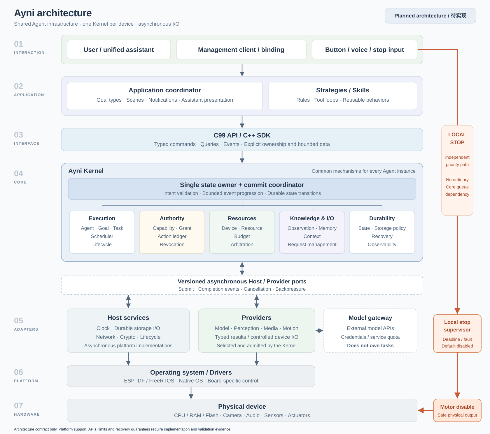
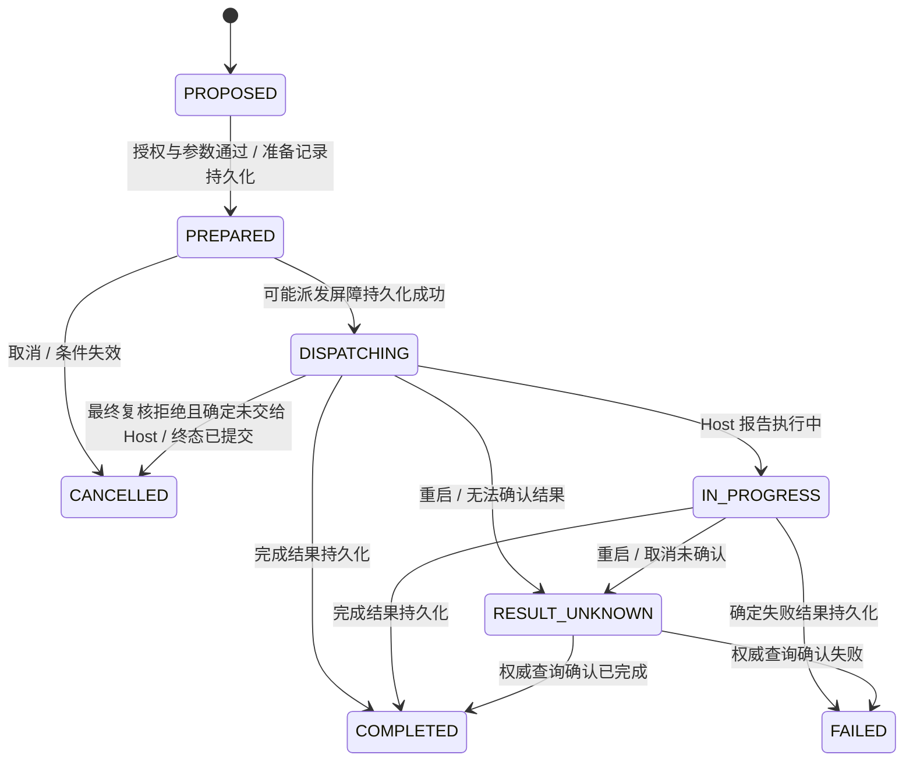

# Ayni：Core 优先的跨设备个人助理 AgentOS 实施计划

> **文档性质**：工程实施计划与待实现契约，不代表已有软件能力。\
> **文档版本**：v1.5 · 2026-10-19；保留文件名 `ayni_v1.0.md`。文档版本与产品 v0.1 / v0.2 分开；本版并入的设计决策见 `docs/adr/`。\
> **产品定位**：面向个人消费者；用户面对一个统一助理，内部由多个 Agent 分工。\
> **架构路线**：按 Ayni 的共享 Agent 状态、授权、资源及恢复需求设计原生 Core，复用宿主 OS，模型优先通过外部 API 获得；架构图仅参考 AIOS 的分层分组表达样式。\
> **首发验证设备**：现有 ESP32-S3 N16R8 开发板；型号、引脚、16 MB Flash / 8 MB PSRAM 均须实测确认。\
> **基准投入**：单人全职；阶段周期是相对工作量估算，不是开工日期或交付日期承诺。\
> **当前状态**：本仓库目前只有实施计划、项目说明、架构图和贡献约定。下文的目录、API、示例、固件、SDK、平台支持和测试结果均为待实现、待验证，除非另附实际验收证据。

## 0. 执行摘要与已确定决策

Ayni 的 Core 是多个 Agent 共用的系统基础设施：每台设备运行一份 Kernel，持有 Agent 实例、持续目标、任务、授权、动作记录、资源和记忆的逻辑状态。规则、Tool Loop 或未来规划器通过系统接口工作；模型提供解释和建议，设备上的 Kernel 决定是否接受任务、如何分配资源，以及动作能否执行。模型网关不拥有任务、记忆或硬件执行权。

“AgentOS”在本项目中的工程标准是：这些服务由应用共同使用、生命周期由系统管理、规则在声明的信任边界内能够强制执行，并有契约测试证明。v0.1 的边界是可信内置代码经受管理入口执行；ESP32 上不能据此声称任意原生代码无法绕过权限。

| 决策项 | 确定方案 | 边界 |
|---|---|---|
| 产品 | 个人消费者的统一助理，内部多个 Agent | 试用界面展示助理状态、授权及行为；开发诊断单独提供 |
| 所有者与入口 | v0.1 单一所有者；按键语音沿用已有授权 | 新增权限、敏感删除、解绑等经已绑定管理端确认；ASR 内容不是身份证明 |
| Agent 身份 | 同一逻辑身份允许驻留多个设备，各实例独立运行 | 身份相同不意味着共享权限、共享可变状态或自动转移任务 |
| 内核与宿主 | 可移植 C++17 Core；ESP-IDF / FreeRTOS、桌面宿主提供系统基础设施 | 不重写硬件 OS 内核，不把底层实时调度与 Agent 调度混同 |
| Core 机制 | 单逻辑状态所有者、有界事件推进、异步 Host | 策略位于 Kernel 之上，不把某一种 Tool Loop 固定为内核 |
| 接入接口 | 统一 C99 兼容 API + C++ 易用封装；首版编译时注册 | 不暴露 STL ABI，不要求动态加载，不执行第三方不可信代码 |
| 具身扩展 | 执行许可、控制会话与运动结果阶段是基础契约（第 2.10 节）；可选 `EMBODIMENT_V1` 只增加机器人专用类型；ROS 2 Bridge / Provider 位于 Core 外 | Profile 不要求所有设备安装机器人栈；外部生态按版本化映射和声明的支持子集接入；MHS 待规范/访问/许可条件满足后适配，不预先宣称兼容 |
| 执行与停止 | 每个控制域由唯一 authority-owner Kernel 准入并签发需续租的短租约许可；执行端逐控制周期校验；停止链分层并含硬件失能 | 停止上限以分项实测为准；不凭任务优先级声称实时停止，不声称独立安全功能或安全标准符合 |
| 信任模型 | 模型、VLA 与外部消息是不可信数据；v0.x 进程内原生代码均为可信内置代码 | 纯函数策略接口不是安全边界；适配器进程另需 OS 权限最小化，执行端许可是最后防线 |
| 模型 | 两个确定性 Mock Provider + 统一认证 HTTPS 网关 | 真实文本、视觉、ASR、TTS 能力分别协商，不假定同一接口全都支持 |
| 记忆 | Agent 默认私有；另设所有者的助理公共档案，按 Agent 授权访问 | 公共档案不公开访问；删除同时使在途依赖及可追溯派生摘要失效；跨设备不自动同步 |
| 暂停与提醒 | 暂停助理保留到期提醒，暂停新自主观察、反思和运动并收敛在途工作 | 紧急停止独立；普通提醒按选定方式成功呈现才完成，失败待处理，无需用户确认 |
| 自主性 | 已授权范围内可提出目标并执行；支持事件、周期检查和空闲反思 | 新目标不产生新权限或无限预算；反思低优先级、可暂停 |
| 首批目标 | 提醒、设备检查、记忆整理、场景观察 | 业务类型由应用注册，Kernel 只规定通用生命周期与约束 |
| v0.1 体验 | 已刷固件的轮式设备；按键录音、语音回答、视觉观察 | 足式机构、自主导航、唤醒词和实时视频对话后续安排 |
| 自主动作 | 用户开启的“转向观察”预授权场景 | 仅校准后的短动作；其他场景通过能力与场景契约扩展 |
| 数据 | 原始媒体默认临时处理；经授权保存事件、事实、摘要 | 不默认持续录像、录音或上传全部个人记忆 |
| 管理与通知 | 局域网管理；重要变化及时提醒，其余汇总，支持安静时段 | 网页关闭后使用本地声光及待展示通知；不承诺手机后台推送 |
| 硬件预算 | 每台新增硬件不超过 300 元 | 不含已有 ESP32、模型费用及工时；不可私自加预算或删体验 |
| 发布顺序 | Core 实验 → ESP32 复核 → 轮式集成 → ToC 试用 → 最小设备互通 | 国产系统扩展保留，但不阻断早期 Core 与个人助理验证 |

**完成定义**：某项能力只有在附有构建、运行和对应验收证据后才标记“已实现”；某个平台只有通过相应功能及恢复测试才标记“已验证”。源码可编译、模拟器通过、实机通过、长稳通过分别记录。

## 1. 产品范围与版本边界

### 1.1 v0.1 实际交付范围

v0.1 是受控的普通用户试用版本。提供已刷固件的轮式设备及本地网页，用户无需编译、刷机或填写模型厂商 API Key。设备独立持有已接受目标和任务；关闭网页不会取消它们。联网模型不可用时，仍能处理本地按键、停止、规则事件和满足时间条件的既有提醒。

| 能力 | v0.1 行为 | 可观察结果 |
|---|---|---|
| 统一助理 | 网页文字、按键录音、语音回答；内部至少两个 Agent 实例 | 用户看到一致的状态和解释，不必操作内部 Agent 拓扑 |
| 目标与任务 | 四类内置应用目标；用户或 Agent 在授权内创建 | 可查询来源、完成条件、当前进度、取消与恢复状态 |
| 视觉 | 持续采集、本地变化筛选、变化触发分析、周期抽查 | 云端分析频率受限，观察带采集时间与有效期 |
| 记忆 | 私有偏好、事实、事件摘要；明确授权共享 | 可查看来源、修改、删除，越权读取被拒绝 |
| 轮式动作 | 明确用户指令及预授权“转向观察”短动作 | 参数、时限、条件和停止均可验证；未校准时禁用 |
| 通知 | 重要变化及时提示；普通后台结果汇总；安静时段 | 设备声光和网页呈现一致，可查看未读及重复合并结果 |
| 管理 | 局域网配网、绑定、授权、任务、记忆、行为记录、停止与恢复入口 | 不依赖开发者串口才能日常使用 |
| 模型访问 | 设备认证到统一网关，网关管理厂商凭据及试用额度 | 超时、额度耗尽、断网均有清晰状态 |
| 恢复与诊断 | 可持久化状态、动作账本、故障降级；开发诊断单独开放 | 重启不盲目重复动作，不把未知结果伪装成成功 |

### 1.2 v0.1 不承担的范围

不在 ESP32 内执行大模型推理，不从零开发 RTOS；不做足式步态、自主导航、SLAM、跟随、任意代码生成执行、第三方原生插件沙箱、完整分布式一致性或商业多租户云平台。不要求在线热替换模型/策略，不实现跨设备自动接管任务或私有记忆自动同步。MCP、A2A、更多宿主和隔离机制按后续阶段验收。

可选具身 Profile 的契约设计及 Mock 验证可在 M0/M1 推进；M2 Core Beta 通过后，可在 M3 独立支线验证 Linux ROS 2 Bridge 与模拟机器人，不增加 v0.1 必需软件栈或硬件采购。R1 可选验收与 E1–E4 分开；未交付可选扩展不阻断既定版本，但声明支持某项扩展时必须通过对应 R1。完整机器人、连续控制、VLA 和 MHS 支持均需各自证据，不能由接口存在推定。

### 1.3 设备与可行性假设

| 假设 | 验证与处置 |
|---|---|
| 现有板型是 ESP32-S3 N16R8 | M0 保存板型照片/资料、启动日志、实测 Flash/PSRAM、GPIO 与启动引脚表 |
| 摄像头、麦克风、扬声器、底盘可共同接入 | 同时审查引脚、I²S/摄像头接口、DMA、供电、内部 RAM、PSRAM、无线和 OTA 容量；不能按单模块成功推定并发可用 |
| 新增硬件可在 300 元内完成 | M0 给出候选 BOM 与价格证据，M3 记录实际采购及实测；若不成立，带选项回到用户决策 |
| 模型需要外网 | Wi-Fi STA 优先；设备 AP 用于初始配网，不能假定 AP 自身有互联网 |
| 试用者使用家庭局域网 | 明确局域网访问、认证和通知限制；不对公网开放设备管理入口 |
| 后续兼容国产软硬件 | M6 按真实工具链/设备推进，不把规划平台写成已经支持 |

## 2. Core 架构与内核原语

### 2.0 Ayni 架构分层与依赖



图中的模块与边界由本计划的 Ayni 需求确定；仅参考 [AIOS 架构图](https://github.com/agiresearch/AIOS#-architecture-of-aios)的分层、分组和连接表达，不采用上游架构作为约束，也不表示复用其实现或继承其能力。

| Ayni 层次 | 职责 | 边界 |
|---|---|---|
| 用户与应用 | 已绑定管理端、语音入口、助理协调器、目标类型、场景与通知规则 | 用户身份来自认证入口，应用通过意图工作 |
| 策略与 SDK | 规则、Tool Loop、有界 Skill；C99 API 与 C++ 封装 | 只读快照、有类型命令/查询/事件，不直接改变 Core 状态 |
| 共享 Kernel | 实例、目标、任务、授权、调用、动作、资源、预算、记忆和恢复 | 每设备单逻辑 owner；所有跨服务变更经提交协调器 |
| 异步执行与平台服务 | Host 提供 Kernel 维护自身不变量所用的时钟、持久存储、网络、加密与生命周期，不经 Grant/预算准入；Provider 实现 Agent 经逻辑调用使用的模型、感知、媒体、检索及动作能力，经准入、计费与绑定 | I/O 不阻塞 step；控制类完成按受理时预留的容量回送 |
| 本地控制与停止 | 控制器在已准入的过程或会话包络内、凭有效许可执行；停止监督器与硬件失能链 | 执行端只能收紧：校验许可、限值与持续联锁，不扩大包络或授予权限；停止不依赖模型、普通队列或网页在线 |
| 可选具身契约与外部适配 | Profile 约束现有 Observation/Capability/Binding；ROS 2 Bridge、未来 MHS 适配器复用受管理入口 | 可选域约束不另造 Kernel；ROS/DDS/tf2/运动规划与控制器实现留在 Core 外；适配器以权限受限的进程运行 |
| 宿主 OS 与硬件 | ESP-IDF/FreeRTOS、Native OS、驱动、传感器、执行器 | 停止链依赖的时钟、中断、内存与硬件超时须写明并实测（第 4.1 节） |

Core 按不变量属主分为九个模块，采用两级目录：第一级是模块边界，第二级按实体命名以便查找（第 2.3 节、ADR-0008）。依赖方向为 `kernel → work → {authority, resources, budget, knowledge} → catalog → durability → foundation`；`authority`、`resources`、`budget`、`knowledge` 之间不互相依赖，跨模块修改由 `kernel` 在同一 transition 中编排并经同一提交协调。`durability` 只提供持久前缀、快照、已提交批次重放与迁移等机制；恢复顺序与领域恢复规则由 `kernel` 按各模块规则编排，底层模块不反向依赖领域模块。应用和 Provider 依赖公开契约，Core 不依赖具体应用、SDK 便捷层、外部协议 SDK 或平台头文件。`knowledge` 保留记忆与上下文的归属、访问、依赖和预算机制；提示词、摘要、排序、业务规划及模型偏好在上层或 Provider。

Ayni 自主定义设备能力模型与安全执行机制，领域契约是系统权威；设备发现由 Host/适配器完成，候选描述经可信注册后进入 Core 目录。ROS 2、MHS、MCP 都是外部互操作体系，与 Ayni 的关系是版本化映射和明确声明的支持子集，不宣称结构等同；其字段和传输版本变化优先在适配层消化，不反向规定 Kernel 对象或执行权。若外部需求新增控制、资源或恢复语义，则通过领域版本、ADR、迁移和验收演进，不能承诺核心永久无需变化，也不能为了兼容削弱本机保证。

### 2.1 运行原则与 Core 的深度

每台设备只有一份 Kernel 逻辑状态源；可以有多个实例和多条异步 I/O 工作线程，但不能同时直接修改 Core 对象。`step` 按工作项和耗时预算推进，不等待网络、Flash、模型或设备操作。Host、Provider 与策略只提交事件/意图，Kernel 完成校验与状态转换；异步持久化未确认前不得报告“已持久接受”，对外输出按第 2.8 节门控。

Core 包含设备和资源的**身份、目录、描述、状态、授权及协调**。具体寄存器、采样、图像筛选、音频编解码、TLS、文件系统和电机闭环实现留在 Host/Provider。OS 调度任务线程；Kernel 调度 Agent 工作与资源准入。高频采集不逐帧进入普通控制队列，使用受限媒体缓冲与观察描述。各部分按时间尺度分开：Agent 与模型以秒计，Kernel 准入以毫秒至秒计，本地控制按控制周期执行，停止链上限由硬件超时与实测决定；慢路径不进入快环路，Kernel 不在实时控制环路上。

### 2.2 原语规范

下表中的持久化是规范要求；M0 固化最小字段、状态与提交不变量，M1 以可执行 fixtures 收敛 experimental 编码。稳定 ID 不复用，修改带版本；物理句柄、指针、资源锁和单调时钟值不跨重启恢复为可用对象。

| 原语 | 归属与生命周期 | 授权 | 持久化与恢复规则 |
|---|---|---|---|
| **AgentInstance** | `agent_id` 是逻辑身份，`instance_id` 是驻留实例，绑定 `device_id`；Kernel 管理启动、暂停、恢复、停止和资源归属 | 实例绑定角色与 Grant，不凭身份相同继承其他设备权限 | 保存身份、绑定、策略配置和状态；重启产生新 `boot_epoch`，旧请求不能继续修改状态；暂停实例不删除记忆 |
| **Goal / Task** | Goal 表示持续目标；Task 是一次有界执行。记录创建者、触发源、owner 实例/设备、完成条件、预算、取消与期限；Session 仅为交互入口 | 创建 Goal、派生 Task 与执行动作分别检查；派生工作只能缩小既有授权与预算 | 保存目标、任务、触发游标、版本、检查点和结果；任务固定归属，失联不接管；恢复后重新检查时间、授权和条件 |
| **Observation** | 测量或解释的来源、采集时间、时钟可信度、有效期、质量、媒体引用及关联观察；测量值与模型推断分开标记 | 采集、订阅、上传、长期保存分开授权；感知订阅也占资源与预算 | 原始媒体引用默认短期有效，不在重启后假装仍可访问；授权事件/事实/摘要可持久化，过期观察不可支持新动作 |
| **Device / Component / Resource** | Device 为宿主身份；Component 描述设备结构（传感器、轮、电机等）；Resource 是准入单位，描述容量、共享/独占、冲突域、健康与租期，可为模型槽等非物理资源。Component 与 Resource 不一一对应，经 Binding 关联；带 `authority_epoch` 的执行器 Resource 称**控制域**，任一时刻只有一个 authority-owner Kernel | 注册来自可信 Host；访问经能力声明与 Grant，应用不能伪造系统资源；发现到的描述只是候选 | 保存可信目录配置和历史；在线状态、占用与本地句柄重新探测，重启释放旧占用，执行器保持禁用；控制域的 `authority_epoch` 由 owner 与执行端分别持久化 |
| **Capability / Grant** | 能力规定类型化输入输出、副作用、资源、时限和恢复行为；Grant 绑定主体、目标、范围、期限、额度、撤销版本及委派限制 | 默认拒绝；委派只能收窄且保留上级撤销链；参数、前置条件与外发范围均由设备检查 | 保存能力契约版本及授权记录；恢复、排队后、派发前再次校验；无法证明期限有效的时限授权不自动启用 |
| **ActionRecord** | 每次外部影响有稳定 `operation_id`，关联实例、任务、能力版本、授权、参数摘要、派发尝试与结果 | 授权绑定参数/场景和操作，不能用批准其他动作的结果替代 | 记录持久准备、可能派发、执行完成和结果落盘；不确定进入 `RESULT_UNKNOWN`，查询或人工处理；不通用承诺恰好执行一次 |
| **MemoryRecord** | 默认归属逻辑 Agent 的私有命名空间，实例写入受控；含来源、版本、可见范围、删除标记和决策引用 | 私有读取、写入、共享和外发分别授权；共享不意味着共享整个私有库 | 本机保存版本与删除状态；同一身份跨设备副本不自动合并；删除后不可进入新上下文，旧审计仅留必要引用与脱敏元信息 |
| **Budget** | 设备总预算与实例/目标/任务子预算，包括模型、token、字节、任务数、媒体分析、CPU 工作项及通知频率 | 子预算不能大于父级；模型不能自行加额；系统保留停止、诊断与前台交互配额 | 保存周期消耗与待结算预留；重启不清零已花额度，不确定调用按保守规则结算；余额不足拒绝、延后或暂停 |
| **UserPrincipal / Session** | 所有者为授权根；Session 绑定认证主体、输入渠道和信任级别，不拥有持续任务 | 语音仅提出已有权限内的工作；敏感命令携带已绑定管理端的认证证据 | 保存所有权及绑定版本；会话凭据按 Host 规则重建，重启不复用已失效身份凭据 |
| **LogicalCall / ProviderBinding / Subscription** | 逻辑调用独立于 I/O 尝试；绑定能力版本、端点、资源和 Provider；订阅有独立代际与租期 | 每个语义步骤检查权限、参数、资源、预算和数据目的地 | 保存步骤调用身份及必要绑定；重启重建 I/O 和订阅，未知副作用不转移实现或自动重做 |
| **ControlSession / ExecutionPermit** | 过程或会话是越过派发屏障的一次有界执行；许可由控制域 owner 签发，绑定会话、控制域、模式、包络摘要及各代际，按短租约续期 | 静态准入在 Kernel，执行期间的联锁与许可校验在执行端；许可只能收紧既有授权 | 许可不跨 Kernel/执行端启动代际或急停复位继续有效；结束后资源保持隔离直到停止确认；规则见第 2.10 节 |

Observation 的 TTL、动作 deadline 在本机采用单调时间执行；跨设备只能传相对限时及可信时间信息，不能比较两台机器的 monotonic 值。绝对时间不可用时，日历提醒进入待校时状态；过期处理按目标的补发一次、汇总或跳过策略执行。

### 2.3 多个 Agent 共用的系统服务

| 系统服务 / 建议目录 | Core 负责 | Host、Provider 或应用负责 |
|---|---|---|
| 编排与入口 `kernel/` | Kernel 生命周期、step、事件入口（有界队列、合并、路由）与完成槽；受管入口（解码 → 校验 → 分派）与命令幂等映射；跨模块编排、恢复编排、输出门控；诊断的脱敏与导出 | ISR 安全桥接、线程唤醒，不从 ISR 调用普通 API；日志出口与性能测量 |
| 执行 `work/`：`agent/`、`goal/`、`task/`、`call/`、`action/`、`session/`、`subscription/` | AgentInstance 注册、生命周期、隔离命名空间、停止与回收；Goal/Task 的接受、调度、触发去重、暂停取消、检查点与归属；步骤、LogicalCall 与请求尝试（request ID、boot epoch、超时、取消、晚到结果）；ActionRecord 与派发屏障；过程、控制会话与订阅（代际、租期、序号、gap）的生命周期 | 实例角色与助理呈现；提醒等目标类型、完成判定和规划策略；非阻塞 I/O、结果验证、取消尝试与流传输 |
| 授权 `authority/`：`principal/`、`grant/`、`scene/` | 主体、节点与实例身份及其绑定证据；Session 信任级别；Grant、撤销与受限委派、审批绑定；Scene 授权；包络静态准入判定 | 认证凭据存储与传输；本地执行、物理限值、持续联锁与独立停止机制 |
| 资源 `resources/`：`admission/`、`lease/`、`permit/` | 资源准入（全有或全无）、排队、冲突、公平与饥饿监测；租期与隔离；执行许可的签发、续租与失效；设备在线、占用与健康等运行时状态 | 设备健康探测的具体实现 |
| 预算 `budget/` | 设备总额与实例/目标/任务子预算层级、预留与结算、限流；重启不清零已花额度，不确定调用按保守规则结算 | 试用额度配置，网关同步执行外部费用限制 |
| 知识 `knowledge/`：`observation/`、`memory/`、`context/`、`lineage/` | Observation 的来源、采集时间与有效期；私有/共享记忆的范围与版本；上下文预算；lineage、tombstone 与依赖失效 | 感知算法、模型解释、可选检索 Provider |
| 目录 `catalog/`：`device/`、`capability/`、`binding/`、`goal_type/`、`strategy/` | 设备、组件、资源、能力（Schema、副作用与恢复属性）、Binding、目标类型与策略的版本化描述与选择约束；可信注册；兼容矩阵；注册的纯函数校验器 | 发现硬件、采集/驱动，生成候选描述 |
| 持久 `durability/` | 持久前缀、日志/快照、已提交批次重放、迁移机制；不含领域恢复策略 | 存储原子性/flush 能力 |
| 基础 `foundation/` | ID、时间、状态码与原因、有界容器、通用代际栅栏、trace 记录类型与注入式 sink | — |

上表每行是对应不变量的唯一属主；跨模块状态转换由 `kernel/` 在同一 transition 中编排，模块之间不修改彼此的内部状态。资源与预算的联合准入由 `kernel/` 在同一 transition 中先判定、后应用。第二级子目录按实体命名以便查找，子目录之间的单向 include 规则在模块内声明并检查；`kernel/`、`budget/`、`durability/`、`foundation/` 职责集中，不再细分子目录。设备与能力的描述同在 `catalog/`，因为 Binding 同时引用二者、注册时须交叉核对且共用一个兼容矩阵；它们的运行时状态分属 `resources/`（在线、占用、租期、许可）、`authority/`（Grant）与 `work/`（调用实例）。

资源按 Capability 声明由系统自动申请、协调和释放，Agent 不直接持有驱动锁。资源组采用全有或全无准入，避免部分占用互相等待；首版不强制抢占不可中断的物理动作，采用排队、超时或可取消操作释放。优先级次序为本地停止路径、前台交互/已到期提醒、普通工作、后台反思；同级使用有界公平排队并记录最长等待时间。每类工作声明等待期限及超限后的延后、过期或暂停原因；后台反思允许不运行，但不能保持无原因的永久等待。模型占用槽期间其他本地工作继续推进，优先级不意味着可以中断既有物理副作用。

媒体采集可用有期限的系统订阅占用资源，不能永久持锁。播放与录音是否互斥由音频资源组声明；视觉分析占模型槽但不必长期占摄像头。完成、失败、取消、超时和实例停止均需释放资源；对尚未确认已停止的执行器保留隔离状态，不提前分配给下一请求。

### 2.4 生命周期与执行状态分开

| 对象 | 状态与关键转换 |
|---|---|
| AgentInstance | `REGISTERED → STARTING → RUNNING ↔ PAUSED → STOPPING → STOPPED`；初始化/检查点不兼容进入 `FAULTED` 或有原因的暂停；结束一次任务不结束实例 |
| Goal | `PROPOSED → ACTIVE ↔ PAUSED → SATISFIED / CANCELLED / EXPIRED / FAILED`；需确认时停留待授权，不生成可执行工作；持续目标可多次产生 Task |
| Task | `READY ↔ RUNNING → COMPLETED`；也可 `PAUSED / CANCELLED / FAILED / EXPIRED`；异步取消未完成时为 `CANCELLING`。等待模型、资源、审批或动作是由待决调用集合派生的 `blocked_on` 视图，可同时存在多项，不写入生命周期枚举；是否已持久接受由提交序号表达 |
| ActionRecord | `PROPOSED → PREPARED → DISPATCHING → IN_PROGRESS → COMPLETED / FAILED`；未派发可 `REJECTED / CANCELLED`，越过可能派发边界而无法确定结果进入 `RESULT_UNKNOWN` |

接受某个对象的 transition 在 `durable_seq` 覆盖它之前只存在于未持久的内存状态；查询可见但须标注 `durable_seq`，只有覆盖后才报告“已持久接受”（第 2.8 节）。`PREPARED` 表示已保存意图且尚未进入可能派发；**必须先持久化 `DISPATCHING` 屏障，再允许 Host 发出具有副作用的请求**。屏障写失败则禁止派发。



图中省略审批等拒绝分支，不得把 `RESULT_UNKNOWN` 当作普通失败自动重试。恢复日志只重建状态，不能直接重放硬件动作；恢复目标也不恢复旧运动命令。取消请求、停止指令已送达、物理输出已停止是三种事实，必须分别表达。

运行终态与副作用结果分开：取消或失败仍可能已有部分影响，结果必须列出已完成步骤、未执行步骤及未知步骤；不能用 `CANCELLED` 推导“没有发生影响”。撤销响应区分 `ACCEPTED`、`DURABLY_EFFECTIVE`、`CANCELLING` 和 `STOP_CONFIRMED`。前两者表示命令接收／授权版本生效，只有最后一项可证明本地物理停止。持久撤销提交前先用内存拒绝栅栏阻止新的派发并停止续租相关执行许可，撤销消息传播失败时执行端最迟在撤销时刻起一个完整租期后收敛（第 2.10 节）；写失败保持受限并报告，重启无法证明授权有效时不自动开放动作。

| 操作 | Goal / Task / Request 的传播 | 采集、执行器与恢复 |
|---|---|---|
| 暂停助理 | 应用协调器暂停自主观察、反思和运动所属目标的新工作，保留已设提醒及其他明确用户工作 | 取消相关订阅和可取消请求，收敛在途运动；恢复时重新准入，不续跑旧运动 |
| 暂停单个 Goal | 保留目标与检查点，停止产生新 Task；在途 Task 按该类型的暂停点收敛 | 无法立即暂停时显示暂停中，不宣称已停止 |
| 取消 Goal / Task | 标记取消版本，禁止新增派生步骤；传播到所属在途请求，等待取消结果或记录未知 | 已完成影响保留事实；补偿是另一个需授权的操作，不自动回滚物理世界 |
| 关闭观察 | 终止相应后台观察目标及订阅，停止采集、上传与新分析；用户日后的独立抓拍需新调用 | 旧代事件拒绝进入上下文；可取消的分析请求取消，已外发数据遵守保留说明 |
| 暂停 / 停止实例 | 暂停阻止该实例新增工作并到兼容检查点；停止收敛全部所属工作并回收资源 | 直接暂停提醒所属实例会使其暂停；用户的“暂停助理”不能映射为暂停全部实例 |
| 紧急停止 | 独立本地入口立即禁止运动准入，再向 Core 报告；不取消提醒或删除目标 | 保持电机禁用，直到故障清除且所有者显式恢复；暂停解除不自动解除停止锁存；复位使 `safety_epoch` 递增，旧执行许可永久失效，恢复运动须重新准入 |

### 2.5 策略与信任边界

规则策略、Tool Loop 和未来规划器注册于 `strategies/`，消费任务快照/观察，提交目标建议、模型请求、动作意图或完成结果。Kernel 校验所有意图，策略不能修改内部对象、绕过资源入口、提升权限或自行恢复未知动作。策略回调同样有工作量限制；复杂计算放异步 Provider。

策略与 GoalType 的接口是有界决策函数：Kernel 在 step 内以只读快照和策略私有检查点调用它，回调返回有界意图集合与新的私有检查点，回调内不得调用 Kernel API、执行 I/O 或阻塞。Tool Loop 的模型调用以返回的模型请求意图表达，结果出现在后续快照中。该形态服务于确定性重放与策略替换，不是安全边界。

信任按两条轴区分：**输出可信度**与**代码可信度**。模型、VLA、外部消息、发现到的设备描述和 MHS 参考文件都是不可信数据，只能作为意图或候选描述经 Kernel 校验，执行端再校验许可。v0.x 固件与 Kernel 进程内的策略、GoalType、Provider、Driver 和控制器都是可信内置 C/C++；纯函数接口不能阻止原生代码越权访存、直接 I/O 或无限循环。权限保证仅覆盖受管理入口；任意原生代码直接访问 GPIO、内存或网络时，ESP32 首版不提供强进程隔离。

ROS 2、MHS、MCP 等适配器在 Full Profile 宿主上以独立进程运行；进程边界只提供地址空间与崩溃隔离，设备、文件、凭据、网络及 IPC 权限须另行限制：适配器使用独立系统账户，不能访问执行器设备节点与凭据库，只经带自身主体身份的本地 IPC 连接 Kernel；ROS 侧启用 SROS2 严格模式，适配器只能向执行端的许可门发布，控制器命令接口仅由许可门写入。无论指令来源，执行端拒绝缺少有效许可的指令，这是“无法旁路受管入口”的最后防线；进程隔离是纵深防御。第三方原生代码与 MHS 代码文件不进入固件，只有可转换为有界 Procedure 数据的子集可经校验接入。未来第三方扩展需单独选择进程、OS 权限或受限执行环境，并声明平台隔离等级。

### 2.6 部署 Profile

| Profile | 语义和容量 | 状态 |
|---|---|---|
| `CORE_LITE` | ESP32 使用；完整任务、授权、动作和恢复语义，容量与可选检索受限 | M2 待实现/验证 |
| `CORE_FULL` | 桌面使用；同一 Core，更多容量、存储和检索 Provider | M1 最小实现；扩展后续 |
| `DEVICE_NODE_C` | 无 Kernel 的受控设备端点；实现身份、设备模型与受控调用协议，并在本地强制限值、执行许可与停止；其控制域由唯一 authority-owner Kernel 治理，换主、分区与端点重启均使旧许可失效 | M6 待评估，不称为独立 Agent 实例或授权决策者 |

部署 Profile 与领域契约 Profile 分开：`EMBODIMENT_V1` 是第 2.9 节的可选类型/行为约束，可由 Lite 或 Full 按声明的特性实现；不意味着额外内核运行时或默认启用 ROS。第 2.10 节的执行许可与运动结果阶段属于基础契约，不随 Profile 启用与否改变。各部署 Profile 由组合根 `runtime/` 装配：它是部署选择与跨组件装配的唯一位置，可执行程序与固件只调用它；各 Host、Provider 与适配器可以在内部封装自身的平台实现（第 8 节、ADR-0010）。未支持的类型、控制模式及必需特性显式拒绝，不静默降级。

### 2.7 函数层级、能力绑定与最小组合

| 层次 | 契约 | 不承担的职责 |
|---|---|---|
| GoalType / Scene / 助理协调器 | GoalType 定义目标语义、触发、完成与暂停规则；Scene 定义授权参数及前提；协调器路由用户意图和合并反馈 | Scene 不兼任执行器，协调器不直接修改 Kernel 对象 |
| Strategy / Skill | 以第 2.5 节有界决策函数形态消费只读快照，提出有界步骤、调用与完成建议；Skill 为可复用组合，可由规则或 Tool Loop 使用 | 不私自 I/O、不持有驱动锁、不将模型输出作为授权 |
| 系统调用 / Capability | 有类型命令、查询、事件；能力声明输入、结果、进度、副作用、资源及恢复条件 | 统一入口不接受任意字符串代码或无 Schema 的不受限字典 |
| LogicalCall / ProviderBinding | `step_key`、`logical_call_id` 表示语义调用；`binding_id` 将能力类型/版本绑定至具体设备、端点、资源、Provider 及外发目的地 | 不把一次传输或 Provider 函数指针当成永久调用身份 |
| Provider / Host / Driver | Provider 实现能力；Host 提供异步平台服务；Driver 完成设备 I/O 与本地控制 | 不持有领域对象写权限；底层控制细节不逐次变成业务步骤 |

注册时核对能力类型、Schema/语义版本、调用形态、模态、资源及取消／查询特性的匹配。同名能力可以有多个绑定；应用提供选择约束，Kernel 只在满足权限、外发与预算约束的候选中准入。准备记录保存具体绑定及版本；超出已批准费用或数据目的地的 fallback 必须重新授权。副作用越过派发屏障后禁止静默切换实现，未知结果不能通过更换 Provider 或 operation ID 绕开；需要换用其他绑定时，须先取得原 operation 的权威未执行结论并封禁旧 ID，再以新 `operation_id` 重新准备与授权。

能力描述分别声明副作用类别（含数据外发、计费、通知与物理影响）、语义幂等性、服务端去重窗口、查询权威性、取消方式和补偿能力；这些是独立属性。无记录／`NOT_FOUND` 不自动证明未执行，只有执行方保证记录完整且旧尝试已终止或被隔离，才可形成权威未执行结论。纯计算无需物理动作账本；计费模型请求和媒体上传仍须持久绑定调用、预算及外发证据，达到副作用门槛时使用同一屏障机制。

v0.1 至少支持有界顺序组合：`转向 → 停止确认 → 拍照 → 分析 → 通知`。每个需独立授权、取消或恢复的步骤有稳定 `step_key`，其 `logical_call_id` 与必要的 `operation_id` 在首次接受时保存，重启/换策略不重新生成。共同检查点保存步骤版本、绑定、输入摘要、结果引用、已提交进度和未知状态，策略私有检查点只保存其算法状态。共同检查点不兼容时暂停，不让新策略改写完成条件。

资源按当前步骤申请、释放或隔离；组合不持有父级资源再等待子调用。Task 的 `blocked_on` 是由当前待决调用派生的视图（第 2.4 节），完整请求集合另存。首版顺序执行，单轮最多 8 个调用是受理上限；后续并行需先定义有界 fan-out、join、失败及取消传播。未知步骤阻止依赖它的后续步骤；已完成步骤不重做，未派发步骤重新准入，补偿作为新调用单独授权。通用 DAG 编辑器及分布式子任务留待后续。

### 2.8 逻辑提交与一致性不变量

单逻辑 owner 保证串行状态推进；持久一致性由 `transition_id + commit_seq` 的提交批次保证。提交与对外输出由两层协议配合：

- **持久层**（`durability/`）只证明持久前缀：`append(batch)` 以 `OK / FAILED / UNKNOWN` 完成，对外只暴露 `durable_seq`，即连续已持久的最长前缀。Host 的日志批次包含长度、校验与提交标记；恢复精确返回该前缀并忽略不完整尾部，同一 transition 重放不重复应用。持久层不理解输出语义。
- **Kernel 层**只维护一份内存状态，transition 按 `commit_seq` 顺序立即应用，不另建暂存副本或跨 transition 依赖追踪。每个对外输出带 `requires_seq`：持久接受回复、对外事件和通知在 `durable_seq ≥ requires_seq` 后释放；具有副作用的 Host submit 还须通过第 4.3 节的最终复核，复核与 submit 之间不处理其他普通意图。查询可返回已应用状态，但须标注 `durable_seq`，不得把未覆盖部分报告为已持久。
- **写入失败或结果未知**：以相同 `transition_id / commit_seq` 有界重试，重试成功按幂等重放处理。仍失败时 Kernel 进入受限栅栏（FENCED）：立即停止新输出、新准入与执行许可续租；已越过持久屏障的在途动作按能力属性继续或取消，其完成事件只进入有界易失缓冲供对账；重载之前，持久层须先确认旧写入方已失去修改日志的能力：存储 Host 报告旧 append/flush 全部终止（排空），或在存储层原子地安装新的 writer epoch，使携带旧 epoch 的写入被拒绝；日志随之写入栅栏记录，恢复时忽略栅栏记录之后出现的旧 epoch 批次，作为第二道防线。两种确认都无法取得时保持只读诊断，不重载、不恢复输出。确认之后才以新 `boot_epoch` 从持久前缀重载，在途动作按第 4.3 节转为 `RESULT_UNKNOWN`，存储可写后经 Host 查询对账，易失缓冲不直接改写状态。存储仍不可写时进入只读诊断，本地停止路径照常可用。

Kernel 不在内存中回滚部分 transition：已应用但未持久的状态可能已被后续决定依赖，只能整体丢弃并复用重启恢复路径。派发屏障因此是输出门控的一个实例；ESP32 上从写失败到重载完成的耗时须实测。

| 最小逻辑提交批次 | 恢复不变量 |
|---|---|
| 命令幂等映射 + Goal/Task 接受结果 | 接受后响应丢失，重试返回相同对象；不新增第二个提醒 |
| 触发 occurrence/游标 + Task 创建 + Budget 预留 | 全部可见或全部不可见；既不漏触发，也不生成新 Task 绕过去重 |
| 步骤检查点 + logical_call/operation 身份 + 参数与绑定 | 恢复沿用原调用身份；策略替换不能把已做步骤当成新动作 |
| 调用结果应用 + 任务进度/记忆变更 + Budget 结算 | 不重复写摘要、不双重结算；提交失败仍可对账 |
| 删除/撤销版本 + 依赖失效索引与处理游标 | 源记录立即对新使用不可见；派生清理由可恢复、有界工作完成 |

跨存储介质采用可验证的协调日志或等价协议，不能声称不同分区天然原子。外部副作用不参加本地原子事务，必须通过持久待派发记录、屏障和执行回执对账。存储提交响应未知时按原 transition 查询/恢复，禁止新建身份重做。所有策略意图携带 `expected_revision` 与关键依赖版本；过时写入返回 `REVISION_CONFLICT`，由上层重新评估，不静默覆盖用户修改。

### 2.9 可选具身契约 Profile

执行许可、控制会话、停止上限与运动结果阶段是所有执行器共用的基础契约（第 2.10 节），v0.1 轮式动作直接使用；`EMBODIMENT_V1` 只在其上增加机器人专用的时空、状态、轨迹与模型候选类型。`EMBODIMENT_V1` 将现有 Device、Resource、Observation、Capability、Binding 和 ActionRecord 约束为可组合的具身接口。`profile_id/version + feature_bits` 随能力与绑定协商，语义版本落入领域契约和旧记录兼容规则，不增加一种传输或持久化版本域。设备仅声明实际实现并验证的功能；不具备关节、定位或反馈时不伪造相关字段。普通提醒、记忆应用及未启用的 Lite 构建无需引入机器人库。

| Profile 契约 | 最小描述及约束 | 执行归属 |
|---|---|---|
| `HardwareManifest / RobotDescription` | 稳定设备/端点/资源、状态槽与过程、能力/固件/模型版本、单位、可用控制模式、限值及校准引用；状态设定值与实测值分开 | 可信注册与版本在 Core；厂商 SDK、URDF 解析、几何/运动学及发现转换在 Provider |
| `StampedState / RobotState` | pose/twist/joint 等类型按特性声明，含 `frame_id`、采样时间、clock domain/epoch、有效期、校准/变换版本及适用的质量/不确定度；多模态快照声明同步误差 | Core 检查必要元信息及依赖；同步、tf2、变换、定位与状态估计在 Provider |
| `MotionGoal / TrajectorySegment` | 控制会话内的有界目标、轨迹或动作片段，声明动作空间、单位、坐标、时域、参数包络、反馈与联锁 | 由第 2.10 节的控制会话承载；本地 controller 在获准包络内高频执行，不逐伺服样本写 journal |
| `ControlAuthority` | 在第 2.10 节执行许可之上，声明位置/速度/力矩等模式与 command interfaces、唯一入口或可信仲裁者 | 代际、租期、命令序号与最大年龄按第 2.10 节在执行端校验；Grant/Resource 准入不等于控制器权限 |
| `MotionOutcome` | 在第 2.10 节基础阶段之上，声明位姿、关节、抓取等目标验证所需的传感来源、实测/估计、时刻/坐标、容差及稳定窗口 | ActionRecord 保存结果引用；Provider/本地验证器产出证据，模型判断不能替代必要实测 |

空间值默认采用已声明的 SI/弧度和坐标约定，外部单位/坐标通过显式转换进入；无法确定单位、frame、变换时刻或校准有效性时拒绝相关动作。按观察采集时刻关联变换，不把旧图像与当前姿态任意组合。ROS 仿真时钟暂停/回退时失效其旧 epoch 的相关快照；真实执行器的租期、watchdog 与停止截止时间继续使用本地单调时间，不能被仿真时钟冻结。

控制会话的屏障、许可、代际、续租、失效与停止规则见第 2.10 节；Profile 只补充轨迹/高频样本的有界缓冲与受控引用，以及关节、位姿等控制模式的命令接口映射。激活、控制权变更、关键故障及终结保存必要证据。复合设备按整个动作所需的资源组和受信任的共享空间策略准入；碰撞检测等连续几何判断由执行层完成，资源锁不宣称能证明动态避障安全。

WorldModel/状态估计位于 Provider，VLA 位于策略或推理 Provider。输入引用版本化机器人状态与观察快照；输出为有动作空间、单位、frame、有限 horizon 及依赖版本的候选目标/片段，只能在已准入的控制会话内经执行端许可、包络与本地限幅/联锁校验后执行。过时、越界或模型不匹配的片段拒绝；模型不直接获得驱动权、任意 PWM 或不受限原生代码执行权。该接口预留不代表 v0.1 增加 VLA 推理、导航或机械臂功能。

### 2.10 执行许可、失效与停止上限

本节是所有执行器共用的基础契约，v0.1 轮式“转向观察”直接使用；第 2.9 节 Profile 只在其上增加机器人专用类型。

**角色。** 每个控制域任一时刻只有一个 authority-owner Kernel，作为决策点负责静态准入、动作账本与持久记录；执行端（本机控制器、托管设备端点与停止监督器）作为执行点，逐控制周期校验许可、限值与持续联锁，并负责停止。决策点不进入实时环路；执行点只能收紧既有授权，不能授予或扩大权限。

**两种执行形态。** 过程（Procedure）是一次 `action` 调用，由本地技能在声明的包络、时长上限与停止条件内完成；控制会话（ControlSession）在获准包络内接收规划器、VLA 或遥操作的流式指令。二者都在过程或会话粒度使用第 2.4/4.3 节的派发屏障与 ActionRecord；包络内样本属于该次获准执行的内部过程，不逐条成为业务 operation。扩大包络、改变控制模式或权限须重新准入并记录。

| 许可字段 | 规则 |
|---|---|
| 身份与范围 | `permit_id`、所属过程/会话的 `operation_id`、控制域、控制模式、包络摘要 |
| 代际 | `kernel_boot_epoch`、控制域 `authority_epoch`、`executor_boot_epoch`、`safety_epoch`、校准版本 |
| 时效 | 租期 `L` 由能力声明；会话为需续租的短租约；过程许可时长不超过该过程的最长执行时长，且不续租 |
| 新鲜度与截止 | 签发与续租须回显执行端下发的 nonce。执行端按本地单调时钟记录每个 nonce 的签发时刻 `t_N`，回显 nonce N 的许可或续租把截止设为 `max(当前截止, t_N + L)`；截止以 nonce 签发时刻而非到达时刻为锚，传输延迟不能延长截止。执行端周期轮换 nonce 并只保留最近若干个，未知或已淘汰的 nonce 一律拒绝 |

**到期即终止。** 会话或过程许可一旦越过截止即进入终态：执行端按包络声明的方式收敛停止，此后到达的任何许可或续租都不能恢复该会话，恢复运动须以新 `permit_id` 重新准入；资源在停止确认前保持隔离。由于撤销前签出的续租所回显的 nonce 必然签发于撤销之前，任何在途续租都不能把截止推过“撤销时刻 + L”；`L` 的预算须含执行端与 Kernel 单调时钟的漂移余量。

执行端每个控制周期检查：各代际与执行端当前值一致；本地单调时间未超过租期；未处于停止锁存；校准版本有效；指令位于包络内且年龄不超过上限。任一项不满足即按包络声明的方式收敛停止。

| 失效事件 | 失效机制 | 最坏停止上限（均须实测） |
|---|---|---|
| Grant 撤销或场景关闭，撤销送达 | 显式撤销，执行端立即收敛 | 传输时间 + 停止时间 |
| 撤销传播失败 | Kernel 内存撤销栅栏先停止续租；在途续租的截止不晚于其 nonce 签发时刻 + `L` | 撤销时刻 + `L` + 停止时间 |
| Kernel 重启、崩溃或进入存储受限栅栏 | 不再续租；新 `kernel_boot_epoch` 的续租被拒，须重新准入 | 失效时刻 + `L` + 停止时间 |
| 执行端或控制器重启 | `executor_boot_epoch` 变化，启动默认失能 | 由启动禁用保证 |
| 校准失效 | 执行端本地校准版本变化 | 检测时间 + 停止时间 |
| 紧急停止 | 硬件失能与停止锁存（第 4.1 节） | 停止链分项实测时间 |
| 急停复位 | `safety_epoch` 递增，所有旧许可永久失效；须所有者显式恢复并重新准入 | — |
| 换主或网络分区 | 执行端持久化的 `authority_epoch` 递增后旧 owner 的续租被拒；分区期间无法续租 | 换主或分区时刻 + `L` + 停止时间 |

会话租期上限按能力风险与实测停止时间设定；过程的最长执行时长同样构成撤销后的停止上限，较长的动作应拆为分段准入的步骤或改用会话形态。无法给出停止上限的能力不开放会话形态。

开始前的静态准入（请求包络 ⊆ Grant 与 Scene 允许的包络 ⊆ 设备限值，前置观察新鲜）由 Kernel 完成；执行期间的持续联锁（反馈丢失、堵转、倾斜、越界、断流、控制者失联）由执行端声明与执行，二者分别有属主。独立停止可覆盖所有控制者。许可结束或失效不等于资源可分配：尚未确认停止的执行器保持隔离，租期结束不直接解除隔离，也不能由 Provider 无限续租；停止确认回到 ActionRecord 后资源才释放。

**运动结果阶段。** `MotionOutcome` 分别记录命令已接受、执行结束、停止确认与目标验证（已验证 / 估计 / 未知），并附传感来源、实测或估计、时刻与容差证据。成功条件由 Capability/GoalType 声明，命令发送完成或电机停止不能自动推出物理目标达成。无角度/位姿反馈的校准限时动作只报告执行时长、停止事实及估计结果，不得宣称实测转角或抓取成功。物理结果未知时重新测量、补偿或人工处理遵循能力恢复属性，不盲目重复。

跨设备控制时，以上校验全部在执行端所在节点完成。缺少可信跨设备时间时，以执行端 nonce 与本地租期证明新鲜度，无法证明则拒绝，不能用“首次收到后 TTL”掩盖已滞留的命令。

## 3. 统一 API、SDK 与协议契约

### 3.1 三类独立版本与一致性来源

| 契约 | 版本域 | 兼容规则 |
|---|---|---|
| Core—Host / 原生 SDK | `abi_major`、结构大小及功能位 | ABI 主版本不兼容时拒绝；新增可选尾字段按 `struct_size` 处理；不得跨 ABI 传 STL、异常或 OS 句柄 |
| 管理与设备间协议 | `protocol_major/minor`、能力版本和功能协商 | 主版本不兼容拒绝；未知可选字段可忽略，未知必需功能/动作拒绝；v0.1 管理 API 与 v0.2 设备互通共用领域语义 |
| 持久化格式 | `storage_schema`、记录版本、迁移版本 | 校验、迁移与回滚有单独用例；不支持版本进入只读/暂停，不能当空数据重建 |

三类版本不要求数字同步。`contracts/domain/` 固化 ID、状态、错误和能力语义，生成/核对 C 类型、JSON Schema、持久化映射及 conformance fixtures。修改语义必须同步测试；内部对象不依赖 JSON 字符串，不能持久化 C++ 内存布局。每类领域意图只有一个领域类型与一个语义校验器，本地类型化 API 与网络解码器构造同一类型并共用校验器；本地调用是否也先编码、IDL 选型（Protobuf/nanopb 等候选）记录为 ADR-0009 候选，按 ESP32 固件体积、峰值 RAM 与最大消息延迟实测决定。幂等参数摘要按契约列出的领域字段规范化计算，不依赖任何序列化字节。

### 3.2 C API 与 C++ 封装

统一接口覆盖在电脑或 ESP32 嵌入 Core、注册设备/资源/能力/目标类型/策略、连接模型/感知/媒体/检索/动作 Provider，并经 Host 端口提供时钟、持久存储、网络与加密；另外提供电脑端管理客户端，用于调用设备 API、查询任务及订阅事件。客户端操作设备不等于在电脑创建了另一个任务所有者。

以下为**拟议接口节选，尚未实现，不是完整可编译头文件**；最小结构、字段限额与错误清单在 M0 定义，M1 通过契约用例收敛：

```c
/* planned: include/ayni/ayni.h — C99-compatible ABI */
typedef struct ayni_kernel ayni_kernel_t;
typedef struct ayni_client ayni_client_t;
typedef struct ayni_config_v1 ayni_config_v1;
typedef struct ayni_host_v1 ayni_host_v1;
typedef struct ayni_event_v1 ayni_event_v1;
typedef struct ayni_intent_v1 ayni_intent_v1;
typedef struct ayni_device_desc_v1 ayni_device_desc_v1;
typedef struct ayni_resource_desc_v1 ayni_resource_desc_v1;
typedef struct ayni_capability_desc_v1 ayni_capability_desc_v1;
typedef struct ayni_provider_v1 ayni_provider_v1;
typedef struct ayni_binding_v1 ayni_binding_v1;
typedef struct ayni_goal_type_v1 ayni_goal_type_v1;
typedef struct ayni_strategy_v1 ayni_strategy_v1;
typedef struct ayni_error_v1 ayni_error_v1; /* reason code + object ref, no sensitive data */

int32_t ayni_create(const ayni_config_v1 *, const ayni_host_v1 *,
                    ayni_kernel_t **out_kernel);
int32_t ayni_register_device(ayni_kernel_t *, const ayni_device_desc_v1 *);
int32_t ayni_register_resource(ayni_kernel_t *, const ayni_resource_desc_v1 *);
int32_t ayni_register_capability(ayni_kernel_t *,
                                const ayni_capability_desc_v1 *);
int32_t ayni_register_provider(ayni_kernel_t *, const ayni_provider_v1 *);
int32_t ayni_register_binding(ayni_kernel_t *, const ayni_binding_v1 *);
int32_t ayni_register_goal_type(ayni_kernel_t *, const ayni_goal_type_v1 *);
int32_t ayni_register_strategy(ayni_kernel_t *, const ayni_strategy_v1 *);
/* Freezes the catalog, validates references, starts asynchronous recovery. */
int32_t ayni_start(ayni_kernel_t *, ayni_error_v1 *out_error /* nullable */);
int32_t ayni_get_lifecycle(const ayni_kernel_t *, uint32_t *out_state);
int32_t ayni_submit_intent(ayni_kernel_t *, const ayni_intent_v1 *,
                           ayni_error_v1 *out_error /* nullable */);
int32_t ayni_post_event(ayni_kernel_t *, const ayni_event_v1 *);
int32_t ayni_step(ayni_kernel_t *, uint32_t max_items, uint32_t max_time_us);
int32_t ayni_begin_shutdown(ayni_kernel_t *);
void ayni_destroy(ayni_kernel_t *);
```

| 接口问题 | 首版契约 |
|---|---|
| 所有权 | 描述符中的小型配置/字符串在注册时复制并校验限额；函数表与 `ctx` 由调用方保持有效至停机完成。事件/意图输入在返回前复制；大媒体仅传受控引用 |
| 输出与分配 | 查询使用调用方缓冲与所需长度；不足返回 `BUFFER_TOO_SMALL`。跨边界对象有明确 release；不用一侧分配、另一侧未知 allocator 释放 |
| 容量 | config 给出资源、实例、队列、日志、任务、媒体、请求上限；满返回 `CAPACITY_EXCEEDED`，不能无界增长或静默丢持久工作 |
| 异步 | Host `submit` 只表示受理 I/O，不表示业务成功；控制类完成在受理时预留完成槽（第 4.2 节）。结果用 `boot_epoch + request_id` 关联，经事件回送；逻辑调用身份跨尝试不变；不得在 `step` 内递归回调或阻塞，策略与 GoalType 回调按第 2.5 节返回有界意图，不在回调内调用 API |
| 线程 | 除专门定义的有界 `post_event` 入口外，API 由 Kernel 所有者线程调用；注册只在 `CONFIGURING` 阶段进行。ISR 经 Host 桥接，不直接调用 |
| 生命周期 | `CONFIGURING`（可注册）→ `ayni_start` 冻结目录并一次性校验交叉引用 → `RECOVERING`（经 `step` 异步重放持久前缀）→ `RUNNING`（开放准入）；恢复发现不兼容或损坏时进入 `RESTRICTED`（只读诊断）；`ayni_begin_shutdown` → `DRAINING` → `STOPPED`，之后才可 `destroy`。非 `RUNNING` 时 `submit_intent` 返回 `NOT_READY`，生命周期变化经事件与 `ayni_get_lifecycle` 可见。注册顺序无关，引用缺失等于 start 失败；首版不提供运行时注销，运行时发现的目录变更另行定义为经提交协调的 transition |
| 取消与释放 | 取消携带目标操作及版本；Provider 报取消成功/无法取消/结果未知。资源在确认释放或隔离后处理；停机完成后才能 destroy |
| 错误 | 区分 `DENIED`、`EXPIRED`、`BUSY`、`NOT_READY`、`STALE`、`BUDGET_EXHAUSTED`、`UNSUPPORTED_VERSION`、`STORAGE_FAILED`、`REVISION_CONFLICT`、`IDEMPOTENCY_CONFLICT`、`RESULT_UNKNOWN`；返回码不是用户文案。可选 `ayni_error_v1` 输出原因码与对象引用以保留分类原因，不含凭据、私有正文或媒体 |
| C++ 封装 | `include/ayni/ayni.hpp` 提供 RAII、类型检查和便捷注册，映射同一 C API；异常/RTTI 关闭，分配失败显式处理，不跨 ABI 暴露 STL |
| 版本 | v0.1 API 标记 experimental，维护可追踪变更；双宿主契约验证后再承诺稳定兼容，不把本节草案称为已稳定 SDK |

### 3.3 三个最小扩展接入示例

以下均为**设计伪代码**；名称对应拟议 SDK，配置对象与回调需在实现时补全。三个例子必须在 M2 作为真正的 C/C++ 示例运行，无需修改 Kernel 源码。

**新硬件：增加触觉按钮。** 注册设备下的 `touch.button0` 资源、只读观察能力、Provider 和具体绑定；订阅开始确认后，驱动经 Host 上报带 subscription ID、generation、序号的去抖测量，不直接写 Agent 状态。

```cpp
// planned examples/new_hardware/: callbacks execute outside Kernel state mutation
ayni_register_resource(kernel, &button_resource);
ayni_register_provider(kernel, &button_provider);
ayni_register_capability(kernel, &button_read_capability);
ayni_register_binding(kernel, &button_binding);
ayni_start(kernel, NULL);  // catalog frozen; recovery advances through ayni_step
// After the lifecycle reaches RUNNING:
ayni_submit_intent(kernel, &button_subscribe_intent, NULL);
// After STARTED, post Observation with subscription generation/sequence/time/quality.
ayni_post_event(kernel, &button_observation_event);
```

**新模型：增加第二个网关 Provider。** 实现异步 submit/cancel、能力声明、结构化结果、配额和错误映射；业务选择由配置决定，不改任务和动作记录。

```cpp
// planned examples/new_model/: provider table includes version and ctx lifetime
ayni_register_provider(kernel, &second_gateway_provider);
ayni_register_binding(kernel, &second_gateway_binding);
// Config constrains binding selection; Kernel checks modality, egress and budget.
```

**新策略：增加事件规则策略。** 注册策略及一个应用目标类型，接收只读任务视图，以有界决策函数返回请求动作或报告完成的意图；与 Tool Loop 共用权限、资源及记忆入口。

```cpp
// planned examples/new_strategy/: callbacks return bounded work, no direct I/O
ayni_register_goal_type(kernel, &device_check_goal_type);
ayni_register_strategy(kernel, &event_rule_strategy);
ayni_start(kernel, NULL);
// After the lifecycle reaches RUNNING:
ayni_submit_intent(kernel, &proposed_device_check_goal, NULL);
```

### 3.4 管理 API 与统一消息信封

v0.1 提供局域网管理传输：经认证的目标创建/取消、任务查询、授权与撤销、记忆查询/删除、助理状态及带游标事件订阅。拟议路径为 `/api/v1/goals`、`tasks`、`grants`、`memories`、`events`、`assistant/status`、`motion/stop`，均为待实现；停止入口还必须连接独立本地停止路径。订阅重连可按游标补有限历史，超出保留范围明确返回 gap 并要求状态查询。

每种消息只有一个幂等键：管理端持久变更命令使用 `command_id`，设备间 `capability.invoke` 使用 `operation_id`，两者不在同一消息中并用。所有管理端持久变更命令携带 `command_id`；幂等作用域为已认证 `principal_id + target_device_id + command_id`，绑定命令类型与规范化参数摘要。幂等映射和业务接受结果同批提交；相同命令重试返回原对象/结果，同 ID 不同内容返回 `IDEMPOTENCY_CONFLICT`。会话重连不改变主体作用域。保留期至少覆盖命令允许的重试期限，使用主体命令代际/窗口及有界拒绝标记防止过期旧命令成为新命令；不能仅凭参数相同合并用户确实想创建的两个目标。内部周期触发另以 occurrence 去重，两者都遵守第 2.8 节。

设备协议在 M0 定义语义，M1 起以多节点确定性仿真与 FakeTransport 验证这些语义（`MA-038`），M5 实现真实认证、协商和远程能力调用并单独验收。控制消息使用有限长 JSON，媒体通过独立受控数据通道；媒体引用绑定主体、用途、有效期、大小与内容类型，不接受任意 URL/文件路径造成越权读取。

以下是未来设备协议中的受控动作请求示例，不表示 v0.1 已实现跨设备调用：

```json
{
  "protocol_major": 1,
  "protocol_minor": 0,
  "message_id": "msg-0002",
  "operation_id": "op-turn-0042",
  "trace_id": "trace-0089",
  "kind": "capability.invoke",
  "principal_ref": {"id": "owner-01", "binding_revision": 2},
  "sender_device_id": "device-pc-01",
  "target_device_id": "device-s3-01",
  "agent_id": "agent-assistant",
  "instance_id": "instance-pc-01",
  "owner_device_id": "device-pc-01",
  "goal_id": "goal-observe-01",
  "task_id": "task-0042",
  "task_revision": 3,
  "ttl_ms": 1500,
  "freshness": {"session_id": "sess-07", "receiver_tick": "771204"},
  "grant_ref": {"id": "grant-turn-01", "revision": 2},
  "payload": {
    "capability": "motion.turn_to_observe",
    "capability_version": 1,
    "binding_id": "binding-s3-motion-01",
    "scene_id": "scene-turn-to-observe",
    "scene_version": 1,
    "arguments": {"direction": "left", "motion_profile": "calibrated-short-turn"},
    "precondition_observations": [
      {"origin_device_id": "device-s3-01", "kind": "observation", "id": "obs-0108", "revision": 1}
    ]
  }
}
```

示例中的 `calibrated-short-turn` 必须由目标设备匹配到实测、已启用的具体参数上限；它本身不是有效校准证据或授权。`principal_ref`、`grant_ref` 和 `binding_id` 都只是引用，接收方以已认证连接、本机授权库、允许的端点及请求绑定关系校验，不能信任消息自报主体。mTLS 等节点认证只证明发送节点的身份，不证明它可以代表所有者或某个 Agent：接收方只在本机注册表（所有者配对时签发）把 `instance_id` 映射到该已认证节点时，才接受该调用主体；所有者发起的敏感命令另需已绑定管理端的认证证据。Grant 由接收方本机保存，不作为持有者令牌随消息传递。查询、取消与订阅同样鉴权：查询与取消限原调用主体、所有者或该控制域的 authority-owner，订阅需相应读取授权。

| 字段/行为 | 规范 |
|---|---|
| `message_id` | 单次传输消息 ID；每次重试可改变，不承担业务幂等身份 |
| `command_id` | 管理端领域命令的幂等键；跨重连不更换，不用于设备间能力调用 |
| `step_key` / `logical_call_id` | `step_key` 是策略可见、在 Task 内唯一且跨策略替换稳定的步骤名；`logical_call_id` 由 Kernel 分配，与 `(task_id, step_key)` 一一对应，跨重连／策略恢复不更换；同一调用的 I/O 尝试可有不同 request |
| `operation_id` | 设备间调用的唯一幂等键，与 `(logical_call_id, binding_id)` 一一对应。作用域为 `(已认证调用主体, 控制域 authority-owner, operation_id)`，绑定能力 ID/版本与按领域字段规范化的参数摘要，同 ID 不同摘要拒绝。调用方在屏障前、接收方在持久接受时保存映射；ID 取自每个调用主体单调递增的序号，接收方回收记录时保留低水位，低于低水位且无记录的请求返回 `EXPIRED`，不作为新动作执行；保留期不短于协商的最长重试期 |
| `request_id` / `boot_epoch` | 本机异步尝试的关联与代际；重试可产生新 request；旧代晚到结果不得修改新状态 |
| `goal_id` / `task_id` | 持续目标、执行任务及固定 owner；远程调用不转移任务归属 |
| 授权与资源 | 接收设备重新校验主体、Grant、场景、配额、资源、条件和期限；相同 Agent ID 不免检 |
| 时间与结果 | 本地以 monotonic 限时；TTL 为首次接收后的执行预算，重试不续期，也不证明传输前的新鲜度。副作用请求另校验授权期限、会话防重放和必要的可信时间：首次执行须携带接收方在会话中最近下发的本地 `receiver_tick`，超出接收方新鲜窗口返回 `STALE`，调用方以同一 `operation_id` 携带新 tick 重试；无法验证时拒绝。返回结构化错误、终态或待确认状态 |
| 查询结果 | `FOUND`（附状态）、`EXPIRED_UNKNOWN`（低于低水位，结果未知）与 `NOT_ACCEPTED`；`NOT_ACCEPTED` 仅在接收方于同一提交中持久封禁该 ID、使迟到的原消息被拒绝时，才是权威未执行结论。查询不到记录本身不推断未执行 |
| 消息限额 | 初始控制帧最大 8 KiB、嵌套深度 8、集合长度受字段 Schema 限定；数值、UTF-8、未知必需字段均校验。M0 测试后锁定 |
| 媒体通道 | 不在普通控制 JSON 中放 base64 大文件；引用过期、取消和重启时回收，单独限制字节与并发 |

接收结果区分：`RECEIVED`（已校验接收，可能尚未持久化）、`DURABLY_ACCEPTED`（已承担持久处理责任）、`IN_PROGRESS`、`COMPLETED`（结果可查询）、`RESULT_UNKNOWN`。客户端未收到响应不能推定未执行，应以同 operation 查询/重试；只有能力明确允许时才能重新尝试。协议不宣称通用的“恰好执行一次”。

### 3.5 自主动作的通用契约

每个自主场景描述包含：场景 ID/版本、用户开启状态、授权主体及范围、目标能力、参数约束、所需资源、前置条件、观察新鲜度、有效期、次数/费用预算、停止条件、取消方式和结果确认方式。动作账本保存所使用版本及证据引用。

首个场景是用户显式开启的“转向观察”：新鲜且满足质量要求的场景变化 → Agent 提出观察目标 → Kernel 检查场景授权及本机状态 → 申请资源 → 执行校准的短转向 → 停止确认 → 新观察与结果。未校准、授权过期/撤销、观察过期、底盘异常、停止按钮触发均禁止或停止动作。超时、重启、失联规则由本机执行，不等待模型返回。

新增动作通过新场景/能力描述扩展，不修改 Kernel 的业务分支；但改变资源或安全语义仍需契约版本与独立测试。MCP、A2A 放在协议适配层，按选定版本转换到领域对象，不让 Core 类型依赖外部协议 SDK。

### 3.6 调用形态、订阅与领域类型

| 调用形态 | 最小生命周期与确认 | 取消／恢复边界 |
|---|---|---|
| `unary` | 接受、一个终态结果；查询也可异步 | 可取消不等于未计费或未外发；重试按能力属性判断 |
| `action` | 接受、可选有序进度、终态与副作用状态；物理停止另确认 | 取消为请求；已部分执行和未知必须保留事实 |
| `subscription` | `STARTING → ACTIVE → STOPPING → STOPPED`，另有 `EXPIRED / FAILED`；有 ID、generation、租期及事件 sequence | 续租重新检查权限与预算；停止后尾部事件不再用于新上下文，重启以新代际重新准入 |

订阅开始确认前不接纳业务观察；续租失败停止新采集/上传，Provider 未确认结束时资源释放或隔离遵循原规则。事件声明是否可合并、可丢弃及 gap 行为；传感遥测不承诺无限历史。订阅代际与 `boot_epoch` 一同校验，旧结果仅可用于必要的脱敏对账，不重新启用观察。模型流式输出作为可选特性单独协商，不要求 v0.1 支持所有流式模式。

`contracts/domain/` 规定有限的类型集合及允许的 JSON Schema 子集：字符串 UTF-8 与长度、枚举、有限数值范围、集合上限、单位、时间基准和需要时的坐标系。64 位 ID/计数在 JSON 中按契约用字符串，避免客户端精度损失；禁止 NaN/Infinity，缺省/null/未知可选字段的含义明确。Schema 合法与语义合法分别检查，物理参数不只验证 JSON 类型。

ObjectRef 至少含 `origin_device_id + kind + id + revision`；接收方按认证来源解析、检查读取/传输/用途权限和有效性，引用本身不携带权限。远程证据可以作为建议，必须由目标本地证明的停止、校准、设备健康等物理前提不能由远程模型观察替代。跨设备时间按第 2.2/3.4 节，不比较不同设备的 monotonic 数值。

MCP/A2A 适配需列出状态、错误、取消、重试与对象引用映射；外部工具注解不直接变成可信能力属性，远端协议不保证的去重/查询不能由适配层伪造。无法保留必要语义时返回不支持，或由上层显式接受受限能力；不得静默削弱 Ayni 的授权与恢复保证。

### 3.7 ROS 2 Bridge 与 MHS 适配边界

两种适配均位于 Core 外，复用版本化能力绑定及受管理命令/事件：可以将外部设备接入 Ayni，也可以将已批准的 Ayni 能力导出为外部端点；双向都执行主体、授权、资源、预算及账本检查。发现外部端点只产生候选描述，不自动生成 Grant。Bridge 不成为第二个任务所有者，ROS 节点名或设备自报身份不能代替认证主体。适配器进程按第 2.5 节限制设备、凭据、网络与 IPC 权限，执行端按第 2.10 节校验许可。

**ROS 2 Bridge / Provider** 首先部署在 Linux/电脑，与 Native Kernel 同机连接 ROS 2 模拟机器人；因此 M3 可选 R1.b 不依赖尚未交付的 M5 设备互通。跨电脑/ESP32 的 Bridge 路径在 M5 协议验收后使用相同固定 owner 和受控调用规则。ESP32 维持原生 Host；micro-ROS 是后续独立部署选项，须测量通信代理失联、静态实体/消息池、传输及相机/音频/TLS 并发预算。

| ROS 2 机制 | Ayni 映射 | 必须明确的绑定/恢复语义 |
|---|---|---|
| Topic | Observation / Subscription；控制流仅可进入已准入 ControlSession | endpoint、namespace、方向、消息类型/接口版本、字段/单位/frame 转换、序号及 QoS |
| Service | 短 `unary` Capability | 请求/响应、错误及副作用分类；RPC 可靠传输不证明业务去重 |
| Action | `action` LogicalCall / ActionRecord | 持久映射 logical_call/operation 与 goal UUID；接受/进度/取消/结果和物理停止证据分别转换 |
| ros2_control / 外部 controller | Motion Provider 的执行后端 | command interfaces、控制模式、唯一命令入口或仲裁、authority epoch、租期、断流停止与实测结果 |

ROS Binding 声明 distro、RMW/组件版本、接口摘要和允许功能；Core 公共 ABI 不暴露 ROS 消息、DDS、executor 或 OS 句柄。tf2、URDF、规划器及 controller 实现留在适配/执行层。输入描述或自然语言设备标签不是可信限值，注册时须由可信配置/Host 校验。ROS 2 的 DDS-Security（SROS2）提供参与者认证、按域/Topic 的访问控制与加密，但默认关闭且默认宽松回退；Bridge 部署须启用严格模式，并以其限制控制 Topic 的发布者。它不能表达 Ayni 的 Grant、预算、持久去重与恢复语义，二者叠加使用，互不替代。

QoS profile 明确 history/depth、reliability、durability、lifespan、deadline、liveliness 及不兼容/gap/失联处理。传感器可采用最新样本优先的有界丢弃策略；控制命令不能因重连或历史保留重新生效。QoS 的可靠性、活跃性或 deadline 事件不等于 Ayni 持久接受、授权、动作期限或物理制动；收到事件后的本地处置必须另行验证。

ROS Action 的 UUID 和结果缓存不等于跨服务端重启的持久去重。Bridge 保存原调用映射及执行端能力，服务器丢失结果时保留 `RESULT_UNKNOWN`，不以查询不到记录推断未执行，也不自动重新 send goal。取消回执只表示受理取消；终态与实际停止按 MotionOutcome 证据确认。控制端限制旁路发布者，或由受信任仲裁器验证所有来源，不能只在 Bridge 内部加锁就宣称唯一控制权；控制器命令接口只接受执行端许可门转发的、持有效许可的指令。

**MHS 适配**以 [Anthropic 官方介绍](https://www.anthropic.com/news/model-hardware-standard-research-preview)和 [MHS 官网](https://www.modelhardwarestandard.com/)在 2026-10-18 可核对的信息为边界：MHS 仍为申请制研究预览；公开介绍包括标准化驱动的读写原语、可发现性、由自然语言标签形成并声明安全限值的设备参考文件、共享状态字典、procedures/代码文件编排，以及经 MCP、CLI 与代码文件访问。公开页面未给出 Schema、认证/权限模型、传输协议与许可证；本计划不把这些介绍当作已公开完整 Schema 或兼容实现证据。

进入实现前必须获得确切可实施规范、合法访问与许可、必要测试夹具；如使用 SDK 则锁定其版本，并审查本项目可公开的实现及文档范围。建立版本化映射并声明支持子集：参考文件只作为候选描述，经所有者确认的可信注册后进入目录；状态字典映射为带时间戳的状态与 Observation；procedures 映射为 Procedure 能力；MHS 设备级限值与 Ayni 包络叠加并取更严者。MHS 代码文件只接受可转换为有界 Procedure 数据（有限的类型化调用序列）的子集，其余拒绝。Ayni 的联锁、物理验证及恢复字段是自身要求，不宣称是 MHS 正式字段。MCP 只是可选接入通道，MCP 接入通过不代表 MHS 兼容。

规格缺失时只保存映射设计和 Mock，状态标记“待规范/访问条件”，不发布声称兼容的 adapter。规范可得后按版本逐项核对权限、限值、取消、恢复和物理证据，不能完整保留的能力拒绝或显式声明受限，不静默降级。不将设备标签、未知外部工具或模型生成代码自动装入 MCU；首版可信编译时注册和独立停止边界继续生效。

## 4. ESP32 Host、资源和恢复实现

### 4.1 软件栈与异步任务

ESP-IDF 候选为 6.x，M0 锁定能在现有板型构建、启动的具体 patch、工具链和组件版本；在获得证据前不称已支持。Core 使用受限 C++17，禁用异常/RTTI，不直接依赖 ESP-IDF、FreeRTOS 或 POSIX。

| Host 逻辑任务 | 职责 | 限制 |
|---|---|---|
| Kernel owner / event ingress | 汇入事件、驱动 step、发出异步请求 | 不等待网络/Flash，不在其他任务直接修改状态 |
| 网络与网关 | Wi-Fi、认证、TLS、模型/管理 I/O、背压 | 有界并发、超时/取消、证书验证，不泄露凭据 |
| 存储 | journal、快照、NVS、flush 完成事件 | 区分排队成功与持久提交成功，写失败禁止越过动作屏障 |
| 采集与媒体 | 摄像头、按键录音、播放、变化筛选、临时缓冲 | 按资源契约协调，CPU/内存/上传有限额 |
| Web 与通知 | 配网、绑定、授权、状态、待展示通知 | 管理身份验证，输入和连接上限，普通界面不用开发术语 |
| 底盘与停止监督器 | 电机输出、许可租期与心跳监督、停止/故障监督 | 独立于模型和普通工作队列；监督代码与数据驻留 IRAM/DRAM；启动与异常时默认禁用 |

上述为逻辑划分，实际线程合并由优先级、栈水位和响应测量决定；Wi-Fi/TCP/IP/TLS 系统任务也计入资源。停止路径不得依赖普通队列空位；采用独立优先入口与本地硬件/控制保护，并验证控制任务失效时输出能回到安全状态。

任务优先级不能单独支撑停止响应：ESP-IDF 默认配置下，SPI Flash 写入或擦除期间缓存关闭，其他任务挂起、另一核忙等，只有 IRAM-safe 中断执行，PSRAM 也不可访问；Flash auto-suspend 为可选功能，依赖 Flash 芯片支持，官方说明不适合严格实时及 Wi-Fi 等频繁中断场景。停止链因此分层，并写明每层依赖：

| 层 | 机制 | 依赖 | 覆盖的失效 |
|---|---|---|---|
| L0 硬件切断 | 急停直接切断驱动器使能，或接入 MCPWM GPIO fault 并采用需软件恢复的 OST 制动；使能脚外部下拉，复位/启动期间默认失能 | 不依赖固件 | 固件任何状态、复位、上电 |
| L1 硬件超时 | 外部看门电路（可重触发单稳态或电荷泵）：使能须由持续翻转的信号维持，翻转停止超过 `T_hw` 即失能 | 信号按时翻转 | L2 停止翻转，或固件整体失效（崩溃、复位过程、中断失效） |
| L2 IRAM 监督 | IRAM-safe 定时中断仅在许可有效且控制任务心跳在 `T_hb` 内时翻转 L1 信号；代码与数据只在 IRAM/DRAM | 中断与内部 RAM 可用 | 许可过期、控制任务心跳丢失（含 Flash 操作造成的长时间挂起） |
| L3 控制任务 | 在包络内减速停止并上报停止事实 | 任务调度 | 正常停止、包络越界 |

journal 的扇区擦除在无活动执行器会话时预先完成，会话期间只做页编程；`T_hb` 必须大于实测最长页编程时间，否则 Flash 写入会造成误停。最坏停止时间按故障类型分别预算，不用单一公式覆盖：

| 故障 | 触发停止的依据 | 最坏停止上限（分项实测） |
|---|---|---|
| 控制任务失效，或 Flash 操作造成长时间挂起 | 控制心跳超过 `T_hb`，L2 停止翻转 | `T_hb + T_hw + 驱动器关断 + 机械停止` |
| Kernel 失效、撤销传播失败、存储受限栅栏、链路中断或分区（控制任务正常） | 许可越过截止（第 2.10 节）：L3 按包络声明的方式收敛，L2 同时停止翻转作为上界 | 失效时刻 + `L` + `T_hw` + 驱动器关断 + 机械停止 |
| 紧急停止 | L0 硬件切断 | L0 切断时间 + 驱动器关断 + 机械停止 |
| 固件整体失效或复位 | L1 硬件超时 | `T_hw + 驱动器关断 + 机械停止` |

各行独立成立，不要求 `L` 与 `T_hb` 之间存在大小关系；某项能力只有在适用于它的最大上限满足运动限值时才可开放。测量时用逻辑分析仪记录使能脚，并以编码器/IMU 或高速视频记录实际停止。故障矩阵至少包括运动中 Flash 擦写、控制任务死锁、在控制心跳保持正常的前提下单独挂起 Kernel、panic/复位、欠压与 Wi-Fi 高负载，并在每种状态下触发急停。MCPWM fault 的强制输出是否完全不依赖 CPU 与缓存同样以实测为准。v0.1 只声明“在已测故障列表下的实测停止上限”，不声明独立安全功能或任何安全标准符合；是否增加安全 MCU 在 M3 实测后决定。

### 4.2 内存、容量与 Flash

8 MB PSRAM 不等于全部可用于 DMA、ISR 和关键任务栈的内部 RAM。M0 建立 `MALLOC_CAP_INTERNAL`、`MALLOC_CAP_SPIRAM`、最大连续块、栈水位基线；M2 验证 Core，M3 对相机、音频、TLS 与运动同时启用重新测量。

| 项目 | 初始配置假设；尚未实测 |
|---|---|
| 实例与任务 | 至少 2 个实例；设备活跃/可恢复 Task 上限初设 16，Goal 单独有界 |
| 事件 | 普通入口初设 128 项；遥测可合并/丢旧。存储确认、终态、撤销与资源回收用预留控制容量；停止独立 |
| 模型 | 1 个活跃外部推理槽；Task 默认最多 8 次决策、单轮最多 8 个能力请求；请求超时初设 30 秒 |
| 能力与资源 | 能力初设上限 32；资源、Grant、订阅和排队长度均可配置、有耗尽测试 |
| 媒体与上下文 | 独立缓冲池和字节上限，不挤占关键栈；保存采集与解释元信息，不默认写入原始媒体 |
| 持久化 | journal 轮转、快照/历史大小、写频率有上限；动作屏障不能为省写入而跳过 |
| Flash | 依据实测固件规划 NVS、OTA 元数据、双 app slot、storage；不得固定未经测算的偏移 |
| 失败处理 | 分配失败、存储满、TLS 失败返回明确状态；拒绝新负载并保留停止/诊断能力 |

Core 一次 step 的时限、本地事件处理延迟、资源最长等待、停止响应上限都要在 M0/M2 定义测量方法。运动响应数值以 M3 底盘校准为准，不把模型延迟用作停止预算。每份报告保存编译选项、固件大小、最小内部空闲堆、最大连续块、PSRAM 峰值和栈剩余量。

控制类完成只采用受理前预留：Host `submit` 受理时占用一个完成槽，槽不足时 `submit` 返回 `BUSY` 形成背压。在途请求数已有上限，因此预留容量有界，可靠性逻辑留在可移植 Core，不在各 Host 重复实现确认与重投协议。满队列不能丢弃存储确认/终态，不能让存储线程阻塞 Kernel 形成互等；重复事件按请求身份只应用一次。遥测与流事件按声明合并、丢弃并报告 gap，不能用单一遥测丢弃策略覆盖控制事件。来自停止监督器、非请求触发的安全状态是电平而非边沿，用可覆盖的最新值寄存器（锁存 + `safety_epoch`）表达，不进入队列。预留槽数和耗尽拒绝策略进入 config 与压测。

### 4.3 持久化与故障语义

NVS 保存小型配置，文件分区保存有界日志/快照。快照采用写新内容、校验版本/长度/CRC、提交切换的方式；若宿主不提供断电原子 rename/flush，则实现双槽和提交标记并用故障注入验证。CRC 用于发现损坏，不代替授权或防篡改。

恢复使用最近有效快照及之后已提交记录，忽略未提交尾部；无法验证关键授权/动作记录时进入暂停或只读诊断，不伪造成功。旧格式迁移先校验并保留回退路径。资源锁、媒体句柄、request 和时钟基准重新建立；不重放硬件调用。

动作提交顺序：保存意图、步骤身份和绑定并确认 `PREPARED` → 再验授权/条件 → 持久化 `DISPATCHING` → **屏障确认（`durable_seq` 覆盖屏障，第 2.8 节）后在 owner 线程再次检查 Grant/Task/Scene/观察、依赖 tombstone 及停止栅栏，物理动作随后签发第 2.10 节执行许可，再非阻塞 submit** → Host 执行 → 接收结果 → 按第 2.8 节共同提交终态、进度及结算 → 对外确认完成。复核和 submit 之间不处理其他普通意图；本地停止监督器仍可独立禁用电机。

屏障后复核失败且可证明未交给 Host 时，持久记录 `CANCELLED`／拒绝原因及 `effect=NONE`；该记录提交前重启仍保守为 `RESULT_UNKNOWN`。Host `submit` 契约区分“确定拒绝且未保留工作”和“已受理／受理结果未知”：后两者即在途，Host 内部排队不再算确定未派发。撤销需使队列中的旧版本工作失效；执行端在真正输出前检查本地停止/撤销栅栏，竞争中已开始的动作按在途停止处理。只有确认终止或隔离旧尝试，才能接受权威未执行结论。

即使屏障提交后、真正发出前重启，也只能保守判为 `RESULT_UNKNOWN`。只有可证明没有越过屏障，或执行方已提供权威未执行证据的记录，才可重新评估；旧运动命令始终不恢复执行。相同 boot 内迟到结果可以用于对账、费用事实和停止确认，但不重新开放已取消 Task；旧 boot 结果需经权威查询入口对账，不直接修改新状态。

存储写失败或结果未知时按第 2.8 节进入受限栅栏：停止新派发与执行许可续租，已在途动作按能力属性继续或取消；确认旧写入方已被排空或隔离后，才以新 `boot_epoch` 重载，在途动作转为 `RESULT_UNKNOWN`，并在存储恢复后经 Host 查询对账。

### 4.4 时间、启动与 OTA

无备用时钟、无网络时，断电后的 ESP32 不能保证绝对时间。恢复后等待可信校时，按目标约定补发一次、汇总或跳过；无有效时间时暂停依赖日历/绝对期限的工作，不能承诺准确提醒。设备内短截止时间采用单调时钟；持久记录保存恢复策略，不恢复旧单调数值。

日历目标保存时区及规则版本，以计划发生时刻形成稳定 occurrence ID；周期规则明确夏令时缺失/重复时段、时区变更与校时前后跳变的处理。首版默认缺失时段跳到下个有效时刻，重复时段只触发一次；向后校时不再触发已提交 occurrence，向前跨过时刻按目标错过策略处理，均向用户显示有效时间。不将“每隔两分钟”的单调间隔和“每天当地 14:00”的日历规则混为一类。

启动首先保持电机禁用，按第 3.2 节完成注册与 `ayni_start`，在 `RECOVERING` 阶段检查存储、资源和授权并重放持久前缀，进入 `RUNNING` 后才开放可用能力；恢复完成前到达的命令返回 `NOT_READY`。OTA 设计双槽、镜像校验、启动自检与回滚；失败不丢失可恢复状态。试用包需验证升级来源、设备凭据隔离与回滚流程。Secure Boot / Flash Encryption 的生产方案另立 ADR，未经明确评审不烧录不可逆 eFuse。

升级清单同时给出 firmware、storage_schema、Capability/Scene/GoalType/检查点的读写与执行兼容矩阵。旧操作绑定旧语义版本，只有明确兼容的实现或迁移可继续查询／处理；缺失时保留记录并暂停，不能用最新参数解释器重新执行。迁移在提交切换前保留旧格式，不能通过回滚丢掉迁移后新动作、预算和删除事实；若旧固件无法读取当前有效状态，只能进入安全诊断，不能回到过时快照继续执行。M1 模拟迁移中断及新格式写入后回滚；M4 验证真实 OTA。无法保证服务连续性时明确报告安全暂停，不把双 app slot 当作状态回滚保证。

解绑/所有权转移属于敏感管理操作：先停止敏感活动，撤销 Grant、管理会话及设备网关凭据，失效媒体引用，再按所有者确认的数据擦除／导出方案处理。v0.1 不自动向新所有者继承公共档案或私有记忆；未知动作保留必要脱敏账本，不能擦除后把旧操作当成从未执行。实际解绑和恢复出厂流程在 M4 前形成可验证方案。

## 5. 模型、私有记忆与自主目标

### 5.1 模型网关和 Provider

模型请求经 Kernel 请求管理、上下文过滤与 Budget 准入，异步交给 Provider。首先实现 Mock A / Mock B；真实网关分别声明文本规划、图像分析、ASR、TTS 等能力。选定供应商后逐项验证结构化输出、媒体格式、流式/非流式、超时、取消和费用，不假定“兼容聊天 API”就支持全部模态。

未来状态估计、WorldModel 或 VLA 按第 2.9 节注册可选模态和输入输出契约，不默认继承文本/视觉 Provider 的兼容结论；推理输出和连续控制的本地执行预算分别约束，离线/迟到结果不能继续驱动动作。

网关持有厂商凭据，设备使用单设备可撤销凭据；普通试用者只需完成绑定与授权。网关验证设备和额度，不承担任务调度或绕过本地权限。Core 与网关均限制费用/速率；超额暂停分析或解释原因，不自动切到有额外费用的新服务。原始数据上传必须符合本地授权和保留规则。

M1 实现网关客户端与可控测试服务，M2 提供最小认证开发网关以复核真实模型接入；M4 再完成面向普通用户的部署、设备凭据管理、试用额度与数据保留流程。M2 的接入证明不依赖尚未交付的 M4 试用服务。

### 5.2 记忆与上下文

| 数据 | 保存和访问 |
|---|---|
| 任务工作上下文 | 有限 RAM/PSRAM；仅提交必要任务、近期观察和获准记忆 |
| 会话摘要 | 按长度/用途保留，Session 不拥有持续任务 |
| 私有事实、偏好、事件 | 带归属、来源、时间、版本、确认状态；关键词/标签检索优先 |
| 助理公共档案 | 归属 UserPrincipal 的独立命名空间；用户明确让统一助理保存的偏好进入该档案，按 Agent 授予读、写、用途与期限 |
| 共享记录 | 明确共享主体、字段/范围、期限；撤销后不再进入新查询与上下文 |
| 原始音视频 | 默认短期缓冲；上传完成、超时、取消后回收，重启不恢复采集档案 |
| 决策与动作引用 | 记录使用了哪些观察/记忆版本，敏感内容最少化，不在开发日志重复全文 |

用户能查看、修改和删除记忆；敏感删除通过已绑定管理端确认。公共档案不意味着全部 Agent 自动可读，私有记忆的分享和外发仍分别授权。上下文记录源记录/观察/授权的 ID 与版本，派生摘要保存有界 lineage；依赖过多时必须缩小输入或拒绝，不能截断依赖后宣称支持完整删除。

删除先使源记录及其可追溯派生摘要不可检索、不可进入新上下文，并让依赖它们的在途整理/动作建议失效；再由可恢复的有界清理任务清除正文。混合摘要失效后可按仍有效来源重新生成。结果应用时检查 tombstone、`expected_revision` 和授权版本，禁止旧模型结果复活删除内容或覆盖用户新修改；共享撤销采用同样的使用栅栏。已发请求尽力取消，费用/已发生影响仍如实结算，必要审计仅留脱敏引用。删除不禁止用户后来主动提供独立的新记录。

备份/网关已外发数据的保留限制必须说明，不能承诺撤回模型已收到的内容。后台整理不可越权读其他 Agent 的私有记录，也不可把未经确认推断改成已确认事实。向量检索是 Full Profile 的可选 Provider，不是 Lite 前置条件。

### 5.3 目标类型与自主执行

| 应用注册的目标类型 | 触发与完成条件 | 约束 |
|---|---|---|
| 提醒 | 用户或已授权规则提出；按选定通知方式成功呈现才完成，无需用户确认，周期目标继续保持 | 呈现失败待处理；时间可信度、错过策略、通知去重与取消 |
| 设备检查 | 事件或周期触发；完成健康采样并记录变化 | 只使用获准检查能力，错误不能自行扩大到维修/运动权限 |
| 记忆整理 | 空闲触发；生成摘要/重复候选并按授权提交 | 低优先级，可暂停；保留来源和确认状态，限制频率与费用 |
| 场景观察 | 本地变化、周期抽查或用户请求；形成有效观察结果 | 外发授权、采样频率、观察质量、短动作场景与通知规则 |

Goal 登记创建来源（用户、规则、反思、远程主体）、父目标、业务类型/版本、完成或持续条件、失效时间、去重键、预算及通知策略。未知业务类型拒绝。周期触发记录持久游标，重启不一次性补建无限 Task；同一触发窗口去重，子目标深度和数量受限。

事件反应可以高于周期工作，空闲反思始终低优先级，遇前台工作、资源压力、安静规则或预算不足时暂停/延后。反思频率、视觉抽查频率与模型额度是系统配置，模型不可自己调高。已接受任务固定 owner，失联不会自动交给其他驻留实例。

### 5.4 通知与用户状态

应用级助理协调器负责 Session 意图路由、目标定位、重复/冲突建议合并、公共档案授权请求和多 Agent 回复汇合；Kernel 仍是目标、权限与执行事实的权威。单一所有者通过绑定管理端建立 UserPrincipal；按键语音可发起已有权限内任务，不可凭识别文本新增 Grant、确认敏感删除或变更所有权。身份与通道可信级别由 Host 验证后传入，应用不能自报更高等级。

统一助理展示“正在聆听 / 正在处理 / 后台观察 / 等待授权 / 已暂停 / 离线 / 需要处理”等可理解状态。内部 task ID、Provider 和资源锁只放开发诊断页。重要变化与到期提醒按用户规则及时呈现；一般检查与整理结果汇总，重复事件合并，安静时段默认不播放普通语音。

助理状态是并发事实的投影：停止/故障警示优先显示，前台聆听/处理显示当前交互，等待授权和后台目标另列；不以一个枚举隐藏并行任务。暂停助理只映射到第 2.4 节规定的自主工作集合，界面明确“提醒继续”；紧急停止单独显示与显式恢复。

安静时段中的重要事件按明确配置决定立即声光还是只记录；v0.1 默认不绕过安静规则大声播报，停止/故障指示仍生效。网页未打开时设备提供本地提示、持久保存待展示通知；重新连接查询结果。不承诺局域网页具备手机后台推送能力。

通知呈现复用能力调用，Kernel 不另设通知专用状态机：每个渠道的呈现是声明“通知”副作用类别的 `notify.present` 能力，经 ActionRecord、`operation_id`、派发屏障与能力的去重/查询属性处理。提醒 GoalType 的完成条件是该 occurrence 的主呈现调用以成功证据完成；主方式与获准备选由 GoalType 的步骤序列表达，首版每个提醒明确主方式及获准备选，避免暗含“所有渠道”或任意降级。用户可见状态是调用事实的投影：

| 用户可见状态 | 对应调用事实 |
|---|---|
| `AVAILABLE` | 通知内容与呈现步骤已持久接受，尚未派发；安静时段延后也停留于此 |
| `PRESENTING` | 呈现调用处于 `DISPATCHING / IN_PROGRESS` |
| `PRESENTED` | 呈现调用以成功证据 `COMPLETED` |
| `PRESENTATION_UNKNOWN / FAILED` | 呈现调用处于 `RESULT_UNKNOWN / FAILED` |
| `ACKNOWLEDGED`（可选） | 用户确认事件，只作为确认型提醒目标类型的完成条件 |

普通提醒只在其选定通知计划的成功条件满足时完成：设备声光/音频由输出完成证据确认，网页由已认证客户端的呈现回执确认，发送成功不等于已呈现，也不证明人已听到/看到。网页回执可能在用户打开页面时才到达，呈现能力须声明独立截止时间，不沿用通用请求超时。

每个 occurrence 的呈现调用使用稳定 `operation_id`；重复回执不重复完成，队列接受和 Task 完成不能混同。呈现失败或结果未知保留待处理；已确认呈现不因重启再次播报，未确认时按渠道能力声明的去重/查询属性对账或标记待处理，不自动重复不支持去重的播放。安静时段仅记录而未呈现的提醒保持待呈现，按已选错过/到期策略延后或明确过期，不能标成完成。用户确认收到不是普通提醒完成的前置条件，确认型提醒另设目标类型。

## 6. 平台、移植与国产系统扩展

| 目标环境 | 顺序和实现形式 | 当前状态 |
|---|---|---|
| macOS ARM64 | M1 当前开发机：Native Host、模拟器、C/C++ SDK | 规划，待构建与功能测试 |
| Linux CI | M1 运行 Core 契约、故障注入、ASan/UBSan；记录 CI ISA/发行版 | 规划，待建立 |
| ESP32-S3 / ESP-IDF | M0 可行性，M2 同一 Core Lite，M3/M4 完整试用设备 | 规划，待板级与集成验证 |
| PC 与 ESP32 双设备 | M5 独立驻留、认证与远程能力调用 | 规划，待互通测试 |
| Linux ROS 2 Bridge / 模拟机器人 | M2 通过后 M3 可选同机 Native Provider；锁定 distro/RMW/接口 | 待 R1.a/b，不构成 ESP32 原生 ROS 支持或真机验证 |
| UOS / 麒麟 / openEuler，x86-64 / AArch64 | M6 复用 POSIX Host，验证服务管理、安装包和权限 | 待具体发行版与真机 |
| LoongArch64 Linux | M6 按可得工具链/设备逐级测试 | 不把交叉编译写作实机支持 |
| RT-Thread / Zephyr / 特殊 MCU | M6 评估 Lite Host 或 C Device Node | 待 BSP、内存与 C++ 能力确认 |
| OpenHarmony / HarmonyOS / Android | M6 评估 Native + 原生 UI、后台限制及应用权限 | 待对应 SDK/设备，不承诺永久后台 |
| SW64 / 其他 RISC-V 等 | 按需求和资源选择 Native 或 Device Node | 规划，未支持 |

移植只替换时钟、异步网络、存储、加密、生命周期和驱动/Provider，不复制一份 Core。保持同一原语与恢复用例；平台能力不足应显式拒绝功能，不能悄悄弱化授权或动作语义。硬件 NPU/DSP 加速作为可选 Provider；国产密码算法属于 Host 加密服务的实现选择，不作为 Agent 可调用的 Provider；接口存在不意味着通过认证。

兼容性按 `source-buildable`、`bootable`、`feature-passed`、`long-run-passed` 分别报告，附工具链、OS、ISA 和证据。完整跨平台能力声明需要同一 Core 在至少两种实际宿主通过共同契约，不能从文件夹名称推断支持。

## 7. 轮式感知交互与硬件实施

### 7.1 BOM 与接线门槛

目前只有开发板，以下模块均未选型/未验证。M0 建立候选 BOM、引脚/供电/内存可行性；M1/M2 四个实验通过后进入 M3 完整硬件集成。采购和接线以验证过的 BOM 为依据，不按示例型号直接下单。

| 子系统 | 需验证内容 | 证据 |
|---|---|---|
| 一路摄像头 | 引脚、PSRAM/DMA、帧大小、低成本变化检测、抓拍与分析并发 | 帧率/内存/丢帧记录及 GPIO 表 |
| 麦克风、功放、扬声器、录音按键 | 音频接口、采样/回放、回声与录音播放互斥、按键可用性 | 录音识别与播报样例、并发和电源测试 |
| 轮式底盘、电机及驱动 | 电机电流、驱动禁用、转向可控性、反馈或可验证限时控制 | 校准范围、短动作误差、停止延迟与异常测试 |
| 停止链硬件 | 驱动器硬件使能输入、急停直接切断或接入 MCPWM fault、使能脚下拉、外部看门电路（第 4.1 节 L0/L1） | 原理图、元件价格、使能脚与实际停止的分项实测时间；计入 300 元 |
| 电源和结构 | 电池/供电保护、峰值电流、共地/噪声、固定与电机干扰 | 同时采集/上传/播放/转向的供电记录 |
| 成本 | 模块、线材、电源、驱动、底盘及必要结构件全部计入 | 每台新增硬件 ≤300 元的实际价格和合计；运费单列 |

如果现有板型引脚或资源不够、停止机制无法验证，或必须的配置超出 300 元，应给用户展示测量结果和可行选项，等待决定后再改变体验或硬件边界。不得把第二块控制器、传感器或供电配件排除在成本之外。

### 7.2 视觉、语音与资源协作

视觉流水线为受授权订阅的持续本地采集 → 轻量变化检测/抽样 → 受预算限制的分析 → 带来源与有效期的解释观察。模型分析是秒级体验，不能承诺每帧上传或实时理解。变化阈值、最短分析间隔、周期抽查频率与上传尺寸由 M3 测量后设定，用户可降低或关闭。关闭观察停止相关采集/上传/分析；暂停助理按第 2.4 节收敛自主观察，均不接受旧订阅代际的尾部观察。

音频使用按键录音、受限录音长度、ASR、任务处理及 TTS 回答。按键停止录音、播放中断、网络失败与额度不足均有界面/声光反馈。摄像头、音频、模型和底盘同时工作必须经过资源 Broker；例如播报期间若不能可靠录音，应停止/延后采集并说明状态，不把回声当新用户请求。

可参考小智 AI 的音频与设备实现，但不把其整套 Agent 生命周期或后端绑定进 Core。视觉识别、语音编解码和本地控制始终为可替换 Provider。

### 7.3 运动与停止

Kernel 提交有界高层动作，不生成任意 PWM。底盘本地控制负责实际输出、校准范围和截止时间；独立停止监督器处理用户停止、授权撤销、异常、过期、控制失联及启动禁用。底盘停止后的确认回到 ActionRecord；没有确认不能声称已完成制动。底盘控制器按第 2.10 节校验执行许可，停止链按第 4.1 节分层并分项实测上限。

停止事实和物理目标验证按第 2.10 节区分。v0.1 可使用原预算内的校准限时控制，记录估计精度和真实停止证据；无反馈时不声称实测达到角度。该结果契约不隐含增加编码器、机械臂或额外控制板；新增设备、连续控制或 ROS 真机开放另行测量并履行相应验收。

“转向观察”仅在明确场景授权和校准完成后启用；具体速度、转角/时长、连续次数、冷却时间与停止上限通过底盘实测确定。在此之前使用 Mock/LED，不对真实电机开放自主动作。该场景只验证原地或受限转向，不扩大为导航、避障或安全看护承诺。足式机构另设电源、姿态、步态与失稳停止验收。

## 8. 计划中的仓库、交付与工程规范

以下为目标结构；当前仅有项目文档与 `docs/assets/` 架构图，其余工程目录待实现。目录存在本身不表示相应平台已支持。

```text
ayni/
├── CMakeLists.txt
├── include/ayni/ayni.h                 # experimental C API
├── include/ayni/ayni.hpp               # C++ wrapper
├── include/ayni/client.h               # PC management client
├── contracts/{domain,host,wire,storage,fixtures}/ # commands/calls/subscriptions/commits/permits
├── contracts/profiles/embodiment/       # optional robot-specific types/outcome evidence; planned
├── core/                               # modules by invariant owner; level 2 = entities (ADR-0008)
│   ├── kernel/
│   ├── work/{agent,goal,task,call,action,session,subscription}/
│   ├── authority/{principal,grant,scene}/
│   ├── resources/{admission,lease,permit}/
│   ├── budget/
│   ├── knowledge/{observation,memory,context,lineage}/
│   ├── catalog/{device,capability,binding,goal_type,strategy}/
│   ├── durability/
│   └── foundation/
├── runtime/                            # composition root: wires node profiles (ADR-0010)
├── strategies/{rule,tool_loop}/
├── applications/{assistant,goal_types,scenes,skills,notifications}/
├── hosts/{native,esp_idf,sim}/          # sim: deterministic multi-node FakeTransport
├── providers/{model,perception,media,retrieval,motion}/
├── control/                            # permit gate, envelope executor, local skills
├── drivers/esp32/
├── safety/                             # stop latch, lease/heartbeat supervision, enable gate
├── protocol/{management,peer,adapters}/ # peer M5; MCP/A2A M6
│   └── adapters/{ros2,mhs}/            # optional, confined processes: ROS bridge M3; MHS gated M6
├── sdk/{cpp,client}/
├── examples/{new_hardware,new_model,new_strategy,composite_workflow}/
├── examples/embodiment/                # optional Mock/ROS simulation; planned
├── targets/{simulator,esp32_assistant}/ # thin executables and firmware images over runtime/
├── gateway/                           # authenticated model access
├── ui/web/
├── tests/{unit,contract,integration,fault_injection,fuzz,hil}/
├── tests/interop/embodiment/           # optional R1.a/b/c; planned
├── reports/{core,hardware,trial,interop}/
├── tools/
├── docs/{assets,adr,architecture,api,protocol,hardware,testing,privacy}/
├── README.md / README.en.md            # present: bilingual project overview
└── .github/workflows/
```

Core 不依赖 OS 型 STL 组件；采用有界容器、显式容量和可失败分配。格式检查、编译器告警、clang-tidy、ASan/UBSan 和关键契约测试进入 CI，第三方组件例外单独记录。对可信 C++ 的管理不等于内存安全隔离。

依赖规则：`core/` 不依赖 `runtime/`、`hosts/`、`providers/`、`drivers/`、`control/`、`protocol/` 或任何外部 SDK，内部按第 2.0 节的模块方向依赖；`safety/` 只依赖自身平台端口与限值契约，不依赖 `core/`；`control/` 只依赖公开契约。`runtime/` 是部署选择与跨组件装配的唯一位置（组合根），按第 2.6 节部署 Profile 装配 Kernel、Host、Provider、控制与停止组件；Host、Provider 与适配器可在各自内部封装平台实现，但不互相装配；`targets/` 只调用 `runtime/`，`examples/` 只使用公开 SDK。ROS、MHS、MCP 与模型厂商 SDK 只出现在对应适配器、Provider 或网关目录。实现开始后，这些规则进入 CI 自动检查。

`applications/` 是运行在 Ayni 之上的应用层（助理协调器、目标类型、场景、Skill、通知规则）；`targets/` 是构建出的可执行程序与固件镜像，与 ESP-IDF 的芯片 target（`idf.py set-target`）是不同概念。

已记录的 ADR 见 `docs/adr/README.md`：ADR-0001～0008 与 ADR-0010 为已接受的设计基线，ADR-0009 为待定候选；均待实现与验证证据。其余初批 ADR：Ayni 分层与依赖、原语与状态机、单状态所有者、逻辑提交与命令幂等、策略位于内核之上、函数层级与绑定、顺序组合与共同检查点、订阅代际、资源协调、身份/授权/撤销、动作屏障与未知结果、私有记忆/公共档案及删除 lineage、三类版本与升级兼容矩阵、C/C++ SDK、模型网关、通知呈现、暂停与独立停止、固定任务归属；可选扩展另立具身 Profile、控制权/连续会话/物理验证、ROS 2 Binding/QoS/恢复映射与 MHS 实施条件 ADR。重大语义改变同步更新契约、迁移与实验。

开源许可证暂以 Apache-2.0 为候选，首次公开发布前由用户确定并审查依赖许可证。复用上游记录版本、许可证、修改与来源；本次修订不代表已经选择或集成任何第三方代码。

## 9. 验收驱动的分阶段开发计划

周期按单人全职估算，不含采购等待、试用招募、外部服务开通和认证。前一阶段门槛未通过，不绕过它开展下一阶段的发布；可提前做不依赖结果的资料核查。v0.1 在 M4 发布，v0.2 在 M5 验收最小设备互通，M6 按各自前置条件排期。v1.5 因新增输出门控与旧写入方隔离、执行许可失效协议与硬件停止链实测，上调 M0、M1、M3 的估算；M0 结束时按分包实测工作量复核。

具身 Profile 草案（`MA-034`）可随 M0 推进但不构成 M0 门槛；`MA-034`～`037` 均为可选支线，额外工作量单独估算，不从首发体验或硬件预算中暗扣。第 2.10 节执行许可与运动结果阶段是必需基础契约，由 `MA-017` 定义。`MA-038` 多节点仿真在 M1 推进，额外工作量另估 1–2 周，不阻断 M2，但为 M5 前置条件。E1–E4 始终是 Core 必需门槛；R1.a/b/c 仅在实现或声明对应扩展时成为该扩展的必需门槛。未经验证的可选项保持关闭/待实现，不进入 v0.1 必需包依赖。

| 阶段 | 估算 | 工作包与依赖 | 产出与证据 / Exit Gate |
|---|---:|---|---|
| **M0：契约与可行性** | 2–3 周 | `MA-001`、`002`、`017`；可选 `034`；无前置阶段 | 分层/函数/提交与输出门控、执行许可与失效、信任模型、Fabric 身份/新鲜度/幂等、五项语义、版本/API、E1–E4 与可选 R1 规范及 ROS/MHS 边界；空 Core/ESP Hello Host 可启动，含停止链硬件的 ≤300 元方案与板级可行性有证据；可选：具身 Profile 草案，未完成不阻断 M0 |
| **M1：Core Alpha** | 5–7 周 | M0 通过；`MA-003`～`006`、`008`～`011`、`018`～`023`、`033`；`038`（不阻断 M2）；可选 `035` | 必需：电脑 E1/E2/E3/E4 与 Linux CI、SDK、独立 Core 报告；`038` 多节点仿真报告在 M5 前完成；可选：Mock 具身 R1.a，未通过不得声明 Profile 支持；不依赖真实 ROS/MHS |
| **M2：Core Beta** | 2–4 周 | M1 通过；`MA-007`、`024` | 同一 Core 上 ESP32，异步 Host、基本管理 API、LED/测试适配器、资源测量；**ESP32 复核 E1/E2/E3/E4**，三个接入示例及组合示例在 Native/ESP32 通过；出具 Core Beta 报告后才进入完整硬件集成 |
| **M3：轮式感知交互** | 5–7 周 | M2 通过；`MA-015`、`025`、`026`；可选 `036` 另估 | 必需：摄像头/语音/底盘、停止、并发/校准、预算及硬件报告；可选：同机 Linux ROS 2 Bridge + 模拟机器人 R1.b，不阻断首发硬件集成或试用 |
| **M4：v0.1 受控试用** | 2–3 周 | M3 通过；`MA-012`、`027`、`028` | 网关、单所有者绑定、公共档案、删除/暂停/通知呈现、停止/恢复与解绑；完成真实 OTA/迁移回滚、完整硬件 72h 长稳、故障回归和普通用户试用；三份报告及发布包齐全 |
| **M5：v0.2 最小设备互通** | 3–5 周 | M4 与 `MA-038` 通过；`MA-016` | PC 与 ESP32 各自独立驻留；认证、版本/能力协商、远程调用、查询、去重、断连恢复；不自动转移 owner；输出互通报告与协议一致性证据 |
| **M6：后续扩展** | 按前置条件排期 | M5 通过后按分项；`MA-013`、`014`、`029`～`032`；有条件 `037` | 更多宿主、委派、协议、足式、隔离独立验收；MHS 仅规范/访问/许可/夹具可得后做 R1.c；micro-ROS/ROS 真机另测，不把预研当已发布能力 |

### 9.1 工作包及依赖

保留已有 `MA-001`～`MA-033`，新增 `MA-034`～`MA-037` 跟踪具身契约和可选接入，`MA-038` 跟踪多节点确定性仿真；编号前缀仅为工作项 ID，项目、API 和示例统一使用 Ayni / `ayni_*`。表中依赖是包级前置条件，另需满足所属阶段 Exit Gate。估算在 M0 按分包实测工作量复核，不能以原估算为由省略必要契约或验收。

| ID | 阶段 | 工作内容 | 依赖 | 完成定义与证据 |
|---|---|---|---|---|
| `MA-001` | M0 | 板型自检、GPIO/电源/接口/内存与预算可行性，含停止链硬件候选 | 现有板与厂商资料 | 实测启动日志、引脚冲突表、候选 BOM（含 L0/L1 失能电路）和价格来源；板型差异明确 |
| `MA-002` | M0 | Native/ESP-IDF 工程骨架、工具链锁定、Linux CI | 无；与 `001` 并行，板级配置使用其结果 | macOS ARM64 空 Core、Linux 构建、ESP Hello Host；环境记录可复现 |
| `MA-003` | M1 | 类型化 Event、有界队列、FakeClock、控制完成槽预留 | `002`、`017` | 1 万事件；完成槽耗尽时 submit 返回 `BUSY` 且控制确认不丢失，无双重释放/结算 |
| `MA-004` | M1 | Principal/Session、Agent/Goal/Task/步骤调度与暂停取消 | `003`、`005` | 固定 owner、共同检查点、occurrence、传播矩阵、`blocked_on` 派生视图、版本冲突及有界等待 |
| `MA-005` | M1 | C ABI、Kernel 生命周期（start/恢复/`NOT_READY`）、类型化系统接口、Native Mock Host | `002`、`017` | C/C++ 调用、缓冲/容量、三形态生命周期、各 Kernel 生命周期状态下的 API 返回值表与失配版本用例 |
| `MA-006` | M1 | Capability/Grant、输入可信级别、审批与撤销 | `003`、`005`、`010` | 管理端确认；屏障确认后再验；在途撤销和外发边界有证据 |
| `MA-007` | M2 | ESP 异步 Host、绑定管理、幂等命令与事件查询 | `005`、`020`、`021`、`022`、`023`、`033` | LAN 认证、创建响应丢失重试不重复；异步确认与事件 gap |
| `MA-008` | M1 | ProviderBinding、三类调用、双 Mock、网关测试服务 | `004`、`005`、`018` | 端点/模态/外发绑定、取消/查询、订阅尾部及晚到结果；M2 最小认证开发网关 |
| `MA-009` | M1 | 双策略、顺序 Skill、Mock/LED 能力链 | `004`、`006`、`008`、`010` | 稳定步骤调用身份、部分完成/未知阻断、换策略不重做；M2 复核 LED |
| `MA-010` | M1 | 事务 journal、输出门控、写失败受限栅栏、旧写入方排空或 writer epoch 隔离与重载、命令幂等、账本/屏障、迁移兼容 | `004`、`005` | 第 2.8 节全部批次断电；写入 `UNKNOWN/FAILED` 与在途动作并存时无新副作用且可对账；重载后旧写才完成时恢复状态与日志不分叉；旧格式及模拟回滚安全 |
| `MA-011` | M1 | 私有记忆/公共档案、依赖删除与提醒呈现 | `006`、`010` | Agent 分权、lineage/在途失效、旧结果不复活；呈现成功才完成及日历边界 |
| `MA-012` | M4 | Watchdog、指标、72h 集成长稳、故障回归及发布包 | `024`、`025`、`026`、`027`、`028` | 全部 v0.1 门槛通过；Core/硬件/试用独立报告，无核心/停止门槛豁免 |
| `MA-013` | M6 | 完整 POSIX Host、国产 Linux 部署与 ABI 报告 | `016` | 至少两类实际环境的共同契约，安装/权限/服务恢复报告；不替代 M1 Native Host |
| `MA-014` | M6 | 国产发行版、LoongArch 等平台验证 | `013` | 明确工具链/ISA/OS/设备和四级验证状态；无真机仅报告已获得证据 |
| `MA-015` | M3 | 原生 Perception/Motion Provider、观察/媒体资源 | `024` | 真实摄像头、音频/底盘无需 Kernel 业务分支；并发/释放可测，不要求启用完整具身 Profile |
| `MA-016` | M5 | Device Protocol：认证、节点到主体绑定、ObjectRef、绑定与受控调用 | `012`、`038` | 来源/用途/时效、`receiver_tick` 新鲜度、错误端点拒绝、重试去重和断连查询；不自动转移 owner |
| `MA-017` | M0 | Ayni 分层、函数/提交/输出门控/身份契约、执行许可与失效、信任模型、三类版本和 E1–E4 ADR | 无；结合 `001`、`002` 关闭可行性问题 | 第 2.5/2.7/2.8/2.10/3.4/3.6 节及五项产品语义可判定；ADR-0001～0008、0010 与正文一致；架构图样式不构成 AIOS 依赖 |
| `MA-018` | M1 | Device/Component/Resource、Binding 准入、执行许可签发/续租/失效、预算/请求/订阅管理 | `003`、`005`、`006` | 全有或全无、公平/超时、续租、隔离、可靠完成、预算预留/结算、第 2.10 节失效矩阵（模拟执行端） |
| `MA-019` | M1 | 助理协调器、四类目标、暂停集合与通知计划 | `004`、`009`、`011`、`018` | 意图路由/回复合并、语音信任、提醒保留、通知呈现与安静规则 |
| `MA-020` | M1 | SDK、管理客户端、三个接入示例及组合示例 | `005`、`009`、`011`、`018` | 类型/绑定匹配、幂等命令、订阅/查询和 E4 应用，无 Kernel 业务分支改动 |
| `MA-021` | M1 | E1 多 Agent 共用系统服务 | `019`、`020` | 电脑测试轨迹与断言全部通过，关联实例/任务/资源/预算 |
| `MA-022` | M1 | E2 动作屏障、跨对象提交与命令重试 | `009`、`010`、`018` | 全部故障点/撤销竞态、计数、提交序号与状态证据通过 |
| `MA-023` | M1 | E3 重启后替换模型/兼容策略 | `019`、`020`、`022` | 双 Mock/双兼容策略、晚到拒绝及不兼容暂停通过 |
| `MA-024` | M2 | Core Beta、ESP 复核 E1–E4 与接入/组合示例 | `007`、`021`、`022`、`023`、`033` | 同一 Core、可靠控制入口、测试版本升级/恢复、资源测量与真实网关契约 |
| `MA-025` | M3 | 摄像头/按键语音/扬声器/底盘完整硬件集成 | `001`、`015`、`024` | 验证后的 BOM、实际成本、引脚/电源、全模态资源压力报告 |
| `MA-026` | M3 | 独立停止、底盘校准与“转向观察”场景 | `025` | 第 4.1 节按故障类型的停止上限分项实测与故障矩阵（含控制心跳正常时单独挂起 Kernel）、第 2.10 节许可失效矩阵、自主场景准入/撤销/过期、重启不续跑 |
| `MA-027` | M4 | 认证模型网关、设备凭据、额度、数据保留 | `008`、`024`、`025` | 文本/视觉/ASR/TTS 契约、身份/限额/超时与外发/删除说明 |
| `MA-028` | M4 | 单所有者引导、统一助理、公共档案/暂停/呈现及解绑 | `019`、`025`、`026`、`027` | 五项产品语义及第 10.7 节流程由普通用户完成，敏感操作认证和隐私闭环 |
| `MA-029` | M6 | 持久子任务委派与可审计所有权协议 | `016` | 断连/重启/撤销/重复下无双重执行权；先不实现透明迁移 |
| `MA-030` | M6 | MCP/A2A 协议适配 | `016` | 锁定外部版本、映射身份/任务/错误、权限衰减、取消与重复用例；Core 不依赖外部 SDK |
| `MA-031` | M6 | 足式机构及更多感知接入 | `026`、新 BOM 与电源/安全评审 | 单独机械/姿态/失稳停止门槛；重新决策预算，不沿用轮式校准 |
| `MA-032` | M6 | 更多宿主与第三方扩展隔离 | `016`、目标平台/产品需求确认 | 每宿主契约与权限测试、隔离威胁模型、不可绕过入口及资源限制证据 |
| `MA-033` | M1 | E4 有界组合、订阅依赖与语义升级/回滚 | `021`、`022`、`023` | 组合中途恢复/取消、绑定拒绝、删除后旧结果、能力/场景版本及模拟回滚；M2 同夹具复核 |
| `MA-034` | M0 | 可选具身 Profile 草案、ROS/MHS 边界与 R1 规范 | `017` | 第 2.9/3.7 节、时空/控制权/物理结果、特性协商及 R1 分层可判定；不引入 ROS SDK 或首发硬件依赖 |
| `MA-035` | M1 | 可选 Profile Mock 实现与 R1.a | `034`、`005`、`008`、`010`、`018`、`033` | Mock 状态/变换/控制会话与验证器；旧代/超龄/越界/联锁/实测失败用例通过，未启用构建可拒绝相关功能 |
| `MA-036` | M3 | 可选 Linux ROS 2 Bridge/Provider 与模拟 R1.b | `024`、`035`、`020` | 同机 Native Kernel + ROS 模拟节点；三形态/QoS/UUID恢复/端点控制权及停止证据通过；跨设备路径另待 `016` |
| `MA-037` | M6 | 有条件 MHS 适配与 R1.c | `016`、`034`、`035`；另需规范/访问/许可/夹具 | 版本化状态/过程映射、授权/联锁/结果/恢复逐项验证；MCP 路径另依 `030`，不要求先有 ROS；条件缺失只保留设计，不宣称兼容 |
| `MA-038` | M1 | 多节点确定性仿真：Sim Host 与 FakeTransport 的延迟、丢失、重放、分区与重启注入 | `003`、`005`、`010` | 节点冒充、实例被错误节点声称、首次到达长延迟、双方分别重启、去重记录回收后重试、查询后原消息迟到、分区下许可到期；不阻断 M2，M5 前必需；真实配对/认证/互通仍由 `MA-016` 验收 |

### 9.2 v0.1 用户演示流程

1. 提供已刷固件设备，用户完成 Wi-Fi 配置、绑定、试用额度和权限引导，看到统一助理状态。
2. 按键说“记住我喜欢下午休息”，在已有写入授权内确认保存到公共档案；界面查看来源及可访问 Agent。创建两分钟后提醒，模拟响应丢失重试仍只有一个目标；关闭网页后设备按选定方式呈现成功才完成。
3. 开启场景观察，演示变化触发分析和周期抽查，解释原始媒体临时处理；未授权上传时保持本地采集/规则而不偷偷外发。
4. 用户开启已校准的“转向观察”场景，演示短转向、自动停止、结果展示，再触发本地停止或撤销授权，确认后续动作被阻止。
5. 模型网关断连时，网页与设备说明离线原因，本地按键和停止仍可用；恢复后不重复旧运动。重启后身份/记忆/目标仍在，待确认结果明确展示。
6. 管理端确认删除一条记忆，验证相关派生摘要与旧整理结果不能恢复内容；暂停助理后观察/反思/运动收敛，既有提醒继续。关闭观察停止采集，取消目标并查看呈现失败的待处理通知；重连仍可查询全部状态。

演示不能替代自动验收，也不能只展示成功路径。越权拒绝、资源竞争、未知动作结果与停止必须有独立证据。

## 10. 四个必要实验与发布验收

### 10.1 通用实验夹具与硬门槛

E1–E4 先在电脑确定性模拟器完成，再在 ESP32 以同一契约复核。M1 不通过不得进入 M2 验收，M2 不通过不得进入 M3 完整硬件集成。Mock 结果可复现，不能用真实模型的偶然输出判定 Core 正确。

夹具提供 FakeClock（含时区/校时跳变）、可控事件顺序、双 Mock Provider、可重启存储、批次中断/短写/丢失/损坏注入、写结果 `OK/FAILED/UNKNOWN` 注入、按屏障切断的 Hook、带代际订阅、模拟通知呈现器、模拟固件/Schema 版本、独立副作用计数器，以及独立于 Kernel 记录许可接受与停止时刻的模拟执行端；`MA-038` 另提供多节点 FakeTransport。副作用计数由测试 Host 侧保留于 Kernel 重启之外；不能仅用同一份可能损坏的 Core 日志作为“未执行”证据。M1/M2 的模拟升级不替代 M4 的实机 OTA 测试。

每次运行保存：代码/工具链/契约版本、配置与随机种子、初始快照、注入点、事件/状态轨迹、权限与资源/预算变化、command/transition/commit_seq、step/logical_call/operation/request/订阅代际、绑定及计数、依赖失效、恢复日志及断言。采用数据对比，截图只作补充。

### 10.2 E1：多个 Agent 共用系统服务

**准备条件**：建立实例 A（规则策略）和 B（Tool Loop），各有私有记忆、不同 Grant 与预算；共享设备目录、摄像头、麦克风、执行器以及容量为 1 的模型槽。配置摄像头观察可共享、录音/播放与执行器组为互斥资源，测试能力声明所需资源。A 规则测试路径允许提交预设模型请求，以便与 B 确定性竞争同一模型槽；A 可读传感器、用无运动副作用的测试能力占用模拟执行器，但不可调用 `motion.*`，B 在场景授权内可操作执行器。

确定性基线配置：初始每实例模型额度 2 次、设备总额度 4 次，按测试子用例重置；正常 Mock 在虚拟 100 ms 完成，超时用例延迟到 1,500 ms，请求 deadline 为 1,000 ms；资源等待上限 500 ms。本地规则事件须在不超过 10 次 `step` 内处理。用 FakeClock 控制边界，不用真实等待；ESP32 对相同逻辑轨迹复核，真实耗时指标另外测量，不把虚拟时限当电机安全限值。

| 步骤 / 故障注入 | 预期轨迹 | 通过断言 |
|---|---|---|
| 1. A/B 分别写入私有事实，再尝试读取对方记录；显式共享一条后重查 | 私有读拒绝；获授权共享记录可读，撤销后不可进入新上下文 | 无私有正文泄露，访问结果与主体/任务关联 |
| 2. B 占模型槽并延迟 Mock 响应，A 请求该槽，同时向 A 注入本地按键/规则事件 | B 的 `blocked_on` 含模型槽，A 的模型工作等待资源；A 本地规则工作继续推进 | 模型活跃数始终 ≤1；本地事件在夹具规定调度界限内完成，Kernel 无阻塞 |
| 3. A/B 竞争麦克风，并经获准测试能力竞争同一模拟执行器资源；穿插共享摄像头订阅 | 独占请求排队，共享容量内并行；多资源请求全有或全无，释放后下一请求准入 | 无双占、死锁或无界排队；轨迹能解释顺序与最长等待 |
| 4. 延迟 Provider 到超时，取消等待任务，再模拟执行未确认停止 | 可确认释放的资源回收；执行器未确认停止进入隔离，不分配给下一动作 | 无资源泄漏、重复完成或带未知执行器状态的再准入 |
| 5. 耗尽 A 的模型/任务预算，再触发 B 的合法工作 | A 被拒绝/暂停并报告预算原因，B 在设备总预算内继续 | 实例配额与设备总额同时成立，重启不重置消耗 |
| 6. 请求排队后撤销 B 运动授权，并测试动作在途撤销；向 A 提交越权动作 | 排队请求派发前拒绝；在途请求触发停止/取消并等待确认；A 越权始终拒绝 | 撤销后不派发新动作；在途状态如实显示，不伪装从未执行 |
| 7. 公共档案只授权 A，B 尝试访问；语音尝试新增 Grant/敏感删除，再由管理端确认 | 档案与私有记忆分域；B 被拒；语音不构成授权证据，管理命令可追踪主体 | 无因统一助理而扩大权限；认证渠道及绑定版本匹配 |
| 8. 启动/续租观察订阅后关闭观察或撤销，再注入旧代尾部事件 | 停止采集/上传并等待停止确认，旧事件不进入新上下文；重开用新代际 | 无订阅续期越权、资源泄漏或旧观察触发动作 |
| 9. 模型整理读取 X 后删除/修改 X 或撤销共享，再返回旧摘要；在清理中重启 | tombstone/版本栅栏即时拒绝写回；派生摘要失效，清理恢复继续 | 被删内容不复活，用户新版本不被覆盖；费用事实只结算一次 |
| 10. 普通队列满时注入存储确认和终态，并持续产生高优先工作 | 受理时预留的完成槽保证完成，槽耗尽时新 submit 返回 `BUSY`；普通工作在限时后明确延期/过期 | 无确认丢失、互等、重复释放/结算和无原因永久等待 |
| 11. 暂停助理时已有提醒到期；分别模拟呈现成功、失败、回执重复/丢失及安静时段 | 自主工作收敛而提醒保留；仅呈现成功完成，失败/未知待处理，安静规则保留 | 暂停不停止提醒；入列不算呈现；重启不重播已确认通知 |

**总通过标准**：所有步骤在电脑和 ESP32 复核，无越权、公共档案误共享或删除内容复活；资源、订阅、控制队列、时间、暂停/呈现与预算闭合。结果可追溯到主体、任务与逻辑调用；等待外部 API 不阻塞其他 Agent。ESP32 初用模拟媒体/执行器/呈现器，M3/M4 再补真实并发和普通用户验证。

### 10.3 E2：动作关键阶段重启

**准备条件**：使用不可默认重复的 `test.increment` 能力，Host 每次真正执行副作用时增加独立计数并记录 operation。分别提供支持按 operation 查询结果和不支持查询的 Provider；不能假定所有 Provider 自动去重。准备持久 `PREPARED`、`DISPATCHING`、完成记录的注入 Hook；每轮用干净夹具重复故障矩阵。

| 注入点 / 步骤 | 恢复后的预期轨迹 | 通过标准 |
|---|---|---|
| F0：准备记录写入中断，尚未提交 | 无已接受动作或恢复为未派发准备工作；不得凭不完整记录发出请求 | Host 副作用计数为 0，错误/恢复原因可查 |
| F1：`PREPARED` 已提交，尚未提交派发屏障；重启前另设授权撤销/前置观察过期 | 有证据未派发；恢复重新检查授权、条件和期限。有效时可发起新尝试，无效则拒绝/暂停 | 不是直接重放动作；有效路径最终计数 1，无效路径始终 0 |
| F2：`DISPATCHING` 写入失败或 flush 未确认 | 禁止 Host 发出动作；若恢复读到完整屏障而提交结果曾未知，保守转待确认 | 写失败时绝不越过屏障；不能将不确定提交当确定未派发 |
| F3：屏障已提交，但 Host 尚未真正发出时重启 | 因已越过可能派发边界，进入 `RESULT_UNKNOWN`，即使夹具计数为 0 也不自作推定 | 不盲目再发；按能力查询得到权威未执行结果后才决定下一步 |
| F4：Host 已发出/执行中，尚无结果时重启 | `RESULT_UNKNOWN`；查询或暂停，不能从“没回执”推出未执行 | 未知期间无自动重复副作用；状态与实测计数相符 |
| F5：副作用已完成，结果事件未到或完成记录写入失败时重启 | 有查询能力则确认既有结果并补终态；无查询能力则保持待确认并报告 | 原操作副作用计数不因恢复增加，禁止自动换 operation 再做 |
| F6：完成终态已持久化，尚未向调用者回复时重启；随后重试同 operation | 返回已有完成结果 | 计数保持 1，结果及原授权/任务关联一致 |
| F7：取消/超时与结果同时到达、日志尾部短写/CRC 错误 | 按有效提交记录重建；晚到结果按代际拒绝或经权威查询对账；已提交区域损坏时暂停诊断 | 不重复终结/释放/结算；无法验证的完成记录不得回退为可派发动作 |
| F8：在 occurrence/游标、Task 创建、Budget 预留的批次每一记录及提交标记之间掉电 | 批次全部恢复或全部不生效，以相同 occurrence 重评估 | 同一发生次数最多一个 Task/预留；不漏已提交触发，不生成新身份重复动作 |
| F9：创建提醒已持久接受，响应丢失后重连重试；另测相同 command ID 不同内容及过期命令 | 原命令返回同一 Goal；冲突拒绝，过期旧命令不当新命令执行 | Goal 计数 1；幂等映射与接受结果同提交，保留边界有证据 |
| F10：DISPATCHING flush 等待中撤销/观察过期/紧急停止；再测 Host 队列已受理的撤销 | 屏障后复核阻止确定未提交 Host 的动作；已受理路径取消/隔离并等待确认 | 无撤销栅栏之后的新准入；确认等级与 Host 独立计数一致 |
| F11：结果应用、步骤进度、摘要写入和预算结算的批次中断；重投相同结果 | 按原 transition 对账恢复，同一次结果只应用一次 | 进度/记忆/预算闭合，不双写摘要、不双重结算 |
| F12：存储写入返回 `UNKNOWN` 后重试成功；另测 `FAILED` 时 Host 仍有动作在途；再测旧 append/flush 被延迟到重载之后才完成，以及旧写入方既无法排空也无法隔离 | `UNKNOWN` 按原 transition 重试且只应用一次；`FAILED` 进入受限栅栏，停止新派发与许可续租，确认旧写入方已排空或隔离后才重载，在途动作为 `RESULT_UNKNOWN` 并经查询对账；无法确认时保持只读诊断 | 无重复应用；栅栏后无新副作用，模拟执行端在失效时刻 + `L` 内停止；延迟的旧写被拒绝或在下次恢复中被忽略，恢复状态与日志不分叉；易失完成事件不直接改写状态 |
| F13：重启后、恢复完成前重试同一 `command_id` | 未进入 `RUNNING` 时返回 `NOT_READY`，进入后返回原对象 | Goal 计数 1；恢复窗口内不受理新意图 |
| F14：会话执行中分别注入撤销送达与指令并发、撤销传播失败、续租丢失、延迟续租重放、Kernel 重启、校准失效、急停复位后重放旧许可；另注入在途续租时序：原截止 100 ms，91 ms 签出续租，92 ms 撤销，95 ms 续租到达；以及截止之后才到达的续租 | 执行端按第 2.10 节失效并收敛；在途续租的截止不晚于其 nonce 签发时刻 + `L`；到期会话不被任何续租恢复；旧许可不能重新获得输出权 | 模拟执行端记录的停止时刻不晚于对应上限，在途续租用例不晚于撤销时刻 + `L` + 停止时间；到期后到达的续租被拒；急停复位后旧许可始终被拒，须重新准入 |

每个注入点验证两类恢复路径：能力支持权威查询/去重时按其契约对账；能力不支持时暂停并向用户解释“结果待确认”，禁止自动重做。若确认未执行但原操作已经过期/授权失效，也不得绕过重新校验。存储没有可用空间保存动作屏障时拒绝新副作用。

查询夹具必须同时提供“权威未执行”和“仅未找到记录”两种响应；只有前者且旧尝试已终止/被隔离才可重新评估。明确未执行也不意味着可恢复旧运动，运动恢复规则保持不变。

**ESP32 复核**：M2 先用 LED 和保留计数/执行证据的测试适配器，在软件重启、Watchdog、可控掉电及存储失败下验证。M3 接入底盘后补充真实输出测试：启动、重启、模型/网络超时、控制异常、撤销、用户停止后保持停止，恢复自主 Goal 不恢复旧运动命令；并按第 4.1 节分项实测停止链，在真实执行端复核 F14。

**总通过标准**：恢复只重建状态、不直接重放硬件调用；明确未派发、已确认完成和结果未知三类处理；已完成不重复，未知不盲发。日志、动作状态、Host 副作用计数相互核对。报告明确仅在能力契约支持的条件下实现去重或查询，**不宣称通用“恰好执行一次”**。

### 10.4 E3：重启后替换模型或策略

**准备条件**：内置 Mock A / Mock B 和两种兼容策略（规则测试策略与 Tool Loop，均消费第 2.7 节共同检查点）；私有检查点单独设 ID/版本。创建带授权、记忆、预算和固定步骤/逻辑调用/绑定的实例/目标/任务，完成一个可计数动作，保留检查点处暂停任务及未完成模型请求。配置切换只在停机/重启时读取，不要求在线热替换。

| 步骤 / 故障注入 | 预期轨迹 | 通过断言 |
|---|---|---|
| 1. 保存共同检查点、任务状态及动作终态，记录 ID/版本和消耗 | 存储提交确认后进入可重启点 | Agent/实例/Goal/Task/Grant/Memory/operation 的基线完整 |
| 2. 重启配置从 Mock A 切到 B，保持策略；恢复后注入 A 的晚到响应 | 旧代结果不能直接改状态；旧调用按原绑定对账/取消或保持未知，新的独立调用才使用 B | ID 与消耗/预留保留；不将同一未知副作用调用换绑定或新 ID 重做 |
| 3. 恢复未完成工作，重查已完成 operation | 完成动作返回旧结果，新的必要工作按当前授权执行 | 已完成副作用计数不变，权限/私有记忆不扩大 |
| 4. 再于共同检查点重启，配置切换到另一兼容策略 | 系统级目标/任务/授权/记忆/动作记录仍有效，策略重新接收状态 | 无任务丢失、无旧动作重演；共同检查点兼容规则有证据 |
| 5. 注入不兼容私有检查点或未知策略版本 | 明确暂停并报告不兼容原因，保留原记录，等待迁移/回退 | 不静默丢弃检查点，不擅自重置 Task 或改写完成条件 |
| 6. M2 补充：用最小真实认证开发网关代替 Mock 完成受控接入 | 正常、超时、错误、取消、媒体能力声明遵守同一接口 | 记录脱敏证据；此项不属于 M1 确定性 E3 门槛，M2 必须补齐 |

**总通过标准**：三类版本和策略检查点分别校验；替换不改变系统持有的身份、任务归属、授权、记忆及调用身份，旧请求隔离有效。M1 以步骤 1–5 的双 Mock/双兼容策略确定性轨迹验收；M2 在 ESP32 复核相同轨迹，并完成步骤 6 的真实网关接入契约验证，不以真实模型答案相同为要求。

### 10.5 E4：有界组合、订阅依赖与语义升级/回滚

**准备条件**：以公开 SDK 注册 `composite_workflow` 应用和版本化步骤，组合测试执行器、停止确认、订阅抓拍、Mock 分析与通知；沿用 E2 的独立计数器。两个兼容 ProviderBinding 加一个不匹配绑定；准备能力/Scene/GoalType v1/v2 及可读/不可读的模拟固件、存储版本。M1/M2 使用 Mock/LED 与测试版本，不开放真实运动或声称完成真实 OTA。

| 步骤 / 故障注入 | 预期轨迹 | 通过断言 |
|---|---|---|
| 1. 新组合经注册执行，尝试错误模态/资源/外发绑定 | 合法绑定准入，错误候选在派发前拒绝 | 无 Kernel 业务分支改动；每步有独立授权、调用身份和资源证据 |
| 2. 第一步已完成、后续抓拍/分析待决时在各提交边界重启并换兼容策略 | 共同检查点恢复，完成步骤跳过，未派发步骤重验；新 request 沿用 logical_call | 独立副作用计数不增加，operation 不因重新规划更换 |
| 3. 父组合取消、动作未知或订阅停止未确认时返回后续结果 | 取消向下传播，未知阻止依赖步骤，资源确认释放或隔离 | 部分完成如实可见，不通过新 Provider 重做未知动作，无父子持锁死锁 |
| 4. 分析在途时删记忆/撤销共享、关闭订阅或修改观察版本 | 依赖复核拒绝旧摘要和动作建议，旧代事件失效，清理可跨重启继续 | 删除内容不复活、停止后无新观察触发，公共档案不越权 |
| 5. 存在旧操作时只注册不兼容能力/Scene/GoalType v2；再提供旧版本查询 resolver | 缺少旧语义时暂停；兼容查询可补原操作结果，不执行新动作 | 不用 v2 参数解释 v1，不扩大权限/费用，不丢旧调用身份 |
| 6. 迁移中断；新格式已写入新动作/结算/删除后回滚模拟旧固件 | 有效提交保留；旧固件不兼容则安全诊断，不回旧快照执行 | 无动作重复、消费回退或删除复活；兼容矩阵与实际状态一致 |
| 7. 通知已入列未呈现时重启，再给失败/成功/未知呈现证据 | 入列保持待呈现；`notify.present` 调用的成功结果与 Task 完成共同提交；未知按 `RESULT_UNKNOWN` 待处理 | 仅成功呈现完成，无需用户 ACK；重复回执不重复终结 |

**总通过标准**：新组合在 Native/ESP32 通过同一夹具，函数层级、共同检查点、绑定、订阅代际、删除依赖和旧语义恢复闭合。代码/契约/版本矩阵、计数和提交轨迹可复现。M3 补真实媒体/停止，M4 补真实 OTA/迁移回滚和通知呈现；模拟版本结果不能代替后两者。

### 10.6 v0.1 综合验收矩阵

| 维度 | 可执行验证 | 门槛 / 证据 |
|---|---|---|
| Core 基础 | macOS ARM64 Native、Linux CI、ESP32 clean build；C/C++ SDK 示例 | 同一 Core 与契约，版本/配置/构建日志齐全 |
| 四个实验 | E1、E2、E3、E4 分别在电脑与 ESP32 运行 | 全部通过；真实模型不替代确定性夹具 |
| 事件与容量 | 1 万事件，含重复、过期、溢出、连续大输入 | 无崩溃、无无界增长；背压/丢弃只符合声明策略 |
| 状态与预算 | 非法转换、组合取消/未知、暂停传播、预留/结算及公平性 | 无未定义永久等待、泄漏或双重结算；暂停保留提醒 |
| 权限与隐私 | 语音信任/绑定管理端、私有/公共档案、在途撤销/删除及外发；适配器直接写设备、绕过许可门发布控制命令、伪造 IPC 主体 | 未授权均拒绝；旧结果不覆盖新版本或复活删除内容；越权尝试被 OS 权限或执行端许可拒绝 |
| 存储与恢复 | 跨对象批次、命令重试、短写/CRC/NVS 满、Watchdog、旧能力及迁移后回滚 | 不丢已接受状态、不生成新身份重复动作；不兼容安全暂停，无屏障不派发 |
| 网络与模型 | TLS 错误、断连、慢/重复/畸形结果、额度耗尽 | 本地规则和停止持续可用，错误分类、重试和晚到处理正确 |
| 感知交互 | 订阅续租/停止/尾部、变化分析/抽查、ASR/TTS、录放冲突 | 符合频率/费用；关闭观察停止采集，旧代观察不再使用 |
| 通知与时间 | 呈现失败/未知/回执丢失、安静时段、时区/DST/校时跳变 | 仅选定方式成功呈现才完成；不要求 ACK，重启不重复已确认呈现 |
| 硬件与自主动作 | 供电/资源峰值、校准、场景授权、撤销、过期、本地停止、重启；停止链分项测量与许可失效矩阵 | 全部停止/禁用规则通过，BOM ≤300 元；运动限值与停止上限有实测证据，开环估计不伪装实测达成 |
| 安全接入 | 配网/绑定/解绑、敏感确认、凭据、速率、真实 OTA/迁移后回滚 | 无公网管理及凭据泄露；旧固件不能回退消费/删除/动作事实，新所有者不继承数据 |
| 长稳 | 完整 ESP32 硬件连续至少 72h，持续感知/交互/网络重连/任务 | 无不可恢复死机；最小堆/栈、泄漏趋势、Watchdog、Flash 和重连有报告 |
| 可维护性 | Core 测试、静态分析、格式、解析 fuzz；Linux ASan/UBSan | 必需检查通过；覆盖率目标 Core ≥75%、安全关键分支 ≥90%，偏差说明与补测记录 |
| 用户试用 | 第 10.7 节任务与故障说明 | 普通用户独立完成，关键误解和缺陷已解决，不用演示录像替代 |
| 可选扩展声明 | 启用/发布具身 Profile、ROS 2 Bridge 或 MHS 时检查第 10.8 节对应 R1 | 未启用不阻断 v0.1；声明支持必须有分级报告，Mock/模拟与真机分开 |

覆盖率数值与初始容量是待验证工程目标；调整需有证据和 ADR。Core 单测可采用 GoogleTest，解析与协议加入 fuzz，测试框架不成为设备运行依赖。四个 Core 实验、权限、动作恢复、真实停止、预算边界和 ToC 关键流程不得以签字豁免发布。凭据需在设备运行时安全配置，不因设备确需保存 Wi-Fi 凭据而声称“任何存储里都不许有凭据”；重点验证供应、访问、导出、日志和撤销边界。

### 10.7 ToC 试用验收与独立报告

发布前至少邀请未参与开发的普通用户试用；人数、试用天数、模型额度与数据同意方案在 M4 前由用户决定。默认门槛是每位参与者无需开发者代操作完成：单所有者配网绑定、按键提问、管理端敏感确认、查看公共档案授权、设置/取消提醒及理解呈现失败、删除记忆与派生摘要、暂停助理时提醒继续、开启/关闭观察、理解转向授权、独立停止/恢复、理解离线/待确认提示、通知汇总及解绑。若需要开发者介入，记录原因并改进后复测关键流程。

报告分开保存，不能相互替代：

| 报告 | 范围和必备证据 |
|---|---|
| `reports/core/` | E1/E2/E3/E4、版本、构建、状态轨迹、故障矩阵、资源/预算、SDK 一致性；M1/M2 分别结论 |
| `reports/hardware/` | 板型/BOM/实际价格、引脚、供电、媒体并发、底盘校准、真实停止、集成资源峰值及 72h 长稳 |
| `reports/trial/` | 参与条件与同意、逐项任务结果、误解/缺陷、通知/隐私体验、停止/恢复、问题闭环与已知限制 |
| `reports/interop/` | M5 后身份、协商、远程动作、固定 owner、重试去重、断连/查询和接收方授权测试 |
| `reports/interop/embodiment/` | 可选 R1.a Mock、R1.b 同机 ROS 模拟、R1.c MHS 分开保存；记录特性/版本/范围/故障矩阵及未运行原因，不依赖 M5 才允许记录同机模拟 |

### 10.8 R1：可选具身契约与外部接入验收

R1 是扩展专用套件，不增加第五个必需 Core 实验。所有版本仍须通过 E1–E4；某扩展未实现可标记未启用，不能把 R1 的未运行写成通过。选择实现或声明支持 `EMBODIMENT_V1` 必须通过对应特性的 R1.a；ROS Bridge 还须通过 R1.b；MHS 还须满足进入条件并通过 R1.c。启用项的失败不可签字豁免为“可选”；可以关闭该扩展并保留准确的发布范围。

| 层级 | 阶段、夹具与前置条件 | 能证明的范围 |
|---|---|---|
| R1.a | M1 可选 `MA-035`：Native Mock robot/controller、时钟/变换、控制权、VLA 候选及物理结果验证器，复用 E2/E4 故障注入 | 对应 Profile 特性的契约符合性；不能证明 ROS、MHS 或真实电机性能 |
| R1.b | M2 通过后 M3 可选 `MA-036`：Linux Native Kernel、锁定 distro/RMW/接口版本、ROS Topic/Service/Action 节点及模拟执行器 | 同机 ROS Bridge/Provider 的明确接口集合；跨设备需先通过 M5，真机需另有实测 |
| R1.c | M6 有条件 `MA-037`：获得可实施 MHS 规范/许可及端点夹具，锁定所用 SDK，先完成相关 R1.a | 被实际验证的 MHS 版本、访问通道和能力子集；Mock 或仅 MCP 连通不证明兼容 |

| 用例 / 故障点 | 预期行为与通过断言 |
|---|---|
| A1：未知单位/frame、过期校准、采样与变换不匹配、多模态同步误差超限 | 必要证据缺失时派发计数为 0；拒绝原因可追踪至 Profile、版本及依赖，不用当前姿态掩盖旧图像 |
| A2：旧 authority/controller epoch、重复/乱序/超龄命令、控制模式冲突 | 执行端拒绝；重启/模式切换后旧流不能再次获得输出权，无双占 command interfaces |
| A3：有界会话越限、断流、撤销、反馈丢失或持续联锁触发 | 本地控制器按契约停止/降级，确认前资源隔离；会话不可无限续租，高频样本不逐条写 journal |
| A4：命令执行结束/已停止，但目标未达到；无反馈开环动作 | 分别报告执行、停止、验证失败/未知/估计；不能仅凭发送回执或定时结束报告实测成功 |
| A5：VLA 动作空间错误、过时/越界 chunk、依赖或模型版本变化 | 仅类型/版本/时域合法候选可经准入；其余无副作用，不自动生成新权限或直接写 PWM |
| B1：Topic/Service/Action 的合法及不匹配类型/端点/主体 | 已声明映射正确；未知类型、未授权导入/导出拒绝，ROS 名称不等于 Agent 或授权身份 |
| B2：不兼容 QoS、传感丢帧、重连历史命令与旧订阅尾部 | 明确不连接/gap/过期状态；观测可按策略丢弃，旧运动命令不重新生效，可靠投递不冒充业务去重 |
| B3：ROS 仿真时间暂停/回退，真实执行时钟仍推进 | 相关旧 epoch 快照失效；执行器限时/断流监督使用本地单调时间，在夹具内仍触发，不能被仿真时钟冻结 |
| B4：goal 已接受但回执丢失，Bridge 或 Action server 重启/结果缓存清空 | 保存原 operation↔goal UUID 映射；缺少权威结果保持 RESULT_UNKNOWN，不重新 send goal 或换 ID 执行 |
| B5：取消回执成功但模拟执行器仍运动；其他 ROS 发布者争用控制口 | 不把取消接受当停止；SROS2 严格模式拒绝未授权发布者，许可门拒绝无有效许可的指令，或由可信仲裁器统一检查，直到停止证据成立才释放隔离 |
| C1：规范/访问/许可/夹具缺失，或只存在非官方替代项目 | 标记“待条件/未运行”，不声称 MHS 兼容；自定义 Manifest 和 MCP 测试不能替代规范符合性 |
| C2：所选 MHS 版本状态/过程/单位/限值/取消语义映射不全 | 明确拒绝缺失必需语义的能力；合法子集仍经本机授权、资源、联锁和物理结果验证 |
| C3：MHS 操作在途断连/重启、部分影响、恢复属性不足 | 按原调用对账、暂停或人工处理；不盲重试、不自动安装代码、不绕过独立停止 |

报告记录代码/契约/Profile、模型/校准、ROS distro/RMW/端点类型及 MHS 规范/SDK/许可条件、clock domain、QoS、控制权/序号、动作与目标达成证据。R1.b 的模拟停止与结果只证明适配语义；开放任何真实机器人/仪器前，对该硬件补足校准、时序、物理联锁、停止和资源实测。既定 v0.1 轮式设备继续履行原 M3/M4 验收，不能用可选 R1 报告替代。

## 11. 开发入口与版本交付件

### 11.1 拟议开发命令

以下为未来工程入口，**目前只有项目文档，命令尚不可执行**。M0/M1 应提供依赖锁定与 bootstrap 说明；macOS ARM64 为当前本机验证，Linux 为 CI，ESP32 需激活已锁定 ESP-IDF 环境。

```bash
# planned: Native Core + simulator
cmake -S . -B build/native \
  -DCMAKE_BUILD_TYPE=Debug \
  -DAYNI_BUILD_TESTS=ON \
  -DAYNI_HOST=native
cmake --build build/native -j
ctest --test-dir build/native --output-on-failure
./build/native/targets/simulator/ayni-sim

# planned: independent experiment runners with deterministic fixtures
./build/native/targets/simulator/ayni-sim --experiment E1
./build/native/targets/simulator/ayni-sim --experiment E2
./build/native/targets/simulator/ayni-sim --experiment E3
./build/native/targets/simulator/ayni-sim --experiment E4

# planned optional build: enabled EMBODIMENT_V1 Mock fixtures only
./build/native/targets/simulator/ayni-sim --suite R1.a
# R1.b uses a separately pinned Linux ROS 2 integration runner (MA-036).
# R1.c has no compatibility runner until the MHS entry conditions are met.

# planned: execute in activated ESP-IDF environment
cd targets/esp32_assistant
idf.py set-target esp32s3
idf.py build
idf.py -p <SERIAL_PORT> flash monitor
```

固化工具链/组件版本、`sdkconfig.defaults`、分区表、CI 镜像与编译选项，不用漂移的 `latest` 作为发布基础。SDK 文档同时覆盖 Native 嵌入、ESP32 嵌入和 PC 管理客户端，不能只给出一种平台的调用例子。

### 11.2 v0.1 同时交付的内容

| 交付件 | 计划路径/形式 | 验收 |
|---|---|---|
| 总览与真实能力范围 | `README.md`、`README.en.md`、架构图、普通用户指南 | 明确 v0.1 已验证与后续规划，说明局域网/模型网络边界 |
| 原语与版本契约 | `contracts/`、架构/API/协议文档、ADR | 字段、状态、错误、权限、取消、恢复、三类版本一致 |
| 原生 SDK 与客户端 | `include/ayni/`、`sdk/`、三个接入及一个组合 `examples/` | C/C++ 两种调用；Native/ESP 示例与 PC 管理查询/订阅通过 |
| Core 与模拟器 | `core/`、`runtime/`、`strategies/`、`applications/`、`targets/simulator/` | E1–E4、回归和契约测试可复现 |
| ESP32 固件及已刷设备 | `targets/esp32_assistant/`、版本发布包、分区/配置/回滚说明 | 对实际板型可重复构建/升级；出厂电机禁用，凭据单设备配置 |
| 硬件资料 | `docs/hardware/`、BOM/接线/供电/校准说明 | 成本、资源、停止证据齐全，不能只给购物链接 |
| 模型网关 | `gateway/`、部署/认证/额度/保留说明 | 文本/视觉/ASR/TTS 接入契约及错误处理通过 |
| 本地网页与引导 | `ui/web/`、配网与助理使用说明 | 授权、任务、记忆、通知、行为、停止/恢复可由普通用户使用 |
| 测试与三份报告 | `tests/`、`reports/core/`、`hardware/`、`trial/` | 有数据、轨迹和缺陷结论，不只成功截图 |
| 安全隐私与上游清单 | `docs/privacy/`、凭据说明、依赖/许可证清单 | 说明媒体处理、记忆删除、外发、可信代码与隔离限制 |

可选交付另列能力清单，不纳入上述 v0.1 必需集合：`contracts/profiles/embodiment/`、`examples/embodiment/` 及 R1.a 报告；实现 ROS Bridge 时增加 adapter、锁定环境和 R1.b；MHS 满足条件后才增加相应实现、版本/许可说明和 R1.c。公开声明精确到接口、特性、模拟/真机和版本，未交付项保持待实现。

## 12. 风险、处置与决策触发条件

| 风险/信号 | 先做的工程处置 | 必须停止或回到用户决策的条件 |
|---|---|---|
| 摄像头/音频/电机引脚或供电冲突 | M0 板级表与并发预算；M3 真实组合测试 | 现有板不满足已确认体验；不得自行删功能或更换主板 |
| 300 元硬件不足 | 补完整 BOM、实际价格、可行替代及代价 | 无满足预算与停止机制的方案；不私自提高预算 |
| 内部 RAM/连续堆不足 | 限并发、有界缓冲、PSRAM 合理放置、测量 DMA/栈 | 降低频率/尺寸仍不能实现确认体验，需要用户决定取舍 |
| 动作结果不确定 | 屏障、账本、能力查询、暂停与对账 | 无法阻止恢复重演、无法解释结果时禁止开放该动作 |
| 自主运动不受控/停止不可靠 | 本地监督、默认禁用、重新校准 | 立即关闭真实运动并停止试用，修复后复测全部停止场景 |
| Flash 操作或任务卡死使停止链超时 | L0/L1 硬件失能、IRAM 监督、预擦除 journal、停止链分项实测 | 实测停止上限不满足运动限值时不开放真实运动，带测量结果回到用户决定是否增加安全 MCU |
| 撤销传播失败使长会话持续运动 | 短租约续租、执行端 nonce 与代际校验、按风险设定租期上限 | 无法给出停止上限的能力不开放会话形态 |
| 适配器或外部代码旁路受管入口 | 进程权限最小化、SROS2 严格模式、执行端许可门 | 越权尝试未被拒绝时关闭该适配器，修复后复测 |
| 网络/模型故障与费用超支 | 超时/背压/Mock 回归、实例与网关双限额 | 网关/模型成本或保留政策无法满足试用条件，需要用户选择服务方案 |
| Flash 满/写失败/寿命风险 | 批量非关键写、轮转、冗余与损坏恢复 | 关键授权/动作记录无法验证时暂停副作用，不跳过屏障 |
| 跨对象提交或创建重试产生重复工作 | transition 批次、命令幂等及 occurrence/步骤稳定身份，E2/E4 故障矩阵 | 无法保证不漏已接受工作或不换 ID 重做时不得越过 Core 门槛 |
| 隐私、跨 Agent 读写 | 私有/公共档案分权、可信入口、依赖版本、删除 lineage 与审计 | 私有正文泄露、旧结果复活删除或未授权外发，停止相关路径并回归 |
| 能力升级或 OTA 回滚语义不兼容 | 版本绑定、查询 resolver、存储/固件兼容矩阵；模拟与真实升级分开验收 | 旧固件可能回退预算/删除/动作事实时只允许安全暂停，不开放执行 |
| 策略/API 过度设计 | 以 E1–E4、三个接入及组合示例约束抽象 | 需求改变目标/授权/恢复语义时由用户确认产品语义，不悄悄扩范围 |
| 跨设备断连产生双执行 | 固定 owner、本地授权、操作 ID 与查询 | 未证明委派所有权语义前不开放自动迁移/接管 |
| 可选具身时空、控制权或结果失真 | Profile 特性协商、校准/变换依赖、端点代际、持续联锁和实测证据 | 相关证据不足时拒绝该动作或暂停该扩展；不能用命令完成伪装物理目标成功 |
| ROS/MHS 接入扩大信任或兼容声明 | 受控导入/导出、端点仲裁、操作映射与 R1；MHS 规格/访问/许可先行 | 不能保留授权/未知结果/停止语义则不开放该能力，不影响未启用扩展的既定 v0.1 |
| 国产/移动平台限制 | 分级报告、独立 Host、使用系统允许的后台模型 | 没有实际设备/权限证据时不宣传已支持 |
| 第三方代码绕过管理 | v0.1 仅可信内置代码，未来隔离单独验收 | 不以 C API 检查冒充任意原生代码强隔离 |
| 生产凭据与升级风险 | 每设备凭据、撤销、升级验证与回滚 | 厂商 Key/共用凭据进入公开固件；或涉及未批准的不可逆 eFuse |

## 13. 后续扩展及各自进入条件

**v0.2 最小互通（M5）**：PC 和 ESP32 都能独立运行实例，认证后发现能力、发起受控远程调用、查询操作并处理重复/断连。任务仍固定归属；同 Agent 身份不自动合并记忆，不允许网络分区后双边各自接管。

**持久子任务委派（M6）**：在最小互通通过后，增加父子任务、接受/拒绝、预算与授权衰减、取消传播、结果汇合及所有权证据。必须验证派发前后重启、网络分区和撤销，不把远程函数调用包装成“已完成分布式任务调度”。

**MCP/A2A 协议适配（M6）**：MCP 用于外部工具/资源接入，A2A 用于外部 Agent 协作；锁定实际协议版本，按本地身份、任务、授权和错误语义映射，不能让远端协议自带权限绕过本机检查。适配可放电脑/网关，不强装完整 SDK 到 MCU。

**可选具身 Profile（M0 草案、M1 Mock）**：通过 `MA-034/035` 与 R1.a 固化时空/校准、机器人状态、有界会话、控制权和物理结果；Profile 是现有原语的领域约束，声明特性才加载相应实现，不改变五项产品语义或首发预算。

**ROS 2 Bridge（M3 可选支线）**：`MA-036` 在 M2 通过后连接同机 Linux Native Kernel 和模拟 ROS 节点，R1.b 验证三形态、QoS、控制端仲裁、取消/停止与重启未知结果。跨电脑/ESP32 路径另依赖 M5；ROS 真机、micro-ROS 和连续动作/VLA 推理分别按实际硬件、资源及控制证据进入，不从模拟支持推定。

**MHS 适配（M6 有条件）**：`MA-037` 必须先取得可实施的确切版本、访问/许可和验证夹具；缺少条件只保留设计/Mock。R1.c 验证实际设备/状态/过程及必要安全、恢复映射，不把新闻示例、自定义 Profile、MCP 接通或独立替代项目当作规范兼容证明。

**国产系统与更多宿主（M6）**：复用 Core 和契约，分别验证构建、权限、生命周期与恢复。OpenHarmony/Android 不预先承诺无限后台或任意系统操作；Device Node 只在硬件资源不足时作为受控端点路线。

**足式与更多感知（M6）**：触觉、气体/嗅觉、其他传感器沿 Resource、Observation 与 Capability 扩展；需要新校准和质量定义。足式加入姿态/步态、电源和失稳停止，不能复用轮式安全结论。视觉/语音/轮式已是 v0.1 范围，不再整体后置。

**第三方扩展与 WASM（M6）**：先确认用户动态安装需求和平台约束，再选择 OS 进程隔离或受限运行时；测量体积、内存、授权、调试与资源耗尽。Core 保持原生可移植实现。签名只证明来源，不代替隔离。

**底层内核研究**：仅在实验表明宿主的实时性、功耗、启动、隔离或资源控制限制无法在上层解决时立项；问题、指标、备选方案与收益必须可测量。新的 Agent 抽象不以重写硬件 OS 为前提。

## 14. 默认值与仍需用户决策的问题

### 14.1 已接受的实施默认值

项目名 Ayni；C API 使用 `ayni_*`；可信编译时注册；单设备一 Kernel、多实例；私有记忆、明确共享；外部模型认证网关；局域网管理；四类自主目标；事件/周期/可暂停空闲反思；原始媒体临时处理；轮式、按键语音、持续视觉采集；用户开启的“转向观察”；每台新增硬件上限 300 元；电脑与 ESP32 通过四个实验后再完整硬件集成。这些已确定事项不在开工时重新提请确认。

本轮已确认并作为实现基线的产品语义：

| 项目 | 已确定行为 |
|---|---|
| 助理公共档案 | 所有者独立命名空间，按 Agent 授权访问；不改变各 Agent 默认私有 |
| 所有者与语音 | v0.1 单一所有者；按键语音沿用已有授权，新增权限等敏感操作经绑定管理端确认 |
| 暂停助理 | 保留到期提醒；暂停新自主观察、反思和运动并收敛在途，独立紧急停止另行恢复 |
| 忘记 | 源记录、可追溯派生摘要及在途依赖失效；已外发数据按保留说明处理 |
| 提醒完成 | 按用户选定方式成功呈现才完成，无需用户确认；失败/未知待处理，仅入列不算完成 |

Ayni 架构按上述需求设计；AIOS 仅作为架构图视觉表达参考。首版有界顺序组合、调用/订阅代际、跨对象提交与升级安全暂停均是必要机制，不等待将来的分布式委派阶段。

本轮扩展基线为可选 `EMBODIMENT_V1`、Core 外 Linux ROS 2 Bridge 和有条件 MHS 适配；E1–E4 必需门槛保持不变，R1.a/b/c 对声明的扩展分别强制。

v1.4 并入的设计基线（ADR-0001～0008、ADR-0010）：设备治理模型与执行许可失效协议、提交与输出门控协议、信任两轴与适配器约束、跨设备身份/新鲜度/幂等契约、ESP32 分层停止链、Kernel 生命周期与 Host/Provider 边界及策略接口、通知呈现复用能力调用与 Task 状态维度、Core 按不变量属主划分为九个模块并采用两级目录、组合根 `runtime/` 与可执行目标目录 `targets/`。IDL 与本地 API 编码（ADR-0009）在 M1 早期按实测决定。以上均为设计决策，不代表已实现或已验证。

v1.5 根据 PR #4 的审查补齐三项契约：续租截止以执行端签发 nonce 的时刻为锚、到期会话不可由续租恢复（第 2.10 节、ADR-0001）；停止上限按故障类型分别预算，覆盖 Kernel 单独失效（第 4.1 节、ADR-0005）；受限栅栏重载前须排空或隔离旧写入方（第 2.8 节、ADR-0002）。同时收窄 `runtime/` 的规则为“部署选择与跨组件装配的唯一位置”（ADR-0010），并上调阶段估算。MHS 规范可得性不阻塞 Ayni Core 或原生设备；不据本次文档更新宣称 ROS、micro-ROS、MHS、完整机器人或 VLA 已支持。

模型额度、视觉频率、反思频率是有限且可配置的系统参数；初始工程值先由 Mock 压测和硬件测量验证，试用套餐和用户可见含义再确认。运动数值没有未经测量的默认启用值。

### 14.2 决策清单与最晚时点

| 问题 | 先准备的证据/默认处理 | 需要用户决定的时点 |
|---|---|---|
| 开源许可证 | 以 Apache-2.0 为候选，审查实际依赖许可 | M0 建议确认，最迟首次公开发布或引入会限制许可选择的依赖前决定；不阻塞独立契约与模拟工作 |
| 具体硬件 BOM、必要的体验取舍 | 开发者先查板型、列 GPIO/供电/资源与 ≤300 元候选及价格；不把选型责任只交给用户 | M0 可行性关闭、M3 采购前确认具体组合；不满足已定条件必须重新决策 |
| 模型/网关部署、费用承担与试用额度 | 双 Mock 不阻塞 M1；准备文本/视觉/ASR/TTS 供应、费用、保留和部署选项 | M2 真实接入前选方案，M4 前确定试用额度和超额提示 |
| 试用人群、人数/天数及数据同意 | 准备试用任务、已知限制、媒体/记忆/网关说明；不擅自承诺目标年龄/敏感照护场景 | M4 招募和开放试用前决定 |
| 通知重要性与安静时段例外 | 默认普通事件汇总，安静时段不普通语音播报；给出重要事件与告警样例 | M4 前确认用户可见分级、默认时段及是否允许例外 |
| 停止链硬件与是否增加安全 MCU | 开发者给出 L0/L1 电路方案、价格及停止链分项实测；未经实测不声明停止上限 | M0 确认 L0/L1 是否计入候选 BOM；M3 实测后决定是否需要安全 MCU |
| 自主短转向的最终限值与启用说明 | 开发者完成底盘测试，提出范围、冷却/次数和停止指标；未校准始终禁用 | M3 开放真实自主动作前审阅测量与授权文案 |
| 国产系统/后续宿主优先级 | 按能获得的真机和需求列候选，不影响前期开发 | M6 分项排期时决定；无真机只做相应级别报告 |
| 可选 ROS 真机/连续控制与 MHS 试点 | 先完成 Profile/模拟与版本、成本、物理安全和许可方案；未选则不启用 | 实际新增硬件/费用、试点数据或开放真实控制前选择；不重新询问已授权的契约和模拟设计 |

遇到改变产品语义、开发深度、预算、隐私保留或安全边界的问题时主动询问；先完成可独立的契约、模拟、测量和方案准备，再带具体选项讨论。不得以未答复代替对超预算、删体验或开放真实运动的批准。

## 15. 最终 Go / No-Go 与文档修订检查

**Core Alpha / Beta**：核心原语与共享服务具有可执行契约；电脑 E1/E2/E3/E4 全通过后，ESP32 复核同一用例、三个接入及一个组合示例；状态、预算、授权、恢复和 SDK 报告齐全。没有这些证据不得越过 Core 门槛。

**Ayni v0.1**：在现有板型与已验证的 ≤300 元新增硬件上，完成统一助理、按键语音、视觉观察、轮式短动作、停止、公共档案/私有记忆/删除、身份授权、暂停保留提醒、通知呈现、网关、故障恢复和普通用户试用；真实 OTA/迁移后回滚、完整硬件 72h 长稳、三份报告及可重复发布交付件齐全。仅有文本/LED 演示或模拟器通过不能发布为本计划的 v0.1。

**Ayni v0.2**：在 v0.1 之上，PC 与 ESP32 独立驻留，认证/协商、远程调用、操作去重、状态查询、断连恢复和本地授权通过；不以此宣称完整分布式委派或自动接管。

**可选扩展支持声明**：Profile 经 R1.a、ROS Bridge 经 R1.a/b、MHS 经条件审查与 R1.a/c，对应特性及版本报告齐全才可声明相应支持；真机声明另有真实校准、联锁、停止与目标验证证据。未完成扩展可关闭并保持原版本发布范围；其失败不能被隐瞒为“已支持但可选”。

本次 v1.5 文档修订通过条件：

- 名称、摘要、架构、模块、接口、硬件、工作包、阶段依赖、验收和发布范围一致；保留原工作包编号。
- 四个实验都有准备、步骤、故障点、预期轨迹和可判定门槛，电脑先于 ESP32，Core 先于完整硬件集成。
- Agent、Goal、Task 和动作状态分开；持续目标、资源竞争、撤销、停止、失联、待确认与恢复均有规则。
- Core—Host、设备协议与持久化分开版本；消息 ID 与操作 ID 分开；不承诺通用恰好执行一次。
- 函数类型、端点绑定、步骤/逻辑调用、尝试与订阅代际分开；共同检查点及跨对象提交有明确恢复不变量。
- 五项产品语义贯穿 API、应用、工作包、E1–E4 与 ToC 验收；旧语义升级及真实 OTA 与模拟结果区分。
- 可选具身 Profile、ROS Bridge/MHS 适配、工作包 034–037 与 R1.a/b/c 一致；R1 不混入四个必需实验，模拟和规范待条件不伪装兼容/真机证据。
- 时空/校准、端点控制权、连续会话/联锁、物理结果和 VLA 候选的边界明确；Core 不依赖机器人 SDK，独立停止路径完整。
- 提交与输出门控、执行许可失效、跨设备身份/新鲜度/幂等、信任两轴与 ESP32 停止链各有可判定规则，并进入对应工作包与 E2 故障点；执行许可与运动结果阶段属于基础契约，可选 Profile 不被必需路径引用。
- `docs/adr/` 中 ADR 的状态与正文一致；待定候选不被写成已决定，`MA-038` 与 M5 前置关系一致。
- 在途续租、到期会话、按故障类型的停止上限与旧写入方隔离各有可判定规则，并分别进入 F14、`MA-026`、F12 与 `MA-010` 的验收。
- 中文/英文 README、架构图与计划一致；AIOS 仅参考图示样式，原文件名与已有工作包编号保留。
- 无固定开工日期或固定总周数承诺；各阶段是工作量参考，门槛不可跳过。
- 未实施能力、平台、SDK、目录、命令和示例明确标记待实现/待验证；本次交付实施计划、中英文 README、架构图与 `docs/adr/` 设计记录，不报告代码测试或硬件验收已经通过。

实施主线：**先打好共享 Agent Kernel 的契约、资源、授权与恢复基础，再完成 ESP32 轮式个人助理的受控试用，随后验证最小跨设备互通，并以证据扩展宿主与系统深度。**

## 附录：开源研究依据与开发资料

以下用于比较设计机制与后续实现核查，不是已集成依赖或 Ayni 已通过测试的证明。实施时锁定实际使用版本和许可证，不依赖文档 `latest` 永远保持相同语义。

| 项目/资料 | 借鉴机制 | Ayni 的采用边界 |
|---|---|---|
| [AIOS](https://github.com/agiresearch/AIOS) | 架构图的分层、分组与连接表达样式 | 仅视觉参考；Ayni 的组件、分层及契约按自身需求设计，不构成上游架构或代码依赖 |
| [LangGraph 持久化](https://docs.langchain.com/oss/python/langgraph/persistence) | 线程检查点、持久执行与状态恢复 | 借鉴检查点；物理副作用另用动作账本和可能派发屏障 |
| [Agno AgentOS](https://docs.agno.com/agent-os/introduction) | Agent 服务化、运行管理和访问控制 | 用于比较框架与系统服务边界，不作为 MCU 内核依赖 |
| [Letta](https://github.com/letta-ai/letta-code)、[MemFS](https://docs.letta.com/concepts/memfs) | 持续 Agent 与可管理记忆 | 借鉴归属、版本与记忆管理；不要求 ESP32 引入完整文件/开发环境 |
| [OpenClaw 架构](https://docs.openclaw.ai/concepts/architecture)、[节点会话](https://docs.openclaw.ai/nodes/session-hosting) | 网关、节点、会话与设备协作 | 比较身份与执行位置；Ayni 设备自己拥有本地任务与授权 |
| [MimiClaw](https://github.com/memovai/mimiclaw) | ESP32 上有界 Agent 循环、记忆与周期行为 | 验证嵌入式路线参考；不继承阻塞调用或未经审查的凭据/存储方式 |
| [Dagent](https://github.com/RobotSe7en/dagent) | 能力执行边界、Tool Loop 与检查点 | 策略与系统服务分离，不要求 DAG |
| [ROS 2 Actions](https://design.ros2.org/articles/actions.html)、[QoS](https://github.com/ros2/ros2_documentation/blob/jazzy/source/Concepts/Intermediate/About-Quality-of-Service-Settings.rst) | Topic/Service/Action、QoS、取消与结果生命周期 | 可选 Bridge 映射；goal UUID/可靠传输不自动提供 Ayni 持久去重或物理停止 |
| [ros2_control](https://control.ros.org/jazzy/doc/getting_started/getting_started.html)、[差速控制器](https://control.ros.org/jazzy/doc/ros2_controllers/diff_drive_controller/doc/userdoc.html) | 硬件接口/控制模式、实时闭环、命令超时 | 执行后端留 Core 外；资源仲裁不代替用户授权，具体时序需实测 |
| [REP-103](https://github.com/ros-infrastructure/rep/blob/master/rep-0103.rst)、[REP-105](https://github.com/ros-infrastructure/rep/blob/master/rep-0105.rst)、[ROS 时间](https://design.ros2.org/articles/clock_and_time.html) | 单位/坐标、空间变换及不同时间域 | Profile 显式转换与有效性；仿真时钟不驱动物理停止 watchdog |
| [micro-ROS](https://micro.ros.org/docs/concepts/client_library/execution_management/)、[ESP-IDF 组件](https://github.com/micro-ROS/micro_ros_espidf_component) | MCU 有界执行与 ROS 通信 | 后续可选且独立测资源；其中 Agent 是通信代理，不拥有 Ayni 任务 |
| [MHS 官方介绍](https://www.anthropic.com/news/model-hardware-standard-research-preview)、[预览入口](https://www.modelhardwarestandard.com/) | 设备描述、状态/过程及统一访问思路 | 2026-10-18 为研究预览；获得版本/访问/许可/夹具后按 R1.c 实施，Ayni Profile 不冒充 MHS Schema |
| [LeRobot](https://github.com/huggingface/lerobot) | 观察/动作接口与机器人设备抽象 | 借鉴数据与驱动边界，不引入训练/端侧推理为前置 |
| [MCP 架构](https://modelcontextprotocol.io/docs/learn/architecture)、[A2A](https://a2a-protocol.org/latest/topics/what-is-a2a/) | 工具/资源和 Agent 间互操作 | 后续适配层，锁定实际协议版本，不绑定 Core 内部布局 |
| [ESP-IDF ESP32-S3 指南](https://docs.espressif.com/projects/esp-idf/en/stable/esp32s3/) | 驱动、系统、构建与板级行为 | M0 验证并锁定具体版本 |
| [ESP-IDF C++ 说明](https://docs.espressif.com/projects/esp-idf/en/v6.0.1/esp32s3/api-guides/cplusplus.html) | C++ 特性与编译配置 | 核查异常/RTTI/库依赖，链接版本不表示工程已采用 |
| [PSRAM](https://docs.espressif.com/projects/esp-idf/en/stable/esp32s3/api-guides/external-ram.html)、[OTA](https://docs.espressif.com/projects/esp-idf/en/stable/esp32s3/api-reference/system/ota.html) | 内外 RAM 约束、升级与回滚 | 所有容量/分区/断电语义须在板上实测 |
| [SPI Flash 并发约束](https://docs.espressif.com/projects/esp-idf/en/stable/esp32s3/api-reference/peripherals/spi_flash/spi_flash_concurrency.html)、[MCPWM](https://docs.espressif.com/projects/esp-idf/en/stable/esp32s3/api-reference/peripherals/mcpwm.html) | Flash 写擦期间缓存关闭、任务挂起、仅 IRAM-safe 中断执行；MCPWM GPIO fault 强制输出与 OST 制动 | 停止链分层与 journal 擦写调度依据；强制输出是否完全不依赖 CPU/缓存须实测 |
| [Protobuf 序列化非规范化](https://protobuf.dev/programming-guides/serialization-not-canonical/) | 序列化字节随 Schema、构建与库版本变化 | 幂等摘要按领域字段规范化计算，不对序列化字节取哈希 |
| [ROS 2 DDS-Security](https://design.ros2.org/articles/ros2_dds_security.html) | 参与者认证、域/Topic 访问控制与加密；默认关闭、默认宽松 | Bridge 启用严格模式，与 Ayni 授权叠加而非替代 |
| [小智 AI](https://github.com/78/xiaozhi-esp32) | 音频、设备和固件实现 | 可选复用 Provider/驱动，审查许可；不接管 Ayni 任务生命周期 |
| [Zephyr C++](https://docs.zephyrproject.org/latest/develop/languages/cpp/index.html)、[OpenHarmony](https://docs.openharmony.cn/) | 后续工具链、Native 与权限模型 | 按实际 SDK/真机逐级验证 |
| [WAMR](https://github.com/bytecodealliance/wasm-micro-runtime) | 未来受限扩展运行时选项 | 动态需求、内存、授权与隔离验收通过后再引入 |
