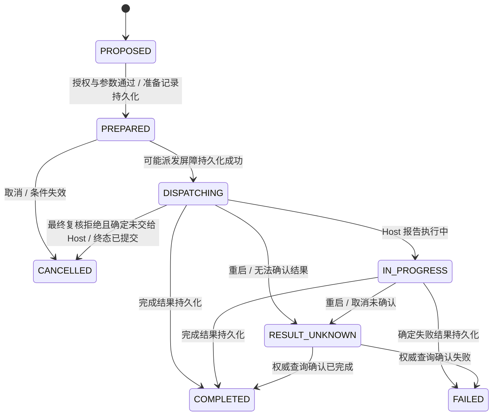

# Ayni：通用原生 AgentOS 基础能力与实验实施计划

> **文档性质**：工程实施计划与待实现契约，不代表已有软件能力。\
> **文档版本**：v1.118 · 2026-11-15；保留文件名 `ayni_v1.0.md`。文档版本与产品 v0.1 / v0.2 分开；本版并入的设计决策见 `docs/adr/`。\
> **产品定位**：跨平台、跨设备的通用原生 AgentOS；宿主与扩展决定提供哪些设备或软件能力，统一助理只是应用示例。\
> **架构路线**：按 Ayni 的共享 Agent 状态、授权、资源及恢复需求设计原生 Core，复用宿主 OS，模型优先通过外部 API 获得；架构图仅参考 AIOS 的分层分组表达样式。\
> **实施顺序**：先完成基础通用能力，再开展 ESP32-S3、Linux 系统等实验；设备与能力组合按实验目标选取，不要求宿主具备语音、视觉、运动或特定外设。\
> **基准投入**：单人全职；阶段周期是相对工作量估算，不是开工日期或交付日期承诺。\
> **当前状态**：通用基础与独立源码SDK已交付；历史证据见[基础报告](../reports/core/foundation-acceptance.md)和[独立接入报告](../reports/core/independent-consumption.md)。本轮按已定计划实施共享正文、异步对话和连续派发提交，升级ABI0.55/schema10，见[ADR-0104](adr/0104-shared-conversation-bodies-and-dispatch-prefix.md)。独立审查修复、正常关闭重开、完整CI和ESP编译已通过，已随[#137](https://github.com/RobotSe7en/ayni/pull/137)合并main；用户已暂缓板端验证，未部署、未擦旧卷，交接P95≤100 ms仍待实测。新格式异常恢复、完整128K峰值、60秒动作及独立硬件停止链保持未验证。

> **本轮范围**：用户2026-10-31要求实施[独立工程接入与验收计划](architecture/independent-consumption-plan.md)：通用源码SDK、低栈工作区、Native/ESP存储及Host、共同应用和验收。平台适配保持独立目录，必要接口直接升级，正常存储和最小重开获授权；实机操作、付费模型及其他新专项不启动。

> **计划入口**：[基础能力实施与实验计划](architecture/foundation-and-experiment-plan.md)统一记录现行工作包顺序、缺口、完成条件及实验进入条件；[通用能力架构计划](architecture/capability-centered-agentos-plan.md)与[发现、适配及代码处置计划](architecture/capability-discovery-and-adapters.md)继续描述机制与迁移边界。历史 MA 编号、已交付实现和实验结果保留；旧轮式设备试用路线不再作为通用 AgentOS 的必经发布链。

## 0. 执行摘要与已确定决策

Ayni 的 Core 是多个 Agent 共用的系统基础设施：每个部署运行一份 Kernel，持有 Agent 实例、持续目标、任务、授权、动作记录、资源和记忆的逻辑状态。规则、Tool Loop 或未来规划器通过系统接口工作；模型提供解释和建议，本机 Kernel 决定是否接受任务、如何分配资源，以及动作能否执行。外部模型服务不拥有任务、记忆或硬件执行权。

“AgentOS”在本项目中的工程标准是：这些服务由应用共同使用、生命周期由系统管理、规则在声明的信任边界内能够强制执行，并有契约测试证明。当前实现的边界是可信内置代码经受管理入口执行；不能据此声称任意原生代码无法绕过权限。纯软件能力部署也是有效的目标形态，不要求构造物理设备或机器人。

| 决策项 | 确定方案 | 边界 |
|---|---|---|
| 产品 | 通用原生 AgentOS；提供多个 Agent 共用的工作、授权、资源、记忆与恢复机制 | 助理、机器人等属于上层应用或实验组合，不规定所有宿主必须提供的设备与业务 |
| 实施顺序 | 基础通用能力建设与验收 → ESP32-S3、Linux 系统等实验 | 日常 Native/Sim 开发验证持续运行；后续平台实验互不作为前置 |
| 能力接入 | 版本化公开契约、说明、Provider 与 Binding；当前可信配置期注册 | 软件与硬件能力同样接入；不要求动态加载，不执行任意第三方代码 |
| 内核与宿主 | 可移植 C++17 Core、C99 API 与 C++ 封装；Host 提供系统基础服务 | 复用宿主 OS，保持单逻辑状态所有者、有界 step 和异步 I/O |
| Agent 身份 | 同一逻辑身份可在不同部署驻留，各实例独立 | 不隐含共享权限、记忆同步、任务转移或远程执行 |
| 授权与输入 | 可信主体、显式 Grant/Scope、审批与撤销；模型仅提出建议 | 声音、设备标签和自然语言说明都不是身份或权限凭据 |
| 执行生命周期 | unary/action/subscription、取消、超时、完成、恢复及未知结果 | 业务成功、取消受理和副作用事实分别表达；RESULT_UNKNOWN 不盲目重试 |
| 物理执行扩展 | 声明受管理物理执行能力时，遵守执行许可、联锁、隔离和真实停止契约 | 不要求纯软件部署装配电机或硬件停止链；已有物理保证不因规划重排而降低 |
| 模型与策略 | 通过 Provider 和策略接口替换，推理可使用外部 API | 不强制本机大模型、某一厂商或视觉/ASR/TTS 模态 |
| 记忆与上下文 | 默认私有、显式共享、来源与删除依赖、容量有界 | 助理公共档案是应用用法，不要求所有部署具备同一业务界面 |
| 具体能力与适配 | 语音、视觉、运动、MCP、ROS、MHS、peer 按需求选择 | 各自验证；不阻断基础通用能力完成，也不互相推定支持 |
| 实验证据 | ESP32-S3、Linux 等各自选择能力组合并报告资源、生命周期和契约结果 | 无特定外设也可开展实验；硬件成本、物理停止、长稳仅约束声明的实验范围 |

**完成定义**：某项能力只有在附有构建、运行和对应验收证据后才标记“已实现”；某个平台只有通过相应功能及恢复测试才标记“已验证”。源码可编译、模拟器通过、实机通过、长稳通过分别记录。

## 1. 产品范围与版本边界

### 1.1 基础通用能力交付范围

Ayni 的基础交付面向宿主和能力扩展开发者：在公开接口上注册能力、创建与推进 Agent 工作、实施权限和资源约束、读取结果及处理取消与恢复。完成条件不依赖某一块板、某类设备、统一助理界面或消费者试用。原计划将 v0.1 与轮式助理试用绑定的范围由 ADR-0083 调整；正式产品版本号、发布时点和实验组合另行确定。

| 基础能力 | 目标行为 | 完成证据 |
|---|---|---|
| 生命周期与工作 | Kernel、Agent、Goal、Task、步骤、触发、暂停与取消有明确归属和状态 | 现有 M1 契约证据及新增变更的相关验证 |
| 能力契约 | 有界 typed 输入/结果、单位、默认值、版本和授权投影一致 | AP-02；模型、C API、持久记录和执行使用同一规范请求 |
| 注册与发现 | 可信配置采纳，按主体/Task 约束发现、分页和选择工具 | AP-03；目录可大于单轮工具窗口，发现不扩权 |
| 多实例绑定 | 同能力的不同实现/端点可明确选择，旧调用不重绑 | AP-04 先分析双实例证据，仅在必要时演进契约 |
| 调用与事件 | unary/action/subscription、长操作与事件流有界且可取消 | AP-05；纯软件作业和事件流即可提供夹具 |
| 授权与资源 | 主体、Grant、撤销、容量、租期、公平性和背压保持一致 | 已有不变量与变更后公开契约测试，不假定物理设备存在 |
| 持久与记忆 | 持久接受、屏障、幂等、未知结果、私有性和删除依赖 | 现有 E2/E4 等证据与变更影响对应；未验证范围明确列出 |
| SDK 与扩展复用 | 通过公开 C/C++ 接口新增能力或更换同语义实现 | AP-06；通用应用编排与 Host/Provider 装配边界清楚 |

详细执行顺序、消费者清单和基础验收见[现行计划](architecture/foundation-and-experiment-plan.md)。已有机制不重复造一套；部分完成与完整通过分别记录，未解决的必需契约缺口不得记为基础完成。

### 1.2 基础范围与可选实验边界

基础能力不要求语音、视觉、运动、屏幕、实体按键或任何特定设备，也不要求 ROS、MCP、MHS、远程 peer、网页产品或某一助理工作流。Host 的时钟、异步存储等系统基础按实际契约提供；普通软件能力不应为接入而伪造设备树。

通用取消、超时、撤权、关闭、资源释放与未知副作用处理仍是系统机制。硬件许可、急停、失能和物理停止确认仅对声明相应物理执行能力的部署适用，适用时保持原保证。现有执行许可和停止链代码、契约及测试不因本次规划而删除或弱化。

跨平台实验在基础验收之后按目标选取；ESP32-S3 不要求凑齐相机、音频和底盘，Linux 不要求先完成 ESP32 或 ROS。可选具身 Profile、协议适配、媒体和机器人实验分别满足其接口、版本、资源及实际效果的证据条件。重写 RTOS、任意原生代码强隔离、完整分布式一致性、自动任务接管等仍不在基础交付范围。

### 1.3 设备与可行性假设

下表仅保留原 ESP32-S3/轮式实验的条件与资料，不构成基础通用能力的依赖或所有宿主的最低配置。实验实际采用哪些项目，在基础验收后按目标确定；未选的设备不必采购、装配或验收。

| 假设 | 验证与处置 |
|---|---|
| 现有板型是 ESP32-S3 N16R8 | M0 保存板型照片/资料、启动日志、实测 Flash/PSRAM、GPIO 与启动引脚表 |
| 摄像头、麦克风、扬声器、底盘可共同接入 | 同时审查引脚、I²S/摄像头接口、DMA、供电、内部 RAM、PSRAM、无线和 OTA 容量；不能按单模块成功推定并发可用 |
| 新增硬件接近 300 元目标 | M0 给出候选 BOM 与价格证据，M3 记录实际采购及实测；超出目标时带原因与选项告知用户 |
| 模型需要外网 | Wi-Fi STA 优先；设备 AP 用于初始配网，不能假定 AP 自身有互联网 |
| 试用者使用家庭局域网 | 明确局域网访问、认证和通知限制；不对公网开放设备管理入口 |
| 后续兼容国产软硬件 | M6 按真实工具链/设备推进，不把规划平台写成已经支持 |

## 2. Core 架构与内核原语

### 2.0 Ayni 架构分层与依赖


图中的模块与边界由本计划的 Ayni 需求确定；图内语音/视觉、执行器和停止链表示可选能力组合，仅在相应部署启用时适用；仅参考 [AIOS 架构图](https://github.com/agiresearch/AIOS#-architecture-of-aios)的分层、分组和连接表达，不采用上游架构作为约束，也不表示复用其实现或继承其能力。

| Ayni 层次 | 职责 | 边界 |
|---|---|---|
| 用户与应用 | 部署选定的入口、应用、目标类型、场景与通知规则；助理与语音是可选示例 | 用户身份来自认证入口，应用通过意图工作 |
| 策略与 SDK | 规则、Tool Loop、有界 Skill；C99 API 与 C++ 封装 | 只读快照、有类型命令/查询/事件，不直接改变 Core 状态 |
| 共享 Kernel | 实例、目标、任务、授权、调用、动作、资源、运行限制、记忆和恢复 | 每设备单逻辑 owner；所有跨服务变更经提交协调器 |
| 异步执行与平台服务 | Host 提供 Kernel 维护自身不变量所用的时钟、持久存储、网络、加密与生命周期，不经 Agent Grant/运行限制准入；Provider 实现 Agent 经逻辑调用使用的模型、感知、媒体、检索及动作能力，经准入、运行限制与绑定 | I/O 不阻塞 step；控制类完成按受理时预留的容量回送 |
| 物理执行部署的本地控制与停止 | 声明相应能力时，控制器在已准入的过程或会话包络内、凭有效许可执行；停止监督器与硬件失能链 | 执行端只能收紧：校验许可、限值与持续联锁，不扩大包络或授予权限；停止不依赖模型、普通队列或网页在线 |
| 可选具身契约与外部适配 | Profile 约束现有 Observation/Capability/Binding；ROS 2 Bridge、未来 MHS 适配器复用受管理入口 | 可选域约束不另造 Kernel；ROS/DDS/tf2/运动规划与控制器实现留在 Core 外；适配器以权限受限的进程运行 |
| 宿主 OS 与硬件 | 实际部署的 OS、系统服务及可选驱动、传感器、执行器 | 仅对接入物理执行能力的部署，按实际停止链依赖测量时钟、中断、内存与硬件超时（第 4.1 节） |

Core 按不变量属主分为八个模块，采用两级目录：第一级是模块边界，第二级按实体命名以便查找（第 2.3 节、ADR-0008）。依赖方向为 `kernel → work → {authority, resources, knowledge} → catalog → durability → foundation`；`authority`、`resources`、`knowledge` 之间不互相依赖，跨模块修改由 `kernel` 在同一 transition 中编排并经同一提交协调。`durability` 只提供持久前缀、快照、已提交批次重放与迁移等机制；恢复顺序与领域恢复规则由 `kernel` 按各模块规则编排，底层模块不反向依赖领域模块。应用和 Provider 依赖公开契约，Core 不依赖具体应用、SDK 便捷层、外部协议 SDK 或平台头文件。`knowledge` 保留记忆与上下文的归属、访问、依赖和预算机制；提示词、摘要、排序、业务规划及模型偏好在上层或 Provider。

Ayni 自主定义设备能力模型与安全执行机制，领域契约是系统权威；设备发现由 Host/适配器完成，候选描述经可信注册后进入 Core 目录。ROS 2、MHS、MCP 都是外部互操作体系，与 Ayni 的关系是版本化映射和明确声明的支持子集，不宣称结构等同；其字段和传输版本变化优先在适配层消化，不反向规定 Kernel 对象或执行权。若外部需求新增控制、资源或恢复语义，则通过领域版本、ADR、迁移和验收演进，不能承诺核心永久无需变化，也不能为了兼容削弱本机保证。

通用能力自描述、发现及调用的后续候选边界见[架构演进计划](architecture/capability-centered-agentos-plan.md)。能力提供者负责设备驱动/软件实现，Ayni 复用现有治理机制；详细计划中的新 Schema、工具窗口和有效 Binding 规则仍为提议，不替代本节已接受边界。

### 2.1 运行原则与 Core 的深度

每个部署只有一份 Kernel 逻辑状态源；可以有多个实例和多条异步 I/O 工作线程，但不能同时直接修改 Core 对象。`step` 按工作项和耗时预算推进，不等待网络、Flash、模型或设备操作。Host、Provider 与策略只提交事件/意图，Kernel 完成校验与状态转换；异步持久化未确认前不得报告“已持久接受”，对外输出按第 2.8 节门控。

Core 包含设备和资源的**身份、目录、描述、状态、授权及协调**。具体寄存器、采样、图像筛选、音频编解码、TLS、文件系统和电机闭环实现留在 Host/Provider。OS 调度任务线程；Kernel 调度 Agent 工作与资源准入。高频采集不逐帧进入普通控制队列，使用受限媒体缓冲与观察描述。各部分按时间尺度分开：Agent 与模型以秒计，Kernel 准入以毫秒至秒计，本地控制按控制周期执行，停止链上限由硬件超时与实测决定；慢路径不进入快环路，Kernel 不在实时控制环路上。

### 2.2 原语规范

下表中的持久化是规范要求；M0 固化最小字段、状态与提交不变量，M1 以可执行 fixtures 收敛 experimental 编码。稳定 ID 不复用，修改带版本；物理句柄、指针、资源锁和单调时钟值不跨重启恢复为可用对象。

| 原语 | 归属与生命周期 | 授权 | 持久化与恢复规则 |
|---|---|---|---|
| **AgentInstance** | `agent_id` 是逻辑身份，`instance_id` 是驻留实例，绑定 `device_id`；Kernel 管理启动、暂停、恢复、停止和资源归属 | 实例绑定角色与 Grant，不凭身份相同继承其他设备权限 | 保存身份、绑定、策略配置和状态；重启产生新 `boot_epoch`，旧请求不能继续修改状态；暂停实例不删除记忆 |
| **Goal / Task** | Goal 表示持续目标；Task 是一次有界执行。记录创建者、触发源、owner 实例/设备、完成条件、运行限制、取消与期限；Session 仅为交互入口 | 创建 Goal、派生 Task 与执行动作分别检查；派生工作只能缩小既有授权并遵守运行限制 | 保存目标、任务、触发游标、版本、检查点和结果；任务固定归属，失联不接管；恢复后重新检查时间、授权和条件 |
| **Observation** | 测量或解释的来源、采集时间、时钟可信度、有效期、质量、媒体引用及关联观察；测量值与模型推断分开标记 | 采集、订阅、上传、长期保存分开授权；感知订阅也占资源并受运行限制 | Task 订阅默认30秒、半租期自动复核续租；分析后等待新样本/状态，忙时只用最新值。原始媒体引用默认短期有效，不在重启后假装仍可访问；授权事件/事实/摘要可持久化，过期观察不可支持新动作 |
| **Device / Component / Resource** | Device 为宿主身份；Component 描述设备结构（传感器、轮、电机等）；Resource 是准入单位，描述容量、共享/独占、冲突域、健康与租期，可为模型槽等非物理资源。Component 与 Resource 不一一对应，经 Binding 关联；带 `authority_epoch` 的执行器 Resource 称**控制域**，任一时刻只有一个 authority-owner Kernel | 注册来自可信 Host；访问经能力声明与 Grant，应用不能伪造系统资源；发现到的描述只是候选 | 保存可信目录配置和历史；在线状态、占用与本地句柄重新探测，重启释放旧占用，执行器保持禁用；控制域的 `authority_epoch` 由 owner 与执行端分别持久化 |
| **Capability / Grant** | 能力规定类型化输入输出、副作用、资源、时限和恢复行为；Grant 绑定主体、目标、范围、期限、撤销版本及委派限制 | 默认拒绝；委派只能收窄且保留上级撤销链；参数、前置条件与外发范围均由设备检查 | 保存能力契约版本及授权记录；恢复、排队后、派发前再次校验；无法证明期限有效的时限授权不自动启用 |
| **ActionRecord** | 每次外部影响有稳定 `operation_id`，关联实例、任务、能力版本、授权、参数摘要、派发尝试与结果 | 授权绑定参数/场景和操作，不能用批准其他动作的结果替代 | 记录持久准备、可能派发、执行完成和结果落盘；不确定进入 `RESULT_UNKNOWN`，查询或人工处理；不通用承诺恰好执行一次 |
| **MemoryRecord** | 默认归属逻辑 Agent 的私有命名空间，实例写入受控；含来源、版本、可见范围、删除标记和决策引用 | 私有读取、写入、共享和外发分别授权；共享不意味着共享整个私有库 | 本机保存版本与删除状态；同一身份跨设备副本不自动合并；删除后不可进入新上下文，旧审计仅留必要引用与脱敏元信息 |
| **TaskRuntimeLimits** | 每 Task 模型调用次数、单次超时、输入/输出大小、后台频率；并发槽归资源模块 | 所有者管理命令可提高软上限；模型不能提高；不得超过启动硬容量 | 调用计数与限制暂停持久保存；普通恢复不清零，保留步骤/检查点。无累计金额、预留或费用结算 |
| **UserPrincipal / Session** | 所有者为授权根；Session 绑定认证主体、输入渠道和信任级别，不拥有持续任务 | 语音仅提出已有权限内的工作；敏感命令携带已绑定管理端的认证证据 | 保存所有权及绑定版本；会话凭据按 Host 规则重建，重启不复用已失效身份凭据 |
| **LogicalCall / ProviderBinding / Subscription** | 逻辑调用独立于 I/O 尝试；绑定能力版本、端点、资源和 Provider；订阅有独立代际与租期 | 每个语义步骤检查权限、参数、资源、运行限制和数据目的地 | 保存步骤调用身份及必要绑定；重启重建 I/O 和订阅，未知副作用不转移实现或自动重做 |
| **ControlSession / ExecutionPermit** | 过程或会话是越过派发屏障的一次有界执行；许可由控制域 owner 签发，绑定会话、控制域、模式、包络摘要及各代际，按短租约续期 | 静态准入在 Kernel，执行期间的联锁与许可校验在执行端；许可只能收紧既有授权 | 许可不跨 Kernel/执行端启动代际或急停复位继续有效；结束后资源保持隔离直到停止确认；规则见第 2.10 节 |

Observation 的 TTL、动作 deadline 在本机采用单调时间执行；跨设备只能传相对限时及可信时间信息，不能比较两台机器的 monotonic 值。绝对时间不可用时，日历提醒进入待校时状态；过期处理按目标的补发一次、汇总或跳过策略执行。

`MA-006` 的授权范围采用可信注册的固定扁平字段：有符号整数等值/闭区间、枚举或标识符等值/有限集合，以及执行目标/外发目的地的精确标识符集合。字段之间取合取，集合排序去重；未知字段、空集合、类型/单位不符拒绝。省略约束只表示该字段已注册取值域的全范围，实际请求缺必要字段仍拒绝。B 的具体字段类型为 I64、ENUM、IDENTIFIER，后两者为不同类型的有限 CatalogId 文本集合；I64 显式声明整数单位，其他两种单位为空，Core 只精确匹配、不隐式换算。执行目标和外发目的地各至多一个 IDENTIFIER 字段，共占每能力 8 字段的限额。Scope 省略字段按全域补齐，但实际请求必须恰好提供全部已声明授权字段且每项为单值；业务可选参数不纳入此授权 schema（ADR-0029，B 已实现并验证，#26 已合并）。一项需求须由一条完整 Grant 覆盖，不拼接扩权；优先 Goal 专属 Grant，再选实例通用 Grant，同级按 ID 决定。委派沿完整父链收窄范围、期限与再委派权限；Grant 续期或扩权新建 ID，已撤销对象不可复活（ADR-0028～0031，C 已合并 #27，D 已实现并完成验证、已由 #28 合并，E/F 尚未交付）。

授权期限分为明确的长期授权与当前 `boot_epoch` 内的限时授权，限时从接受时开始且重载/重启不续期。默认 Capability/Grant 容量为 16/32，每 Goal 至多 4 项需求，每项规范编码至多 256 B，委派深度 4；可配置范围分别为 1–256、1–1024、1–16、64–4096 B、1–16。每能力最多 8 个授权字段、每集合最多 8 个成员；全来自调用方有界内存，容量不足明确拒绝，ESP32 预算须实测。完整注册域也须适配范围规范字节上限，防止接受后无法表达省略约束的全域；字段数、成员数与字节上限同时生效，默认 256 B 不保证容纳所有最大组合（ADR-0029）。表满仅回收永久失效且无子 Grant、活工作或 Gate 引用的叶节点，按终态提交顺序、再按 ID 选择，日志固定替代对象，不在重放时重选。

C 的 Grant 管理沿用统一意图入口：根创建或受限委派要求绑定所有者的管理端 Session 和非零命令 ID；root 的 expected_revision 为 0，child 校验 parent 当前 revision。新 Grant 持久前不得使用或继续委派，未持久父返回 BUSY/GRANT_NOT_DURABLE。委派深度按边数，根为 0，完整父链的范围、期限和再委派权限只能收窄。每 Grant 保存创建时完整 Capability 域与补全后的范围；当前 exact ID/version 的完整域改变时只作恢复 hold，不重释旧权限或因此回收。查询使用 caller-owned 的固定 typed 输出，按 index 复制字段，不返回内部指针（ADR-0030，C 最终五配置各784/784、本地独立验证及代码CI通过，已合并 #27（`b133032`））。

限时 Grant 的 duration 可以持久，创建 boot 从 ID 得到；绝对 deadline 只在当前 boot 内存中使用，日志与快照均不保存 monotonic 时刻。恢复的限时 Grant 直接失效，不能沿 Goal 的计时规则从恢复时刻重新开始。到期即时拒绝，安全回收则须等待明确终态持久，按终态提交序号再按 ID 选无保留子引用的叶节点。授权命令保存不依赖当前目录的原始规范请求，保留字段省略、排序去重并逐字节比较；FNV 只作索引，旧目录/主体/父失效后仍先返回已映射的原结果（ADR-0030）。

D 的撤销首次接受要求管理端 Session 与正确目标 revision，接受后不再依赖旧 Session/CAS。先在 caller arena 的 GrantTable 安装易失 Gate、在 CommandTable 保留完整16 B canonical/pending，再等待存储；祖先 Gate 同样拒绝后代。PENDING 的 effect=NONE、target revision/seq/boot均0；APPLIED 标明本boot/seq；DURABLE 只确认原根拒绝或明确 NO_CHANGE/TARGET_GONE，不能代表全部后代清理或物理停止。所有 kind 先查 pending，再查唯一窗口/floor；APPLIED结果在持久移交前pin，自动reload保留Gate/pending并清旧queued stamp，不能用新boot水位确认旧请求。快照冻结期间只接受易失控制，不改分页模型；DRAINING只在writer有效时排空控制，失败恢复后的关闭不应用新事实；进程断电仅承诺已持久事实（ADR-0031，Native 场景已通过；五配置各892/892及代码CI通过；35项有效变异闭环通过，已由 #28 合并）。

清理按固定 through 与单调 after 有界推进，后代状态与根cursor同批，独立 cleanup_stamp 不改首次终态回收顺序。回收须等待终态及最新清理持久、清理完成且无保留child/Gate/pending引用；活工作依赖随 E/F。D 发布独立type15/16记录、14/v2、9/v3及snapshot13/v2，兼容C的旧版本；不持久Gate、pending、pin或deadline。Native内存两轮实测较C增加4,272/544 B；栈与最坏step时长仍待实测。

所有者绑定由 Host 认证后提供，Core 持久保存原 principal 与 `binding_revision`，与本次配置失配时在恢复写入前进入只读受限。无 `OWNER_BINDING` 的旧存储先核对全部保留 `USER` Goal 的来源主体/revision 及命令映射主体；任一冲突在新恢复写入前受限，现存证据全一致或完全无证据才采用可信 Host 首次绑定。已有绑定以绑定为权威，不用历史来源覆盖；首次建立绑定不向既有工作授予权限；恢复的活 Goal/Task 缺授权元数据时以独立 `LEGACY_UNCONFIRMED` 原因禁行，保留进度、检查点及其他暂停原因，普通恢复不能解除（ADR-0028 A）。完整转移、解绑与旧主体命令窗口清理随 `MA-028`。

### 2.3 多个 Agent 共用的系统服务

| 系统服务 / 建议目录 | Core 负责 | Host、Provider 或应用负责 |
|---|---|---|
| 编排与入口 `kernel/` | Kernel 生命周期、step、事件入口（有界队列、合并、路由）与完成槽；受管入口（解码 → 校验 → 分派）与命令幂等映射；跨模块编排、恢复编排、输出门控；诊断的脱敏与导出 | ISR 安全桥接、线程唤醒，不从 ISR 调用普通 API；日志出口与性能测量 |
| 执行 `work/`：`agent/`、`goal/`、`task/`、`call/`、`action/`、`session/`、`subscription/` | AgentInstance 注册、生命周期、隔离命名空间、停止与回收；Goal/Task 的接受、调度、触发去重、暂停取消、检查点与归属；步骤、LogicalCall 与请求尝试（request ID、boot epoch、超时、取消、晚到结果）；ActionRecord 与派发屏障；过程、控制会话与订阅（代际、租期、序号、gap）的生命周期 | 实例角色与助理呈现；提醒等目标类型、完成判定和规划策略；非阻塞 I/O、结果验证、取消尝试与流传输 |
| 授权 `authority/`：`principal/`、`scope/`、`grant/`、`scene/` | 主体、节点与实例身份及其绑定证据；Session 信任级别；有限范围规范化/覆盖及实际请求完整性；Grant、撤销与受限委派、审批绑定；Scene 授权；包络静态准入判定 | 认证凭据存储与传输；本地执行、物理限值、持续联锁与独立停止机制 |
| 资源 `resources/`：`admission/`、`lease/`、`permit/` | 资源准入（全有或全无）、排队、冲突、公平与饥饿监测；租期与隔离；执行许可的签发、续租与失效；设备在线、占用与健康等运行时状态 | 设备健康探测的具体实现 |
| 运行限制 `work/task/` | Task 调用计数与限制暂停；所有者显式提高软上限；与资源准入同批检查 | Provider 的输入/输出与超时限制，可信应用配置后台频率；无费用钱包 |
| 知识 `knowledge/`：`observation/`、`memory/`、`context/`、`lineage/` | Observation 的来源、采集时间与有效期；私有/共享记忆的范围与版本；上下文预算；lineage、tombstone 与依赖失效 | 感知算法、模型解释、可选检索 Provider |
| 目录 `catalog/`：`device/`、`capability/`、`binding/`、`goal_type/`、`strategy/` | 设备、组件、资源、能力（Schema、副作用与恢复属性）、Binding、目标类型与策略的版本化描述与选择约束；可信注册；兼容矩阵；注册的纯函数校验器 | 发现硬件、采集/驱动，生成候选描述 |
| 持久 `durability/` | 持久前缀、日志/快照、已提交批次重放、迁移机制；不含领域恢复策略 | 存储原子性/flush 能力 |
| 基础 `foundation/` | ID、时间、状态码与原因、有界容器、通用代际栅栏、trace 记录类型与注入式 sink | — |

上表每行是对应不变量的唯一属主；跨模块状态转换由 `kernel/` 在同一 transition 中编排，模块之间不修改彼此的内部状态。资源与任务运行限制的联合准入由 `kernel/` 在同一 transition 中先判定、后应用。第二级子目录按实体命名以便查找，子目录之间的单向 include 规则在模块内声明并检查；`kernel/`、`durability/`、`foundation/` 职责集中，不再细分子目录。设备与能力的描述同在 `catalog/`，因为 Binding 同时引用二者、注册时须交叉核对且共用一个兼容矩阵；它们的运行时状态分属 `resources/`（在线、占用、租期、许可）、`authority/`（Grant）与 `work/`（调用实例）。

资源按 Capability 声明由系统自动申请、协调和释放，Agent 不直接持有驱动锁。资源组采用全有或全无准入，避免部分占用互相等待；首版不强制抢占不可中断的物理动作，采用排队、超时或可取消操作释放。优先级次序为本地停止路径、前台交互/已到期提醒、普通工作、后台反思；同级按 Agent 实例轮转、实例内 FIFO，并记录最长等待时间。每类工作声明等待期限及超限后的延后、过期或暂停原因；后台反思允许不运行，但不能保持无原因的永久等待。模型占用槽期间其他本地工作继续推进，优先级不意味着可以中断既有物理副作用。

媒体采集可用有期限的系统订阅占用资源，不能永久持锁。播放与录音是否互斥由音频资源组声明；视觉分析占模型槽但不必长期占摄像头。完成、失败、取消、超时和实例停止均需释放资源；对尚未确认已停止的执行器保留隔离状态，不提前分配给下一请求。

### 2.4 生命周期与执行状态分开

| 对象 | 状态与关键转换 |
|---|---|
| AgentInstance | `REGISTERED → STARTING → RUNNING ↔ PAUSED → STOPPING → STOPPED`；初始化/检查点不兼容进入 `FAULTED` 或有原因的暂停；结束一次任务不结束实例 |
| Goal | `PROPOSED → ACTIVE ↔ PAUSED → SATISFIED / CANCELLED / EXPIRED / FAILED`；需确认时停留待授权，不生成可执行工作；持续目标可多次产生 Task |
| Task | `READY ↔ RUNNING → COMPLETED`；也可 `PAUSED / CANCELLED / FAILED / EXPIRED`；异步取消未完成时为 `CANCELLING`。等待模型、资源、审批或动作是由待决调用集合派生的 `blocked_on` 视图，可同时存在多项，不写入生命周期枚举；是否已持久接受由提交序号表达 |
| ActionRecord | `PROPOSED → PREPARED → DISPATCHING → IN_PROGRESS → COMPLETED / FAILED`；未派发可 `REJECTED / CANCELLED`，越过可能派发边界而无法确定结果进入 `RESULT_UNKNOWN` |

接受某个对象的 transition 在 `durable_seq` 覆盖它之前只存在于未持久的内存状态；查询可见但须标注 `durable_seq`，只有覆盖后才报告“已持久接受”（第 2.8 节）。`PREPARED` 表示已保存意图且尚未进入可能派发；**必须先持久化 `DISPATCHING` 屏障，再允许 Host 发出具有副作用的请求**。屏障写失败则禁止派发。



图中省略审批等拒绝分支，不得把 `RESULT_UNKNOWN` 当作普通失败自动重试。恢复日志只重建状态，不能直接重放硬件动作；恢复目标也不恢复旧运动命令。取消请求、停止指令已送达、物理输出已停止是三种事实，必须分别表达。

运行终态与副作用结果分开：取消或失败仍可能已有部分影响，结果必须列出已完成步骤、未执行步骤及未知步骤；不能用 `CANCELLED` 推导“没有发生影响”。撤销的意图回执区分 `PENDING`（已建立拒绝栅栏并保留请求，尚无有效提交序号）、`APPLIED`（已应用并入日志）和 `DURABLE`（已确认持久），并携带提交所属 boot；不能用新 boot 的持久水位判断旧未持久序号。取消/停止进度另报 `CANCELLING` 与 `STOP_CONFIRMED`，只有后者可证明本地物理停止。持久撤销提交前先用内存拒绝栅栏阻止新的派发并停止续租相关执行许可，撤销消息传播失败时执行端最迟在撤销时刻起一个完整租期后收敛（第 2.10 节）；写失败保持受限并报告，重启无法证明授权有效时不自动开放动作。`PENDING` 只保证本 Kernel 及其自动重载中持续拒绝，进程断电前未到 `DURABLE` 不承诺跨重启保存。待决撤销不依赖旧 Session，幂等窗口推进不能遗忘它；快照期间拒绝覆盖不得改写分页中的持久模型。撤销/失效保留工作与检查点，独立授权暂停解除须显式重新准入，新 Grant 不自动恢复，也不解除其他失败或不兼容原因（ADR-0028、0031，D 的 Gate/回执/Grant 清理已实现并通过 Native 场景，工作暂停与显式恢复待 E/F）。

| 操作 | Goal / Task / Request 的传播 | 采集、执行器与恢复 |
|---|---|---|
| 暂停助理 | 应用协调器暂停自主观察、反思和运动所属目标的新工作，保留已设提醒及其他明确用户工作 | 取消相关订阅和可取消请求，收敛在途运动；恢复时重新准入，不续跑旧运动 |
| 暂停单个 Goal | 保留目标与检查点，停止产生新 Task；在途 Task 按该类型的暂停点收敛 | 无法立即暂停时显示暂停中，不宣称已停止 |
| 取消 Goal / Task | 标记取消版本，禁止新增派生步骤；传播到所属在途请求，等待取消结果或记录未知 | 已完成影响保留事实；补偿是另一个需授权的操作，不自动回滚物理世界 |
| 关闭观察 | 终止相应后台观察目标及订阅，停止采集、上传与新分析；用户日后的独立抓拍需新调用 | 旧代事件拒绝进入上下文；可取消的分析请求取消，已外发数据遵守保留说明 |
| 暂停 / 停止实例 | 暂停阻止该实例新增工作并到兼容检查点；停止收敛全部所属工作并回收资源 | 直接暂停提醒所属实例会使其暂停；用户的“暂停助理”不能映射为暂停全部实例 |
| 紧急停止 | 独立本地入口立即禁止运动准入，再向 Core 报告；不取消提醒或删除目标 | 保持电机禁用，直到故障清除且所有者显式恢复；暂停解除不自动解除停止锁存；复位使 `safety_epoch` 递增，旧执行许可永久失效，恢复运动须重新准入 |

### 2.5 策略与信任边界

规则策略、Tool Loop 和未来规划器注册于 `strategies/`，消费任务快照/观察，提交目标建议、模型请求、动作意图或完成结果。Kernel 校验所有意图，策略不能修改内部对象、绕过资源入口、提升权限或自行恢复未知动作。策略回调同样有工作量限制；复杂计算放异步 Provider。

策略与 GoalType 的接口是有界决策函数：Kernel 在 step 内以只读快照和策略私有检查点调用它，回调返回有界意图集合与新的私有检查点，回调内不得调用 Kernel API、执行 I/O 或阻塞（唯一例外是 ToolLoop 可选的非阻塞时钟端口，只改变模型请求正文，ADR-0073）。Tool Loop 的模型调用以返回的模型请求意图表达，结果出现在后续快照中。该形态服务于确定性重放与策略替换，不是安全边界。

信任按两条轴区分：**输出可信度**与**代码可信度**。模型、VLA、外部消息、发现到的设备描述和 MHS 参考文件都是不可信数据，只能作为意图或候选描述经 Kernel 校验，执行端再校验许可。v0.x 固件与 Kernel 进程内的策略、GoalType、Provider、Driver 和控制器都是可信内置 C/C++；纯函数接口不能阻止原生代码越权访存、直接 I/O 或无限循环。权限保证仅覆盖受管理入口；任意原生代码直接访问 GPIO、内存或网络时，ESP32 首版不提供强进程隔离。

ROS 2、MHS、MCP 等适配器在 Full Profile 宿主上以独立进程运行；进程边界只提供地址空间与崩溃隔离，设备、文件、凭据、网络及 IPC 权限须另行限制：适配器使用独立系统账户，不能访问执行器设备节点与凭据库，只经带自身主体身份的本地 IPC 连接 Kernel；ROS 侧启用 SROS2 严格模式，适配器只能向执行端的许可门发布，控制器命令接口仅由许可门写入。无论指令来源，执行端拒绝缺少有效许可的指令，这是“无法旁路受管入口”的最后防线；进程隔离是纵深防御。第三方原生代码与 MHS 代码文件不进入固件，只有可转换为有界 Procedure 数据的子集可经校验接入。未来第三方扩展需单独选择进程、OS 权限或受限执行环境，并声明平台隔离等级。

### 2.6 部署 Profile

| Profile | 语义和容量 | 状态 |
|---|---|---|
| `CORE_LITE` | ESP32 使用；完整任务、授权、动作和恢复语义，容量与可选检索受限 | M2 待实现/验证 |
| `CORE_FULL` | 桌面使用；同一 Core，更多容量、存储和检索 Provider | M1 最小实现；扩展后续 |
| `DEVICE_NODE_C` | 无 Kernel 的受控设备端点；实现身份、设备模型与受控调用协议，并在本地强制限值、执行许可与停止；其控制域由唯一 authority-owner Kernel 治理，换主、分区与端点重启均使旧许可失效 | M6 待评估，不称为独立 Agent 实例或授权决策者 |

部署 Profile 与领域契约 Profile 分开：`EMBODIMENT_V1` 是第 2.9 节的可选类型/行为约束，可由 Lite 或 Full 按声明的特性实现；不意味着额外内核运行时或默认启用 ROS。第 2.10 节的执行许可与运动结果阶段是受管理物理执行能力适用的基础契约，不随具身 Profile 启用与否改变；不要求未声明这类能力的部署装配执行器。各部署 Profile 由组合根 `runtime/` 装配：它是部署选择与跨组件装配的唯一位置，可执行程序与固件只调用它；各 Host、Provider 与适配器可以在内部封装自身的平台实现（第 8 节、ADR-0010）。未支持的类型、控制模式及必需特性显式拒绝，不静默降级。

### 2.7 函数层级、能力绑定与最小组合

| 层次 | 契约 | 不承担的职责 |
|---|---|---|
| GoalType / Scene / 助理协调器 | GoalType 定义目标语义、触发、完成与暂停规则；Scene 定义授权参数及前提；协调器把会话交给助理 Agent、登记目标并呈现反馈 | Scene 不兼任执行器，协调器不直接修改 Kernel 对象 |
| Strategy / Skill | 以第 2.5 节有界决策函数形态消费只读快照，提出有界步骤、调用与完成建议；Skill 为可复用组合，可由规则或 Tool Loop 使用 | 不私自 I/O、不持有驱动锁、不将模型输出作为授权 |
| 系统调用 / Capability | 有类型命令、查询、事件；能力声明输入、结果、进度、副作用、资源及恢复条件 | 统一入口不接受任意字符串代码或无 Schema 的不受限字典 |
| LogicalCall / ProviderBinding | `step_key`、`logical_call_id` 表示语义调用；`binding_id` 将能力类型/版本绑定至具体设备、端点、资源、Provider 及外发目的地 | 不把一次传输或 Provider 函数指针当成永久调用身份 |
| Provider / Host / Driver | Provider 实现能力；Host 提供异步平台服务；Driver 完成设备 I/O 与本地控制 | 不持有领域对象写权限；底层控制细节不逐次变成业务步骤 |

注册时核对能力类型、Schema/语义版本、调用形态、模态、资源及取消／查询特性的匹配。同名能力可以有多个绑定；应用提供选择约束，Kernel 只在满足权限、外发与运行限制约束的候选中准入。准备记录保存具体绑定及版本；改变已批准服务或数据目的地的 fallback 必须重新授权。副作用越过派发屏障后禁止静默切换实现，未知结果不能通过更换 Provider 或 operation ID 绕开；需要换用其他绑定时，须先取得原 operation 的权威未执行结论并封禁旧 ID，再以新 `operation_id` 重新准备与授权。

能力描述分别声明副作用类别（含数据外发、计费、通知与物理影响）、语义幂等性、服务端去重窗口、查询权威性、取消方式和补偿能力；这些是独立属性。无记录／`NOT_FOUND` 不自动证明未执行，只有执行方保证记录完整且旧尝试已终止或被隔离，才可形成权威未执行结论。纯计算无需物理动作账本；计费模型请求和媒体上传仍须持久绑定调用、Task 调用计数及外发证据，达到副作用门槛时使用同一屏障机制。

基础能力支持有界顺序组合，例如软件计算、结果处理与通知；`转向 → 停止确认 → 拍照 → 分析 → 通知` 是沿用同一机制的可选物理实验组合。每个需独立授权、取消或恢复的步骤有稳定 `step_key`，其 `logical_call_id` 与必要的 `operation_id` 在首次接受时保存，重启/换策略不重新生成。共同检查点保存步骤版本、绑定、输入摘要、结果引用、已提交进度和未知状态，策略私有检查点只保存其算法状态。共同检查点不兼容时暂停，不让新策略改写完成条件。

资源按当前步骤申请、释放或隔离；组合不持有父级资源再等待子调用。Task 的 `blocked_on` 是由当前待决调用派生的视图（第 2.4 节），完整请求集合另存。首版顺序执行，单轮最多 8 个调用是受理上限；后续并行需先定义有界 fan-out、join、失败及取消传播。未知步骤阻止依赖它的后续步骤；已完成步骤不重做，未派发步骤重新准入，补偿作为新调用单独授权。通用 DAG 编辑器及分布式子任务留待后续。

### 2.8 逻辑提交与一致性不变量

单逻辑 owner 保证串行状态推进；持久一致性由 `transition_id + commit_seq` 的提交批次保证。提交与对外输出由两层协议配合：

- **持久层**（`durability/`）只证明持久前缀：`append(batch)` 以 `OK / FAILED / UNKNOWN` 完成，对外只暴露 `durable_seq`，即连续已持久的最长前缀。Host 的日志批次包含长度、校验与提交标记；恢复精确返回该前缀并忽略不完整尾部，同一 transition 重放不重复应用。持久层不理解输出语义。
- **Kernel 层**只维护一份内存状态，transition 按 `commit_seq` 顺序立即应用，不另建暂存副本或跨 transition 依赖追踪。每个对外输出带 `requires_seq`：持久接受回复、对外事件和通知在 `durable_seq ≥ requires_seq` 后释放；具有副作用的 Host submit 还须通过第 4.3 节的最终复核，复核与 submit 之间不处理其他普通意图。查询可返回已应用状态，但须标注 `durable_seq`，不得把未覆盖部分报告为已持久。
- **写入失败或结果未知**：以相同 `transition_id / commit_seq` 有界重试，重试成功按幂等重放处理。仍失败时 Kernel 进入受限栅栏（FENCED）：立即停止新输出、新准入与执行许可续租；已越过持久屏障的在途动作按能力属性继续或取消，其完成事件只进入有界易失缓冲供对账；重载之前，持久层须先确认旧写入方已失去修改日志的能力：存储 Host 报告旧 append/flush 全部终止（排空），或在存储层原子地安装新的 writer epoch，使携带旧 epoch 的写入被拒绝；日志随之写入栅栏记录，恢复时忽略栅栏记录之后出现的旧 epoch 批次，作为第二道防线。两种确认都无法取得时保持只读诊断，不重载、不恢复输出。确认之后才以新 `boot_epoch` 从持久前缀重载，在途动作按第 4.3 节转为 `RESULT_UNKNOWN`，存储可写后经 Host 查询对账，易失缓冲不直接改写状态。存储仍不可写时进入只读诊断，本地停止路径照常可用。

Kernel 不在内存中回滚部分 transition：已应用但未持久的状态可能已被后续决定依赖，只能整体丢弃并复用重启恢复路径。派发屏障因此是输出门控的一个实例；ESP32 上从写失败到重载完成的耗时须实测。

| 最小逻辑提交批次 | 恢复不变量 |
|---|---|
| 命令幂等映射 + Goal/Task 接受结果 | 接受后响应丢失，重试返回相同对象；不新增第二个提醒 |
| 触发 occurrence/游标 + Task 创建 + Task 初始运行限制 | 全部可见或全部不可见；既不漏触发，也不生成新 Task 绕过去重 |
| 步骤检查点 + logical_call/operation 身份 + 参数与绑定 | 恢复沿用原调用身份；策略替换不能把已做步骤当成新动作 |
| 调用结果应用 + 任务进度/记忆变更 + 调用计数与 Task 结果状态 | 不重复写摘要、不重复应用结果；提交失败仍可对账 |
| 删除/撤销版本 + 依赖失效索引与处理游标 | 源记录立即对新使用不可见；派生清理由可恢复、有界工作完成 |

跨存储介质采用可验证的协调日志或等价协议，不能声称不同分区天然原子。外部副作用不参加本地原子事务，必须通过持久待派发记录、屏障和执行回执对账。存储提交响应未知时按原 transition 查询/恢复，禁止新建身份重做。所有策略意图携带 `expected_revision` 与关键依赖版本；过时写入返回 `REVISION_CONFLICT`，由上层重新评估，不静默覆盖用户修改。

### 2.9 可选具身契约 Profile

执行许可、控制会话、停止上限与运动结果阶段是受管理物理执行能力共用的基础契约（第 2.10 节），可选轮式实验直接使用；`EMBODIMENT_V1` 只在其上增加机器人专用的时空、状态、轨迹与模型候选类型。`EMBODIMENT_V1` 将现有 Device、Resource、Observation、Capability、Binding 和 ActionRecord 约束为可组合的具身接口。`profile_id/version + feature_bits` 随能力与绑定协商，语义版本落入领域契约和旧记录兼容规则，不增加一种传输或持久化版本域。设备仅声明实际实现并验证的功能；不具备关节、定位或反馈时不伪造相关字段。普通提醒、记忆应用及未启用的 Lite 构建无需引入机器人库。

| Profile 契约 | 最小描述及约束 | 执行归属 |
|---|---|---|
| `HardwareManifest / RobotDescription` | 稳定设备/端点/资源、状态槽与过程、能力/固件/模型版本、单位、可用控制模式、限值及校准引用；状态设定值与实测值分开 | 可信注册与版本在 Core；厂商 SDK、URDF 解析、几何/运动学及发现转换在 Provider |
| `StampedState / RobotState` | pose/twist/joint 等类型按特性声明，含 `frame_id`、采样时间、clock domain/epoch、有效期、校准/变换版本及适用的质量/不确定度；多模态快照声明同步误差 | Core 检查必要元信息及依赖；同步、tf2、变换、定位与状态估计在 Provider |
| `MotionGoal / TrajectorySegment` | 控制会话内的有界目标、轨迹或动作片段，声明动作空间、单位、坐标、时域、参数包络、反馈与联锁 | 由第 2.10 节的控制会话承载；本地 controller 在获准包络内高频执行，不逐伺服样本写 journal |
| `ControlAuthority` | 在第 2.10 节执行许可之上，声明位置/速度/力矩等模式与 command interfaces、唯一入口或可信仲裁者 | 代际、租期、命令序号与最大年龄按第 2.10 节在执行端校验；Grant/Resource 准入不等于控制器权限 |
| `MotionOutcome` | 在第 2.10 节基础阶段之上，声明位姿、关节、抓取等目标验证所需的传感来源、实测/估计、时刻/坐标、容差及稳定窗口 | ActionRecord 保存结果引用；Provider/本地验证器产出证据，模型判断不能替代必要实测 |

空间值默认采用已声明的 SI/弧度和坐标约定，外部单位/坐标通过显式转换进入；无法确定单位、frame、变换时刻或校准有效性时拒绝相关动作。按观察采集时刻关联变换，不把旧图像与当前姿态任意组合。ROS 仿真时钟暂停/回退时失效其旧 epoch 的相关快照；真实执行器的租期、watchdog 与停止截止时间继续使用本地单调时间，不能被仿真时钟冻结。

控制会话的屏障、许可、代际、续租、失效与停止规则见第 2.10 节；Profile 只补充轨迹/高频样本的有界缓冲与受控引用，以及关节、位姿等控制模式的命令接口映射。激活、控制权变更、关键故障及终结保存必要证据。复合设备按整个动作所需的资源组和受信任的共享空间策略准入；碰撞检测等连续几何判断由执行层完成，资源锁不宣称能证明动态避障安全。

WorldModel/状态估计位于 Provider，VLA 位于策略或推理 Provider。输入引用版本化机器人状态与观察快照；输出为有动作空间、单位、frame、有限 horizon 及依赖版本的候选目标/片段，只能在已准入的控制会话内经执行端许可、包络与本地限幅/联锁校验后执行。过时、越界或模型不匹配的片段拒绝；模型不直接获得驱动权、任意 PWM 或不受限原生代码执行权。该接口预留不代表 v0.1 增加 VLA 推理、导航或机械臂功能。

### 2.10 执行许可、失效与停止上限

本节适用于声明受管理物理执行能力的扩展与部署。基础通用能力保留相应治理机制与已有测试，不要求每个 Host 提供执行器、控制会话或硬件停止链；实际启用时下列保证仍须验证。

本节是受管理物理执行能力共用的基础契约，可选轮式“转向观察”实验直接使用；第 2.9 节 Profile 只在其上增加机器人专用类型。

**角色。** 每个控制域任一时刻只有一个 authority-owner Kernel，作为决策点负责静态准入、动作账本与持久记录；执行端（本机控制器、托管设备端点与停止监督器）作为执行点，逐控制周期校验许可、限值与持续联锁，并负责停止。决策点不进入实时环路；执行点只能收紧既有授权，不能授予或扩大权限。

**两种执行形态。** 过程（Procedure）是一次 `action` 调用，由本地技能在声明的包络、时长上限与停止条件内完成；控制会话（ControlSession）在获准包络内接收规划器、VLA 或遥操作的流式指令。二者都在过程或会话粒度使用第 2.4/4.3 节的派发屏障与 ActionRecord；包络内样本属于该次获准执行的内部过程，不逐条成为业务 operation。扩大包络、改变控制模式或权限须重新准入并记录。

| 许可字段 | 规则 |
|---|---|
| 身份与范围 | `permit_id`、所属过程/会话的 `operation_id`、控制域、控制模式、包络摘要 |
| 代际 | `kernel_boot_epoch`、控制域 `authority_epoch`、`executor_boot_epoch`、`safety_epoch`、校准版本 |
| 时效 | 租期 `L` 由能力声明；会话为需续租的短租约；过程许可时长不超过该过程的最长执行时长，且不续租 |
| 新鲜度与截止 | 签发与续租须回显执行端下发的 nonce。执行端按本地单调时钟记录每个 nonce 的签发时刻 `t_N`，回显 nonce N 的许可或续租把截止设为 `max(当前截止, t_N + L)`；截止以 nonce 签发时刻而非到达时刻为锚，传输延迟不能延长截止。执行端周期轮换 nonce 并只保留最近若干个，未知或已淘汰的 nonce 一律拒绝 |

**到期即终止。** 会话或过程许可一旦越过截止即进入终态：执行端按包络声明的方式收敛停止，此后到达的任何许可或续租都不能恢复该会话，恢复运动须以新 `permit_id` 重新准入；资源在停止确认前保持隔离。由于撤销前签出的续租所回显的 nonce 必然签发于撤销之前，任何在途续租都不能把截止推过“撤销时刻 + L”；`L` 的预算须含执行端与 Kernel 单调时钟的漂移余量。

执行端每个控制周期检查：各代际与执行端当前值一致；本地单调时间未超过租期；未处于停止锁存；校准版本有效；指令位于包络内且年龄不超过上限。任一项不满足即按包络声明的方式收敛停止。

| 失效事件 | 失效机制 | 最坏停止上限（均须实测） |
|---|---|---|
| Grant 撤销或场景关闭，撤销送达 | 显式撤销，执行端立即收敛 | 传输时间 + 停止时间 |
| 撤销传播失败 | Kernel 内存撤销栅栏先停止续租；在途续租的截止不晚于其 nonce 签发时刻 + `L` | 撤销时刻 + `L` + 停止时间 |
| Kernel 重启、崩溃或进入存储受限栅栏 | 不再续租；新 `kernel_boot_epoch` 的续租被拒，须重新准入 | 失效时刻 + `L` + 停止时间 |
| 执行端或控制器重启 | `executor_boot_epoch` 变化，启动默认失能 | 由启动禁用保证 |
| 校准失效 | 执行端本地校准版本变化 | 检测时间 + 停止时间 |
| 紧急停止 | 硬件失能与停止锁存（第 4.1 节） | 停止链分项实测时间 |
| 急停复位 | `safety_epoch` 递增，所有旧许可永久失效；须所有者显式恢复并重新准入 | — |
| 换主或网络分区 | 执行端持久化的 `authority_epoch` 递增后旧 owner 的续租被拒；分区期间无法续租 | 换主或分区时刻 + `L` + 停止时间 |

会话租期上限按能力风险与实测停止时间设定；过程的最长执行时长同样构成撤销后的停止上限，较长的动作应拆为分段准入的步骤或改用会话形态。无法给出停止上限的能力不开放会话形态。

开始前的静态准入（请求包络 ⊆ Grant 与 Scene 允许的包络 ⊆ 设备限值，前置观察新鲜）由 Kernel 完成；执行期间的持续联锁（反馈丢失、堵转、倾斜、越界、断流、控制者失联）由执行端声明与执行，二者分别有属主。独立停止可覆盖所有控制者。许可结束或失效不等于资源可分配：尚未确认停止的执行器保持隔离，租期结束不直接解除隔离，也不能由 Provider 无限续租；停止确认回到 ActionRecord 后资源才释放。

**运动结果阶段。** `MotionOutcome` 分别记录命令已接受、执行结束、停止确认与目标验证（已验证 / 估计 / 未知），并附传感来源、实测或估计、时刻与容差证据。成功条件由 Capability/GoalType 声明，命令发送完成或电机停止不能自动推出物理目标达成。无角度/位姿反馈的校准限时动作只报告执行时长、停止事实及估计结果，不得宣称实测转角或抓取成功。物理结果未知时重新测量、补偿或人工处理遵循能力恢复属性，不盲目重复。

跨设备控制时，以上校验全部在执行端所在节点完成。缺少可信跨设备时间时，以执行端 nonce 与本地租期证明新鲜度，无法证明则拒绝，不能用“首次收到后 TTL”掩盖已滞留的命令。

## 3. 统一 API、SDK 与协议契约

### 3.1 三类独立版本与一致性来源

| 契约 | 版本域 | 兼容规则 |
|---|---|---|
| Core—Host / 原生 SDK | `abi_major`、结构大小及功能位 | ABI 主版本不兼容时拒绝；主版本 0 下 minor 精确匹配、每个结构体只收当前布局，主版本 ≥ 1 时新增可选尾字段按 `struct_size` 处理（ADR-0053）；不得跨 ABI 传 STL、异常或 OS 句柄 |
| 管理与设备间协议 | `protocol_major/minor`、能力版本和功能协商 | 主版本不兼容拒绝；未知可选字段可忽略，未知必需功能/动作拒绝；v0.1 管理 API 与 v0.2 设备互通共用领域语义 |
| 持久化格式 | `storage_schema`、记录版本、迁移版本 | 校验、迁移与回滚有单独用例；不支持版本进入只读/暂停，不能当空数据重建 |

三类版本不要求数字同步。`contracts/domain/` 固化 ID、状态、错误和能力语义，生成/核对 C 类型、JSON Schema、持久化映射及 conformance fixtures。修改语义必须同步测试；内部对象不依赖 JSON 字符串，不能持久化 C++ 内存布局。每类领域意图只有一个领域类型与一个语义校验器，本地类型化 API 与网络解码器构造同一类型并共用校验器；本地调用是否也先编码、IDL 选型（Protobuf/nanopb 等候选）记录为 ADR-0009 候选，按实际消费者的体积、峰值 RAM 与最大消息延迟证据决定；ESP32 实测属于后续平台实验，不是基础本地 typed API 的前置。幂等参数摘要按契约列出的领域字段规范化计算，不依赖任何序列化字节。

### 3.2 C API 与 C++ 封装

统一接口覆盖在电脑或 ESP32 嵌入 Core、注册设备/资源/能力/目标类型/策略、连接模型/感知/媒体/检索/动作 Provider，并经 Host 端口提供时钟、持久存储、网络与加密；另外提供电脑端管理客户端，用于调用设备 API、查询任务及订阅事件。客户端操作设备不等于在电脑创建了另一个任务所有者。

接口以头文件为准，不在本计划中维护第二份：应用接口在 `include/ayni/ayni.h`，Host 认证后使用的主体注册与会话建立入口在 `include/ayni/host_authority.h`，Capability 授权字段/Scope、可信注册及 Grant 创建/查询类型在 `include/ayni/authority.h`；该头文件划分受管 API 职责，不是进程内原生代码隔离。这些头文件承载当前接口（当前 ABI 见 `AYNI_ABI_MAJOR`/`AYNI_ABI_MINOR`，experimental），计划部分是 `include/ayni/draft/` 中可编译、无符号的草案（ADR-0013）。与 v1.5 节选相比的变化：`ayni_create` 改为使用调用方提供的内存，并先由 `ayni_kernel_memory_requirements` 查询大小与对齐（ADR-0014）；`ayni_destroy` 返回状态码，非 `CONFIGURING`/`STOPPED` 时拒绝；`ayni_step` 增加步进报告，给出下一次必须调用的时刻；返回类型统一为 `ayni_status_t`。下表的接口问题仍是这些头文件遵守的契约，条款见 `contracts/`。

| 接口问题 | 首版契约 |
|---|---|
| 所有权 | 描述符中的小型配置/字符串在注册时复制并校验限额；函数表与 `ctx` 由调用方保持有效至停机完成。事件/意图输入在返回前复制；大媒体仅传受控引用 |
| 输出与分配 | 查询使用调用方缓冲与所需长度；不足返回 `BUFFER_TOO_SMALL`。跨边界对象有明确 release；不用一侧分配、另一侧未知 allocator 释放 |
| 容量 | config 给出资源、实例、队列、日志、任务、媒体、请求上限；满返回 `CAPACITY_EXCEEDED`，不能无界增长或静默丢持久工作 |
| 异步 | Host `submit` 只表示受理 I/O，不表示业务成功；控制类完成在受理时预留完成槽（第 4.2 节）。结果用 `boot_epoch + request_id` 关联，经事件回送；逻辑调用身份跨尝试不变；不得在 `step` 内递归回调或阻塞，策略与 GoalType 回调按第 2.5 节返回有界意图，不在回调内调用 API |
| 线程 | 除专门定义的有界 `post_event` 入口外，API 由 Kernel 所有者线程调用；注册只在 `CONFIGURING` 阶段进行。ISR 经 Host 桥接，不直接调用 |
| 生命周期 | `CONFIGURING`（可注册）→ `ayni_start` 冻结目录并一次性校验交叉引用 → `RECOVERING`（经 `step` 异步重放持久前缀）→ `RUNNING`（开放准入）；恢复发现不兼容或损坏时进入 `RESTRICTED`（只读诊断）；`ayni_begin_shutdown` → `DRAINING` → `STOPPED`，之后才可 `destroy`。非 `RUNNING` 时 `submit_intent` 返回 `NOT_READY`，生命周期变化经事件与 `ayni_get_lifecycle` 可见。注册顺序无关，引用缺失等于 start 失败；首版不提供运行时注销，运行时发现的目录变更另行定义为经提交协调的 transition |
| 取消与释放 | 取消携带目标操作及版本；Provider 报取消成功/无法取消/结果未知。资源在确认释放或隔离后处理；停机完成后才能 destroy |
| 错误 | 区分 `DENIED`、`EXPIRED`、`BUSY`、`NOT_READY`、`STALE`、`BUDGET_EXHAUSTED`、`UNSUPPORTED_VERSION`、`STORAGE_FAILED`、`REVISION_CONFLICT`、`IDEMPOTENCY_CONFLICT`、`RESULT_UNKNOWN`；返回码不是用户文案。可选 `ayni_error_v1` 输出原因码与对象引用以保留分类原因，不含凭据、私有正文或媒体 |
| C++ 封装 | `include/ayni/ayni.hpp` 提供 RAII、类型检查和便捷注册，映射同一 C API；异常/RTTI 关闭，分配失败显式处理，不跨 ABI 暴露 STL |
| 版本 | v0.1 API 标记 experimental，维护可追踪变更；双宿主契约验证后再承诺稳定兼容，不把本节草案称为已稳定 SDK |

### 3.3 三个最小扩展接入示例

以下保留**设计伪代码**作为接入模式说明；名称、配置与回调以当前公开 SDK/示例为准。AP-06 在 Native/Sim 验证软件能力、模型、策略和组合接入；平台实验再按所选能力复核，具体硬件例子不作为基础依赖，无需修改 Kernel 业务代码。

**新硬件：增加触觉按钮。** 注册设备下的 `touch.button0` 资源、只读观察能力、Provider 和具体绑定；订阅开始确认后，驱动经 Host 上报带 subscription ID、generation、序号的去抖测量，不直接写 Agent 状态。

```cpp
// planned examples/new_hardware/: callbacks execute outside Kernel state mutation
ayni_register_resource(kernel, &button_resource);
ayni_register_provider(kernel, &button_provider);
ayni_register_capability(kernel, &button_read_capability);
ayni_register_binding(kernel, &button_binding);
ayni_start(kernel);  // catalog frozen; recovery advances through ayni_step
// After the lifecycle reaches RUNNING:
ayni_submit_intent(kernel, &button_subscribe_intent, NULL, NULL);
// After STARTED, post Observation with subscription generation/sequence/time/quality.
ayni_post_event(kernel, &button_observation_event);
```

**新模型：增加第二个直连模型 Provider。** 实现异步 submit/cancel、能力声明、结构化结果、请求限制和错误映射；业务选择由配置决定，不改任务和动作记录。

```cpp
// planned examples/new_model/: provider table includes version and ctx lifetime
ayni_register_provider(kernel, &second_model_provider);
ayni_register_binding(kernel, &second_model_binding);
// Config constrains binding selection; Kernel checks modality, egress and runtime limits.
```

**新策略：增加事件规则策略。** 注册策略及一个应用目标类型，接收只读任务视图，以有界决策函数返回请求动作或报告完成的意图；与 Tool Loop 共用权限、资源及记忆入口。

```cpp
// planned examples/new_strategy/: callbacks return bounded work, no direct I/O
ayni_register_goal_type(kernel, &device_check_goal_type);
ayni_register_strategy(kernel, &event_rule_strategy);
ayni_start(kernel);
// After the lifecycle reaches RUNNING:
ayni_submit_intent(kernel, &proposed_device_check_goal, NULL, NULL);
```

### 3.4 管理 API 与统一消息信封

局域网管理传输是可选部署入口：经认证的目标创建/取消、任务查询、授权与撤销、记忆查询/删除、助理状态及带游标事件订阅。拟议路径为 `/api/v1/goals`、`tasks`、`grants`、`memories`、`events`、`assistant/status`、`motion/stop`，均为待实现；只有部署声明物理执行能力时才提供相应物理停止入口，且必须连接独立本地停止路径。订阅重连可按游标补有限历史，超出保留范围明确返回 gap 并要求状态查询。

每种消息只有一个幂等键：管理端持久变更命令使用 `command_id`，设备间 `capability.invoke` 使用 `operation_id`，两者不在同一消息中并用。所有管理端持久变更命令携带 `command_id`；幂等作用域为已认证 `principal_id + target_device_id + command_id`，绑定命令类型与规范化参数摘要。幂等映射和业务接受结果同批提交；相同命令重试返回原对象/结果，同 ID 不同内容返回 `IDEMPOTENCY_CONFLICT`。会话重连不改变主体作用域。保留期至少覆盖命令允许的重试期限，使用主体命令代际/窗口及有界拒绝标记防止过期旧命令成为新命令；不能仅凭参数相同合并用户确实想创建的两个目标。内部周期触发另以 occurrence 去重，两者都遵守第 2.8 节。

设备协议在 M0 定义语义，M1 起以多节点确定性仿真与 FakeTransport 验证这些语义（`MA-038`），M5 实现真实认证、协商和远程能力调用并单独验收。控制消息使用有限长 JSON，媒体通过独立受控数据通道；媒体引用绑定主体、用途、有效期、大小与内容类型，不接受任意 URL/文件路径造成越权读取。

以下是未来设备协议中的受控动作请求示例，不表示 v0.1 已实现跨设备调用：

```json
{
  "protocol_major": 1,
  "protocol_minor": 0,
  "message_id": "msg-0002",
  "operation_id": "op-turn-0042",
  "trace_id": "trace-0089",
  "kind": "capability.invoke",
  "principal_ref": {"id": "owner-01", "binding_revision": 2},
  "sender_device_id": "device-pc-01",
  "target_device_id": "device-s3-01",
  "agent_id": "agent-assistant",
  "instance_id": "instance-pc-01",
  "owner_device_id": "device-pc-01",
  "goal_id": "goal-observe-01",
  "task_id": "task-0042",
  "task_revision": 3,
  "ttl_ms": 1500,
  "freshness": {"session_id": "sess-07", "receiver_tick": "771204"},
  "grant_ref": {"id": "grant-turn-01", "revision": 2},
  "payload": {
    "capability": "motion.turn_to_observe",
    "capability_version": 1,
    "binding_id": "binding-s3-motion-01",
    "scene_id": "scene-turn-to-observe",
    "scene_version": 1,
    "arguments": {"direction": "left", "motion_profile": "calibrated-short-turn"},
    "precondition_observations": [
      {"origin_device_id": "device-s3-01", "kind": "observation", "id": "obs-0108", "revision": 1}
    ]
  }
}
```

示例中的 `calibrated-short-turn` 必须由目标设备匹配到实测、已启用的具体参数上限；它本身不是有效校准证据或授权。`principal_ref`、`grant_ref` 和 `binding_id` 都只是引用，接收方以已认证连接、本机授权库、允许的端点及请求绑定关系校验，不能信任消息自报主体。mTLS 等节点认证只证明发送节点的身份，不证明它可以代表所有者或某个 Agent：接收方只在本机注册表（所有者配对时签发）把 `instance_id` 映射到该已认证节点时，才接受该调用主体；所有者发起的敏感命令另需已绑定管理端的认证证据。Grant 由接收方本机保存，不作为持有者令牌随消息传递。查询、取消与订阅同样鉴权：查询与取消限原调用主体、所有者或该控制域的 authority-owner，订阅需相应读取授权。

| 字段/行为 | 规范 |
|---|---|
| `message_id` | 单次传输消息 ID；每次重试可改变，不承担业务幂等身份 |
| `command_id` | 管理端领域命令的幂等键；跨重连不更换，不用于设备间能力调用 |
| `step_key` / `logical_call_id` | `step_key` 是策略可见、在 Task 内唯一且跨策略替换稳定的步骤名；`logical_call_id` 由 Kernel 分配，与 `(task_id, step_key)` 一一对应，跨重连／策略恢复不更换；同一调用的 I/O 尝试可有不同 request |
| `operation_id` | 设备间调用的唯一幂等键，与 `(logical_call_id, binding_id)` 一一对应。作用域为 `(已认证调用主体, 控制域 authority-owner, operation_id)`，绑定能力 ID/版本与按领域字段规范化的参数摘要，同 ID 不同摘要拒绝。调用方在屏障前、接收方在持久接受时保存映射；ID 取自每个调用主体单调递增的序号，接收方回收记录时保留低水位，低于低水位且无记录的请求返回 `EXPIRED`，不作为新动作执行；保留期不短于协商的最长重试期 |
| `request_id` / `boot_epoch` | 本机异步尝试的关联与代际；重试可产生新 request；旧代晚到结果不得修改新状态 |
| `goal_id` / `task_id` | 持续目标、执行任务及固定 owner；远程调用不转移任务归属 |
| 授权与资源 | 接收设备重新校验主体、Grant、场景、配额、资源、条件和期限；相同 Agent ID 不免检 |
| 时间与结果 | 本地以 monotonic 限时；TTL 为首次接收后的执行预算，重试不续期，也不证明传输前的新鲜度。副作用请求另校验授权期限、会话防重放和必要的可信时间：首次执行须携带接收方在会话中最近下发的本地 `receiver_tick`，超出接收方新鲜窗口返回 `STALE`，调用方以同一 `operation_id` 携带新 tick 重试；无法验证时拒绝。返回结构化错误、终态或待确认状态 |
| 查询结果 | `FOUND`（附状态）、`EXPIRED_UNKNOWN`（低于低水位，结果未知）与 `NOT_ACCEPTED`；`NOT_ACCEPTED` 仅在接收方于同一提交中持久封禁该 ID、使迟到的原消息被拒绝时，才是权威未执行结论。查询不到记录本身不推断未执行 |
| 消息限额 | 初始控制帧最大 8 KiB、嵌套深度 8、集合长度受字段 Schema 限定；数值、UTF-8、未知必需字段均校验。JSON 解码器实现时（`MA-038` 或 `MA-007` 中较早者）测试后锁定 |
| 媒体通道 | 不在普通控制 JSON 中放 base64 大文件；引用过期、取消和重启时回收，单独限制字节与并发 |

接收结果区分：`RECEIVED`（已校验接收，可能尚未持久化）、`DURABLY_ACCEPTED`（已承担持久处理责任）、`IN_PROGRESS`、`COMPLETED`（结果可查询）、`RESULT_UNKNOWN`。客户端未收到响应不能推定未执行，应以同 operation 查询/重试；只有能力明确允许时才能重新尝试。协议不宣称通用的“恰好执行一次”。

### 3.5 自主动作的通用契约

每个自主场景描述包含：场景 ID/版本、用户开启状态、授权主体及范围、目标能力、参数约束、所需资源、前置条件、观察新鲜度、有效期、次数/频率限制、停止条件、取消方式和结果确认方式。动作账本保存所使用版本及证据引用。

首个场景是用户显式开启的“转向观察”：新鲜且满足质量要求的场景变化 → Agent 提出观察目标 → Kernel 检查场景授权及本机状态 → 申请资源 → 执行校准的短转向 → 停止确认 → 新观察与结果。未校准、授权过期/撤销、观察过期、底盘异常、停止按钮触发均禁止或停止动作。超时、重启、失联规则由本机执行，不等待模型返回。

新增动作通过新场景/能力描述扩展，不修改 Kernel 的业务分支；但改变资源或安全语义仍需契约版本与独立测试。MCP、A2A 放在协议适配层，按选定版本转换到领域对象，不让 Core 类型依赖外部协议 SDK。

### 3.6 调用形态、订阅与领域类型

| 调用形态 | 最小生命周期与确认 | 取消／恢复边界 |
|---|---|---|
| `unary` | 接受、一个终态结果；查询也可异步 | 可取消不等于未计费或未外发；重试按能力属性判断 |
| `action` | 接受、可选有序进度、终态与副作用状态；物理停止另确认 | 取消为请求；已部分执行和未知必须保留事实 |
| `subscription` | `STARTING → ACTIVE → STOPPING → STOPPED`，另有 `EXPIRED / FAILED`；有 ID、generation、租期及事件 sequence | 续租重新检查权限与运行限制；停止后尾部事件不再用于新上下文，重启以新代际重新准入 |

订阅开始确认前不接纳业务观察；续租失败停止新采集/上传，Provider 未确认结束时资源释放或隔离遵循原规则。事件声明是否可合并、可丢弃及 gap 行为；传感遥测不承诺无限历史。订阅代际与 `boot_epoch` 一同校验，旧结果仅可用于必要的脱敏对账，不重新启用观察。模型流式输出作为可选特性单独协商，不要求 v0.1 支持所有流式模式。

`contracts/domain/` 规定有限的类型集合及允许的 JSON Schema 子集：字符串 UTF-8 与长度、枚举、有限数值范围、集合上限、单位、时间基准和需要时的坐标系。64 位 ID/计数在 JSON 中按契约用字符串，避免客户端精度损失；禁止 NaN/Infinity，缺省/null/未知可选字段的含义明确。Schema 合法与语义合法分别检查，物理参数不只验证 JSON 类型。

ObjectRef 至少含 `origin_device_id + kind + id + revision`；接收方按认证来源解析、检查读取/传输/用途权限和有效性，引用本身不携带权限。远程证据可以作为建议，必须由目标本地证明的停止、校准、设备健康等物理前提不能由远程模型观察替代。跨设备时间按第 2.2/3.4 节，不比较不同设备的 monotonic 数值。

MCP/A2A 适配需列出状态、错误、取消、重试与对象引用映射；外部工具注解不直接变成可信能力属性，远端协议不保证的去重/查询不能由适配层伪造。无法保留必要语义时返回不支持，或由上层显式接受受限能力；不得静默削弱 Ayni 的授权与恢复保证。

### 3.7 ROS 2 Bridge 与 MHS 适配边界

两种适配均位于 Core 外，复用版本化能力绑定及受管理命令/事件：可以将外部设备接入 Ayni，也可以将已批准的 Ayni 能力导出为外部端点；双向都执行主体、授权、资源、运行限制及账本检查。发现外部端点只产生候选描述，不自动生成 Grant。Bridge 不成为第二个任务所有者，ROS 节点名或设备自报身份不能代替认证主体。适配器进程按第 2.5 节限制设备、凭据、网络与 IPC 权限，执行端按第 2.10 节校验许可。

**ROS 2 Bridge / Provider** 首先部署在 Linux/电脑，与 Native Kernel 同机连接 ROS 2 模拟机器人；同机 R1.b 不依赖 ESP32-S3 实验或尚未交付的跨节点互通。跨电脑/ESP32 的 Bridge 路径在 M5 协议验收后使用相同固定 owner 和受控调用规则。ESP32 维持原生 Host；micro-ROS 是后续独立部署选项，须测量通信代理失联、静态实体/消息池、传输及相机/音频/TLS 并发预算。

| ROS 2 机制 | Ayni 映射 | 必须明确的绑定/恢复语义 |
|---|---|---|
| Topic | Observation / Subscription；控制流仅可进入已准入 ControlSession | endpoint、namespace、方向、消息类型/接口版本、字段/单位/frame 转换、序号及 QoS |
| Service | 短 `unary` Capability | 请求/响应、错误及副作用分类；RPC 可靠传输不证明业务去重 |
| Action | `action` LogicalCall / ActionRecord | 持久映射 logical_call/operation 与 goal UUID；接受/进度/取消/结果和物理停止证据分别转换 |
| ros2_control / 外部 controller | Motion Provider 的执行后端 | command interfaces、控制模式、唯一命令入口或仲裁、authority epoch、租期、断流停止与实测结果 |

ROS Binding 声明 distro、RMW/组件版本、接口摘要和允许功能；Core 公共 ABI 不暴露 ROS 消息、DDS、executor 或 OS 句柄。tf2、URDF、规划器及 controller 实现留在适配/执行层。输入描述或自然语言设备标签不是可信限值，注册时须由可信配置/Host 校验。ROS 2 的 DDS-Security（SROS2）提供参与者认证、按域/Topic 的访问控制与加密，但默认关闭且默认宽松回退；Bridge 部署须启用严格模式，并以其限制控制 Topic 的发布者。它不能表达 Ayni 的 Grant、预算、持久去重与恢复语义，二者叠加使用，互不替代。

QoS profile 明确 history/depth、reliability、durability、lifespan、deadline、liveliness 及不兼容/gap/失联处理。传感器可采用最新样本优先的有界丢弃策略；控制命令不能因重连或历史保留重新生效。QoS 的可靠性、活跃性或 deadline 事件不等于 Ayni 持久接受、授权、动作期限或物理制动；收到事件后的本地处置必须另行验证。

ROS Action 的 UUID 和结果缓存不等于跨服务端重启的持久去重。Bridge 保存原调用映射及执行端能力，服务器丢失结果时保留 `RESULT_UNKNOWN`，不以查询不到记录推断未执行，也不自动重新 send goal。取消回执只表示受理取消；终态与实际停止按 MotionOutcome 证据确认。控制端限制旁路发布者，或由受信任仲裁器验证所有来源，不能只在 Bridge 内部加锁就宣称唯一控制权；控制器命令接口只接受执行端许可门转发的、持有效许可的指令。

**MHS 适配**以 [Anthropic 官方介绍](https://www.anthropic.com/news/model-hardware-standard-research-preview)和 [MHS 官网](https://www.modelhardwarestandard.com/)在 2026-10-18 可核对的信息为边界：MHS 仍为申请制研究预览；公开介绍包括标准化驱动的读写原语、可发现性、由自然语言标签形成并声明安全限值的设备参考文件、共享状态字典、procedures/代码文件编排，以及经 MCP、CLI 与代码文件访问。公开页面未给出 Schema、认证/权限模型、传输协议与许可证；本计划不把这些介绍当作已公开完整 Schema 或兼容实现证据。

进入实现前必须获得确切可实施规范、合法访问与许可、必要测试夹具；如使用 SDK 则锁定其版本，并审查本项目可公开的实现及文档范围。建立版本化映射并声明支持子集：参考文件只作为候选描述，经所有者确认的可信注册后进入目录；状态字典映射为带时间戳的状态与 Observation；procedures 映射为 Procedure 能力；MHS 设备级限值与 Ayni 包络叠加并取更严者。MHS 代码文件只接受可转换为有界 Procedure 数据（有限的类型化调用序列）的子集，其余拒绝。Ayni 的联锁、物理验证及恢复字段是自身要求，不宣称是 MHS 正式字段。MCP 只是可选接入通道，MCP 接入通过不代表 MHS 兼容。

规格缺失时只保存映射设计和 Mock，状态标记“待规范/访问条件”，不发布声称兼容的 adapter。规范可得后按版本逐项核对权限、限值、取消、恢复和物理证据，不能完整保留的能力拒绝或显式声明受限，不静默降级。不将设备标签、未知外部工具或模型生成代码自动装入 MCU；首版可信编译时注册和独立停止边界继续生效。

## 4. ESP32 Host、资源和恢复实现

本节是基础能力完成后的 ESP32-S3 实验设计。时钟、异步存储、生命周期和所选能力用于验证同一 Core 的可移植性；采集、网页、底盘及分层硬件停止链仅在实验明确选择时装配。不能把本节所有模块视为通用 Host 的必需配置，实际实验范围以[现行计划](architecture/foundation-and-experiment-plan.md)为准。

### 4.1 软件栈与异步任务

ESP-IDF 候选为 6.x，M0 锁定能在现有板型构建、启动的具体 patch、工具链和组件版本；在获得证据前不称已支持。Core 使用受限 C++17，禁用异常/RTTI，不直接依赖 ESP-IDF、FreeRTOS 或 POSIX。

| Host 逻辑任务 | 职责 | 限制 |
|---|---|---|
| Kernel owner / event ingress | 汇入事件、驱动 step、发出异步请求 | 不等待网络/Flash，不在其他任务直接修改状态 |
| 网络与外部 API | Wi-Fi、认证、TLS、模型/管理 I/O、背压 | 有界并发、超时/取消、证书验证，不泄露凭据 |
| 存储 | journal、快照、NVS、flush 完成事件 | 区分排队成功与持久提交成功，写失败禁止越过动作屏障 |
| 采集与媒体 | 摄像头、按键录音、播放、变化筛选、临时缓冲 | 按资源契约协调，CPU/内存/上传有限额 |
| Web 与通知 | 配网、绑定、授权、状态、待展示通知 | 管理身份验证，输入和连接上限，普通界面不用开发术语 |
| 底盘与停止监督器 | 电机输出、许可租期与心跳监督、停止/故障监督 | 独立于模型和普通工作队列；监督代码与数据驻留 IRAM/DRAM；启动与异常时默认禁用 |

上述为逻辑划分，实际线程合并由优先级、栈水位和响应测量决定；Wi-Fi/TCP/IP/TLS 系统任务也计入资源。停止路径不得依赖普通队列空位；采用独立优先入口与本地硬件/控制保护，并验证控制任务失效时输出能回到安全状态。

任务优先级不能单独支撑停止响应：ESP-IDF 默认配置下，SPI Flash 写入或擦除期间缓存关闭，其他任务挂起、另一核忙等，只有 IRAM-safe 中断执行，PSRAM 也不可访问；Flash auto-suspend 为可选功能，依赖 Flash 芯片支持，官方说明不适合严格实时及 Wi-Fi 等频繁中断场景。停止链因此分层，并写明每层依赖：

| 层 | 机制 | 依赖 | 覆盖的失效 |
|---|---|---|---|
| L0 硬件切断 | 急停直接切断驱动器使能，或接入 MCPWM GPIO fault 并采用需软件恢复的 OST 制动；使能脚外部下拉，复位/启动期间默认失能 | 不依赖固件 | 固件任何状态、复位、上电 |
| L1 硬件超时 | 外部看门电路（可重触发单稳态或电荷泵）：使能须由持续翻转的信号维持，翻转停止超过 `T_hw` 即失能 | 信号按时翻转 | L2 停止翻转，或固件整体失效（崩溃、复位过程、中断失效） |
| L2 IRAM 监督 | IRAM-safe 定时中断仅在许可有效且控制任务心跳在 `T_hb` 内时翻转 L1 信号；代码与数据只在 IRAM/DRAM | 中断与内部 RAM 可用 | 许可过期、控制任务心跳丢失（含 Flash 操作造成的长时间挂起） |
| L3 控制任务 | 在包络内减速停止并上报停止事实 | 任务调度 | 正常停止、包络越界 |

journal 的扇区擦除在无活动执行器会话时预先完成，会话期间只做页编程；`T_hb` 必须大于实测最长页编程时间，否则 Flash 写入会造成误停。最坏停止时间按故障类型分别预算，不用单一公式覆盖：

| 故障 | 触发停止的依据 | 最坏停止上限（分项实测） |
|---|---|---|
| 控制任务失效，或 Flash 操作造成长时间挂起 | 控制心跳超过 `T_hb`，L2 停止翻转 | `T_hb + T_hw + 驱动器关断 + 机械停止` |
| Kernel 失效、撤销传播失败、存储受限栅栏、链路中断或分区（控制任务正常） | 许可越过截止（第 2.10 节）：L3 按包络声明的方式收敛，L2 同时停止翻转作为上界 | 失效时刻 + `L` + `T_hw` + 驱动器关断 + 机械停止 |
| 紧急停止 | L0 硬件切断 | L0 切断时间 + 驱动器关断 + 机械停止 |
| 固件整体失效或复位 | L1 硬件超时 | `T_hw + 驱动器关断 + 机械停止` |

各行独立成立，不要求 `L` 与 `T_hb` 之间存在大小关系；某项能力只有在适用于它的最大上限满足运动限值时才可开放。测量时用逻辑分析仪记录使能脚，并以编码器/IMU 或高速视频记录实际停止。故障矩阵至少包括运动中 Flash 擦写、控制任务死锁、在控制心跳保持正常的前提下单独挂起 Kernel、panic/复位、欠压与 Wi-Fi 高负载，并在每种状态下触发急停。MCPWM fault 的强制输出是否完全不依赖 CPU 与缓存同样以实测为准。v0.1 只声明“在已测故障列表下的实测停止上限”，不声明独立安全功能或任何安全标准符合；是否增加安全 MCU 在 M3 实测后决定。

### 4.2 内存、容量与 Flash

8 MB PSRAM 不等于全部可用于 DMA、ISR 和关键任务栈的内部 RAM。M0 建立 `MALLOC_CAP_INTERNAL`、`MALLOC_CAP_SPIRAM`、最大连续块、栈水位基线；M2 验证 Core，M3 对相机、音频、TLS 与运动同时启用重新测量。

| 项目 | 初始配置假设；尚未实测 |
|---|---|
| 实例与任务 | 至少 2 个实例；设备活跃/可恢复 Task 上限初设 16，Goal 单独有界 |
| 事件 | 普通入口初设 128 项；遥测可合并/丢旧。存储确认、终态、撤销与资源回收用预留控制容量；停止独立 |
| 模型 | 1 个活跃外部推理槽；Task 默认最多 8 次决策、单轮最多 8 个能力请求；请求超时初设 30 秒 |
| 能力与资源 | 能力初设上限 32；资源、Grant、订阅和排队长度均可配置、有耗尽测试 |
| 媒体与上下文 | 独立缓冲池和字节上限，不挤占关键栈；保存采集与解释元信息，不默认写入原始媒体 |
| 持久化 | journal 轮转、快照/历史大小、写频率有上限；动作屏障不能为省写入而跳过 |
| Flash | 依据实测固件规划 NVS、OTA 元数据、双 app slot、storage；不得固定未经测算的偏移 |
| 失败处理 | 分配失败、存储满、TLS 失败返回明确状态；拒绝新负载并保留停止/诊断能力 |

Core 一次 step 的时限、本地事件处理延迟、资源最长等待、停止响应上限都要在 M0/M2 定义测量方法。运动响应数值以 M3 底盘校准为准，不把模型延迟用作停止预算。每份报告保存编译选项、固件大小、最小内部空闲堆、最大连续块、PSRAM 峰值和栈剩余量。

控制类完成只采用受理前预留：Host `submit` 受理时占用一个完成槽，槽不足时 `submit` 返回 `BUSY` 形成背压。在途请求数已有上限，因此预留容量有界，可靠性逻辑留在可移植 Core，不在各 Host 重复实现确认与重投协议。满队列不能丢弃存储确认/终态，不能让存储线程阻塞 Kernel 形成互等；重复事件按请求身份只应用一次。遥测与流事件按声明合并、丢弃并报告 gap，不能用单一遥测丢弃策略覆盖控制事件。来自停止监督器、非请求触发的安全状态是电平而非边沿，用可覆盖的最新值寄存器（锁存 + `safety_epoch`）表达，不进入队列。预留槽数和耗尽拒绝策略进入 config 与压测。

### 4.3 持久化与故障语义

NVS 保存小型配置，文件分区保存有界日志/快照。快照采用写新内容、校验版本/长度/CRC、提交切换的方式；若宿主不提供断电原子 rename/flush，则实现双槽和提交标记并用故障注入验证。CRC 用于发现损坏，不代替授权或防篡改。

恢复使用最近有效快照及之后已提交记录，忽略未提交尾部；无法验证关键授权/动作记录时进入暂停或只读诊断，不伪造成功。旧格式迁移先校验并保留回退路径。资源锁、媒体句柄、request 和时钟基准重新建立；不重放硬件调用。

动作提交顺序：保存意图、步骤身份和绑定并确认 `PREPARED` → 再验授权/条件 → 持久化 `DISPATCHING` → **屏障确认（`durable_seq` 覆盖屏障，第 2.8 节）后在 owner 线程再次检查 Grant/Task/Scene/观察、依赖 tombstone 及停止栅栏，物理动作随后签发第 2.10 节执行许可，再非阻塞 submit** → Host 执行 → 接收结果 → 按第 2.8 节共同提交终态、进度及相关记忆变更 → 对外确认完成。复核和 submit 之间不处理其他普通意图；本地停止监督器仍可独立禁用电机。

屏障后复核失败且可证明未交给 Host 时，持久记录 `CANCELLED`／拒绝原因及 `effect=NONE`；该记录提交前重启仍保守为 `RESULT_UNKNOWN`。Host `submit` 契约区分“确定拒绝且未保留工作”和“已受理／受理结果未知”：后两者即在途，Host 内部排队不再算确定未派发。撤销需使队列中的旧版本工作失效；执行端在真正输出前检查本地停止/撤销栅栏，竞争中已开始的动作按在途停止处理。只有确认终止或隔离旧尝试，才能接受权威未执行结论。

即使屏障提交后、真正发出前重启，也只能保守判为 `RESULT_UNKNOWN`。只有可证明没有越过屏障，或执行方已提供权威未执行证据的记录，才可重新评估；旧运动命令始终不恢复执行。相同 boot 内迟到结果可以用于对账、费用事实和停止确认，但不重新开放已取消 Task；旧 boot 结果需经权威查询入口对账，不直接修改新状态。

存储写失败或结果未知时按第 2.8 节进入受限栅栏：停止新派发与执行许可续租，已在途动作按能力属性继续或取消；确认旧写入方已被排空或隔离后，才以新 `boot_epoch` 重载，在途动作转为 `RESULT_UNKNOWN`，并在存储恢复后经 Host 查询对账。

### 4.4 时间、启动与 OTA

无备用时钟、无网络时，断电后的 ESP32 不能保证绝对时间。恢复后等待可信校时，按目标约定补发一次、汇总或跳过；无有效时间时暂停依赖日历/绝对期限的工作，不能承诺准确提醒。设备内短截止时间采用单调时钟；持久记录保存恢复策略，不恢复旧单调数值。

日历目标保存时区及规则版本，以计划发生时刻形成稳定 occurrence ID；周期规则明确夏令时缺失/重复时段、时区变更与校时前后跳变的处理。首版默认缺失时段跳到下个有效时刻，重复时段只触发一次；向后校时不再触发已提交 occurrence，向前跨过时刻按目标错过策略处理，均向用户显示有效时间。不将“每隔两分钟”的单调间隔和“每天当地 14:00”的日历规则混为一类。

若接入电机，启动首先保持电机禁用；所有部署按第 3.2 节完成注册与 `ayni_start`，在 `RECOVERING` 阶段检查存储、资源和授权并重放持久前缀，进入 `RUNNING` 后才开放可用能力；恢复完成前到达的命令返回 `NOT_READY`。OTA 设计双槽、镜像校验、启动自检与回滚；失败不丢失可恢复状态。试用包需验证升级来源、设备凭据隔离与回滚流程。Secure Boot / Flash Encryption 的生产方案另立 ADR，未经明确评审不烧录不可逆 eFuse。

升级清单同时给出 firmware、storage_schema、Capability/Scene/GoalType/检查点的读写与执行兼容矩阵。旧操作绑定旧语义版本，只有明确兼容的实现或迁移可继续查询／处理；缺失时保留记录并暂停，不能用最新参数解释器重新执行。迁移在提交切换前保留旧格式，不能通过回滚丢掉迁移后新动作、Task 调用计数和删除事实；若旧固件无法读取当前有效状态，只能进入安全诊断，不能回到过时快照继续执行。M1 模拟迁移中断及新格式写入后回滚；M4 验证真实 OTA。无法保证服务连续性时明确报告安全暂停，不把双 app slot 当作状态回滚保证。

解绑/所有权转移属于敏感管理操作：先停止敏感活动，撤销 Grant、管理会话及设备上的模型凭据，失效媒体引用，再按所有者确认的数据擦除／导出方案处理。v0.1 不自动向新所有者继承公共档案或私有记忆；未知动作保留必要脱敏账本，不能擦除后把旧操作当成从未执行。实际解绑和恢复出厂流程在 M4 前形成可验证方案。

## 5. 模型、私有记忆与自主目标

本节区分通用机制与助理示例：模型调用、记忆归属/删除及工作生命周期属于系统机制；四类目标、公共档案、提醒呈现、安静时段和具体交互由应用注册与组合，不是所有 Ayni 部署的必需业务。已有助理行为继续保持，不因重新定位而变更其契约。

### 5.1 模型 API 和 Provider

模型请求经 Kernel 调用管理、上下文过滤、授权、资源与 Task 运行限制准入，异步交给 Provider。Mock A / Mock B与直连OpenAI-compatible Chat Completions非流式文本/工具调用已有基线；可选ModelProtocol现支持Chat/Responses及流式，Native/ESP共用wire实现，完整工具可作为当前请求tools预置（ADR-0098）。JSON 与 HTTP 留在边界，Core 使用有界 typed 结构。真实文本、视觉、ASR、TTS 分别声明和验证，不假定聊天 API 支持全部模态。

endpoint、model 与密钥引用运行时配置；密钥由 Provider/Host 管理，不进入 Core、日志或提交。默认模型并发 1、每 Task 模型调用 8 次、单次请求 30 秒，输入/输出大小与后台频率有显式上限。达到 Task 上限暂停并保留进度；普通恢复不清零，仅所有者可提高软上限。无设备/Agent/Goal 累计额度、充值、费用预留或结算；可选 usage 仅诊断。数据外发和计费副作用仍受稳定调用身份与派发屏障约束，未知结果不能盲目重试或自动换服务。

M1 实现 Native Provider 与本地协议夹具；真实服务使用用户的配置单独验证。M2 实现 ESP32 上的凭据配置、TLS、网络和模型接入，M4 完成面向普通用户的配置引导及数据保留说明，不建设自有模型网关或试用套餐。未来 WorldModel/VLA 仍按可选模态契约逐项验收；网络取消不证明远端未执行。

### 5.2 记忆与上下文

| 数据 | 保存和访问 |
|---|---|
| 任务工作上下文 | 有限 RAM/PSRAM；仅提交必要任务、近期观察和获准记忆 |
| 会话摘要 | 按长度/用途保留，Session 不拥有持续任务 |
| 私有事实、偏好、事件 | 带归属、来源、时间、版本、确认状态；关键词/标签检索优先 |
| 助理公共档案 | 归属 UserPrincipal 的独立命名空间；用户明确让统一助理保存的偏好进入该档案，按 Agent 授予读、写、用途与期限 |
| 共享记录 | 明确共享主体、字段/范围、期限；撤销后不再进入新查询与上下文 |
| 原始音视频 | 默认短期缓冲；上传完成、超时、取消后回收，重启不恢复采集档案 |
| 决策与动作引用 | 记录使用了哪些观察/记忆版本，敏感内容最少化，不在开发日志重复全文 |

用户能查看、修改和删除记忆；敏感删除通过已绑定管理端确认。公共档案不意味着全部 Agent 自动可读，私有记忆的分享和外发仍分别授权。上下文记录源记录/观察/授权的 ID 与版本，派生摘要保存有界 lineage；依赖过多时必须缩小输入或拒绝，不能截断依赖后宣称支持完整删除。

删除先使源记录及其可追溯派生摘要不可检索、不可进入新上下文，并让依赖它们的在途整理/动作建议失效；再由可恢复的有界清理任务清除正文。混合摘要失效后可按仍有效来源重新生成。结果应用时检查 tombstone、`expected_revision` 和授权版本，禁止旧模型结果复活删除内容或覆盖用户新修改；共享撤销采用同样的使用栅栏。已发请求尽力取消，已发生影响及可选 usage 诊断仍如实保留，必要审计仅留脱敏引用。删除不禁止用户后来主动提供独立的新记录。

备份/外部服务已外发数据的保留限制必须说明，不能承诺撤回模型已收到的内容。后台整理不可越权读其他 Agent 的私有记录，也不可把未经确认推断改成已确认事实。向量检索是 Full Profile 的可选 Provider，不是 Lite 前置条件。

### 5.3 目标类型与自主执行

| 应用注册的目标类型 | 触发与完成条件 | 约束 |
|---|---|---|
| 提醒 | 用户或已授权规则提出；按选定通知方式成功呈现才完成，无需用户确认，周期目标继续保持 | 呈现失败待处理；时间可信度、错过策略、通知去重与取消 |
| 设备检查 | 事件或周期触发；完成健康采样并记录变化 | 只使用获准检查能力，错误不能自行扩大到维修/运动权限 |
| 记忆整理 | 空闲触发；生成摘要/重复候选并按授权提交 | 低优先级，可暂停；保留来源和确认状态，限制频率与费用 |
| 场景观察 | 本地变化、周期抽查或用户请求；形成有效观察结果 | 外发授权、采样频率、观察质量、短动作场景与通知规则 |

Goal 登记创建来源（用户、规则、反思、远程主体）、父目标、业务类型/版本、完成或持续条件、失效时间、去重键、运行限制及通知策略。未知业务类型拒绝。周期触发记录持久游标，重启不一次性补建无限 Task；同一触发窗口去重，子目标深度和数量受限。

GoalType 以有界纯回调从已验证参数导出权限需求，Kernel 保存需求上限与所选 Grant 引用；Task 继承上限，子目标另查自身授权及父上限。合法但缺 Grant 的目标保存为 `PROPOSED`，不生成可执行 Task；不支持的 Scene/额度或非法需求明确拒绝。管理端批准只覆盖该 Goal 的 owner、类型版本、完整参数、触发源、既定重复规则和有效期，不跨目标或子目标复用。专属 Grant、引用、激活与命令映射同批，新权限须持久后才能开放执行。待审批不积累 occurrence，延时/周期从批准激活起计时；不设置隐含审批超时，已明确的 Goal 失效期限仍执行。旧工作须由原 GoalType 版本重建完整需求并显式确认，无法重建则继续禁行（ADR-0028 的原设计；自 ADR-0038 起，本轮 F2 采用开发期新格式边界，旧格式受限保留，不实现旧工作确认）。

事件反应可以高于周期工作，空闲反思始终低优先级，遇前台工作、资源压力、安静规则或达到运行上限时暂停/延后。反思频率、视觉抽查频率与每 Task 模型调用上限是系统配置，模型不可自己调高。已接受任务固定 owner，失联不会自动交给其他驻留实例。

### 5.4 通知与用户状态

应用级助理协调器把全部会话文本交给唯一的助理 Agent（ToolLoop），不按关键词路由；模型可经计划工具登记长期目标，所有者批准后才运行；整句“停”走不经模型的确定性停止。协调器还负责目标定位与公共档案授权请求（ADR-0072）；Kernel 仍是目标、权限与执行事实的权威。单一所有者通过绑定管理端建立 UserPrincipal；按键语音可发起已有权限内任务，不可凭识别文本新增 Grant、确认敏感删除或变更所有权。身份与通道可信级别由 Host 验证后传入，应用不能自报更高等级。

统一助理展示“正在聆听 / 正在处理 / 后台观察 / 等待授权 / 已暂停 / 离线 / 需要处理”等可理解状态。内部 task ID、Provider 和资源锁只放开发诊断页。重要变化与到期提醒按用户规则及时呈现；一般检查与整理结果汇总，重复事件合并，安静时段默认不播放普通语音。

助理状态是并发事实的投影：停止/故障警示优先显示，前台聆听/处理显示当前交互，等待授权和后台目标另列；不以一个枚举隐藏并行任务。暂停助理只映射到第 2.4 节规定的自主工作集合，界面明确“提醒继续”；紧急停止单独显示与显式恢复。

安静时段中的重要事件按明确配置决定立即声光还是只记录；v0.1 默认不绕过安静规则大声播报，停止/故障指示仍生效。网页未打开时设备提供本地提示、持久保存待展示通知；重新连接查询结果。不承诺局域网页具备手机后台推送能力。

通知呈现复用能力调用，Kernel 不另设通知专用状态机：每个渠道的呈现是声明“通知”副作用类别的 `notify.present` 能力，经 ActionRecord、`operation_id`、派发屏障与能力的去重/查询属性处理。提醒 GoalType 的完成条件是该 occurrence 的主呈现调用以成功证据完成；主方式与获准备选由 GoalType 的步骤序列表达，首版每个提醒明确主方式及获准备选，避免暗含“所有渠道”或任意降级。用户可见状态是调用事实的投影：

| 用户可见状态 | 对应调用事实 |
|---|---|
| `AVAILABLE` | 通知内容与呈现步骤已持久接受，尚未派发；安静时段延后也停留于此 |
| `PRESENTING` | 呈现调用处于 `DISPATCHING / IN_PROGRESS` |
| `PRESENTED` | 呈现调用以成功证据 `COMPLETED` |
| `PRESENTATION_UNKNOWN / FAILED` | 呈现调用处于 `RESULT_UNKNOWN / FAILED` |
| `ACKNOWLEDGED`（可选） | 用户确认事件，只作为确认型提醒目标类型的完成条件 |

普通提醒只在其选定通知计划的成功条件满足时完成：设备声光/音频由输出完成证据确认，网页由已认证客户端的呈现回执确认，发送成功不等于已呈现，也不证明人已听到/看到。网页回执可能在用户打开页面时才到达，呈现能力须声明独立截止时间，不沿用通用请求超时。

每个 occurrence 的呈现调用使用稳定 `operation_id`；重复回执不重复完成，队列接受和 Task 完成不能混同。呈现失败或结果未知保留待处理；已确认呈现不因重启再次播报，未确认时按渠道能力声明的去重/查询属性对账或标记待处理，不自动重复不支持去重的播放。安静时段仅记录而未呈现的提醒保持待呈现，按已选错过/到期策略延后或明确过期，不能标成完成。用户确认收到不是普通提醒完成的前置条件，确认型提醒另设目标类型。

## 6. 平台、移植与国产系统扩展

| 目标环境 | 顺序和实现形式 | 当前状态 |
|---|---|---|
| Linux x86-64 | 当前 Native/Sim 开发验证继续使用；基础完成后另做 Linux 系统集成实验 | 现有 M1 Native/Sim 证据见 Core Alpha 报告；真实 OS 服务、权限、安装和进程生命周期实验未完成 |
| macOS ARM64 | 按需求补充的 Native 宿主 | 未验证 |
| ESP32-S3 / ESP-IDF | 基础完成后验证异步 Host、小容量配置及选定能力；可选扩展设备实验 | 实验待安排；不要求完整轮式设备或全部模态 |
| PC 与 ESP32 双设备 | 可选 peer 实验，所用平台先各自独立通过，明确协议与认证 | 规划，待互通测试 |
| Linux ROS 2 Bridge / 模拟机器人 | Linux 的可选能力实验；基础与所用适配契约通过后锁定 distro/RMW/接口，不依赖 ESP | 待 R1.a/b，不构成 ESP32 原生 ROS 支持或真机验证 |
| UOS / 麒麟 / openEuler，x86-64 / AArch64 | 基础完成后按实验需求复用 POSIX Host，验证服务管理、安装包和权限 | 待具体发行版与真机 |
| LoongArch64 Linux | M6 按可得工具链/设备逐级测试 | 不把交叉编译写作实机支持 |
| RT-Thread / Zephyr / 特殊 MCU | M6 评估 Lite Host 或 C Device Node | 待 BSP、内存与 C++ 能力确认 |
| OpenHarmony / HarmonyOS / Android | M6 评估 Native + 原生 UI、后台限制及应用权限 | 待对应 SDK/设备，不承诺永久后台 |
| SW64 / 其他 RISC-V 等 | 按需求和资源选择 Native 或 Device Node | 规划，未支持 |

移植只替换时钟、异步网络、存储、加密、生命周期和驱动/Provider，不复制一份 Core。保持同一原语与恢复用例；平台能力不足应显式拒绝功能，不能悄悄弱化授权或动作语义。硬件 NPU/DSP 加速作为可选 Provider；国产密码算法属于 Host 加密服务的实现选择，不作为 Agent 可调用的 Provider；接口存在不意味着通过认证。

兼容性按 `source-buildable`、`bootable`、`feature-passed`、`long-run-passed` 分别报告，附工具链、OS、ISA 和证据。完整跨平台能力声明需要同一 Core 在至少两种实际宿主通过共同契约，不能从文件夹名称推断支持。

## 7. 轮式感知交互与硬件实施

本节保留可选轮式助理实验方案，不是通用 AgentOS 的产品范围或发布门槛。语音、视觉、运动可分别选取，也可全部不选；只有明确采用完整组合时，才验证对应 BOM、并发、校准、硬件停止与长稳。基础完成后的 ESP32-S3 或 Linux 实验不以本节完成为前提。

### 7.1 BOM 与接线门槛

目前只有开发板，以下模块均未选型/未验证。M0 建立候选 BOM、引脚/供电/内存可行性（`reports/hardware/m0/`，停止链候选电路见 `docs/hardware/stop-chain.md`）；M1/M2 四个实验通过后进入 M3 完整硬件集成。采购和接线以验证过的 BOM 为依据，不按示例型号直接下单。

| 子系统 | 需验证内容 | 证据 |
|---|---|---|
| 一路摄像头 | 引脚、PSRAM/DMA、帧大小、低成本变化检测、抓拍与分析并发 | 帧率/内存/丢帧记录及 GPIO 表 |
| 麦克风、功放、扬声器、录音按键 | 音频接口、采样/回放、回声与录音播放互斥、按键可用性 | 录音识别与播报样例、并发和电源测试 |
| 轮式底盘、电机及驱动 | 电机电流、驱动禁用、转向可控性、反馈或可验证限时控制 | 校准范围、短动作误差、停止延迟与异常测试 |
| 停止链硬件 | 驱动器硬件使能输入、急停直接切断或接入 MCPWM fault、使能脚下拉、外部看门电路（第 4.1 节 L0/L1） | 原理图、元件价格、使能脚与实际停止的分项实测时间；计入新增硬件成本 |
| 电源和结构 | 电池/供电保护、峰值电流、共地/噪声、固定与电机干扰 | 同时采集/上传/播放/转向的供电记录 |
| 成本 | 模块、线材、电源、驱动、底盘及必要结构件全部计入 | 每台新增硬件的实际价格和合计，与 300 元目标对比；运费单列 |

如果现有板型引脚或资源不够、停止机制无法验证，或必须的配置超出 300 元目标，应给用户展示测量结果、原因和可行选项，等待决定后再改变体验或硬件边界。不得把第二块控制器、传感器或供电配件排除在成本之外。

### 7.2 视觉、语音与资源协作

视觉流水线为受授权订阅的持续本地采集 → 轻量变化检测/抽样 → 受调用次数/频率限制的分析 → 带来源与有效期的解释观察。模型分析是秒级体验，不能承诺每帧上传或实时理解。变化阈值、最短分析间隔、周期抽查频率与上传尺寸由 M3 测量后设定，用户可降低或关闭。关闭观察停止相关采集/上传/分析；暂停助理按第 2.4 节收敛自主观察，均不接受旧订阅代际的尾部观察。

音频使用按键录音、受限录音长度、ASR、任务处理及 TTS 回答。按键停止录音、播放中断、网络失败与运行上限均有界面/声光反馈。摄像头、音频、模型和底盘同时工作必须经过资源 Broker；例如播报期间若不能可靠录音，应停止/延后采集并说明状态，不把回声当新用户请求。

可参考小智 AI 的音频与设备实现，但不把其整套 Agent 生命周期或后端绑定进 Core。视觉识别、语音编解码和本地控制始终为可替换 Provider。

### 7.3 运动与停止

Kernel 提交有界高层动作，不生成任意 PWM。底盘本地控制负责实际输出、校准范围和截止时间；独立停止监督器处理用户停止、授权撤销、异常、过期、控制失联及启动禁用。底盘停止后的确认回到 ActionRecord；没有确认不能声称已完成制动。底盘控制器按第 2.10 节校验执行许可，停止链按第 4.1 节分层并分项实测上限。

停止事实和物理目标验证按第 2.10 节区分。v0.1 可使用原预算内的校准限时控制，记录估计精度和真实停止证据；无反馈时不声称实测达到角度。该结果契约不隐含增加编码器、机械臂或额外控制板；新增设备、连续控制或 ROS 真机开放另行测量并履行相应验收。

“转向观察”仅在明确场景授权和校准完成后启用；具体速度、转角/时长、连续次数、冷却时间与停止上限通过底盘实测确定。在此之前使用 Mock/LED，不对真实电机开放自主动作。该场景只验证原地或受限转向，不扩大为导航、避障或安全看护承诺。足式机构另设电源、姿态、步态与失稳停止验收。

## 8. 计划中的仓库、交付与工程规范

以下为目标结构；M0 已建立 `core/` 骨架、`include/ayni/`、`contracts/`、`hosts/{native,esp_idf}`、`runtime/`、`targets/`、`tests/`、`tools/` 与 `reports/`，其余目录待实现。目录存在本身不表示相应平台已支持。

```text
ayni/
├── CMakeLists.txt
├── include/ayni/ayni.h                 # experimental C API
├── include/ayni/draft/                 # M0 interface drafts, no symbols (ADR-0013)
├── include/ayni/ayni.hpp               # C++ wrapper
├── include/ayni/client.h               # PC management client
├── contracts/{domain,host,wire,storage,fixtures}/ # commands/calls/subscriptions/commits/permits
├── contracts/profiles/embodiment/       # optional robot-specific types/outcome evidence; planned
├── core/                               # modules by invariant owner; level 2 = entities (ADR-0008)
│   ├── kernel/
│   ├── work/{agent,goal,task,call,action,session,subscription}/
│   ├── authority/{principal,scope,grant,scene}/
│   ├── resources/{admission,lease,permit}/
│   ├── knowledge/{observation,memory,context,lineage}/
│   ├── catalog/{device,capability,binding,goal_type,strategy}/
│   ├── durability/
│   └── foundation/
├── runtime/                            # composition root: wires node profiles (ADR-0010)
├── strategies/{rule,tool_loop}/
├── applications/{assistant,goal_types,scenes,skills,notifications}/
├── hosts/{native,esp_idf,sim}/          # sim: deterministic multi-node FakeTransport
├── providers/{model,perception,media,retrieval,motion}/
├── control/                            # permit gate, envelope executor, local skills
├── drivers/esp32/
├── safety/                             # stop latch, lease/heartbeat supervision, enable gate
├── protocol/{management,peer,adapters}/ # peer M5; MCP/A2A M6
│   └── adapters/{ros2,mhs}/            # optional, confined processes: ROS bridge M3; MHS gated M6
├── sdk/{cpp,client}/
├── examples/{new_hardware,new_model,new_strategy,composite_workflow}/
├── examples/embodiment/                # optional Mock/ROS simulation; planned
├── targets/{simulator,esp32_assistant}/ # thin executables and firmware images over runtime/
├── gateway/                           # authenticated model access
├── ui/web/
├── tests/{unit,contract,integration,fault_injection,fuzz,hil}/
├── tests/interop/embodiment/           # optional R1.a/b/c; planned
├── reports/{core,hardware,trial,interop}/
├── tools/
├── docs/{assets,adr,architecture,api,protocol,hardware,testing,privacy}/
├── README.md / README.en.md            # present: bilingual project overview
└── .github/workflows/
```

Core 不依赖 OS 型 STL 组件；采用有界容器、显式容量和可失败分配。格式检查、编译器告警、clang-tidy、ASan/UBSan 和关键契约测试进入 CI，第三方组件例外单独记录。对可信 C++ 的管理不等于内存安全隔离。

依赖规则：`core/` 不依赖 `runtime/`、`hosts/`、`providers/`、`drivers/`、`control/`、`protocol/` 或任何外部 SDK，内部按第 2.0 节的模块方向依赖；`safety/` 只依赖自身平台端口与限值契约，不依赖 `core/`；`control/` 只依赖公开契约。`runtime/` 是部署选择与跨组件装配的唯一位置（组合根），按第 2.6 节部署 Profile 装配 Kernel、Host、Provider、控制与停止组件；Host、Provider 与适配器可在各自内部封装平台实现，但不互相装配；`targets/` 只调用 `runtime/`，`examples/` 只使用公开 SDK。ROS、MHS、MCP 与模型厂商 SDK 只出现在对应适配器、Provider 或网关目录。这些规则由 `tools/check_deps.py`（包含关系）与 CMake 层级检查（链接关系）在 CI 中执行，新增顶层目录须先登记规则（ADR-0011）。

`applications/` 是运行在 Ayni 之上的应用层（助理协调器、目标类型、场景、Skill、通知规则）；`targets/` 是构建出的可执行程序与固件镜像，与 ESP-IDF 的芯片 target（`idf.py set-target`）是不同概念。

已记录的 ADR 见 `docs/adr/README.md`：ADR-0001～0008、0010～0014 为已接受的决策，ADR-0009 为待定候选；ADR-0011～0014（构建布局与依赖检查、测试框架、IDL 之前的契约表达、Core 不自行分配内存）已有 M0 实现证据，其余待实现与验证证据。其余初批 ADR：Ayni 分层与依赖、原语与状态机、单状态所有者、逻辑提交与命令幂等、策略位于内核之上、函数层级与绑定、顺序组合与共同检查点、订阅代际、资源协调、身份/授权/撤销、动作屏障与未知结果、私有记忆/公共档案及删除 lineage、三类版本与升级兼容矩阵、C/C++ SDK、模型网关、通知呈现、暂停与独立停止、固定任务归属；可选扩展另立具身 Profile、控制权/连续会话/物理验证、ROS 2 Binding/QoS/恢复映射与 MHS 实施条件 ADR。重大语义改变同步更新契约、迁移与实验。

开源许可证暂以 Apache-2.0 为候选，首次公开发布前由用户确定并审查依赖许可证。复用上游记录版本、许可证、修改与来源；本次修订不代表已经选择或集成任何第三方代码。

## 9. 验收驱动的分阶段开发计划

现行实施顺序为：**基础通用能力盘点与建设 → 基础验收 → ESP32-S3、Linux 系统等平台实验 → 按需求选择领域/协议/跨节点扩展**。详细任务、依赖、消费者、完成条件和实验方案统一见[基础能力实施与实验计划](architecture/foundation-and-experiment-plan.md)，本节保留阶段入口与 MA 历史映射。具体工作包实施和实机实验不由此次文档修订自动启动。

Native/Sim 的编译、正常测试、现有完整 CI 及必要契约验证贯穿基础建设；“之后进行 Linux 系统实验”指真实 OS 服务、权限、进程/安装与资源环境的集成验证，不要求暂停当前 Linux 开发环境。实验发现通用契约缺口时返回原属主修正，不把平台特例塞入 Core。

| 阶段 | 工作与依赖 | 产出与证据 / Exit Gate |
|---|---|---|
| 已交付基线 | 历史 M0/M1、AP-00/AP-01 与审查修复 | 保留 #105～#109、Core Alpha Native 报告和既有契约证据；不等于全部基础通用能力完成 |
| 基础建设 | 盘点现有工作/授权/资源/记忆/持久机制；AP-02 → AP-03 → AP-05 → AP-06；AP-06 可独立准备 | typed 请求与结果、受限发现、三形态调用和 SDK/扩展复用闭环；AP-04 先完成多实例验证，Binding 演进按证据决定 |
| 基础验收 | 上述基础包和相关公开契约完成 | 纯软件/模拟能力组合、权限、背压、取消/关闭、既有恢复回归及新增接口消费者均有证据；必需缺口未解决不进入平台实验 |
| 平台实验 | 基础验收后，分别选择 ESP32-S3、Linux 或其他实际 Host | 同一 Core 在实际系统的启动/关闭、系统端口、所选能力及资源结果；各实验独立，不要求某类设备或 ROS |
| 可选扩展实验 | 按真实需求选择媒体、物理执行、MCP/ROS/MHS、peer 或应用试用 | 对声明的类型、协议、平台和效果单独验收；未选项目不阻断基础完成或其他独立实验 |

原 M0～M6 是已有工作包和历史报告的定位，编号不删除、不复用。原 M2 对应 ESP32-S3 平台实验，M3 对应可选多设备组合，M4 对应可选设备应用试用/部署，M5 对应可选 peer，M6 的各项按自身前置进入；不再强制“ESP → 轮式 → ToC → 互通 → 更多 Host”的发布链。原按轮式产品估算的周数不用于新增基础能力承诺。正式产品版本号和发布组合另定。

E1–E4 继续提供 Core 契约证据；平台只针对所选部署复核适用共同契约，Mock 不能替代真实平台或物理停止。R1.a/b/c 对声明相应扩展的范围仍为必需证据，不因扩展可选而豁免保证。完整 MA-038 在声明 peer 前仍须完成，不阻断基础通用能力或独立平台实验。

### 9.1 工作包及依赖

当前开发流程例外（用户 2026-10-24）：先补相关正常功能测试，暂停强制新增故障注入、恢复专项和变异测试，不在每个工作包末尾自动补做；已有测试继续运行。下表涉及断电、故障与恢复的验收证据不足时保持未验证，实施进度与完整验收分开记录；后续专项恢复安排另定，不由本次流程调整推定 E1–E4 或发布门槛通过。

2026-10-28 范围补充（用户授权）：按[完整实验实施计划](../reports/core/m1-experiment-plan.md)完成缺口盘点、运行器/注入能力、E2、E1、E3、E4，每阶段一个 PR；提交后独立审查、修复，最终适用 CI 全绿后自动 merge commit。仅恢复这些实验所需故障/恢复活动，变异继续暂停。完整 E1 本地事件仍须不超过 10 次 `step`（用户明确选择），本轮止于 E4，安全覆盖专项、Core Alpha 报告与硬件留待后续。

保留已有 `MA-001`～`MA-038` 编号以追踪既有工作与历史证据；表中 M 阶段列保留原归属。尚未实施的工作按 §9 与现行基础/实验计划进入，硬件和应用包仅适用于选定实验；基础新增工作使用 AP-02～AP-06，不因旧表依赖重新引入 ESP 或轮式必需链。下表已调整独立 Linux/协议工作的跨平台前置，相关语义/版本/证据条件仍须满足。

| ID | 阶段 | 工作内容 | 依赖 | 完成定义与证据 |
|---|---|---|---|---|
| `MA-001` | M0 | 板型自检、GPIO/电源/接口/内存与预算可行性，含停止链硬件候选 | 现有板与厂商资料 | 实测启动日志、引脚冲突表、候选 BOM（含 L0/L1 失能电路）和价格来源；板型差异明确 |
| `MA-002` | M0 | Native/ESP-IDF 工程骨架、工具链锁定、Linux CI | 无；与 `001` 并行，板级配置使用其结果 | Linux 空 Core 与本地/CI 构建、ESP Hello Host；环境记录可复现 |
| `MA-003` | M1 | 类型化 Event、有界队列、FakeClock、控制完成槽预留 | `002`、`017` | 1 万事件；完成槽耗尽时 submit 返回 `BUSY` 且控制确认不丢失，无重复释放/应用结果 |
| `MA-004` | M1 | Principal/Session、Agent/Goal/Task/步骤调度与暂停取消 | `003`、`005` | 固定 owner、共同检查点、occurrence、传播矩阵、`blocked_on` 派生视图、版本冲突及有界等待 |
| `MA-005` | M1 | C ABI、Kernel 生命周期（start/恢复/`NOT_READY`）、类型化系统接口、Native Mock Host | `002`、`017` | C/C++ 调用、缓冲/容量、三形态生命周期、各 Kernel 生命周期状态下的 API 返回值表与失配版本用例 |
| `MA-006` | M1 | Capability/Grant、输入可信级别、审批与撤销；A～F 分别交付，A–D 先按 [整理计划](ma006-implementation.md) 完成 R1～R4 | `003`、`005`、`010` | 可信绑定、有限范围、受限委派、管理端确认、即时拒绝与分阶段回执、Goal/Task 独立准入及旧格式明确拒绝并保留；绑定/Grant/审批/撤销的同批断电、快照与恢复。E 开放批准前具备最低消费复核，F 已交付授权有效的新格式工作重启后继续、授权暂停须显式恢复（ADR-0038）；开发期不实现旧存储迁移/确认（ADR-0038）。机制及模拟消费者验收；真实屏障后复核/停止续租随 `018`，在途取消/外发随 `008`，完整撤销故障矩阵随 `022` |
| `MA-007` | M2（ESP 实验） | ESP 异步 Host、按实验选择管理入口 | 基础验收；`005`、`020` 及所用契约 | LAN 认证、创建响应丢失重试不重复；异步确认与事件 gap |
| `MA-008` | M1 | ProviderBinding、三类调用、双 Mock、直连文本 Provider 与本地协议夹具 | `004`、`005`、`018A`；018B 再依赖 008A | 端点/模态/外发绑定、取消/查询、订阅尾部及晚到结果；接入 `MA-006` 的派发授权复核、在途撤销与外发边界；调用身份、动作账本与调用结果批次断电（ADR-0025，专项暂停）；M2 真实外部 API 接入 |
| `MA-009` | M1 | 双策略、顺序 Skill、Mock/LED 能力链 | `004`、`006`、`008`、`010` | 稳定步骤调用身份、部分完成/未知阻断、换策略不重做；步骤检查点与调用身份批次（B3）断电（ADR-0025）；M2 复核 LED |
| `MA-010` | M1 | 事务 journal、输出门控、写失败受限栅栏、旧写入方排空或 writer epoch 隔离与重载、命令幂等、账本/屏障、迁移兼容 | `004`、`005` | 第 2.8 节中现有对象（Agent 实例、Goal、Task、步骤与私有检查点）所在批次断电；写入 `UNKNOWN/FAILED` 后不发出新输出；重载后旧写才完成时恢复状态与日志不分叉；旧格式及模拟回滚安全。其余批次的断电随各记录所属的包，写入 `UNKNOWN/FAILED` 与在途动作并存的验收随 `MA-022`，均使用本包的断电注入（ADR-0025） |
| `MA-011` | M1 | 私有记忆/公共档案、依赖删除与提醒呈现 | `006`、`010` | Agent 分权、lineage/在途失效、旧结果不复活；呈现成功才完成及日历边界；记忆、删除与失效批次（B4、B5）断电（ADR-0025） |
| `MA-012` | M4（应用实验） | 所选设备应用的 Watchdog、指标、长稳、故障回归及发布包 | 已选应用/硬件的实际依赖，完整轮式组合仍需 `024`～`028` | 对声明的应用范围出具 Core/硬件/试用独立报告；完整硬件采用原 72h 门槛，不要求所有宿主具备该硬件 |
| `MA-013` | M6（Linux 实验） | POSIX Host、Linux 系统集成与 ABI 报告 | 基础验收与 AP-06；不依赖 ESP/peer | 至少两类实际环境的共同契约，安装/权限/服务恢复报告；不替代 M1 Native Host |
| `MA-014` | M6 | 国产发行版、LoongArch 等平台验证 | `013` | 明确工具链/ISA/OS/设备和四级验证状态；无真机仅报告已获得证据 |
| `MA-015` | M3 | 原生 Perception/Motion Provider、观察/媒体资源 | `024` | 真实摄像头、音频/底盘无需 Kernel 业务分支；并发/释放可测，不要求启用完整具身 Profile |
| `MA-016` | M5（peer 实验） | Device Protocol：认证、节点到主体绑定、ObjectRef、绑定与受控调用 | 基础验收、所用平台独立实验、`038` 和线协议决定 | 来源/用途/时效、`receiver_tick` 新鲜度、错误端点拒绝、重试去重和断连查询；不自动转移 owner |
| `MA-017` | M0 | Ayni 分层、函数/提交/输出门控/身份契约、执行许可与失效、信任模型、三类版本和 E1–E4 ADR | 无；结合 `001`、`002` 关闭可行性问题 | 第 2.5/2.7/2.8/2.10/3.4/3.6 节及五项产品语义可判定；ADR-0001～0008、0010 与正文一致；架构图样式不构成 AIOS 依赖 |
| `MA-018` | M1 | Device/Component/Resource、Binding 准入、执行许可签发/续租/失效、运行限制/请求/订阅管理 | `003`、`005`、`006` | 全有或全无、公平/超时、续租、隔离、可靠完成、Task 调用计数与显式提高上限、第 2.10 节失效矩阵（模拟执行端）；执行许可与调用计数批次断电（专项暂停）（ADR-0025）；接入授权范围、屏障后复核及撤销停止续租证据（ADR-0028） |
| `MA-019` | M1 | 助理协调器、四类目标、暂停集合与通知计划 | `004`、`009`、`011`、`018` | 单一助理入口、模型计划工具待批与确定性停止（ADR-0072）、语音信任、提醒保留、通知呈现与安静规则 |
| `MA-020` | M1 | SDK、管理客户端、三个接入示例及组合示例 | `005`、`009`、`011`、`018` | 类型/绑定匹配、幂等命令、订阅/查询和 E4 应用，无 Kernel 业务分支改动 |
| `MA-021` | M1 | E1 多 Agent 共用系统服务 | `019`、`020` | 电脑测试轨迹与断言全部通过，关联实例/任务/资源/运行限制 |
| `MA-022` | M1 | E2 动作屏障、跨对象提交与命令重试 | `009`、`010`、`018` | 全部故障点/撤销竞态、计数、提交序号与状态证据通过；补齐 `MA-006` 机制在真实资源/调用链中的完整故障矩阵（ADR-0028）；写入 `UNKNOWN/FAILED` 与在途动作并存时无新副作用且可对账（ADR-0025） |
| `MA-023` | M1 | E3 重启后替换模型/兼容策略 | `019`、`020`、`022` | 双 Mock/双兼容策略、晚到拒绝及不兼容暂停通过 |
| `MA-024` | M2（ESP 实验） | 同一 Core 的 ESP 共同契约复核与接入/组合示例 | 基础验收、`007`；所选能力对应 E1–E4 夹具 | 同一 Core、可靠控制入口、测试版本升级/恢复、资源测量与真实外部 API 契约 |
| `MA-025` | M3 | 摄像头/按键语音/扬声器/底盘完整硬件集成 | `001`、`015`、`024` | 验证后的 BOM、实际成本、引脚/电源、全模态资源压力报告 |
| `MA-026` | M3 | 独立停止、底盘校准与“转向观察”场景 | `025` | 第 4.1 节按故障类型的停止上限分项实测与故障矩阵（含控制心跳正常时单独挂起 Kernel）、第 2.10 节许可失效矩阵、自主场景准入/撤销/过期、重启不续跑 |
| `MA-027` | M4 | 外部模型配置引导、设备凭据与数据保留 | `008`、`024`、`025` | 文本/视觉/ASR/TTS 契约、凭据/运行限制/超时与外发/删除说明 |
| `MA-028` | M4 | 单所有者引导、统一助理、公共档案/暂停/呈现及解绑 | `019`、`025`、`026`、`027` | 五项产品语义及第 10.7 节流程由普通用户完成，敏感操作认证和隐私闭环；所有权转移/解绑与旧主体命令窗口清理（ADR-0028） |
| `MA-029` | M6 | 持久子任务委派与可审计所有权协议 | `016` | 断连/重启/撤销/重复下无双重执行权；先不实现透明迁移 |
| `MA-030` | M6（协议扩展） | MCP/A2A 协议适配，分别冻结接入范围 | 基础验收及实际使用的 AP-02/AP-03 子集；不以 Ayni peer 为本机 MCP 前置 | 锁定外部版本、映射身份/任务/错误、权限衰减、取消与重复用例；Core 不依赖外部 SDK |
| `MA-031` | M6 | 足式机构及更多感知接入 | `026`、新 BOM 与电源/安全评审 | 单独机械/姿态/失稳停止门槛；重新决策预算，不沿用轮式校准 |
| `MA-032` | M6（平台/隔离扩展） | 更多宿主与按需第三方扩展隔离 | 基础验收、目标平台/产品需求；不依赖 ESP 或 peer | 每宿主契约与权限测试、隔离威胁模型、不可绕过入口及资源限制证据 |
| `MA-033` | M1 | E4 有界组合、订阅依赖与语义升级/回滚 | `021`、`022`、`023` | 组合中途恢复/取消、绑定拒绝、删除后旧结果、能力/场景版本及模拟回滚；M2 同夹具复核 |
| `MA-034` | M0 | 可选具身 Profile 草案、ROS/MHS 边界与 R1 规范 | `017` | 第 2.9/3.7 节、时空/控制权/物理结果、特性协商及 R1 分层可判定；不引入 ROS SDK 或首发硬件依赖 |
| `MA-035` | M1 | 可选 Profile Mock 实现与 R1.a | `034`、`005`、`008`、`010`、`018`、`033` | Mock 状态/变换/控制会话与验证器；旧代/超龄/越界/联锁/实测失败用例通过，未启用构建可拒绝相关功能 |
| `MA-036` | M3（可选 ROS 实验） | Linux ROS 2 Bridge/Provider 与模拟 R1.b | 基础验收、相关 `035`、`020` 及实际 Linux 环境；不依赖 ESP | 同机 Native Kernel + ROS 模拟节点；三形态/QoS/UUID恢复/端点控制权及停止证据通过；跨设备路径另待 `016` |
| `MA-037` | M6（条件扩展） | 有条件 MHS 适配与 R1.c | 基础验收、相关 `034`/`035`；规范/访问/许可/夹具；远程按实际协议另验 | 版本化状态/过程映射、授权/联锁/结果/恢复逐项验证；MCP 路径另依 `030`，不要求先有 ROS；条件缺失只保留设计，不宣称兼容 |
| `MA-038` | M1 | 多节点确定性仿真：Sim Host 与 FakeTransport 的延迟、丢失、重放、分区与重启注入 | `003`、`005`、`010` | 节点冒充、实例被错误节点声称、首次到达长延迟、双方分别重启、去重记录回收后重试、查询后原消息迟到、分区下许可到期；不阻断 M2，M5 前必需；真实配对/认证/互通仍由 `MA-016` 验收 |

### 9.2 通用能力演示与可选应用实验流程

基础演示使用两个纯软件能力或模拟端点完成发现、理解参数、授权内调用、结构化结果、长操作/事件流、取消与关闭；新增普通能力不修改 Core 或模型 codec 的业务分支。双实例路由、不同权限和容量背压均须可观察。演示不替代自动契约验证。

以下保留完整轮式助理的可选演示脚本，只有另行选定该实验组合才执行，不作为基础验收或 Linux/ESP 平台实验的必需步骤：

1. 提供已刷固件设备，用户完成 Wi-Fi 配置、绑定、模型配置和权限引导，看到统一助理状态。
2. 按键说“记住我喜欢下午休息”，在已有写入授权内确认保存到公共档案；界面查看来源及可访问 Agent。创建两分钟后提醒，模拟响应丢失重试仍只有一个目标；关闭网页后设备按选定方式呈现成功才完成。
3. 开启场景观察，演示变化触发分析和周期抽查，解释原始媒体临时处理；未授权上传时保持本地采集/规则而不偷偷外发。
4. 用户开启已校准的“转向观察”场景，演示短转向、自动停止、结果展示，再触发本地停止或撤销授权，确认后续动作被阻止。
5. 外部模型服务断连时，网页与设备说明离线原因，本地按键和停止仍可用；恢复后不重复旧运动。重启后身份/记忆/目标仍在，待确认结果明确展示。
6. 管理端确认删除一条记忆，验证相关派生摘要与旧整理结果不能恢复内容；暂停助理后观察/反思/运动收敛，既有提醒继续。关闭观察停止采集，取消目标并查看呈现失败的待处理通知；重连仍可查询全部状态。

演示不能替代自动验收，也不能只展示成功路径。越权拒绝、资源竞争、未知动作结果与停止必须有独立证据。

## 10. 通用契约实验、平台实验与发布验收

### 10.1 通用实验夹具与硬门槛

E1–E4 是共享服务、恢复、替换与组合的 Core 契约夹具；已有 Native/Sim 完整证据继续保留，新增基础能力按影响补相关正常验证并保留未验证限制。基础通用能力完成后，ESP32-S3、Linux 等平台针对所选范围复核共同契约，不互为前置，也不要求装配全部感知/运动设备。Mock 结果可复现，不能用真实模型的偶然输出判定 Core 正确；新的故障/恢复专项仍按工作流另行安排。

夹具提供 FakeClock（含时区/校时跳变）、可控事件顺序、双 Mock Provider、可重启存储、批次中断/短写/丢失/损坏注入、写结果 `OK/FAILED/UNKNOWN` 注入、按屏障切断的 Hook、带代际订阅、模拟通知呈现器、模拟固件/Schema 版本、独立副作用计数器，以及独立于 Kernel 记录许可接受与停止时刻的模拟执行端；`MA-038` 另提供多节点 FakeTransport。副作用计数由测试 Host 侧保留于 Kernel 重启之外；不能仅用同一份可能损坏的 Core 日志作为“未执行”证据。M1/M2 的模拟升级不替代 M4 的实机 OTA 测试。

每次运行保存：代码/工具链/契约版本、配置与随机种子、初始快照、注入点、事件/状态轨迹、权限与资源/运行限制变化、command/transition/commit_seq、step/logical_call/operation/request/订阅代际、绑定及计数、依赖失效、恢复日志及断言。采用数据对比，截图只作补充。

### 10.2 E1：多个 Agent 共用系统服务

**准备条件**：建立实例 A（规则策略）和 B（Tool Loop），各有私有记忆、不同 Grant 与 Task 运行限制；共享设备目录、摄像头、麦克风、执行器以及容量为 1 的模型槽。配置摄像头观察可共享、录音/播放与执行器组为互斥资源，测试能力声明所需资源。A 规则测试路径允许提交预设模型请求，以便与 B 确定性竞争同一模型槽；A 可读传感器、用无运动副作用的测试能力占用模拟执行器，但不可调用 `motion.*`，B 在场景授权内可操作执行器。

确定性基线配置：初始每 Task 模型调用上限 2 次、设备模型并发槽 1，按测试子用例重置；正常 Mock 在虚拟 100 ms 完成，超时用例延迟到 1,500 ms，请求 deadline 为 1,000 ms；资源等待上限 30 秒（用户 2026-10-28 决定沿用已实现值，替代原 500 ms）。本地规则事件须在不超过 10 次 `step` 内处理。用 FakeClock 控制边界，不用真实等待；ESP32 对相同逻辑轨迹复核，真实耗时指标另外测量，不把虚拟时限当电机安全限值。

本轮 P6 正常 profile 的范围调整（产品语义，用户 2026-10-27 选定）：计入持久提交推进的本地事件步数如实记录，先验证模型等待期间本地工作仍完成；10 步保留为后续性能目标。此正常子场景不替代上述完整 E1 门槛（ADR-0068）。

| 步骤 / 故障注入 | 预期轨迹 | 通过断言 |
|---|---|---|
| 1. A/B 分别写入私有事实，再尝试读取对方记录；显式共享一条后重查 | 私有读拒绝；获授权共享记录可读，撤销后不可进入新上下文 | 无私有正文泄露，访问结果与主体/任务关联 |
| 2. B 占模型槽并延迟 Mock 响应，A 请求该槽，同时向 A 注入本地按键/规则事件 | B 的 `blocked_on` 含模型槽，A 的模型工作等待资源；A 本地规则工作继续推进 | 模型活跃数始终 ≤1；本地事件在夹具规定调度界限内完成，Kernel 无阻塞 |
| 3. A/B 竞争麦克风，并经获准测试能力竞争同一模拟执行器资源；穿插共享摄像头订阅 | 独占请求排队，共享容量内并行；多资源请求全有或全无，释放后下一请求准入 | 无双占、死锁或无界排队；轨迹能解释顺序与最长等待 |
| 4. 延迟 Provider 到超时，取消等待任务，再模拟执行未确认停止 | 可确认释放的资源回收；执行器未确认停止进入隔离，不分配给下一动作 | 无资源泄漏、重复完成或带未知执行器状态的再准入 |
| 5. A 的一个 Task 达模型调用上限，再触发 B 的合法工作 | A 的该 Task 暂停并报告运行限制，B 正常继续 | Task 计数和并发槽限制同时成立，普通恢复不清零；恢复专项仍待验证 |
| 6. 请求排队后撤销 B 运动授权，并测试动作在途撤销；向 A 提交越权动作 | 排队请求派发前拒绝；在途请求触发停止/取消并等待确认；A 越权始终拒绝 | 撤销后不派发新动作；在途状态如实显示，不伪装从未执行 |
| 7. 公共档案只授权 A，B 尝试访问；语音尝试新增 Grant/敏感删除，再由管理端确认 | 档案与私有记忆分域；B 被拒；语音不构成授权证据，管理命令可追踪主体 | 无因统一助理而扩大权限；认证渠道及绑定版本匹配 |
| 8. 启动/续租观察订阅后关闭观察或撤销，再注入旧代尾部事件 | 停止采集/上传并等待停止确认，旧事件不进入新上下文；重开用新代际 | 无订阅续期越权、资源泄漏或旧观察触发动作 |
| 9. 模型整理读取 X 后删除/修改 X 或撤销共享，再返回旧摘要；在清理中重启 | tombstone/版本栅栏即时拒绝写回；派生摘要失效，清理恢复继续 | 被删内容不复活，用户新版本不被覆盖；晚到结果不重复应用、不重新开放已取消工作 |
| 10. 普通队列满时注入存储确认和终态，并持续产生高优先工作 | 受理时预留的完成槽保证完成，槽耗尽时新 submit 返回 `BUSY`；普通工作在限时后明确延期/过期 | 无确认丢失、互等、重复释放/应用结果和无原因永久等待 |
| 11. 暂停助理时已有提醒到期；分别模拟呈现成功、失败、回执重复/丢失及安静时段 | 自主工作收敛而提醒保留；仅呈现成功完成，失败/未知待处理，安静规则保留 | 暂停不停止提醒；入列不算呈现；重启不重播已确认通知 |

**总通过标准**：Core 夹具中所有步骤通过，无越权、公共档案误共享或删除内容复活；资源、订阅、控制队列、时间、暂停/呈现与运行限制闭合。结果可追溯到主体、任务与逻辑调用；等待外部 API 不阻塞其他 Agent。后续平台实验复核适用共同契约；模拟媒体/执行器/呈现器不证明真实设备通过，真实并发和普通用户验证仅在选定相关实验时补足。

### 10.3 E2：动作关键阶段重启

**准备条件**：使用不可默认重复的 `test.increment` 能力，Host 每次真正执行副作用时增加独立计数并记录 operation。分别提供支持按 operation 查询结果和不支持查询的 Provider；不能假定所有 Provider 自动去重。准备持久 `PREPARED`、`DISPATCHING`、完成记录的注入 Hook；每轮用干净夹具重复故障矩阵。

| 注入点 / 步骤 | 恢复后的预期轨迹 | 通过标准 |
|---|---|---|
| F0：准备记录写入中断，尚未提交 | 无已接受动作或恢复为未派发准备工作；不得凭不完整记录发出请求 | Host 副作用计数为 0，错误/恢复原因可查 |
| F1：`PREPARED` 已提交，尚未提交派发屏障；重启前另设授权撤销/前置观察过期 | 有证据未派发；恢复重新检查授权、条件和期限。有效时可发起新尝试，无效则拒绝/暂停 | 不是直接重放动作；有效路径最终计数 1，无效路径始终 0 |
| F2：`DISPATCHING` 写入失败或 flush 未确认 | 禁止 Host 发出动作；若恢复读到完整屏障而提交结果曾未知，保守转待确认 | 写失败时绝不越过屏障；不能将不确定提交当确定未派发 |
| F3：屏障已提交，但 Host 尚未真正发出时重启 | 因已越过可能派发边界，进入 `RESULT_UNKNOWN`，即使夹具计数为 0 也不自作推定 | 不盲目再发；按能力查询得到权威未执行结果后才决定下一步 |
| F4：Host 已发出/执行中，尚无结果时重启 | `RESULT_UNKNOWN`；查询或暂停，不能从“没回执”推出未执行 | 未知期间无自动重复副作用；状态与实测计数相符 |
| F5：副作用已完成，结果事件未到或完成记录写入失败时重启 | 有查询能力则确认既有结果并补终态；无查询能力则保持待确认并报告 | 原操作副作用计数不因恢复增加，禁止自动换 operation 再做 |
| F6：完成终态已持久化，尚未向调用者回复时重启；随后重试同 operation | 返回已有完成结果 | 计数保持 1，结果及原授权/任务关联一致 |
| F7：取消/超时与结果同时到达、日志尾部短写/CRC 错误 | 按有效提交记录重建；晚到结果按代际拒绝或经权威查询对账；已提交区域损坏时暂停诊断 | 不重复终结/释放/应用结果；无法验证的完成记录不得回退为可派发动作 |
| F8：在 occurrence/游标、Task 创建、Task 初始运行限制的批次每一记录及提交标记之间掉电 | 批次全部恢复或全部不生效，以相同 occurrence 重评估 | 同一发生次数最多一个 Task 及其初始运行限制；不漏已提交触发，不生成新身份重复动作 |
| F9：创建提醒已持久接受，响应丢失后重连重试；另测相同 command ID 不同内容及过期命令 | 原命令返回同一 Goal；冲突拒绝，过期旧命令不当新命令执行 | Goal 计数 1；幂等映射与接受结果同提交，保留边界有证据 |
| F10：DISPATCHING flush 等待中撤销/观察过期/紧急停止；再测 Host 队列已受理的撤销 | 屏障后复核阻止确定未提交 Host 的动作；已受理路径取消/隔离并等待确认 | 无撤销栅栏之后的新准入；确认等级与 Host 独立计数一致 |
| F11：结果应用、步骤进度、摘要写入和结果应用的批次中断；重投相同结果 | 按原 transition 对账恢复，同一次结果只应用一次 | 进度/记忆闭合，不重复应用结果或双写摘要 |
| F12：存储写入返回 `UNKNOWN` 后重试成功；另测 `FAILED` 时 Host 仍有动作在途；再测旧 append/flush 被延迟到重载之后才完成，以及旧写入方既无法排空也无法隔离 | `UNKNOWN` 按原 transition 重试且只应用一次；`FAILED` 进入受限栅栏，停止新派发与许可续租，确认旧写入方已排空或隔离后才重载，在途动作为 `RESULT_UNKNOWN` 并经查询对账；无法确认时保持只读诊断 | 无重复应用；栅栏后无新副作用，模拟执行端在失效时刻 + `L` 内停止；延迟的旧写被拒绝或在下次恢复中被忽略，恢复状态与日志不分叉；易失完成事件不直接改写状态 |
| F13：重启后、恢复完成前重试同一 `command_id` | 未进入 `RUNNING` 时返回 `NOT_READY`，进入后返回原对象 | Goal 计数 1；恢复窗口内不受理新意图 |
| F14：会话执行中分别注入撤销送达与指令并发、撤销传播失败、续租丢失、延迟续租重放、Kernel 重启、校准失效、急停复位后重放旧许可；另注入在途续租时序：原截止 100 ms，91 ms 签出续租，92 ms 撤销，95 ms 续租到达；以及截止之后才到达的续租 | 执行端按第 2.10 节失效并收敛；在途续租的截止不晚于其 nonce 签发时刻 + `L`；到期会话不被任何续租恢复；旧许可不能重新获得输出权 | 模拟执行端记录的停止时刻不晚于对应上限，在途续租用例不晚于撤销时刻 + `L` + 停止时间；到期后到达的续租被拒；急停复位后旧许可始终被拒，须重新准入 |

每个注入点验证两类恢复路径：能力支持权威查询/去重时按其契约对账；能力不支持时暂停并向用户解释“结果待确认”，禁止自动重做。若确认未执行但原操作已经过期/授权失效，也不得绕过重新校验。存储没有可用空间保存动作屏障时拒绝新副作用。

查询夹具必须同时提供“权威未执行”和“仅未找到记录”两种响应；只有前者且旧尝试已终止/被隔离才可重新评估。明确未执行也不意味着可恢复旧运动，运动恢复规则保持不变。

**ESP32 实验复核**：基础完成并明确实验范围后，可先用保留计数/执行证据的测试适配器，按工作流安排软件重启、Watchdog、可控掉电及存储失败验证；具体新增恢复专项不由本文自动启动。只有实验接入底盘时才补充真实输出测试：启动、重启、模型/网络超时、控制异常、撤销、用户停止后保持停止，恢复自主 Goal 不恢复旧运动命令；并按第 4.1 节分项实测停止链，在真实执行端复核 F14。

**总通过标准**：恢复只重建状态、不直接重放硬件调用；明确未派发、已确认完成和结果未知三类处理；已完成不重复，未知不盲发。日志、动作状态、Host 副作用计数相互核对。报告明确仅在能力契约支持的条件下实现去重或查询，**不宣称通用“恰好执行一次”**。

### 10.4 E3：重启后替换模型或策略

**准备条件**：内置 Mock A / Mock B 和两种兼容策略（规则测试策略与 Tool Loop，均消费第 2.7 节共同检查点）；私有检查点单独设 ID/版本。创建带授权、记忆、运行限制和固定步骤/逻辑调用/绑定的实例/目标/任务，完成一个可计数动作，保留检查点处暂停任务及未完成模型请求。配置切换只在停机/重启时读取，不要求在线热替换。

| 步骤 / 故障注入 | 预期轨迹 | 通过断言 |
|---|---|---|
| 1. 保存共同检查点、任务状态及动作终态，记录 ID/版本和消耗 | 存储提交确认后进入可重启点 | Agent/实例/Goal/Task/Grant/Memory/operation 的基线完整 |
| 2. 重启配置从 Mock A 切到 B，保持策略；恢复后注入 A 的晚到响应 | 旧代结果不能直接改状态；旧调用按原绑定对账/取消或保持未知，新的独立调用才使用 B | ID 与 Task 调用计数保留；不将同一未知副作用调用换绑定或新 ID 重做 |
| 3. 恢复未完成工作，重查已完成 operation | 完成动作返回旧结果，新的必要工作按当前授权执行 | 已完成副作用计数不变，权限/私有记忆不扩大 |
| 4. 再于共同检查点重启，配置切换到另一兼容策略 | 系统级目标/任务/授权/记忆/动作记录仍有效，策略重新接收状态 | 无任务丢失、无旧动作重演；共同检查点兼容规则有证据 |
| 5. 注入不兼容私有检查点或未知策略版本 | 明确暂停并报告不兼容原因，保留原记录，等待迁移/回退 | 不静默丢弃检查点，不擅自重置 Task 或改写完成条件 |
| 6. 可选平台/模型实验补充：用选定真实模型 Provider 代替 Mock 完成受控接入 | 正常、超时、错误、取消及所选模态遵守同一接口 | 记录脱敏证据；不属于确定性 Core E3 门槛，真实服务与费用另按实验安排 |

**总通过标准**：三类版本和策略检查点分别校验；替换不改变系统持有的身份、任务归属、授权、记忆及调用身份，旧请求隔离有效。M1 以步骤 1–5 的双 Mock/双兼容策略确定性轨迹验收；平台实验复核适用轨迹；若选择步骤 6 的真实模型接入，验证该 Provider 契约，不以答案相同为要求，也不要求每个实验采用外部服务。

### 10.5 E4：有界组合、订阅依赖与语义升级/回滚

**准备条件**：以公开 SDK 注册 `composite_workflow` 应用和版本化步骤，组合测试执行器、停止确认、订阅抓拍、Mock 分析与通知；沿用 E2 的独立计数器。两个兼容 ProviderBinding 加一个不匹配绑定；准备能力/Scene/GoalType v1/v2 及当前 reader 可读格式、CRC 正确的不支持 schema/必需记录版本。M1 不制作迁移器或旧格式兼容 reader；JSON Schema 关键字入口留到 MA-007，当前按 typed 描述验非法类型与界限（用户 2026-10-28 选择，ADR-0079）。M1/M2 使用 Mock/LED 与测试版本，不开放真实运动或声称完成真实 OTA。

| 步骤 / 故障注入 | 预期轨迹 | 通过断言 |
|---|---|---|
| 1. 新组合经注册执行，尝试错误模态/资源/外发绑定 | 合法绑定准入，错误候选在派发前拒绝 | 无 Kernel 业务分支改动；每步有独立授权、调用身份和资源证据 |
| 2. 第一步已完成、后续抓拍/分析待决时在各提交边界重启并换兼容策略 | 共同检查点恢复，完成步骤跳过，未派发步骤重验；新 request 沿用 logical_call | 独立副作用计数不增加，operation 不因重新规划更换 |
| 3. 父组合取消、动作未知或订阅停止未确认时返回后续结果 | 取消向下传播，未知阻止依赖步骤，资源确认释放或隔离 | 部分完成如实可见，不通过新 Provider 重做未知动作，无父子持锁死锁 |
| 4. 分析在途时删记忆/撤销共享、关闭订阅或修改观察版本 | 依赖复核拒绝旧摘要和动作建议，旧代事件失效，清理可跨重启继续 | 删除内容不复活、停止后无新观察触发，公共档案不越权 |
| 5. 存在旧操作时只注册不兼容能力/Scene/GoalType v2；再提供旧版本查询 resolver | 缺少旧语义时暂停；兼容查询可补原操作结果，不执行新动作 | 不用 v2 参数解释 v1，不扩大权限/费用，不丢旧调用身份 |
| 6. 已写入动作/调用计数/删除后，以不支持 schema 或必需记录版本重启当前 reader；重复重启 | 明确受限，原数据保留，不安装新 writer，不回旧快照执行；开发期迁移中断项不适用 | 无新动作、数据改写或删除复活；兼容矩阵与实际状态一致，不宣称运行旧固件二进制 |
| 7. 通知已入列未呈现时重启，再给失败/成功/未知呈现证据 | 入列保持待呈现；`notify.present` 调用的成功结果先持久，随后按原步骤完成 Task（ADR-0066）；未知按 `RESULT_UNKNOWN` 待处理 | 仅成功呈现完成，无需用户 ACK；重复回执不重复终结 |

**总通过标准**：新组合在 Core 夹具通过，函数层级、共同检查点、绑定、订阅代际、删除依赖和旧语义恢复闭合。代码/契约/版本矩阵、计数和提交轨迹可复现。后续平台复核适用共同夹具；只有选择真实媒体/物理执行或 OTA 的实验才补对应实际证据，模拟版本结果不能替代。

### 10.6 基础、平台与扩展验收矩阵

| 适用范围 | 可执行验证 | 门槛 / 证据 |
|---|---|---|
| 基础：生命周期与工作 | Agent/Goal/Task/步骤、触发、暂停、取消及有界 step | 单 owner、状态与归属清楚；无未定义永久等待 |
| 基础：能力契约 | typed 输入/结果、默认值/未知字段、授权映射、版本拒绝 | C 输入、模型解码、持久记录和 Provider 执行使用同一规范请求 |
| 基础：注册与发现 | 可信采纳、受限目录、分页、工具窗口、说明读取 | 发现不授信不扩权；容量与 cursor 失效明确，说明不代替结构化约束 |
| 基础：绑定与执行 | 双软件实例、unary/action/subscription、进度/终态、取消/关闭 | 精确路由、旧调用不重绑、资源归属与借用明确；不靠物理外设验通用机制 |
| 基础：权限与私有数据 | Grant/撤销、Agent 隔离、记忆/依赖删除、外发边界 | 未授权拒绝；旧结果不能恢复已删除内容 |
| 基础：持久与恢复 | 持久前缀、幂等、派发屏障、UNKNOWN、已有 E2/E4 回归 | 不盲目重演副作用；变更对应的未验证范围与兼容决定清楚 |
| 基础：SDK 与扩展 | C99/C++17 公共接口、公开接入/组合示例、替换能力实现 | 不依赖 Core 私有接口或具体宿主；新增业务无模型 codec 业务分支 |
| 基础：工程验证 | Native/Sim、现有 ASan/UBSan CI、格式/依赖/契约检查 | Core ≥75%、安全关键分支 ≥80% 为通用目标（ADR-0088）；历史范围及新证据如实说明，不自动恢复专项 |
| ESP32-S3 实验 | 实际板型、异步 Host、小容量配置、所选能力及共同契约 | 构建/启动/功能/恢复/资源各有证据，不要求相机、音频或底盘 |
| Linux 系统实验 | 真实 OS 服务、权限、文件/进程等选定软件能力、安装/生命周期 | 系统拒绝和 Ayni 授权相容；资源、取消/关闭与恢复证据独立；不要求 ESP 或 ROS |
| 可选媒体实验 | 采集/读写/过期/删除/外发、订阅/背压、实际格式 | 只对声明的媒体/能力组合验收，不从 Mock 推定真实采集 |
| 可选物理执行实验 | 许可失效、联锁、校准、撤销、停止与效果验证 | 真实停止与目标效果分开；无相应实证不开放该能力，不要求其他部署装配停止链 |
| 可选协议/peer | 所选版本、身份、映射、取消/查询/断连和恢复 | 逐项声明子集；peer 保留完整 MA-038 与独立协议验收门槛 |
| 可选设备应用试用 | 选定应用的配网、通知、数据说明、OTA/回滚与长稳 | 完整轮式硬件仍需相应 72h/停止/试用证据；不作为基础 AgentOS 发布前置 |

四个 Core 实验、权限、持久接受、未知副作用与资源边界的保证保持。硬件、协议或应用项目未选时不影响独立基础验收；一旦声明支持，适用证据不足不能写成已通过，也不能靠修改范围掩盖已有失败。凭据运行时配置，日志与公开产物不得泄露。

### 10.7 ToC 试用验收与独立报告

本节仅适用于另行选定的消费者助理/轮式设备试用，不是基础通用能力、ESP32-S3 或 Linux 系统实验的必需门槛。对该应用发布前至少邀请未参与开发的普通用户试用；人数、试用天数、模型配置与数据同意方案在 M4 前由用户决定。默认门槛是每位参与者无需开发者代操作完成：单所有者配网绑定、按键提问、管理端敏感确认、查看公共档案授权、设置/取消提醒及理解呈现失败、删除记忆与派生摘要、暂停助理时提醒继续、开启/关闭观察、理解转向授权、独立停止/恢复、理解离线/待确认提示、通知汇总及解绑。若需要开发者介入，记录原因并改进后复测关键流程。

报告分开保存，不能相互替代：

| 报告 | 范围和必备证据 |
|---|---|
| `reports/core/` | 基础通用能力与 Native/Sim 的 E1～E4、版本、状态、资源、SDK；平台实验分别说明环境和适用范围，不能合并推定通过 |
| `reports/hardware/` | 板型/BOM/实际价格、引脚、供电、媒体并发、底盘校准、真实停止、集成资源峰值及 72h 长稳 |
| `reports/trial/` | 参与条件与同意、逐项任务结果、误解/缺陷、通知/隐私体验、停止/恢复、问题闭环与已知限制 |
| `reports/interop/` | M5 后身份、协商、远程动作、固定 owner、重试去重、断连/查询和接收方授权测试 |
| `reports/interop/embodiment/` | 可选 R1.a Mock、R1.b 同机 ROS 模拟、R1.c MHS 分开保存；记录特性/版本/范围/故障矩阵及未运行原因，不依赖 M5 才允许记录同机模拟 |

### 10.8 R1：可选具身契约与外部接入验收

R1 是扩展专用套件，不增加第五个必需 Core 实验。Core 通用契约仍由 E1–E4 及变更对应验证约束；某扩展未实现可标记未启用，不能把 R1 的未运行写成通过。选择实现或声明支持 `EMBODIMENT_V1` 必须通过对应特性的 R1.a；ROS Bridge 还须通过 R1.b；MHS 还须满足进入条件并通过 R1.c。启用项的失败不可签字豁免为“可选”；可以关闭该扩展并保留准确的发布范围。

| 层级 | 阶段、夹具与前置条件 | 能证明的范围 |
|---|---|---|
| R1.a | M1 可选 `MA-035`：Native Mock robot/controller、时钟/变换、控制权、VLA 候选及物理结果验证器，复用 E2/E4 故障注入 | 对应 Profile 特性的契约符合性；不能证明 ROS、MHS 或真实电机性能 |
| R1.b | 基础完成后可选 `MA-036`：实际 Linux 环境、相关 R1.a、锁定 distro/RMW/接口版本、ROS 节点及模拟执行器；不依赖 ESP32 实验 | 同机 ROS Bridge/Provider 的明确接口集合；跨设备需先通过 M5，真机需另有实测 |
| R1.c | M6 有条件 `MA-037`：获得可实施 MHS 规范/许可及端点夹具，锁定所用 SDK，先完成相关 R1.a | 被实际验证的 MHS 版本、访问通道和能力子集；Mock 或仅 MCP 连通不证明兼容 |

| 用例 / 故障点 | 预期行为与通过断言 |
|---|---|
| A1：未知单位/frame、过期校准、采样与变换不匹配、多模态同步误差超限 | 必要证据缺失时派发计数为 0；拒绝原因可追踪至 Profile、版本及依赖，不用当前姿态掩盖旧图像 |
| A2：旧 authority/controller epoch、重复/乱序/超龄命令、控制模式冲突 | 执行端拒绝；重启/模式切换后旧流不能再次获得输出权，无双占 command interfaces |
| A3：有界会话越限、断流、撤销、反馈丢失或持续联锁触发 | 本地控制器按契约停止/降级，确认前资源隔离；会话不可无限续租，高频样本不逐条写 journal |
| A4：命令执行结束/已停止，但目标未达到；无反馈开环动作 | 分别报告执行、停止、验证失败/未知/估计；不能仅凭发送回执或定时结束报告实测成功 |
| A5：VLA 动作空间错误、过时/越界 chunk、依赖或模型版本变化 | 仅类型/版本/时域合法候选可经准入；其余无副作用，不自动生成新权限或直接写 PWM |
| B1：Topic/Service/Action 的合法及不匹配类型/端点/主体 | 已声明映射正确；未知类型、未授权导入/导出拒绝，ROS 名称不等于 Agent 或授权身份 |
| B2：不兼容 QoS、传感丢帧、重连历史命令与旧订阅尾部 | 明确不连接/gap/过期状态；观测可按策略丢弃，旧运动命令不重新生效，可靠投递不冒充业务去重 |
| B3：ROS 仿真时间暂停/回退，真实执行时钟仍推进 | 相关旧 epoch 快照失效；执行器限时/断流监督使用本地单调时间，在夹具内仍触发，不能被仿真时钟冻结 |
| B4：goal 已接受但回执丢失，Bridge 或 Action server 重启/结果缓存清空 | 保存原 operation↔goal UUID 映射；缺少权威结果保持 RESULT_UNKNOWN，不重新 send goal 或换 ID 执行 |
| B5：取消回执成功但模拟执行器仍运动；其他 ROS 发布者争用控制口 | 不把取消接受当停止；SROS2 严格模式拒绝未授权发布者，许可门拒绝无有效许可的指令，或由可信仲裁器统一检查，直到停止证据成立才释放隔离 |
| C1：规范/访问/许可/夹具缺失，或只存在非官方替代项目 | 标记“待条件/未运行”，不声称 MHS 兼容；自定义 Manifest 和 MCP 测试不能替代规范符合性 |
| C2：所选 MHS 版本状态/过程/单位/限值/取消语义映射不全 | 明确拒绝缺失必需语义的能力；合法子集仍经本机授权、资源、联锁和物理结果验证 |
| C3：MHS 操作在途断连/重启、部分影响、恢复属性不足 | 按原调用对账、暂停或人工处理；不盲重试、不自动安装代码、不绕过独立停止 |

报告记录代码/契约/Profile、模型/校准、ROS distro/RMW/端点类型及 MHS 规范/SDK/许可条件、clock domain、QoS、控制权/序号、动作与目标达成证据。R1.b 的模拟停止与结果只证明适配语义；开放任何真实机器人/仪器前，对该硬件补足校准、时序、物理联锁、停止和资源实测。若另行选择完整轮式设备实验，继续履行其原 M3/M4 硬件/应用验收，不能用可选 R1 报告替代；未选择该实验不阻断基础完成。

## 11. 开发入口与版本交付件

### 11.1 拟议开发命令

Native 构建、测试与 `ayni-sim` 以及 ESP32 固件构建已在 M0 可执行，实际版本与命令以 `docs/development.md` 为准；下列标为 planned 的入口仍待实现。Linux 为本机与 CI 验证环境，ESP32 需激活已锁定的 ESP-IDF 环境。

```bash
# M0: Native Core + simulator (see docs/development.md for presets)
cmake -S . -B build/native \
  -DCMAKE_BUILD_TYPE=Debug \
  -DAYNI_BUILD_TESTS=ON \
  -DAYNI_HOST=native
cmake --build build/native
ctest --test-dir build/native --output-on-failure
./build/native/targets/simulator/ayni-sim

# Native/Sim compiled experiments; set build/test parallelism from resources first
./build/native/targets/simulator/ayni-sim --experiment E1 --output NEW_E1_DIRECTORY
./build/native/targets/simulator/ayni-sim --experiment E2 --output NEW_E2_DIRECTORY
./build/native/targets/simulator/ayni-sim --experiment E3 --output NEW_E3_DIRECTORY
./build/native/targets/simulator/ayni-sim --experiment E4 --output NEW_E4_DIRECTORY

# planned optional build: enabled EMBODIMENT_V1 Mock fixtures only
./build/native/targets/simulator/ayni-sim --suite R1.a
# R1.b uses a separately pinned Linux ROS 2 integration runner (MA-036).
# R1.c has no compatibility runner until the MHS entry conditions are met.

# M0: build in activated ESP-IDF environment (sdkconfig.defaults sets esp32s3)
cd targets/esp32_assistant
idf.py build
idf.py -p <SERIAL_PORT> flash monitor
```

固化工具链/组件版本、`sdkconfig.defaults`、分区表、CI 镜像与编译选项，不用漂移的 `latest` 作为发布基础。SDK 文档同时覆盖 Native 嵌入、ESP32 嵌入和 PC 管理客户端，不能只给出一种平台的调用例子。

### 11.2 基础交付与实验交付件

| 范围 | 交付件与计划路径 | 验收 |
|---|---|---|
| 基础 | `README.md`、`README.en.md`、现行基础计划和能力范围 | 定位、依赖、状态与证据一致，不把某类设备写成必需 |
| 基础 | `contracts/`、公开 `include/ayni/`、相关 ADR | 类型、版本、授权、结果、取消、恢复和容量契约一致 |
| 基础 | Core、Native/Sim、策略/应用示例与 C/C++ SDK | 相关正常功能与既有完整 CI、E1～E4 回归，未验证限制明确 |
| 基础 | 公开能力/Host/Provider 接入与组合示例 | 软件能力无需设备；更换实现或添加普通能力不修改 Core 业务分支 |
| 基础 | 基础能力验收报告及证据索引 | 必需缺口闭合，历史证据与本次增量分开，不伪造平台支持 |
| ESP32-S3 实验 | 选定板型的 Host、固件、部署配置和资源/共同契约报告 | 可复现构建/启动/关闭与所选能力；不强制硬件组合 |
| Linux 系统实验 | 实际 OS/ISA、系统服务及软件能力、权限/安装/生命周期报告 | 区分现有 Native/Sim 开发验证与实际系统实验结果 |
| 可选扩展 | 媒体、物理执行、协议/peer、更多 Host 或应用试用的实现与报告 | 只对已选范围交付；相关停止/OTA/长稳/隐私及 R1 条件仍须满足 |

实验产物与基础发布包分开记录。ESP32 固件、已刷设备、相机/音频/底盘 BOM、网页产品和消费者试用报告不再列为所有 Ayni 部署的必需交付。正式版本号、公开发布与实验组合按用户另行安排。

## 12. 风险、处置与决策触发条件

下表按实际能力与实验范围适用；硬件/轮式/试用条件不构成基础通用能力或未采用相关设备的平台的必需工作。通用授权、持久、副作用、资源和私有数据风险始终按已有契约处理。

| 风险/信号 | 先做的工程处置 | 必须停止或回到用户决策的条件 |
|---|---|---|
| 摄像头/音频/电机引脚或供电冲突 | M0 板级表与并发预算；M3 真实组合测试 | 现有板不满足已确认体验；不得自行删功能或更换主板 |
| 超出 300 元目标 | 补完整 BOM、实际价格、可行替代及代价 | 必需配置超出目标；预算可按实际增加，但每项增加须列明原因并告知用户 |
| 内部 RAM/连续堆不足 | 限并发、有界缓冲、PSRAM 合理放置、测量 DMA/栈 | 降低频率/尺寸仍不能实现确认体验，需要用户决定取舍 |
| 动作结果不确定 | 屏障、账本、能力查询、暂停与对账 | 无法阻止恢复重演、无法解释结果时禁止开放该动作 |
| 自主运动不受控/停止不可靠 | 本地监督、默认禁用、重新校准 | 立即关闭真实运动并停止试用，修复后复测全部停止场景 |
| Flash 操作或任务卡死使停止链超时 | L0/L1 硬件失能、IRAM 监督、预擦除 journal、停止链分项实测 | 实测停止上限不满足运动限值时不开放真实运动，带测量结果回到用户决定是否增加安全 MCU |
| 撤销传播失败使长会话持续运动 | 短租约续租、执行端 nonce 与代际校验、按风险设定租期上限 | 无法给出停止上限的能力不开放会话形态 |
| 适配器或外部代码旁路受管入口 | 进程权限最小化、SROS2 严格模式、执行端许可门 | 越权尝试未被拒绝时关闭该适配器，修复后复测 |
| 网络/模型故障与费用超支 | 超时/背压/Mock 回归、Task 调用上限、并发槽和后台频率限制 | 外部模型成本或保留政策无法满足试用条件，需要用户选择服务方案 |
| Flash 满/写失败/寿命风险 | 批量非关键写、轮转、冗余与损坏恢复 | 关键授权/动作记录无法验证时暂停副作用，不跳过屏障 |
| 跨对象提交或创建重试产生重复工作 | transition 批次、命令幂等及 occurrence/步骤稳定身份，E2/E4 故障矩阵 | 无法保证不漏已接受工作或不换 ID 重做时不得越过 Core 门槛 |
| 隐私、跨 Agent 读写 | 私有/公共档案分权、可信入口、依赖版本、删除 lineage 与审计 | 私有正文泄露、旧结果复活删除或未授权外发，停止相关路径并回归 |
| 能力升级或 OTA 回滚语义不兼容 | 版本绑定、查询 resolver、存储/固件兼容矩阵；模拟与真实升级分开验收 | 旧固件可能回退调用计数/删除/动作事实时只允许安全暂停，不开放执行 |
| 策略/API 过度设计 | 以 E1–E4、三个接入及组合示例约束抽象 | 需求改变目标/授权/恢复语义时由用户确认产品语义，不悄悄扩范围 |
| 跨设备断连产生双执行 | 固定 owner、本地授权、操作 ID 与查询 | 未证明委派所有权语义前不开放自动迁移/接管 |
| 可选具身时空、控制权或结果失真 | Profile 特性协商、校准/变换依赖、端点代际、持续联锁和实测证据 | 相关证据不足时拒绝该动作或暂停该扩展；不能用命令完成伪装物理目标成功 |
| ROS/MHS 接入扩大信任或兼容声明 | 受控导入/导出、端点仲裁、操作映射与 R1；MHS 规格/访问/许可先行 | 不能保留授权/未知结果/停止语义则不开放该能力，不影响未启用扩展的既定 v0.1 |
| 国产/移动平台限制 | 分级报告、独立 Host、使用系统允许的后台模型 | 没有实际设备/权限证据时不宣传已支持 |
| 第三方代码绕过管理 | v0.1 仅可信内置代码，未来隔离单独验收 | 不以 C API 检查冒充任意原生代码强隔离 |
| 生产凭据与升级风险 | 每设备凭据、撤销、升级验证与回滚 | 厂商 Key/共用凭据进入公开固件；或涉及未批准的不可逆 eFuse |

## 13. 后续扩展及各自进入条件

本节各项均在基础通用能力验收之后按需求安排，不构成所有宿主的最低能力集合；彼此只保留实际契约依赖。具体实验目的、能力组合和产物见[现行计划](architecture/foundation-and-experiment-plan.md)。

**ESP32-S3 与 Linux 系统实验**：分别验证同一 Core 的 Host 适配、生命周期、资源边界和所选能力；Linux 可只用文件、进程或软件服务，ESP 可只用软件/测试能力。两项互不前置，当前 Native/Sim 继续用于基础开发。

**媒体、语音与视觉**：按实验目标选择采集、ASR、TTS、播放或图像处理，逐项声明格式、数据归属、到期、取消、删除及外发。泛用引用或数据面机制只有实际需求证明必要时才演进；不要求每个 Host 提供这些模态。

**物理执行、轮式或其他机构**：声明相关能力才装配控制/许可/联锁与独立停止，验证校准、时序、真实效果及资源。轮式、足式、仪器等分别取得证据，不沿用其他设备结论；完整轮式助理试用仍履行选定组合的硬件、OTA/长稳和试用条件。

**MCP/A2A、ROS 与 MHS 适配**：按需要冻结版本、transport、输入/结果子集和导入/导出范围，映射到同一治理路径。Linux 系统实验无需 ROS；本机 MCP 无需 Ayni peer。MHS 在确切规范、访问、许可和夹具可得前不声明兼容；ROS/MHS 声明仍须相应 R1，真实设备另取得物理证据。

**Ayni peer 与持久子任务委派**：先验证所用部署各自独立运行，再完成 ADR-0009、完整 MA-038 及认证/新鲜度/去重/查询/断连证据。任务固定 owner，不从同 Agent 身份推导权限共享或接管；持久委派在受控调用之外另证授权衰减、所有权、取消及结果汇合。

**更多 Host、ISA 和隔离机制**：按实际 SDK、OS 权限和生命周期验证，分开报告可构建、可启动、功能和长稳。手机后台、第三方扩展隔离、WASM 或底层内核研究均需具体需求与成本证据，不作为基础原生 Core 的前置；不预先承诺无限后台或任意系统访问。

## 14. 默认值与仍需用户决策的问题

### 14.1 已接受的实施默认值

本次修订（v1.118，2026-11-15）：对话执行流程经一个子智能体独立审查、修复复核及适用CI通过后随[#137](https://github.com/RobotSe7en/ayni/pull/137)合并main；同步交接和ADR状态。用户暂缓板端验证、100 ms交接目标及新格式异常恢复的未验证范围保持。

本次修订（v1.117，2026-11-15）：按用户计划实施共享不可变正文和独立引用、后台对话保存、工具/回合表示复用、首次完整Call与后续状态增量、有界连续提交及执行记录优先。ABI0.55/schema10、ConversationRecord6/turn7直接升级，不迁移或自动清空。用户随后要求先只完成代码、板载先不验证；OTA、指定区清理、20次短动作及板端短/长历史P95与最大值保持未执行，新格式异常恢复未验证。见[ADR-0104](adr/0104-shared-conversation-bodies-and-dispatch-prefix.md)。

本次修订（v1.116，2026-11-14）：用户补充确认正常OTA及现有无模型/无电机合成验证，d754ca4正常启动、自确认；同夹具回合5677→4732 ms，仍为秒级。记录实际改善与未达成的毫秒级目标，不把桌面门检查收益推定为整回合收益，不扩大硬件或新专项。见[ADR-0103](adr/0103-reuse-immutable-admission-in-live-calls.md)。

本次修订（v1.115，2026-11-14）：运行期从已准入且不可变的catalog/Call字节读取机器契约，执行门复用本boot静态输入准入，动态失效逐次检查；Schema只初始化/复制活动前缀，工作区仍完整清除。ESP放开模型多工具批次并沿用串行ToolLoop；不新增并行或硬实时承诺，ABI/schema及原持久/授权/停止语义保持。见[ADR-0103](adr/0103-reuse-immutable-admission-in-live-calls.md)。

本次修订（v1.114，2026-11-14）：用户要求简化本地热路径并提交推送：同一调用链复用已验证契约，正常新日志跳过历史查重，ESP独占卷维护保守空间账目。保留实时授权、停止和持久化屏障，无新增常驻契约缓存、Kernel状态、ABI或存储格式变化；实机提速待后续验证。见[ADR-0102](adr/0102-reuse-call-proofs-and-storage-accounting.md)。

本次修订（v1.113，2026-11-14）：用户确认修正自动语音中的Markdown符号，先转换朗读文本再按句子／词语边界分段，保留聊天原文及显式语音能力，不增加模型请求；随后明确要求正常OTA，并取消刷写前驱动断电的人工前置要求，仍保留软件停止、排空及真实关闭屏障和硬件复位失能未验证事实。仅改独立实验呈现和相关正常测试，原Context、授权、停止与未知结果规则保持，见[ADR-0101](adr/0101-touch-apps-and-automatic-reply-voice.md)及实验记录。

本次修订（v1.112，2026-11-13）：按用户选择将独立ESP触屏入口改为应用图标；自动语音按钮跨重启保留状态，开启后朗读每轮最终答复，显式扬声器调用仍保留且不抑制最终朗读。电机资源自动初始化，会话就绪后默认启用；普通停用可再启用，独立停止仍锁存至重启。复用Rules、原扬声器能力、许可和正文引用，不改变Core/ABI/schema；正常软件、部署及未验证边界见[ADR-0101](adr/0101-touch-apps-and-automatic-reply-voice.md)。

本次修订（v1.111，2026-11-12）：按用户要求完成共享交互运行时的单子智能体独立审查及两项缓存问题的最小修复。清退保留正文所有权元数据供collect；自动回收保留未取走的读写完成结果，显式清退可放弃这类缓存；预算不足明确拒绝，避免多正文重试循环。C ABI和存储格式不变，见[ADR-0100](adr/0100-shared-interactive-runtime.md)。

本次修订（v1.110，2026-11-12）：按用户要求依次补齐共享交互会话、正文缓存、外层文件准入和命令提交辅助并迁移ESP。默认草稿保留语义不变，显式discard支持取消后继续；发布与删除仍走Core锚点/精确ACK。旧独立历史按用户决定不迁移；Core/ABI/schema不变，本轮只做软件检查及编译、统一提交推送，独立审查后续由用户安排，见[ADR-0100](adr/0100-shared-interactive-runtime.md)。

本次修订（v1.109，2026-11-11）：用户选择独立ESP实验Web OTA与内存修复一起部署；沿用正常关闭，重用停用音频区建立双槽，配置、配对和8 MiB数据区保留，见[ADR-0099](adr/0099-esp32-web-ota.md)。只运行正常安装/更新，不扩展故障回退或断电专项。

本次修订（v1.108，2026-11-11）：同步#132已合并及用户随后授权的独立ESP实机复核。Chat SSE的可选null字段修正保留完整终态、最终工具身份及授权检查，Core/ABI/schema不变。语音转写与断电驱动下的PWM控制信号正常；旧卷重放失败原因、本版朗读及线上Responses仍未验证，详见实验记录。不扩大为新的恢复专项或硬件停止链验收。

本次修订（v1.107，2026-11-11）：按用户要求在原ToolLoop内完成完整工具预置、共用Chat/Responses原生协议、SSE与ESP设置；工具不累积进历史，续传绑定模型/目的地，摘要排除opaque内容，实际协议投影统一预算。turn格式6保留格式5reader，ConversationRecord5/ABI0.54/schema9不变；默认旧消费者保留发现/Chat非流式行为。软件验证与独立复查见ADR-0098及工作分支提交说明；不烧录、不调用线上模型、不合并PR。

本次修订（v1.106，2026-11-08）：按用户决定删除独立 USB 版本，Wi-Fi使用同一个内置ToolLoop，由模型直接回答或按需发现、调用设备；普通直接回答只请求一次模型；最终采用通用提示词，应用显示聊天记录，屏幕/扬声器等由模型按用户需求调用，删除自动TTS收尾。原电机能力迁入Wi-Fi，触屏准备和停止；按用户最新决定不逐动作人工确认，默认单次累计PWM最多60秒；上下文预算改为128K，窗口满时允许原摘要；不改 Core/ABI/schema，128K硬件峰值验收仍未完成。见[实验说明](../experiments/esp32_wifi_chat/WIFI.md)。

此前修订（v1.105，2026-11-07）：用户选择独立 ESP32 触屏 Wi-Fi / RC003-MS 语音实验：松键自动发送、Qwen3 ASR/TTS API、局域网 HTTP 无密钥语音及无需验证码的 Web 设置。本轮不连接电机，复用原 Core/会话/能力契约，不改 ABI0.54/schema9，不自动擦除旧卷。实机与验证边界见 [ADR-0097](adr/0097-esp32-touch-wifi-voice-experiment.md) 和[实验说明](../experiments/esp32_wifi_chat/WIFI.md)，不据此推进通用硬件验收或新故障/恢复专项。

v1.104（2026-10-31）：#118～#123已合并，独立验证前所需代码及Native正常运行、ESP编译证据交付完成；整部分覆盖达到现行目标。ESP实际内存/栈/Flash、硬件和耐久仍未验证，不延续本包最小重开授权启动新专项。

v1.103（2026-10-31）：共同会话运行时、独立Native/ESP程序及正常验收闭环，见ADR-0094和#123；保持实机证据边界。

本次修订（v1.102，2026-10-31）：为共同应用的上下文发布/删除确认补齐Host外层文件值；正文版本与Core锚点分开，真实后台同步后才允许ACK。ABI0.53/schema8及原数据库编码不变，新增AYFV格式1，见ADR-0093。

本次修订（v1.101，2026-10-31）：ESP Host接入同一SDK/HostStorage，以FreeRTOS后台队列和专用LittleFS raw卷实现完整异步端口、独占及正常关闭；ABI0.53/schema8不变。编译和RAM介质检查不代表ESP实际运行，见ADR-0092。

本次修订（v1.100，2026-10-31）：抽取`hosts/storage/`共用文件日志、快照及轮转机制；Linux系统调用留在`hosts/native/`。独立SDK新增按需HostStorage/NativeHost；原AYNL格式、ABI0.53/schema8不变，ESP及实机尚待后续。见ADR-0091。

本次修订（v1.99，2026-10-31）：独立源码 SDK 首包 #118 已合并。按用户决定推进通用低栈整改：Kernel arena 与纯函数/ToolLoop/Conversation显式工作区，ABI0.53，持久编码不变；全部消费者直接升级，见 ADR-0090。完整平台运行及实机证据仍待后续，不把导入和 Native 回归当作 ESP 验收。

本次修订（v1.97，2026-10-30）：用户明确统一安全关键分支覆盖目标为 ≥80%，弃用原90%目标，Core行目标仍为 ≥75%；统计范围、分母与聚合方法保持。ADR-0088 统一替代历史目标；下列修订和冻结报告保留各自当时的门槛与测量事实。当前基础报告按新目标判定，不恢复尚未授权的新专项。

本次修订（v1.96，2026-10-30）：推进 AP-06/AP-04 与基础验收，用户选择有界 Binding 资源映射及本包直接升级；ABI0.52/schema8，原 Call 保存有效实际组，Capability/Provider 保留逻辑组与其他约束。共用软件应用归 applications，Native/Sim 由 runtime 装配；正常证据、覆盖与未验证范围见 ADR-0087 和基础报告，未自动恢复新专项或开始平台。

本次修订（v1.95，2026-10-30）：继续实施 AP-05，ABI0.51/schema7；共同Call归属、Task前沿/独立UNKNOWN阻塞、四工具操作封套及模型样本来源链贯通软件作业/事件流和SDK。原Task最终答复收尾，跨Task引用拒绝；策略格式4与SQLite版本2独立升级。单次等待暂用30秒上限，未作为新增用户确认；新故障/恢复专项、平台与硬件仍未验证。实现审查与验证见ADR-0086及对应PR。

本次修订（v1.94，2026-10-30）：交付 AP-05 消费者盘点与实施设计。用户分别选择保留四工具、在 `ayni_call_capability` 内扩展同 Task 的受管启动/读/等待/取消/关闭；本包直接升级全仓消费者、拒旧保留目录、无旧 reader/迁移器；最终文字答复结束 Task 并触发操作收尾，持续工作显式等待；首版每 Task 同时一个 action，可与模型和订阅并存。前后台归属、等待前沿和样本进入模型后的来源链见 [AP-05 设计](architecture/ap05-managed-operations-design.md)、[ADR-0086](adr/0086-task-owned-managed-operation-controls.md)。本次设计不改变生产 ABI 0.50/schema 6，不宣称长操作模型控制已实现或验证。

本次修订（v1.92，2026-10-30）：用户选定 AP-03 按需绑定；未使用工具缺权不阻塞对话，已用授权失效暂停所属 Task，原必需需求/父 Scope 保持。第一部分完成 Task 目录和授权来源，第二部分完成模型工具/消息/预算与部署；交付程序及兼容选择见 ADR-0085。

本次修订（v1.90，2026-10-29）：用户授权交付路线文档 PR、完成基础/消费者盘点和 AP-02 实施设计，并确认首版支持嵌套对象、列表、浮点与精确十进制。列表逐项由同一完整授权覆盖，越界/空授权列表整次拒绝；关系/跨列表/总量规则后续扩展，权限数值只用整数/精确十进制。AP-02 直接升级并重编译全部消费者，旧目录拒绝并保留，无旧 reader/迁移器。证据及方案见 [AP-02 设计](architecture/ap02-typed-capability-design.md)与 [ADR-0084](adr/0084-typed-capability-values-and-authority-projection.md)。当前仅交付盘点/设计，ABI 0.47 / schema 3 和生产实现未变。

本次修订（v1.89，2026-10-29，用户明确要求）：Ayni 是通用原生 AgentOS，宿主不必具备语音、视觉、运动或任何特定设备。先完成基础通用能力及验收，再开展 ESP32-S3、Linux 系统等独立实验。Native/Sim 日常开发验证继续；助理/轮式体验、媒体、物理停止链及协议属于按实际能力适用的示例或实验，不再决定所有部署的产品范围。详细顺序与完成条件见[现行计划](architecture/foundation-and-experiment-plan.md)和 [ADR-0083](adr/0083-general-foundation-before-platform-experiments.md)。本次只改文档，未启动实施/平台实验或恢复专项。

以下历史决定保留其日期、已交付行为与证据；设备、助理或试用默认值只约束实际选用的应用/实验，不能覆盖上述通用定位与新顺序。

本次修订（v1.82，2026-10-28）：交付 [Core Alpha Native 报告](../reports/core/m1-core-alpha.md)，索引完整 E1～E4、SDK、最终 Linux 配置、容量与覆盖证据。安全分支按用户本轮接受的 ≥80% 收尾，通用 90% 偏差及既有 optional/原子批次兼容待决项继续保留（ADR-0080）。本报告不构成所有契约、ESP32/硬件或 v0.1 发布验收通过；报告后停止，M2 暂缓。

本次修订（v1.42，2026-10-25）：用户进一步收窄日常 CI 为一套 GCC Debug + ASan/UBSan；不再因并发、公共头、构建或 CI 路径自动追加配置。Release、Clang、TSan 与 ESP-IDF 仅定期或显式手动运行。本地按需、专项暂停及原验收证据边界保持。

本次修订（v1.41，2026-10-24）：用户批准简化开发流程：按完整功能组织 PR，约 1,500 行仅提醒评估审查规模；暂停强制变异及新增故障注入/恢复专项，先补相关正常功能测试，保留现有测试。取消本地全套和五配置必跑要求；普通代码 PR 由 CI 检查及 ASan/UBSan 全套负责，其他编译器、TSan 与 ESP-IDF 按改动或周期触发。独立审查保留，ADR 按重要新决定编写；验证未覆盖的能力仍明确保留缺口。细则以 `docs/workflow.md` 为准。

项目名 Ayni；C API 使用 `ayni_*`；可信编译时注册；单设备一 Kernel、多实例；私有记忆、明确共享；外部模型 API 直连；局域网管理；四类自主目标；事件/周期/可暂停空闲反思；原始媒体临时处理；轮式、按键语音、持续视觉采集；用户开启的“转向观察”；每台新增硬件目标 300 元（可按实际需要增加）；电脑与 ESP32 通过四个实验后再完整硬件集成。这些为原轮式助理路线的历史默认值；通用契约与已交付应用行为继续保持，设备/体验项目仅在重新选定相应实验时适用，不能据此启动采购、实机或要求所有部署具备同一能力。

本轮已确认并作为实现基线的产品语义：

| 项目 | 已确定行为 |
|---|---|
| 助理公共档案 | 所有者独立命名空间，按 Agent 授权访问；不改变各 Agent 默认私有 |
| 所有者与语音 | v0.1 单一所有者；按键语音沿用已有授权，新增权限等敏感操作经绑定管理端确认 |
| 暂停助理 | 保留到期提醒；暂停新自主观察、反思和运动并收敛在途，独立紧急停止另行恢复 |
| 忘记 | 源记录、可追溯派生摘要及在途依赖失效；已外发数据按保留说明处理 |
| 提醒完成 | 按用户选定方式成功呈现才完成，无需用户确认；失败/未知待处理，仅入列不算完成 |
| 错过的提醒 | 默认补发一次：断电、恢复或待校时期间错过的提醒在恢复后呈现一次并标明原定时间；周期提醒错过多次也只补一次（C-PROD-018） |
| 普通对话正文 | 保存当前 Task 所需的有界输入/回答以支持重启后继续；删除接入记忆与隐私机制，不保存密钥或原始媒体，不作无限归档（用户 2026-10-25，ADR-0042 补充决定） |
| 持久历史保留 | 采用 A：保留当前可查询对象、步骤/检查点和既有幂等窗口；快照激活后清理已覆盖日志，不额外归档历史（ADR-0027） |
| 重试与快照维护 | 暂停新 transition 并返回背压，查询与已映射命令的首次结果仍可读取；维护不停止时钟、不重置运行中计时，实际空间不足明确返回存储失败（ADR-0027） |
| 未注册所有者的命令 | 保留原 principal 的一行窗口及下限，不因未注册而丢弃；第二个 principal 放不下时明确拒绝，完整所有权迁移与清理随 `MA-028`；`MA-006` 只做持久绑定隔离（ADR-0027、ADR-0028） |
| 写频与默认缓冲 | 逻辑持久请求共享 10 ms 最小发起间隔，等待时背压；默认存储缓冲为三倍最大批次及环开销，显式小缓冲仍可用（ADR-0027） |
| 未完成存储请求 | 不合成超时成功或取消；隔离写权限不代表归还缓冲，须等待全部借用完成后才能销毁，不承诺卡死 I/O 的有限自动恢复时长（ADR-0027） |
| 缺授权的合法目标 | 保存为 `PROPOSED`，管理端批准后激活；审批只覆盖原目标的参数与重复规则，跨目标另建 Grant，不覆盖子目标（ADR-0028） |
| 待审批与撤销暂停 | 待批不积累 occurrence，延时/周期从激活开始；撤销保留工作与检查点，新授权不自动恢复，须显式准入（ADR-0028） |
| 授权期限与范围 | 长期授权或当前 boot 限时；采用有限声明式参数约束，由 Core 判定覆盖及收窄（ADR-0028） |
| 旧工作授权 | 当前保留并禁行；用户 2026-10-24 选择开发期不兼容，F2 起旧格式受限保留并使用新状态目录，不实现旧工作确认（ADR-0038） |
| 撤销失败与回执 | 拒绝栅栏跨自动重载保留，按 `PENDING`/`APPLIED`/`DURABLE` 报告；未持久不承诺跨进程断电保存，不表示物理停止（ADR-0028） |
| 授权阶段边界 | 费用额度已取消（ADR-0042）；旧额度字段仍不支持即拒绝；Scene 授权返回 `UNSUPPORTED`；Grant 表满只回收最早安全终态，无候选则拒绝（ADR-0028） |
| 部分需求的批准 | 继续依赖原 Grant，只为缺项创建 Goal 专属 Grant；审批前已有依赖失效导致缺项增加时拒绝本次批准，重新展示缺项（2026-10-22 用户选定推荐项；E 待实现） |
| 授权恢复范围 | 指定 Goal 及直属 Task 重新准入，子 Goal 单独恢复；不解除其他暂停/失败原因（2026-10-22 用户选定推荐项；F 待实现） |
| 授权暂停的新触发 | 周期全部未派生积压和恢复边界前未消费输入跳过；一次性/延迟目标未失效则恢复后执行一次，同 boot 不重启延时；保留已有 Task/检查点，普通断电规则不变（2026-10-24 用户选定推荐项；ADR-0038，F 待实现） |


Ayni 架构按上述需求设计；AIOS 仅作为架构图视觉表达参考。首版有界顺序组合、调用/订阅代际、跨对象提交与升级安全暂停均是必要机制，不等待将来的分布式委派阶段。

本轮扩展基线为可选 `EMBODIMENT_V1`、Core 外 Linux ROS 2 Bridge 和有条件 MHS 适配；E1–E4 必需门槛保持不变，R1.a/b/c 对声明的扩展分别强制。

v1.4 并入的设计基线（ADR-0001～0008、ADR-0010）：设备治理模型与执行许可失效协议、提交与输出门控协议、信任两轴与适配器约束、跨设备身份/新鲜度/幂等契约、ESP32 分层停止链、Kernel 生命周期与 Host/Provider 边界及策略接口、通知呈现复用能力调用与 Task 状态维度、Core 按不变量属主划分为九个模块并采用两级目录、组合根 `runtime/` 与可执行目标目录 `targets/`。IDL 与本地 API 编码（ADR-0009）在 M1 早期按实测决定。以上均为设计决策，不代表已实现或已验证。

v1.5 根据 PR #4 的审查补齐三项契约：续租截止以执行端签发 nonce 的时刻为锚、到期会话不可由续租恢复（第 2.10 节、ADR-0001）；停止上限按故障类型分别预算，覆盖 Kernel 单独失效（第 4.1 节、ADR-0005）；受限栅栏重载前须排空或隔离旧写入方（第 2.8 节、ADR-0002）。同时收窄 `runtime/` 的规则为“部署选择与跨组件装配的唯一位置”（ADR-0010），并上调阶段估算。MHS 规范可得性不阻塞 Ayni Core 或原生设备；不据本次文档更新宣称 ROS、micro-ROS、MHS、完整机器人或 VLA 已支持。

v1.6 记录 M0 的执行结果与用户决定：M0 范围为契约、骨架与可行性（不做可选 `MA-034`）；契约以 Markdown 条款加可编译 C 头文件草案表达（ADR-0013）；Native 测试使用 GoogleTest，ESP32 后续使用 Unity（ADR-0012）；开发机以 Linux 为准；300 元为可按实际增加的目标；停止链 L0/L1 计入候选 BOM；许可证仍待决定。新增 ADR-0011～0014，契约复核补充了持续联锁、运动配置名与重连幂等作用域三条条款（`reports/core/m0-review.md`）。

v1.7 记录 M1 中的用户决定：本地 API 采用类型化 C 结构直调，IDL 与线格式在 ESP32 实测后、最迟在 `MA-038` 编写消息解码器之前选定（ADR-0009 部分决定）；错过的提醒默认补发一次（上表，C-PROD-018，`MA-019` 验证）。同时记录 `MA-004` 第一部分的设计（ADR-0017）：Kernel ID 以持久化的 `boot_epoch` 为前缀，Goal 意图在日志记录落地（`MA-010`）之前只在内存中应用并如实报告未持久，Grant（`MA-006`）之前所有者的会话可以提交全部 Goal 意图。

v1.8 记录 `MA-004` 第二部分的拆分与其中第一个 PR 的设计（ADR-0018）：第二部分分为 Task 与传播、时间、事件三个 PR，“暂停集合”按第 9.1 节交给 `MA-019`；Goal 在创建时选择 GoalType 声明接受的触发种类，`ayni_step` 把到期的 occurrence 派生为 Task；Task 只在其 Goal、全部祖先为 `ACTIVE` 且 owner 实例为 `RUNNING` 时前进，暂停不改写子目标；实例可以暂停、恢复与停止，停止一并取消名下工作；结束的 Task 在表满时让位；派生不提升 Goal 的版本。后三项产品语义与最后一项实施细则按推荐项实现，待用户确认。

v1.9 记录 `MA-004` 第二部分时间 PR 的再拆分与其中触发部分的设计（ADR-0019）：时间部分分为触发、失效与有界等待两个 PR；新增单调时钟上的延时与周期触发，最短周期 1 秒，日历规则仍随 `MA-011`；occurrence 从 1 编号，等待的 occurrence 合并为一个 Task 并记下代表的个数，同一触发窗口不补建多个 Task（C-LIMIT-007）；最早到期的 Goal 先派生；`ayni_step` 报告放行 Goal 中最早的下一次到期时间。计时不因暂停而停止、补发后保持原节拍两项产品语义按推荐项实现，待用户确认。

v1.10 记录 `MA-004` 第二部分失效与有界等待的设计（ADR-0020）：Goal 可在创建时给出相对创建时间的失效时长，到时由 `ayni_step` 执行失效，暂停不挡失效，失效先于同一 step 中到期的 occurrence；GoalType 声明 occurrence 等待 Task 槽位或 ID 的上限，超限的 occurrence 被跳过、计数并记原因，跳过不提升版本，可声明无界等待；Goal 信息给出当前的等待原因；`ayni_step` 的期限计入失效时刻与有界等待的结束；Kernel 的失效会使版本越过最大值时放弃该失效。失效级联到后代与其 Task、等待上限由 GoalType 声明且超限跳过两项产品语义按推荐项实现，待用户确认。

v1.11 记录 `MA-004` 第二部分事件 PR 的设计（ADR-0021）：`ayni_post_event` 进入公开 ABI，M1 只实现本地输入事件，观察、遥测与时钟可信事件随 `MA-018`、`MA-011`；`ayni_start` 之后、`STOPPED` 之前接收事件，`RUNNING` 应用、`RECOVERING` 保留到进入 `RUNNING`、`DRAINING` 与 `RESTRICTED` 丢弃并计数，`ayni_step` 先做到期工作再取事件，持续的事件流不挡失效与派生；本地输入不可丢弃，队列满时返回 `BUSY`；新增本地输入触发，Goal 在创建时给出来源，事件为每个来源相同、尚未终结的 Goal 记录一次 occurrence，暂停的 Goal 也记录，记录不提升版本，未匹配的事件计数。按来源匹配、等待的输入合并为一个 Task 两项产品语义按推荐项实现，待用户确认。

v1.12 记录 `MA-004` 第三部分的拆分与其中第一个 PR 的设计（ADR-0022）：第三部分分为策略与决策、步骤与检查点两个 PR，`blocked_on`、在途请求的暂停点与取消传播移到 `MA-008`、`MA-018`，实例的 `STARTING`、`FAULTED` 与重启后的检查点兼容随 `MA-010`；`ayni_register_strategy` 进入公开 ABI，同一 ID 同时只有一个版本，会产生 Task 的 GoalType 指定策略，`ayni_start` 解析，缺少时保持 `CONFIGURING`；`ayni_step` 在到期工作之后、事件之前，按进入 `READY` 的先后请策略决定本次 step 之前已是 `READY` 的 Task，每个决定一个 item；M1 的意图只有报告完成与报告失败，结束 Task，Goal 没有其他未结束的 Task、也不会再有 occurrence 时随之完成或失败；其他决定使 Task 停下并记原因，不再被决定，只能被取消或随失效结束，在此之前它的 Goal 不派生新 Task（用户决定），occurrence 等待并按上限跳过；`RUNNING` 留给等待在途请求的 Task。按依赖拆分、一次性 Goal 失败而周期 Goal 继续、Goal 结束时取消其子目标三项按推荐项实现，待用户确认；一次性 Goal 的最后一个 Task 被取消或跳过后是否结束，已另请用户决定。

v1.13 记录一次性 Goal 的结束（ADR-0023）：`TASK_CANCEL` 取消 Goal 最后一个未结束的 Task、而 Goal 不会再有 occurrence 时，Goal 随之取消并取消其子目标；等待超限跳过 Goal 最后一个 occurrence、而 Goal 没有未结束的 Task 时，Goal 进入 `FAILED`，原因保留在 `skip_reason`；结束会使版本越过最大值时，取消被拒绝，跳过只跳过。随之结束这一产品语义按推荐项实现，待用户确认。

v1.14 记录 `MA-004` 第三部分第二个 PR 的设计（ADR-0024）：策略以 `REPORT_PROGRESS` 意图和内联的 `step_key` 提交 Task 的步骤，步骤在 Task 内唯一、只增不删，每个 Task 至多 `task_step_capacity` 个；只报告进度的决定使 Task 保持 `READY`，在之后的 step 中再被决定；策略声明私有检查点的上限，快照带写入它的策略 ID、版本与内容，被应用的决定替换它，被拒绝的决定保留它；只改私有检查点、没有意图的决定使 Task 停下（用户决定），所以一个 Task 至多被应用 `task_step_capacity` + 1 个决定；Task 信息先只给步骤数（用户决定），逐条查询与调用的步骤随 `MA-008`，检查点的持久化与重启后的兼容随 `MA-010`。

v1.15 记录 `MA-010` 的拆分与其中第一个 PR 的设计（ADR-0025）：`MA-010` 分为终态 Goal 让位、事务日志与整批暂存的重放、Native 文件存储 Host、命令幂等、有界重试与写入方栅栏、快照与存储格式迁移六个部分，分三个 PR 提交（终态 Goal 让位；日志、重放、文件存储与命令幂等；重试、栅栏、快照与迁移）；`MA-010` 实现日志机制并为现有对象写下记录即算完成，调用、账本、Grant、执行许可与预算批次的断电验收随这些记录所属的包与 E2 补齐（用户决定），第 9.1 节据此修改了 `MA-010` 与这些包的完成定义；Goal 表满时最早结束的终态 Goal 让位给新 Goal，连同它已结束的 Task 一起移除，之后按旧 ID 返回 `NOT_FOUND`，没有终态 Goal 可让位时仍拒绝（用户决定）；同时结束的 Goal 先让深度最大的，所以父目标留在表中不比子目标短；Goal 的位置不再是创建顺序，同时到期的工作按 Goal ID 取先创建的。重启后各计时从恢复起按完整时长重新计算、目录项缺失或改变时保留对象并使其停下两项由用户选定，随后续 PR 实现。用户同时确认了 v1.8～v1.13 中按推荐项实现、待用户确认的各项。另按用户提供的照片核对了开发板：引脚引出与原假设一致，但板上没有摄像头插座，摄像头须另配转接板接入，尚未上电实测（`reports/hardware/m0/board-feasibility.md`）。

v1.16 记录 `MA-010` 第二个 PR 的设计（ADR-0026）：`RUNNING` 中每个 transition 在应用的同一步写一个日志批次，记录它改变的实例、Goal、Task、步骤、私有检查点与命令映射在它之后的状态，不含单调时间；transition 开始前须有放得下最大批次的空间，否则意图返回 `BUSY`，到期工作与事件等待；追加成功后 `durable_seq` 前进，并在步骤报告中给出（用户选定推荐项）；追加失败、结果未知或被拒绝时进入 `RESTRICTED`，重试与栅栏随第三个 PR；`DRAINING` 先存完已提交的批次。恢复时整批暂存地重放日志，违反表规则或末尾不一致的日志为 `LOG_CORRUPT`，本次容量放不下时为 `STATE_EXCEEDS_CAPACITY`，任何受限都不留下重放的内容；重放之后各计时从恢复时刻按完整时长重新开始，不补建断电期间错过的 occurrence，日历提醒的“补发一次”仍随 `MA-019`；本次没有注册的 GoalType、策略或其版本与检查点写入方不一致时，对象只在内存中停下，没有注册的 Agent 的实例为 `FAULTED`，日志保留原样（两项用户选定推荐项）。实例跨重启保留，会话不保留。非零 `command_id` 按 principal 记录，每个 principal 至多 `command_capacity` 个映射，满时编号最小的让位并提高下限（用户选定推荐项）。Native Host 以单写入方的文件保存日志，每次追加 `fdatasync`，撕裂的末帧被截断。ABI 升至 0.14；默认配置的内存需求从 46,432 字节增至 57,944 字节，主要是默认的存储缓冲区。另记录了开发流程（`docs/workflow.md`）与 M1 进度（`reports/core/m1-progress.md`），供换人接手时保持一致。

v1.17 记录 `MA-010` E+F 的实现与用户决定（ADR-0027，2026-10-21）：同一批次最多三次尝试，身份与字节不变，失败后退避 10/50 ms；首次失败或未知时暂停新 transition，耗尽后进入已选定的 `FENCED=7`，确认旧写入方隔离并收回借用后重载，持久化新 writer fence 与 boot epoch。新增物理日志 cursor 以保留旧 epoch 尾部的次序，读取首批大于缓冲时报告所需大小并准确归为 `STATE_EXCEEDS_CAPACITY`。快照在排空日志后复用同一缓冲分页导出，保留对象原 stamp、调度与回收次序，区分持久状态和本次目录缺失的临时覆盖；槽内容回读与尾标记持久后，由 REQUIRED `SNAPSHOT_COMMIT` 唯一激活，再轮转覆盖日志。迁移保留 schema 0 来源直至 schema 1 快照激活；旧 reader 不支持当前有效状态时只读诊断，不能回旧快照执行，真实 OTA 仍随 M4。用户选择历史保留 A、维护与重试期间冻结新工作、保留未注册 principal 的命令窗口、共享 10 ms 写频和等待背压、默认缓冲三倍以及本包不承诺卡死请求超时恢复。ABI 升为 0.15，0.14 调用方须重新编译；同一 64 位环境实测默认内存为 62,608 字节（较 0.14 增 4,664），最小工作容量为 28,816 字节（增 1,472），对齐均为 8；配置与后续完整检查见 ADR-0027。调用、动作账本、Grant、预算和记忆的相应验收仍由各自工作包补齐，本次变更不宣称完整 E1–E4 已通过。

v1.18 记录 `MA-006` 六部分的实施基线与用户批准的 13 项语义（ADR-0028，2026-10-22）：可信绑定/会话、Capability 范围、Grant/委派、撤销/回执、目标审批、工作模型/兼容分别一个 PR，预留 ADR-0028～0033、ABI 0.16～0.21。A 把认证入口收至 Host 受管头文件，持久保存 owner/revision，失配时在恢复写入前只读受限；首次绑定与首个领域 transition 同批，持久前不开放敏感会话。旧恢复工作缺授权元数据以独立 `LEGACY_UNCONFIRMED` 禁行；后续审批不得自动补授权限。同步明确本包机制验收与 `MA-018`/`MA-008`/`MA-022` 的派发链证据归属，所有权转移/解绑与旧命令窗口清理改随 `MA-028`。A 已实现并验证：五配置各 641/641，33 项独立变异中 32 检出、1 等价，默认与最小内存均 +112 B，八项 CI 均通过，PR #25 已合并（`f297941`）；B～F 的实现与证据分别在独立部分交付，不能由本次文档或 ABI 变更推定功能完成。

v1.19 记录 `MA-006` B 的接口与设计（ADR-0029，2026-10-22）：Capability 按 ID/版本注册有界 flat 授权字段，I64 用显式单位闭区间，ENUM/IDENTIFIER 用不同类型的有限 CatalogId 集合；参数、执行目标和外发目的地字段共用同一范围机制。规范表达排序去重并补全省略全域，实际请求仍须提供全部授权字段的单值。完整注册域与 Scope 共用配置字节上限，以 metadata 加固定字节 stride 控制目录内存；不新增 Grant、审批、持久记录或 Provider 调用，也不实现 Scene/额度。ABI 升为 0.17，0.16 调用方须重新编译；B 的 GCC Debug/Release/ASan+UBSan/TSan、Clang Debug 各 678/678 通过；35 项独立变异初轮检出 30 项，补五个行为回归后全部检出。默认/最小调用方内存为 67,544/29,060 B，较 A 分别 +4,832/+140 B；覆盖率与范围边界见 ADR-0029。B 已合并 #26（`00a4126`），最终提交 `8fcc096` 的 CI run 39726008701 八项通过；不表示整个权限包或真实派发链已完成。

v1.20 记录 `MA-006` C 的设计与已确认接口（ADR-0030，2026-10-22）：固定 typed Grant/字段查询、root depth=0 的边数定义、known Scene/Quota flags 明确 UNSUPPORTED、未持久父 BUSY/专用原因；创建与确切规范命令同批。命令身份保留原始字段省略、独立于当前目录/主体有效性，FNV 只作索引；Grant 分别保存完整源域与展开 Scope，恢复域漂移只 hold。限时只持久 duration，deadline 仅内存，恢复不重锚；安全回收依已持久终态顺序和叶节点依赖。ABI 升为 0.18，0.17 调用方须重新编译。最终五配置各784/784、50项独立变异49检出/1等价、Core含头分支90.66%/C组件96.19%、独立审查与代码CI39731553579八项通过；默认/最小工作内存106,520/31,072 B，较B增加38,976/2,012 B，对齐8 B。A/B已由#25/#26合并，C #27 已合并（`b133032`），最终文档 CI39732417119 八项全过。用户当时将范围收窄为 C/D；该停点已由 2026-10-23 的继续整理与 E/F 授权撤销。

v1.21 记录 `MA-006` D 的即时撤销与统一回执（ADR-0031，2026-10-22）：首次管理端CAS接受后先保留Gate和完整pending，背压/维护/失败/自动重载不忘记已接受拒绝；all-kind pending优先、跨floor发布、同target BUSY、APPLIED mapping pin均由既有authority/command owner承担。PENDING不预报effect/seq，APPLIED用当前boot实际日志确认，DURABLE保留原结果并不冒充物理停止；reload清queued stamp后凭完整恢复canonical确认或重提，允许原expected2在恢复ACTIVE1后应用CHANGED2。后代清理cursor有界持久且cleanup_stamp独立，安全回收须清理完成并持久。ABI升0.19，Grant snapshot写v2兼容读v1，command保留v1/v2并新增revoke v3；journal/snapshot分类显式区分。D正常基线与fresh coverage各892/892、126项定向通过，Core含头分支90.57%、D实际改动90.16%（局部偏差见ADR-0031），内存110,792/31,616 B多轮严格C99复核；生产代码e4a017a，最终五配置各892/892、模拟器退出0及代码CI39735323115八项通过；有效35项为34原878检出+D30补测后879检出，恢复normal879及源码核对通过；D 已由 #28 合并，最终检查记录见该 PR；当时的 C/D 停点已由用户于 2026-10-23 撤销，继续整理及 E/F；真实派发链保留为后续计划。


v1.22 记录 MA-006 A–D 整理和 E/F 的详细实施计划（2026-10-23，`docs/ma006-implementation.md`）：R1 约束与机器检查、R2a/R2b 行为不变整理、R3 A1 修复、R4 文档收尾；约 1,500 行生产改动上限继续约束各 PR。记录用户确认的部分需求只补缺项、指定 Goal/直属 Task 显式恢复、授权暂停期间新触发跳过三项选择。E 的公开批准入口以最低消费检查与持久闭环为前置；F 完成授权恢复、清理和旧数据确认。当时 R1 已开始、E/F 尚未实施；整理后停点已于 2026-10-23 撤销；本次没有公开 ABI 或持久格式变化。

v1.23 记录 R2a1（2026-10-23，ADR-0033）：Kernel ID 的位拆分和形状检查集中在 foundation，Grant 生命周期 revision 由 authority 定义，启动恢复经 Grant 记录模块读取 ID；记录长度标明布局出处。R2a 分成基础规则与字段编解码两份 PR，D4 的重叠事项随 R2a1 处理。ABI 0.19、持久字节及产品行为保持，验证与剩余限制见 ADR-0033。

模型额度、视觉频率、反思频率是有限且可配置的系统参数；初始工程值先由 Mock 压测和硬件测量验证，试用套餐和用户可见含义再确认。运动数值没有未经测量的默认启用值。

v1.24 记录 R2a2 的共享字段值、ABI 大小检查下移、Scope 具名模式和注册准入结果复用（ADR-0034），保持 ABI 0.19 与持久字节。用户 2026-10-23 扩展本轮为剩余 R2/R3/R4 与 E/F 全部完成，撤销旧停点；三项已选 E/F 语义保持。GitHub CI 额度耗尽期间按 workflow 本地验证、独立变异和审查后由实施代理提 PR 并合并，不以远端 CI 为门槛。新的产品问题先给出选项，较长时间未回复时按推荐项推进并记录。

v1.25 记录 R2b 的 Grant/命令状态归属、重放配对与 Kernel 有界编排整理完成（ADR-0035），行为、公开 ABI 0.19 与持久格式保持。R3/R4 后继续 E/F；R2b 各 PR 共用一份 ADR，合并后统一量覆盖率，按 2026-10-23 更新的 workflow 分档交付。

#- **v1.26（2026-10-23）：** MA-006 R3 完成：普通 Goal 暂停/恢复不能修改 LEGACY_UNCONFIRMED 的授权暂停事实，保留 revision 冲突优先顺序、取消及检查点；ABI 与持久格式不变（ADR-0036）。下一步 R4，随后 E/F。

- **v1.27（2026-10-23）：** R4 整理已完成状态、契约测试引用和复查关闭索引；主计划、交接及 README 统一恢复限制。F 的补充输入语义已提问，按推荐项实现、改选再改：显式恢复时只对该 Goal 丢弃恢复边界之前未消费的本地输入（含暂停前旧输入），其他 Goal、已有 Task/步骤/检查点不受影响；当时为依用户授权采用的默认项，现已于 v1.28 获用户明确确认。

v1.28 记录 E 的配置 ABI 0.20 与 Goal 授权持久基础，并确认 F 的旧输入边界（产品语义，用户选定推荐项，2026-10-23）：显式恢复也丢弃该 Goal 暂停前已入队未消费的输入，不影响其他 Goal、已有 Task 和检查点。需求导出、批准及 F 仍待后续 PR，当前重启 hold 保持。

本次修订（v1.29，2026-10-23）：E2b 增加需求导出、明确零需求/待批创建、原域/Scope 查询及执行前后复核；待批恢复保留原期限。用户暂停与授权暂停独立保存，普通恢复不解除授权暂停；ABI 0.21 与新 REQUIRED Goal/state 版本同步，批准和完整恢复仍由后续 E3/F 交付。

本次修订（v1.30，2026-10-23）：用户确认批准缺项产生的 Goal 专属 Grant 默认长期有效，重启后仍可用；该 Goal 结束即不可消费，管理员可选择更短期限或撤销。有效 PROPOSED 恢复保持待批并继续失效计时，已激活工作正常恢复仍由 F 闭环。

本次修订（v1.31，2026-10-23）：E3a 增加 Goal 专属 Grant 的不可委派绑定、整批容量/ID 预检和现有消费限制；ABI 0.22 增加绑定查询，公开原子批准仍由 E3b 交付。

本次修订（v1.32，2026-10-23）：用户将本轮停点改为完成 E 后停止；E 包括本地验证、独立审查、PR 合并和整部分覆盖率收尾，F 的已定语义与计划保留，等待下一步安排。

本次修订（v1.33，2026-10-24）：E3b 接入管理端完整身份批准、仅补原缺项的整批专属 Grant、原引用保留、接受时激活与 journal/snapshot 配对。用户接入 #46 自托管 runner，结束仅本地 CI 例外。E 统一验证与覆盖率收尾后停止；F 的显式恢复、完整清理和正常工作恢复仍待后续。

本次修订（v1.35，2026-10-24）：用户批准 MA-006 F 五 PR 实施及分层本地验证；开发期无需旧存储兼容，F2 切换 schema 2、旧格式受限并保留，不实现旧工作确认。用户选择未失效的一次性/延迟目标显式恢复后执行一次，周期全部未派生积压跳过；普通断电计时规则保持。完整设计见 ADR-0038，F1 内部事实尚不代表正常恢复或公开重新授权完成。

v1.36 记录 MA-006 F2（ADR-0038、#51）：ABI 0.24，Goal 绑定及 Task 独立准入接入 arena、日志、快照和消费复核，查询复制授权事实并即时反映拒绝；批次/快照仅支持 schema 2，旧格式在新写前拒绝并保留。F2 仍保留已激活工作的统一恢复 hold，正常重启由 F5 验收。

v1.37 记录 MA-006 F3（ADR-0038、#52）：ABI 0.25，有界持久工作清理、独立授权暂停、专属 Grant 终态/回收与输入顺序及触发边界。完整直属 Task 暂停和专属 Grant 终态与清理游标同批证明；用户/策略状态、进度和检查点保留。显式重新授权与正常重启分别由 F4/F5 验收。

v1.46 记录 MA-008A 内部调用契约边界（ADR-0045）：精确参数与有界文本、动作状态/证据及编码、静态调用语义匹配；#62 的结果交接已合并。没有发布调用入口，未声称正文已持久化或真实 Provider 链已完成。

v1.47 记录 MA-008A 公开调用契约与两项用户选择（ADR-0045，2026-10-25）：所有者撤销执行权限后仍可显式查询原 Provider/operation；资源等待超时允许显式恢复原 Task，保留调用身份、进度与模型次数，只解除等待暂停。已受理、取消请求、借用归还、结果未知与权威对账分别记录；新 ABI 0.31 和 REQUIRED 记录扩展明确拒绝旧 reader。当前验证状态以进度页和 PR 为准，不据本修订宣称完整 M1 或故障验收完成。

v1.48 记录可信 Device/Component 目录和资源冲突域（ADR-0046，2026-10-25）：ABI 0.32 启动解析多对多组件关联，不同同域资源互斥，同资源保持共享容量；停止隔离约束整个冲突域。两项产品语义均由用户选定推荐项。此项不替代工作分类、许可或硬件验证。

v1.49 记录可信工作分类与等待策略（ADR-0047，2026-10-25）：ABI 0.33 将 GoalType 的分类保存到 Goal，接入已有资源队列；提醒保留待办，普通/前台超时保留原调用，后台超时以明确未派发的 SKIPPED 结束本次并保留后续周期。后台等待 30 秒、默认最短周期 5 分钟均由用户选定推荐项。新 REQUIRED 记录保持旧默认格式兼容，并补齐只读队列摘要；不代表完整 M1 或新的恢复验证。

v1.50 记录可复用确定性 Mock A/B（ADR-0048，2026-10-25）：以独立 Provider 组件提供延迟文本回显与模拟呈现，复用公开注册、调用、完成及关闭契约；Provider 依赖边界进入自动检查。ABI 0.33 / schema 2 不变；Native 完整装配、执行许可和真实模型另行交付。

v1.51 记录独立执行端许可门（ADR-0049，2026-10-25）：ABI 0.34 提供有界 C 类型和不依赖 Core 的固定内存校验库，包含 nonce 锚定、完整数值包络、每周期样本新鲜度及停止确认。完整包络由用户确认采用；Core 许可签发/续租、Scene、停止账本和资源隔离闭环随后交付，不因本地门通过而启用真实执行器。

v1.52 记录 MA-018B 受管理执行闭环（ADR-0050，2026-10-25）：ABI 0.35 将许可、Scene 启用偏好、最小可信观察及独立停止确认接入统一调用链。所有者启用偏好持久保存，但旧动作/会话不自动续跑；正常 Mock 闭环不代表重启/传播失效矩阵或硬件停止上限已验收。

v1.53 记录用户 2026-10-26 在 M1 详细实施计划中的六项选择（ADR-0042 决定 11～16）及 P0 结构收尾（ADR-0053）：剩余工作改为先文本纵切，按 P0～P6 推进，订阅（MA-008B）移到记忆与日历之后；ABI 主版本 0 每个结构体只接受本次 minor 的布局，删除旧布局的前缀读取；M1 的 Native CLI 为单进程、内嵌 Kernel；Provider 把模型的工具调用解码为有界 typed 结构，Core 与策略看不到 JSON；模型可见工具为 GoalType 允许列表内该 Task 已授权的部分，每个调用仍走原有校验；多轮对话超出上限时由一次计入 Task 模型调用上限的摘要替代旧轮次，摘要写入成功后才丢弃原轮次，P1 只支持删除整个对话。ABI 0.36 布局与 schema 2 不变；不据本修订宣称新能力已交付。

v1.54 记录 P1 第一个 PR（ADR-0054，#73）：ADR-0042 决定 14、15 的 Core 侧落地。模型结果可为最终文本或至多 8 项 typed 工具调用；提供给模型的工具为 GoalType 允许列表中 Task 所属 Goal 已授权的部分，视图在 submit 内交给 Provider，回执时再按视图复核；模型输出无法变成 typed 结果时为 `MODEL_OUTPUT`；列表随调用记录持久（type21/v4）；提议由策略按普通调用请求，Kernel 不自动执行。ABI 0.37，schema 2 不变；真实模型 Provider 随 P1 第二个 PR。

v1.55 记录 P1 第二个 PR（ADR-0055，#75）：Native OpenAI-compatible Provider 用单个 libcurl multi worker 与有界 yyjson 处理非流式文本和 typed 工具提议；通过公开 model.slot 准入，运行时提供 URL/model/密钥环境变量名，TLS 校验保持开启，不自动重试，取消报告未知。回环协议夹具和独立 DeepSeek 文本/工具验证通过；实 API 不加入日常 CI。ABI 0.37、schema 2 与 Core 内存不变；下一步 MA-009 双策略与摘要，完整 E1–E4/恢复专项和硬件仍待验收。

v1.56 记录 P1 第三个 PR（ADR-0056，#76）：Core 外规则策略与顺序 ToolLoop，最近 3 轮及模型摘要候选、整段对话值删除与迟到结果拒绝；ABI 0.38 提供显式 checkpoint reader 与已完成 durable 检查点导出，schema 2 不变。用户 2026-10-26 选定 P1 交付对话组件、P2 接文件存储；历史正文擦除/单轮删除保持 P3。下一步为 Native CLI 和双 Agent。

v1.57 记录 P2 runtime 与文件装配（ADR-0057）：ABI 0.39 增加保留对象 ID 的有界公开枚举，既有布局、arena 和 schema 2 不变；Native/Sim 复用双 Agent Profile，公开意图管理、异步对话文件与正常重开可继续。Provider 在 Kernel STOPPED 后先 quiesce/join，再销毁 Kernel/Host。用户 2026-10-26 选定英文短命令配中文提示，配置/数据分别放用户配置/数据目录并允许显式覆盖，密钥只从环境读取；CLI 随 P2 下一项交付。

v1.45 记录用户选定的有界对话正文保留语义（ADR-0042 补充决定）及 MA-008A 内部结果交接边界（ADR-0044）。#61 已合并；完成槽正常验证不等于调用消费或正文持久化已交付。

v1.44 记录 MA-018A Task 运行限制的实施边界（ADR-0043）：独立持久计数/上限/暂停、管理命令精确幂等、启动硬上限、兼容记录扩展。管理和状态机制与 MA-008 调用消费分开验证；新恢复/故障专项仍暂停。

v1.43 记录用户 2026-10-25 的 M1 剩余实施决定（ADR-0042）：取消累计费用预算和自建网关，直连外部 Chat Completions；同级按 Agent 轮转、实例内 FIFO；Task 达上限暂停、所有者提高上限后继续，普通恢复不清零；助理暂停包含之后新建的自主工作，提醒/显式工作不受影响；记忆满拒绝；Core typed / 边界 JSON；018/008 交错推进。新故障/恢复和变异活动继续暂停，不自动恢复、不据正常测试宣布 Core Alpha。资源模块正在实施，未声称调用链已交付。

v1.58 记录 P2 CLI（ADR-0057）：`@a/@b`、英文短命令与中文提示，后台线程独占 Kernel；配置/数据路径可覆盖，真实密钥仅环境读取；脚本会话验证双 Agent、多轮摘要、正常重开、默认/显式目录和 Ctrl-C 退出。Mock 与回环 HTTP 通过不替代用户本机实 API 多轮验收；下一步 P3。

v1.59 记录 P3 结构整改（ADR-0058）：Kernel 全部字段私有、只读视图与具体操作 facade；service/runtime 及低层 ports 的单向边界由嵌套依赖检查覆盖；StepContext 保持固定调度前沿与新鲜授权时间的区别，CallbackGate 用作用域恢复嵌套状态。公共 ABI 0.39/schema 2 不变，内部内存需求另量。用户同时选定记忆的明确保存即确认、模型结果待确认；公共档案仅基础偏好且初始为空；默认全 Kernel 64 条/正文 512 UTF-8 字节/8 项来源依赖，可启动配置满表拒绝；写入走 Kernel 意图、读取走受限查询。记忆实现随 P3 后一项。

v1.60 记录 P3 结构整改 #79 已合并；Grant/命令 PersistentStore 与 F12 作为独立兼容整改 PR，随后交付完整记忆，阶段共三个 PR（ADR-0059）。

v1.61 记录 P3 记忆与隐私来源（ADR-0060，#81）：显式保存即确认、模型/派生保持来源，公共档案初始为空且逐 Agent 授权；实际读/外发许可进入完整有界依赖。删除先阻断读取，再清理正文、原始命令和双快照槽；Context 的文件 ACK 与旧输入原编号保留阻止迟到结果复活。ABI 0.40、schema 2，旧无来源 chat 明确拒绝且保留目录。显式模型工具和后台整理调度未接入，下一步 P4。

v1.62 记录 P4 开工选择（2026-10-27，ADR-0061）：订阅归 Task，时区采用 POSIX TZ，M1 媒体为元数据与 Mock 字节；周期补发选择最近一次计划时刻并计数，显式重新授权跳过周期积压并保留单次，UTC 不可信时周期重新授权暂缓、校时后显式重试。MA-011B 正在实施，本修订不宣称 P4 已交付。

v1.65 记录 P4 #82/#83/#84 均在 CI 通过后按用户授权合并；下一步 P5。正常功能交付不替代完整 E1–E4、真实媒体/硬件及暂停的故障/恢复专项验收；覆盖率收尾结论见 ADR-0063。

v1.64 记录 P4 Task 订阅的用户决定（ADR-0063）：默认30秒、半租期由 Kernel 复核续租，ACTIVE 后 Task 可继续分析；分析后 WAITING 等待新样本/订阅状态，忙时只用最新值；正常重启/暂停恢复原意图以新代际重开，UNKNOWN 不自动重试。ABI 0.43 / schema 2，媒体仍限 Mock，完整 E1–E4 及硬件验收未完成。

v1.63 记录 P4 观测/Mock 媒体的独立 PR 边界（ADR-0062）：可信 Host FIFO 满拒绝计数，每源保留可靠 gap 失效前沿，Core 只保留媒体元数据，外部 Mock 按字节/对象上界回收。ABI 0.42、schema 2 不变；订阅 ACTIVE/续租/关闭仍待下一 PR，本修订不宣称 MA-008B 全部交付。


v1.66 记录 P5 的 F04 存储整改（#86，ADR-0064）与通用持久暂停组（#87，ADR-0065，ABI 0.44）。用户 2026-10-27 选择：Goal 单组并继承祖先限制；自主工作恢复不补周期/事件积压，提醒与显式工作组外；统一文本入口点名优先加简单规则，四类目标先用明确 CLI 命令及公开 API；安静时段机制默认关闭，启用后使用明确 POSIX 时区，未校时普通通知等待。正常机制交付与未验证故障/硬件边界保持区分。

v1.75 记录用户 2026-10-28 的完整实验授权：按缺口盘点、运行器/注入能力、E2、E1、E3、E4 顺序推进，每阶段一个 PR，提交后独立审查修复，最终适用 CI 全绿后自动 merge commit。对应故障/恢复专项恢复，变异继续暂停；完整 E1 本地响应保留 ≤10 step 硬门槛。本轮不包含 E4 后的安全覆盖专项、Core Alpha 报告、MA-038 与硬件；授权不代表实验已通过。

## 14.2 决策清单与最晚时点

基础建设的近期决策为 typed Schema/默认语义、ABI/存储兼容、发现披露/分页预算、长操作控制和多实例绑定的必要变化，见架构计划 D03～D09。完成范围、消费者和证据准备后，逐包处理；不把开发期旧格式例外永久化。

下表设备、消费者体验和协议相关事项仅在选择对应实验或扩展后进入决策；平台实验的具体启动时间、能力组合和正式发布版本仍待安排，不能据本次文档修改视为全部批准。

| 问题 | 先准备的证据/默认处理 | 需要用户决定的时点 |
|---|---|---|
| 开源许可证 | 以 Apache-2.0 为候选，审查实际依赖许可 | M0 建议确认，最迟首次公开发布或引入会限制许可选择的依赖前决定；不阻塞独立契约与模拟工作 |
| 具体硬件 BOM、必要的体验取舍 | 开发者先查板型、列 GPIO/供电/资源与以 300 元为目标的候选及价格；不把选型责任只交给用户 | M0 可行性关闭、M3 采购前确认具体组合；不满足已定条件必须重新决策 |
| 外部模型供应与运行配置 | 直连方案已定；endpoint/model/密钥由运行时提供，文本/视觉/ASR/TTS 各自核验 | 实服务验证前提供配置，M4 前完成普通用户配置引导与数据说明 |
| 试用人群、人数/天数及数据同意 | 准备试用任务、已知限制、媒体/记忆/网关说明；不擅自承诺目标年龄/敏感照护场景 | M4 招募和开放试用前决定 |
| 通知重要性与安静时段例外 | 默认普通事件汇总，安静时段不普通语音播报；给出重要事件与告警样例 | M4 前确认用户可见分级、默认时段及是否允许例外 |
| 停止链硬件与是否增加安全 MCU | 开发者给出 L0/L1 电路方案、价格及停止链分项实测；未经实测不声明停止上限 | M0 确认 L0/L1 是否计入候选 BOM；M3 实测后决定是否需要安全 MCU |
| 自主短转向的最终限值与启用说明 | 开发者完成底盘测试，提出范围、冷却/次数和停止指标；未校准始终禁用 | M3 开放真实自主动作前审阅测量与授权文案 |
| 国产系统/后续宿主优先级 | 按能获得的真机和需求列候选，不影响前期开发 | M6 分项排期时决定；无真机只做相应级别报告 |
| 可选 ROS 真机/连续控制与 MHS 试点 | 先完成 Profile/模拟与版本、成本、物理安全和许可方案；未选则不启用 | 实际新增硬件/费用、试点数据或开放真实控制前选择；不重新询问已授权的契约和模拟设计 |

遇到改变产品语义、开发深度、预算、隐私保留或安全边界的问题时主动询问；先完成可独立的契约、模拟、测量和方案准备，再带具体选项讨论。不得以未答复代替对超预算、删体验或开放真实运动的批准。

## 15. 最终 Go / No-Go 与文档修订检查

**基础通用能力**：现有 Core 原语、typed 能力契约、授权映射、可信注册/受限发现、绑定、unary/action/subscription、取消/关闭、资源、持久/未知结果、私有记忆与 SDK 形成公开路径。AP-02/AP-03/AP-05/AP-06 完成，AP-04 多实例验证及必要修订有结论；相关契约、消费者、正常验证与已有回归证据齐全，必需缺口未解决不进入平台实验。完整验收按[现行计划](architecture/foundation-and-experiment-plan.md)逐项判定，不以“已有 M1 报告”或某个设备演示代替基础完成。

**平台实验**：基础验收后，ESP32-S3、Linux 或其他实际 Host 分别按所选能力和环境验证系统端口、工作/授权/资源、生命周期和适用共同契约，记录实际容量、延迟、错误及恢复限制。ESP32 未通过不阻断独立 Linux 实验，Linux 无需 ROS；两者均不要求语音、视觉或电机。实际支持声明精确到 OS/ISA/SDK、配置、接口和证据，当前 Native/Sim 证据不冒充完整平台实验。

**可选能力、协议与应用实验**：只对声明的媒体、物理执行、具身 Profile、MCP/ROS/MHS、peer 或设备应用履行其验收。启用物理执行时继续验证许可、联锁、校准、真实停止和目标效果；完整轮式试用仍有其硬件、OTA/回滚、72h 长稳与隐私条件。未选项目不构成通用 OS 门槛；已声明支持的失败不能隐藏为可选项。

**产品发布**：基础通过、平台实验、扩展支持和消费者应用发布是不同结论。原 v0.1/v0.2 的轮式/双设备命名保留历史意义，后续版本号和发布组合由用户另定；不从本次规划修订推导任何新平台或产品已经发布。

本次 v1.90 文档修订通过条件：

- 定位、摘要、范围、架构、工作包、阶段、验收、README 与交接一致；现行详细计划只有一个入口。
- 基础能力先完成，ESP32-S3、Linux 等实验随后按目标独立进入；Native/Sim 日常开发验证继续。
- 不要求宿主具备语音、视觉、电机、机器人栈或特定业务；软件部署无需伪造物理设备。
- AP/MA 编号及历史实现/证据保留，原平台/设备产品阶段不再形成通用发布依赖链。
- 单 owner、有界 step、异步 I/O、授权、持久接受、屏障、未知结果、私有记忆和资源归属保证保持。
- 通用取消/关闭与物理停止分别表达；相应执行许可、联锁和真实停止保证按声明能力适用，不删除或降低既有契约。
- ABI、线协议、存储与能力版本各自管理；新的类型、发现和绑定语义仍逐包做消费者分析及明确兼容决定。
- 基础、编译、模拟、真实平台、物理效果、长稳和试用证据分别记录；未验证范围不能写成通过。
- 不由本次文档修订自动开始后续代码、实机、付费 API、变异或新故障/恢复专项；测试安排以工作流为准。
- 正式产品版本号、平台实验组合、硬件预算/权限和可选协议进入条件仍在适用时处理；不设置未经依据的日期承诺。

实施主线：**先完成 Ayni 的 AgentOS 基础通用能力，再通过 ESP32-S3、Linux 系统等实验验证通用机制；具体设备、模态、协议与应用由实验目标选择。**

## 附录：开源研究依据与开发资料

以下用于比较设计机制与后续实现核查，不是已集成依赖或 Ayni 已通过测试的证明。实施时锁定实际使用版本和许可证，不依赖文档 `latest` 永远保持相同语义。

| 项目/资料 | 借鉴机制 | Ayni 的采用边界 |
|---|---|---|
| [AIOS](https://github.com/agiresearch/AIOS) | 架构图的分层、分组与连接表达样式 | 仅视觉参考；Ayni 的组件、分层及契约按自身需求设计，不构成上游架构或代码依赖 |
| [LangGraph 持久化](https://docs.langchain.com/oss/python/langgraph/persistence) | 线程检查点、持久执行与状态恢复 | 借鉴检查点；物理副作用另用动作账本和可能派发屏障 |
| [Agno AgentOS](https://docs.agno.com/agent-os/introduction) | Agent 服务化、运行管理和访问控制 | 用于比较框架与系统服务边界，不作为 MCU 内核依赖 |
| [Letta](https://github.com/letta-ai/letta-code)、[MemFS](https://docs.letta.com/concepts/memfs) | 持续 Agent 与可管理记忆 | 借鉴归属、版本与记忆管理；不要求 ESP32 引入完整文件/开发环境 |
| [OpenClaw 架构](https://docs.openclaw.ai/concepts/architecture)、[节点会话](https://docs.openclaw.ai/nodes/session-hosting) | 网关、节点、会话与设备协作 | 比较身份与执行位置；Ayni 设备自己拥有本地任务与授权 |
| [MimiClaw](https://github.com/memovai/mimiclaw) | ESP32 上有界 Agent 循环、记忆与周期行为 | 验证嵌入式路线参考；不继承阻塞调用或未经审查的凭据/存储方式 |
| [Dagent](https://github.com/RobotSe7en/dagent) | 能力执行边界、Tool Loop 与检查点 | 策略与系统服务分离，不要求 DAG |
| [ROS 2 Actions](https://design.ros2.org/articles/actions.html)、[QoS](https://github.com/ros2/ros2_documentation/blob/jazzy/source/Concepts/Intermediate/About-Quality-of-Service-Settings.rst) | Topic/Service/Action、QoS、取消与结果生命周期 | 可选 Bridge 映射；goal UUID/可靠传输不自动提供 Ayni 持久去重或物理停止 |
| [ros2_control](https://control.ros.org/jazzy/doc/getting_started/getting_started.html)、[差速控制器](https://control.ros.org/jazzy/doc/ros2_controllers/diff_drive_controller/doc/userdoc.html) | 硬件接口/控制模式、实时闭环、命令超时 | 执行后端留 Core 外；资源仲裁不代替用户授权，具体时序需实测 |
| [REP-103](https://github.com/ros-infrastructure/rep/blob/master/rep-0103.rst)、[REP-105](https://github.com/ros-infrastructure/rep/blob/master/rep-0105.rst)、[ROS 时间](https://design.ros2.org/articles/clock_and_time.html) | 单位/坐标、空间变换及不同时间域 | Profile 显式转换与有效性；仿真时钟不驱动物理停止 watchdog |
| [micro-ROS](https://micro.ros.org/docs/concepts/client_library/execution_management/)、[ESP-IDF 组件](https://github.com/micro-ROS/micro_ros_espidf_component) | MCU 有界执行与 ROS 通信 | 后续可选且独立测资源；其中 Agent 是通信代理，不拥有 Ayni 任务 |
| [MHS 官方介绍](https://www.anthropic.com/news/model-hardware-standard-research-preview)、[预览入口](https://www.modelhardwarestandard.com/) | 设备描述、状态/过程及统一访问思路 | 2026-10-18 为研究预览；获得版本/访问/许可/夹具后按 R1.c 实施，Ayni Profile 不冒充 MHS Schema |
| [LeRobot](https://github.com/huggingface/lerobot) | 观察/动作接口与机器人设备抽象 | 借鉴数据与驱动边界，不引入训练/端侧推理为前置 |
| [MCP 架构](https://modelcontextprotocol.io/docs/learn/architecture)、[A2A](https://a2a-protocol.org/latest/topics/what-is-a2a/) | 工具/资源和 Agent 间互操作 | 后续适配层，锁定实际协议版本，不绑定 Core 内部布局 |
| [ESP-IDF ESP32-S3 指南](https://docs.espressif.com/projects/esp-idf/en/stable/esp32s3/) | 驱动、系统、构建与板级行为 | M0 验证并锁定具体版本 |
| [ESP-IDF C++ 说明](https://docs.espressif.com/projects/esp-idf/en/v6.0.1/esp32s3/api-guides/cplusplus.html) | C++ 特性与编译配置 | 核查异常/RTTI/库依赖，链接版本不表示工程已采用 |
| [PSRAM](https://docs.espressif.com/projects/esp-idf/en/stable/esp32s3/api-guides/external-ram.html)、[OTA](https://docs.espressif.com/projects/esp-idf/en/stable/esp32s3/api-reference/system/ota.html) | 内外 RAM 约束、升级与回滚 | 所有容量/分区/断电语义须在板上实测 |
| [SPI Flash 并发约束](https://docs.espressif.com/projects/esp-idf/en/stable/esp32s3/api-reference/peripherals/spi_flash/spi_flash_concurrency.html)、[MCPWM](https://docs.espressif.com/projects/esp-idf/en/stable/esp32s3/api-reference/peripherals/mcpwm.html) | Flash 写擦期间缓存关闭、任务挂起、仅 IRAM-safe 中断执行；MCPWM GPIO fault 强制输出与 OST 制动 | 停止链分层与 journal 擦写调度依据；强制输出是否完全不依赖 CPU/缓存须实测 |
| [Protobuf 序列化非规范化](https://protobuf.dev/programming-guides/serialization-not-canonical/) | 序列化字节随 Schema、构建与库版本变化 | 幂等摘要按领域字段规范化计算，不对序列化字节取哈希 |
| [ROS 2 DDS-Security](https://design.ros2.org/articles/ros2_dds_security.html) | 参与者认证、域/Topic 访问控制与加密；默认关闭、默认宽松 | Bridge 启用严格模式，与 Ayni 授权叠加而非替代 |
| [小智 AI](https://github.com/78/xiaozhi-esp32) | 音频、设备和固件实现 | 可选复用 Provider/驱动，审查许可；不接管 Ayni 任务生命周期 |
| [Zephyr C++](https://docs.zephyrproject.org/latest/develop/languages/cpp/index.html)、[OpenHarmony](https://docs.openharmony.cn/) | 后续工具链、Native 与权限模型 | 按实际 SDK/真机逐级验证 |
| [WAMR](https://github.com/bytecodealliance/wasm-micro-runtime) | 未来受限扩展运行时选项 | 动态需求、内存、授权与隔离验收通过后再引入 |


v1.39 记录 MA-006 F5（ADR-0038）：ABI 0.27 以完整 schema 2 授权事实开放正常重启，保留独立暂停、旧 boot 时限拒绝及原跨 boot 触发计时；无 owner 事实的旧工作不从 Host 配置收养。统一覆盖率/资源边界验收及文档收尾仍待执行。

v1.38 记录 MA-006 F4（ADR-0038）：完整 diff 触发原约 1,500 行门槛，分为内部结果事实/持久证明、完整公开事务。ABI 0.26 管理端以完整原创建回显及双 CAS 原子重新授权；新绑定持久前不消费，保留用户/策略/兼容 hold、步骤、检查点与终态历史，子 Goal 单独恢复。普通重启和统一验收仍随 F5。


v1.40 记录 MA-006 F 统一收尾（ADR-0038）：A–F 授权机制与模拟消费者形成闭环，旧格式明确拒绝并保留。用户在收尾时指定本轮安全分支覆盖率超过 88%；通用 90% 目标保持，偏差如实记录，不缩统计范围。Native 五配置、资源边界与适用 CI 分别记录，固件编译不代表实机或后续许可/Provider 验收。

v1.67 记录 P5 统一助理应用（ADR-0066）：四类目标明确 CLI/API，点名优先加简单路由，自主暂停保留提醒，后台模型摘要与本地查重只产出未确认来源候选；持续 Mock 观察默认八次模型调用后停下。用户选定安静时段默认关闭、明确 POSIX TZ/校时等待、已开始呈现可完成，并选定成功回执持久后下一策略提交完成 Task。ABI 0.45 提供纯日历字段及调用 effect 视图；后续 SDK/示例，完整实验与硬件范围不变。

v1.68 记录 P5 SDK 与公开示例（#89，ADR-0067）：源代码 C++17 封装明确 arena/外部生产者借用、有界 drain 与 quiesce 后显式 close，四个接入示例及双 Agent Mock 脚本纳入正常 CI。C ABI 0.45/schema 2 不变；P5 正常功能完成，下一步 P6 正常集成，完整实验、故障/恢复与硬件边界不变。

v1.69 记录 P6 的正常集成 profile（ADR-0068）：JSON 编译为有界动作/断言表，CLI 与 GoogleTest 复用 SimNode 执行器，记录脱敏公共状态和独立模拟执行计数。用户选定本轮先验本地响应性并记录完整步数，10 步保留为后续目标。C ABI 0.45/schema 2 不变；MA-038 与测量报告随后交付，完整实验及硬件范围不变。

v1.70 明确 P6 Native 测量口径（ADR-0069）：公开最大配置与选定表的实际填充分开，编码、管理提交和 step 分别计时；保留当前编码扫描作为基线，不声称硬实时预算或全表满载验证。ABI/schema 不变。

v1.71 记录 MA-038 typed 正常子集（ADR-0070）：按推荐项暂用接收端固定服务 Task，原 Task 不迁移；两端本机授权、独立时钟/存储、执行中/完成查询及在途正常关闭有独立证据。RAM 映射不等于完整持久协议，真实认证、IDL/解码与故障/恢复矩阵未交付。ABI/schema 不变。

v1.72 收齐 P6 正常集成报告与覆盖率/配置证据入口（#93，ADR-0071）；Core 行覆盖达到目标，安全分支 90% 目标继续开放，统计范围未缩减。正常交付不替代完整 E1～E4/MA-038、Alpha 或硬件验收；固定服务 Task 仍按推荐项暂定。ABI/schema 不变。

v1.73 记录单一助理（ADR-0072）。用户 2026-10-27 选定推荐项：Native 只保留一个 ToolLoop 助理，删除 `@a/@b`、`check/检查` 路由与预设规则 Agent；模型计划工具与所有者命令共用文法，按 operation_id 去重，新目标默认待批；“停”取消当前回答并暂停自主工作、提醒保留，不经模型；双 Agent 版本目录启动前明确拒绝、不迁移（外层文件 AYNF v3、应用参数 format2）。Core 多 Agent 机制与 Sim 夹具不变；ABI 0.45/schema 2 不变。模型来源且待批的 Goal 至多 4 个，停止落在工具决定之前时不登记。本次只改 Native 演示装配，§1.1 v0.1 设备“内部至少两个 Agent 实例”的拓扑不在本次范围。

v1.74 记录模型请求写明当前本地时间（ADR-0073）与指令作为 system 消息（ADR-0074）。用户 2026-10-28 指出让模型遇到相对日期先问用户是绕开问题，并选定推荐项：每次主模型请求写明发请求时的本地日期、时刻、星期与 POSIX 时区，模型自行换算，代码不解释自然语言日期；时钟未同步时照写并标注，时区来自 CLI `timezone` 配置或本机设置。用户同日要求把指令拆成 system 消息：模型请求正文以 `AYNI_MODEL_INSTRUCTIONS_PREFIX` 加字节数把指令与数据分开，Core 不解读；OpenAI 兼容 Provider 把指令作为 system 消息、其余作为 user 消息，格式错误时不外发；ToolLoop 的主模型与摘要请求、助理应用的记忆整理与场景观察都改用它。C-POLICY-001/006 为可选时钟端口记例外。Core、ABI 0.45 布局/schema 2 与计划文法不变。


v1.75 记录用户 2026-10-28 授权：按缺口盘点、运行器、完整 E2→E1→E3→E4 每阶段一个 PR，提交后独立审查修复、最终适用 CI 全绿自动合并；恢复对应故障/恢复专项，变异继续暂停。完整 E1 保留本地事件 ≤10 step 硬门槛，历史 P6 的 30 step 不替代该门槛。E4 后的安全覆盖、Core Alpha、MA-038 与硬件另行安排。

v1.76 记录完整实验运行器（#97，ADR-0075）及 E2 F0～F14（ADR-0076）的实施边界：通过真实 Sim 存储镜像/属主 codec 的测试探针精确切断，原调用身份对账、命令窗口、结果/检查点/派生记忆闭合，复用 Mock 执行端收集实际许可/在途续租/独立停止证据。Core 同时修复满盘缓存导致关闭无法排空的缺陷；C ABI 0.45 与 schema 2 不变。模拟自动停止测量不替代硬件或耐久验收。E1/E3/E4 继续按原顺序实施。


v1.77 记录完整 E1 共享服务验收（ADR-0077）：32 个确定性 Native 用例覆盖计划步骤 1～11，实际 ToolLoop/规则、资源/订阅、来源失效、可靠完成和提醒呈现闭合。本地事件继续受 ≤10 step 硬门槛约束；用户选择资源等待保留当前 30 秒，替代原 500 ms，不改 ABI。Core 修复来源失效后恢复旧可能派发调用被错误当作未派发取消的问题，仍保留 UNKNOWN 和原身份；ABI 0.45/schema 2 不变。ESP32、真实硬件、E3/E4 及 Core Alpha 仍须各自证据。

v1.78 记录完整 E3（#100，ADR-0078）：规则测试策略与真实 ToolLoop 消费共同步骤，停机替换 Mock A/B 后保留旧调用路由、operation、Task 和消耗，未知调用不重绑；旧响应只投给当前有效邮箱并被拒绝。不兼容私有检查点或未知策略版本明确暂停，原字节和身份保留，可回退原 reader。ABI 0.45/schema 2 不变；E4、Core Alpha、完整 MA-038 与硬件仍待验收。

v1.79 记录完整 E4（ADR-0079）的组合、11 项提交边界、来源/订阅失效、旧能力/GoalType/Scene 及通知证据；用户确认 M1 不做迁移/兼容 reader，并以 typed 注册边界验非法类型和界限，JSON Schema 关键字留到 MA-007。不支持的 schema/必需记录明确拒绝并保留数据；Mock 九项工具提议整轮拒绝。ABI 0.45/schema 2 不变；本轮止于 E4，安全覆盖、Core Alpha、完整 MA-038 与硬件另行安排。

v1.81 记录安全覆盖收尾（ADR-0080）：用户接受本轮 ≥80%，保守统计范围与口径不变，通用 90% 偏差明确保留。补测修复已知停止后订阅新代恢复及四个回调 ABI 尺寸分类；未知 optional 扩展与独立原子批次的兼容解释保持待决。覆盖率与 Core Alpha 报告各一个 PR，报告后停止，M2 暂缓。

v1.82 收齐 Core Alpha Native 报告：E1～E4、SDK、最终配置与本轮 ≥80% 安全覆盖证据有统一入口；通用 90% 偏差及存储兼容待决项明确保留。全部契约闭环、硬件/发布验收各有边界；本轮报告后停止，M2 暂缓。

v1.83 增加通用能力架构与实施计划及 ADR-0081 提议：记录用户 2026-10-29 授权的三方讨论，明确硬件/软件能力自描述、可信注册、受管发现、模型视图、调用与后端职责，分阶段列出后续工作和待决事项。本次仅交付规划文档，不改变实现、既定产品/兼容语义，不自动开始 M2、硬件或新测试专项。

v1.84 记录用户已确认的当前平台优先方向：各部署首先通过本机驱动、OS API、软件或受管命令适配使用该平台能力，远程设备控制按需求后续扩展。该方向不要求本机大模型推理、不自动重绑调用，已同步架构计划的目标、分期与验收；具体实施次序及其余决策仍待安排。

v1.85 记录两方交叉讨论形成的能力发现、协议适配与代码处置计划：原生/MCP/ROS 先产生候选，可信配置采纳后复用现有注册/调用；MHS 可叠加协议但暂不声明兼容。区分本机、直接远程第三方及 Ayni peer，明确资源/健康 owner、取消无最终响应时的 UNKNOWN 收口和逐项代码迁移/删除门槛；本次只改文档，ABI/schema、M2 暂缓及既定验收保持。

v1.86 记录用户批准实施 AP-00/AP-01：先清理已替代草案和旧入口，迁移消费者；随后统一 Core 存储 schema 3、严格拒绝未知记录/版本/标志、无旧格式迁移，恢复对应必需的故障/恢复验证，再交付严格能力自描述。ABI 0.46 的本包仅删除旧草案/路径，schema 2 尚保持；后续状态见实施清单和 ADR-0082。M2、硬件与变异仍暂停。


v1.88 完成 ADR-0082 的三部分交付：入口清理 #105、当前 schema 3 #106、能力自描述 #107。ABI 0.47 新增模型中立说明端口及共用 UTF-8 纯校验；说明不入 Core 目录/持久状态，submit 内精确配对复制；缺失/失配/超界拒绝外发。Schedule 文法/日期用法归扩展，原 fields+text、别名、授权和 Call 保留。当前只配置期注册；AP-02 typed 业务协议、AP-03 候选/目录、真实设备和其他后续包未启动。


v1.89 按用户 2026-10-29 明确定位重排实施与验收：Ayni 是通用原生 AgentOS，不要求宿主具有任何特定设备。先补齐基础通用能力，再开展 ESP32-S3、Linux 系统等独立实验；Native/Sim 开发验证继续。新增现行基础/实验计划与 ADR-0083，原 M/MA 编号和历史证据保留，轮式/语音/视觉/物理停止链/ToC 与协议改为按声明能力或选定实验适用；本次仅文档，未变更 ABI/schema、实现和专项授权。

v1.90 完成基础与调用消费者只读盘点、AP-02 设计和 ADR-0084；用户选择首版有界嵌套/列表、浮点与精确十进制，列表同一完整授权逐项覆盖且拒空，权限数值只用精确类型，关联/总量另扩；本包直接升级、拒旧保留目录，无 reader/迁移器。当前代码、ABI 0.47/schema 3 未变，生产实现与平台实验未执行。

v1.91 实施 AP-02：ABI 0.48/schema 4 统一业务 Schema/值、规范化后完整授权投影、原业务契约证明、typed 结果与工具提议；C99/C++ SDK、OpenAI/Mock、Schedule、Native/Sim/示例同步。旧 schema 0..3 在新写入前拒绝并保留，无旧 reader/迁移器；Native 外层对话版本本包不变。Shell Provider 已有正常链验证，部署开关和固定原生工具属仍在实施的 AP-03；不能据此进入平台实验或声称基础完成。

v1.92 实施 AP-03 第一部分：可信配置采纳有界说明，Task 目录按当前授权分页/检查，Goal 冻结原允许列表；首次实际调用与 Call 同批绑定一份完整 Grant，已用依赖失效只暂停所属 Task。显式重新授权保留原整份 Scope、业务证明和精确 Binding，并作用于应用时完整 direct-live cohort。ABI 0.49/schema 5 直接升级、拒旧保留目录；外层对话格式本部分保持，固定四工具、标准消息、上下文预算和 Native Shell 装配留给第二部分（ADR-0085）。
