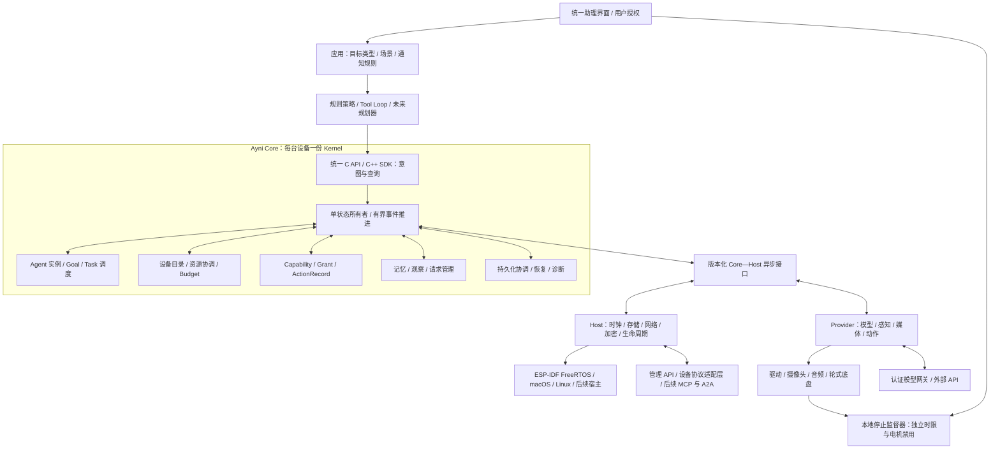
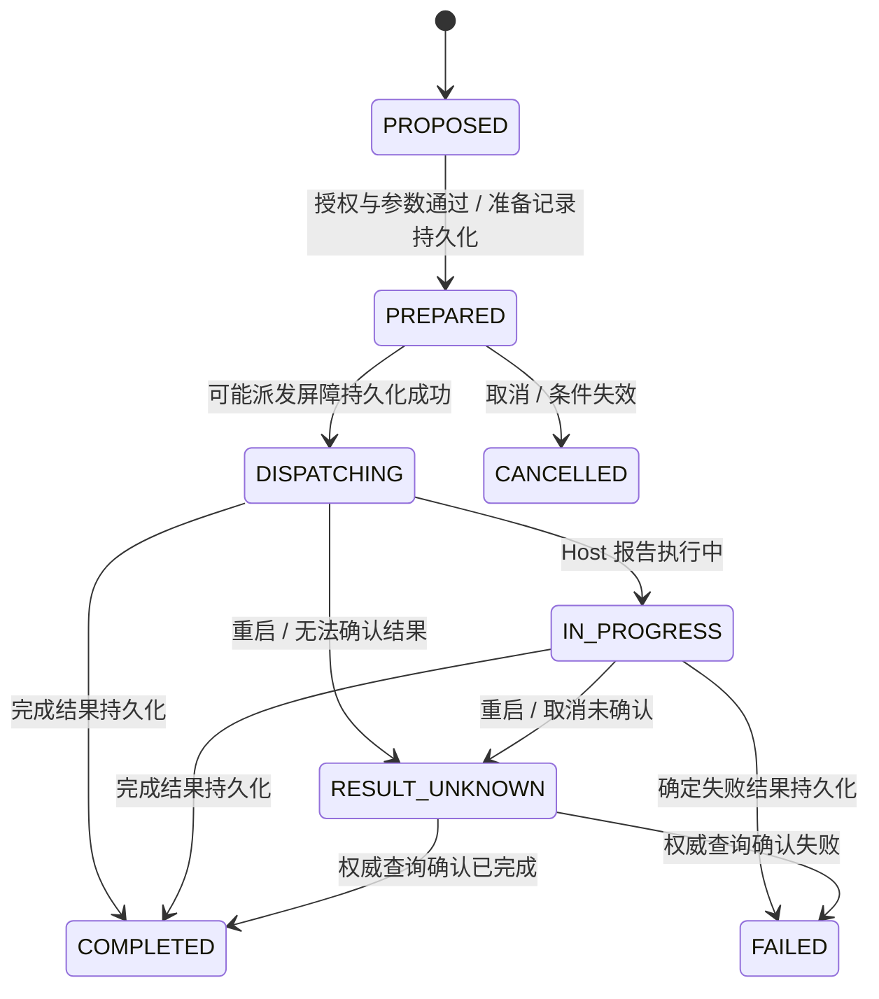

# Ayni：Core 优先的跨设备个人助理 AgentOS 实施计划

> **文档性质**：工程实施计划与待实现契约，不代表已有软件能力。  
> **文档版本**：v1.1 · 2026-10-17；保留文件名 `ayni_v1.0.md`。文档版本与产品 v0.1 / v0.2 分开。  
> **产品定位**：面向个人消费者；用户面对一个统一助理，内部由多个 Agent 分工。  
> **架构路线**：从零设计 Agent 内核抽象，复用现有操作系统基础设施，优先通过外部 API 获得模型能力。  
> **首发验证设备**：现有 ESP32-S3 N16R8 开发板；型号、引脚、16 MB Flash / 8 MB PSRAM 均须实测确认。  
> **基准投入**：单人全职；阶段周期是相对工作量估算，不是开工日期或交付日期承诺。  
> **当前状态**：本仓库目前仅有计划文件。下文的目录、API、示例、固件、SDK、平台支持和测试结果均为待实现、待验证，除非另附实际验收证据。

## 0. 执行摘要与已确定决策

Ayni 的 Core 是多个 Agent 共用的系统基础设施：每台设备运行一份 Kernel，持有 Agent 实例、持续目标、任务、授权、动作记录、资源和记忆的逻辑状态。规则、Tool Loop 或未来规划器通过系统接口工作；模型提供解释和建议，设备上的 Kernel 决定是否接受任务、如何分配资源，以及动作能否执行。模型网关不拥有任务、记忆或硬件执行权。

“AgentOS”在本项目中的工程标准是：这些服务由应用共同使用、生命周期由系统管理、规则在声明的信任边界内能够强制执行，并有契约测试证明。v0.1 的边界是可信内置代码经受管理入口执行；ESP32 上不能据此声称任意原生代码无法绕过权限。

| 决策项 | 确定方案 | 边界 |
|---|---|---|
| 产品 | 个人消费者的统一助理，内部多个 Agent | 试用界面展示助理状态、授权及行为；开发诊断单独提供 |
| Agent 身份 | 同一逻辑身份允许驻留多个设备，各实例独立运行 | 身份相同不意味着共享权限、共享可变状态或自动转移任务 |
| 内核与宿主 | 可移植 C++17 Core；ESP-IDF / FreeRTOS、桌面宿主提供系统基础设施 | 不重写硬件 OS 内核，不把底层实时调度与 Agent 调度混同 |
| Core 机制 | 单逻辑状态所有者、有界事件推进、异步 Host | 策略位于 Kernel 之上，不把某一种 Tool Loop 固定为内核 |
| 接入接口 | 统一 C99 兼容 API + C++ 易用封装；首版编译时注册 | 不暴露 STL ABI，不要求动态加载，不执行第三方不可信代码 |
| 模型 | 两个确定性 Mock Provider + 统一认证 HTTPS 网关 | 真实文本、视觉、ASR、TTS 能力分别协商，不假定同一接口全都支持 |
| 记忆 | 不同 Agent 默认私有；共享记录需明确授权 | 相同 Agent 的跨设备副本同步另行设计，不在 v0.1 自动同步 |
| 自主性 | 已授权范围内可提出目标并执行；支持事件、周期检查和空闲反思 | 新目标不产生新权限或无限预算；反思低优先级、可暂停 |
| 首批目标 | 提醒、设备检查、记忆整理、场景观察 | 业务类型由应用注册，Kernel 只规定通用生命周期与约束 |
| v0.1 体验 | 已刷固件的轮式设备；按键录音、语音回答、视觉观察 | 足式机构、自主导航、唤醒词和实时视频对话后续安排 |
| 自主动作 | 用户开启的“转向观察”预授权场景 | 仅校准后的短动作；其他场景通过能力与场景契约扩展 |
| 数据 | 原始媒体默认临时处理；经授权保存事件、事实、摘要 | 不默认持续录像、录音或上传全部个人记忆 |
| 管理与通知 | 局域网管理；重要变化及时提醒，其余汇总，支持安静时段 | 网页关闭后使用本地声光及待展示通知；不承诺手机后台推送 |
| 硬件预算 | 每台新增硬件不超过 300 元 | 不含已有 ESP32、模型费用及工时；不可私自加预算或删体验 |
| 发布顺序 | Core 实验 → ESP32 复核 → 轮式集成 → ToC 试用 → 最小设备互通 | 国产系统扩展保留，但不阻断早期 Core 与个人助理验证 |

**完成定义**：某项能力只有在附有构建、运行和对应验收证据后才标记“已实现”；某个平台只有通过相应功能及恢复测试才标记“已验证”。源码可编译、模拟器通过、实机通过、长稳通过分别记录。

## 1. 产品范围与版本边界

### 1.1 v0.1 实际交付范围

v0.1 是受控的普通用户试用版本。提供已刷固件的轮式设备及本地网页，用户无需编译、刷机或填写模型厂商 API Key。设备独立持有已接受目标和任务；关闭网页不会取消它们。联网模型不可用时，仍能处理本地按键、停止、规则事件和满足时间条件的既有提醒。

| 能力 | v0.1 行为 | 可观察结果 |
|---|---|---|
| 统一助理 | 网页文字、按键录音、语音回答；内部至少两个 Agent 实例 | 用户看到一致的状态和解释，不必操作内部 Agent 拓扑 |
| 目标与任务 | 四类内置应用目标；用户或 Agent 在授权内创建 | 可查询来源、完成条件、当前进度、取消与恢复状态 |
| 视觉 | 持续采集、本地变化筛选、变化触发分析、周期抽查 | 云端分析频率受限，观察带采集时间与有效期 |
| 记忆 | 私有偏好、事实、事件摘要；明确授权共享 | 可查看来源、修改、删除，越权读取被拒绝 |
| 轮式动作 | 明确用户指令及预授权“转向观察”短动作 | 参数、时限、条件和停止均可验证；未校准时禁用 |
| 通知 | 重要变化及时提示；普通后台结果汇总；安静时段 | 设备声光和网页呈现一致，可查看未读及重复合并结果 |
| 管理 | 局域网配网、绑定、授权、任务、记忆、行为记录、停止与恢复入口 | 不依赖开发者串口才能日常使用 |
| 模型访问 | 设备认证到统一网关，网关管理厂商凭据及试用额度 | 超时、额度耗尽、断网均有清晰状态 |
| 恢复与诊断 | 可持久化状态、动作账本、故障降级；开发诊断单独开放 | 重启不盲目重复动作，不把未知结果伪装成成功 |

### 1.2 v0.1 不承担的范围

不在 ESP32 内执行大模型推理，不从零开发 RTOS；不做足式步态、自主导航、SLAM、跟随、任意代码生成执行、第三方原生插件沙箱、完整分布式一致性或商业多租户云平台。不要求在线热替换模型/策略，不实现跨设备自动接管任务或私有记忆自动同步。MCP、A2A、更多宿主和隔离机制按后续阶段验收。

### 1.3 设备与可行性假设

| 假设 | 验证与处置 |
|---|---|
| 现有板型是 ESP32-S3 N16R8 | M0 保存板型照片/资料、启动日志、实测 Flash/PSRAM、GPIO 与启动引脚表 |
| 摄像头、麦克风、扬声器、底盘可共同接入 | 同时审查引脚、I²S/摄像头接口、DMA、供电、内部 RAM、PSRAM、无线和 OTA 容量；不能按单模块成功推定并发可用 |
| 新增硬件可在 300 元内完成 | M0 给出候选 BOM 与价格证据，M3 记录实际采购及实测；若不成立，带选项回到用户决策 |
| 模型需要外网 | Wi-Fi STA 优先；设备 AP 用于初始配网，不能假定 AP 自身有互联网 |
| 试用者使用家庭局域网 | 明确局域网访问、认证和通知限制；不对公网开放设备管理入口 |
| 后续兼容国产软硬件 | M6 按真实工具链/设备推进，不把规划平台写成已经支持 |

## 2. Core 架构与内核原语



### 2.1 运行原则与 Core 的深度

每台设备只有一份 Kernel 逻辑状态源；可以有多个实例和多条异步 I/O 工作线程，但不能同时直接修改 Core 对象。`step` 按工作项和耗时预算推进，不等待网络、Flash、模型或设备操作。Host、Provider 与策略只提交事件/意图，Kernel 完成校验与状态转换；异步持久化未确认前不得报告“已持久接受”。

Core 包含设备和资源的**身份、目录、描述、状态、授权及协调**。具体寄存器、采样、图像筛选、音频编解码、TLS、文件系统和电机闭环实现留在 Host/Provider。OS 调度任务线程；Kernel 调度 Agent 工作与资源准入。高频采集不逐帧进入普通控制队列，使用受限媒体缓冲与观察描述。

### 2.2 原语规范

下表中的持久化是规范要求；最终字段和编码在 M0 固化。稳定 ID 不复用，修改带版本；物理句柄、指针、资源锁和单调时钟值不跨重启恢复为可用对象。

| 原语 | 归属与生命周期 | 授权 | 持久化与恢复规则 |
|---|---|---|---|
| **AgentInstance** | `agent_id` 是逻辑身份，`instance_id` 是驻留实例，绑定 `device_id`；Kernel 管理启动、暂停、恢复、停止和资源归属 | 实例绑定角色与 Grant，不凭身份相同继承其他设备权限 | 保存身份、绑定、策略配置和状态；重启产生新 `boot_epoch`，旧请求不能继续修改状态；暂停实例不删除记忆 |
| **Goal / Task** | Goal 表示持续目标；Task 是一次有界执行。记录创建者、触发源、owner 实例/设备、完成条件、预算、取消与期限；Session 仅为交互入口 | 创建 Goal、派生 Task 与执行动作分别检查；派生工作只能缩小既有授权与预算 | 保存目标、任务、触发游标、版本、检查点和结果；任务固定归属，失联不接管；恢复后重新检查时间、授权和条件 |
| **Observation** | 测量或解释的来源、采集时间、时钟可信度、有效期、质量、媒体引用及关联观察；测量值与模型推断分开标记 | 采集、订阅、上传、长期保存分开授权；感知订阅也占资源与预算 | 原始媒体引用默认短期有效，不在重启后假装仍可访问；授权事件/事实/摘要可持久化，过期观察不可支持新动作 |
| **Device / Resource** | Device 为宿主身份；Resource 为摄像头、麦克风、执行器组、模型槽等，含父设备、共享/独占、容量、健康与租期 | 注册来自可信 Host；访问经能力声明与 Grant，应用不能伪造系统资源 | 保存可信目录配置和历史；在线状态、占用与本地句柄重新探测，重启释放旧占用，执行器保持禁用 |
| **Capability / Grant** | 能力规定类型化输入输出、副作用、资源、时限和恢复行为；Grant 绑定主体、目标、范围、期限、额度、撤销版本及委派限制 | 默认拒绝；委派只能收窄且保留上级撤销链；参数、前置条件与外发范围均由设备检查 | 保存能力契约版本及授权记录；恢复、排队后、派发前再次校验；无法证明期限有效的时限授权不自动启用 |
| **ActionRecord** | 每次外部影响有稳定 `operation_id`，关联实例、任务、能力版本、授权、参数摘要、派发尝试与结果 | 授权绑定参数/场景和操作，不能用批准其他动作的结果替代 | 记录持久准备、可能派发、执行完成和结果落盘；不确定进入 `RESULT_UNKNOWN`，查询或人工处理；不通用承诺恰好执行一次 |
| **MemoryRecord** | 默认归属逻辑 Agent 的私有命名空间，实例写入受控；含来源、版本、可见范围、删除标记和决策引用 | 私有读取、写入、共享和外发分别授权；共享不意味着共享整个私有库 | 本机保存版本与删除状态；同一身份跨设备副本不自动合并；删除后不可进入新上下文，旧审计仅留必要引用与脱敏元信息 |
| **Budget** | 设备总预算与实例/目标/任务子预算，包括模型、token、字节、任务数、媒体分析、CPU 工作项及通知频率 | 子预算不能大于父级；模型不能自行加额；系统保留停止、诊断与前台交互配额 | 保存周期消耗与待结算预留；重启不清零已花额度，不确定调用按保守规则结算；余额不足拒绝、延后或暂停 |

Observation 的 TTL、动作 deadline 在本机采用单调时间执行；跨设备只能传相对限时及可信时间信息，不能比较两台机器的 monotonic 值。绝对时间不可用时，日历提醒进入待校时状态；过期处理按目标的补发一次、汇总或跳过策略执行。

### 2.3 多个 Agent 共用的系统服务

| 系统服务 / 建议目录 | Core 负责 | Host、Provider 或应用负责 |
|---|---|---|
| 实例监督 `agent/` | 实例注册、生命周期、身份绑定、隔离命名空间、停止和回收 | 实例角色与用户可理解的助理呈现 |
| 目标与任务 `goal/`、`task/` | 接受、调度、触发去重、暂停取消、检查点、归属与恢复 | 提醒等目标类型、完成判定和规划策略 |
| 设备目录与资源协调 `device/`、`resource/` | 设备/资源/能力注册、容量、冲突、队列、租期、准入、释放 | 发现硬件、采集/驱动、设备健康探测 |
| 能力与授权 `capability/`、`policy/` | Schema 校验、Grant、撤销与受限委派、审批绑定、动作账本 | 本地执行、物理限值与独立停止机制 |
| 请求管理 `request/` | request ID、boot epoch、超时、取消、晚到结果、预算预留/结算 | 非阻塞 I/O、结果验证和取消尝试 |
| 观察、记忆与上下文 `observation/`、`memory/`、`context/` | 来源、有效期、私有/共享范围、版本、引用、上下文预算 | 感知算法、模型解释、可选检索 Provider |
| 预算与公平性 `budget/` | 多实例配额、设备总额、优先级、限流及饥饿监测 | 试用额度配置；网关同步执行外部费用限制 |
| 状态与诊断 `state/`、`observability/` | 提交协议、日志/快照协调、恢复、trace、脱敏诊断 | 存储原子性/flush 能力、日志出口与性能测量 |
| 事件与基础定义 `event/`、`foundation/` | 有界队列、合并、路由、错误、时间和类型 | ISR 安全桥接、线程唤醒；不从 ISR 调用普通 API |

资源按 Capability 声明由系统自动申请、协调和释放，Agent 不直接持有驱动锁。资源组采用全有或全无准入，避免部分占用互相等待；首版不强制抢占不可中断的物理动作，采用排队、超时或可取消操作释放。优先级次序为本地停止路径、前台交互/已到期提醒、普通工作、后台反思；同级使用有界公平排队并记录最长等待时间。

媒体采集可用有期限的系统订阅占用资源，不能永久持锁。播放与录音是否互斥由音频资源组声明；视觉分析占模型槽但不必长期占摄像头。完成、失败、取消、超时和实例停止均需释放资源；对尚未确认已停止的执行器保留隔离状态，不提前分配给下一请求。

### 2.4 生命周期与执行状态分开

| 对象 | 状态与关键转换 |
|---|---|
| AgentInstance | `REGISTERED → STARTING → RUNNING ↔ PAUSED → STOPPING → STOPPED`；初始化/检查点不兼容进入 `FAULTED` 或有原因的暂停；结束一次任务不结束实例 |
| Goal | `PROPOSED → ACTIVE ↔ PAUSED → SATISFIED / CANCELLED / EXPIRED / FAILED`；需确认时停留待授权，不生成可执行工作；持续目标可多次产生 Task |
| Task | `ACCEPTING → READY → RUNNING ↔ WAITING_MODEL / WAITING_RESOURCE / WAITING_APPROVAL / WAITING_ACTION → COMPLETED`；也可 `PAUSED / CANCELLED / FAILED / EXPIRED`；异步取消未完成时为 `CANCELLING` |
| ActionRecord | `PROPOSED → PREPARED → DISPATCHING → IN_PROGRESS → COMPLETED / FAILED`；未派发可 `REJECTED / CANCELLED`，越过可能派发边界而无法确定结果进入 `RESULT_UNKNOWN` |

`ACCEPTING` 表示存储提交未确认；只有提交完成才报告任务“已持久接受”。`PREPARED` 表示已保存意图且尚未进入可能派发；**必须先持久化 `DISPATCHING` 屏障，再允许 Host 发出具有副作用的请求**。屏障写失败则禁止派发。



图中省略审批等拒绝分支，不得把 `RESULT_UNKNOWN` 当作普通失败自动重试。恢复日志只重建状态，不能直接重放硬件动作；恢复目标也不恢复旧运动命令。取消请求、停止指令已送达、物理输出已停止是三种事实，必须分别表达。

### 2.5 策略与信任边界

规则策略、Tool Loop 和未来规划器注册于 `strategies/`，消费任务快照/观察，提交目标建议、模型请求、动作意图或完成结果。Kernel 校验所有意图，策略不能修改内部对象、绕过资源入口、提升权限或自行恢复未知动作。策略回调同样有工作量限制；复杂计算放异步 Provider。

v0.1 运行可信内置 C/C++。权限保证仅覆盖受管理入口；任意原生代码直接访问 GPIO、内存或网络时，ESP32 首版不提供强进程隔离。未来第三方扩展需单独选择进程、OS 权限或受限执行环境，并声明平台隔离等级。

### 2.6 部署 Profile

| Profile | 语义和容量 | 状态 |
|---|---|---|
| `CORE_LITE` | ESP32 使用；完整任务、授权、动作和恢复语义，容量与可选检索受限 | M2 待实现/验证 |
| `CORE_FULL` | 桌面使用；同一 Core，更多容量、存储和检索 Provider | M1 最小实现；扩展后续 |
| `DEVICE_NODE_C` | 无完整 Agent 的受控设备端点；实现身份、能力与受控调用协议 | M6 待评估，不称为独立 Agent 实例 |

## 3. 统一 API、SDK 与协议契约

### 3.1 三类独立版本与一致性来源

| 契约 | 版本域 | 兼容规则 |
|---|---|---|
| Core—Host / 原生 SDK | `abi_major`、结构大小及功能位 | ABI 主版本不兼容时拒绝；新增可选尾字段按 `struct_size` 处理；不得跨 ABI 传 STL、异常或 OS 句柄 |
| 管理与设备间协议 | `protocol_major/minor`、能力版本和功能协商 | 主版本不兼容拒绝；未知可选字段可忽略，未知必需功能/动作拒绝；v0.1 管理 API 与 v0.2 设备互通共用领域语义 |
| 持久化格式 | `storage_schema`、记录版本、迁移版本 | 校验、迁移与回滚有单独用例；不支持版本进入只读/暂停，不能当空数据重建 |

三类版本不要求数字同步。`contracts/domain/` 固化 ID、状态、错误和能力语义，生成/核对 C 类型、JSON Schema、持久化映射及 conformance fixtures。修改语义必须同步测试；内部对象不依赖 JSON 字符串，不能持久化 C++ 内存布局。

### 3.2 C API 与 C++ 封装

统一接口覆盖在电脑或 ESP32 嵌入 Core、注册设备/资源/能力/目标类型/策略、连接模型/存储/感知/动作 Provider；另外提供电脑端管理客户端，用于调用设备 API、查询任务及订阅事件。客户端操作设备不等于在电脑创建了另一个任务所有者。

以下为**拟议接口节选，尚未实现，不是完整可编译头文件**；具体结构定义、字段限额与错误清单在 M0 固化：

```c
/* planned: include/ayni/ayni.h — C99-compatible ABI */
typedef struct ayni_kernel ayni_kernel_t;
typedef struct ayni_client ayni_client_t;
typedef struct ayni_config_v1 ayni_config_v1;
typedef struct ayni_host_v1 ayni_host_v1;
typedef struct ayni_event_v1 ayni_event_v1;
typedef struct ayni_intent_v1 ayni_intent_v1;
typedef struct ayni_device_desc_v1 ayni_device_desc_v1;
typedef struct ayni_resource_desc_v1 ayni_resource_desc_v1;
typedef struct ayni_capability_desc_v1 ayni_capability_desc_v1;
typedef struct ayni_provider_v1 ayni_provider_v1;
typedef struct ayni_goal_type_v1 ayni_goal_type_v1;
typedef struct ayni_strategy_v1 ayni_strategy_v1;

int32_t ayni_create(const ayni_config_v1 *, const ayni_host_v1 *,
                    ayni_kernel_t **out_kernel);
int32_t ayni_register_device(ayni_kernel_t *, const ayni_device_desc_v1 *);
int32_t ayni_register_resource(ayni_kernel_t *, const ayni_resource_desc_v1 *);
int32_t ayni_register_capability(ayni_kernel_t *,
                                const ayni_capability_desc_v1 *);
int32_t ayni_register_provider(ayni_kernel_t *, const ayni_provider_v1 *);
int32_t ayni_register_goal_type(ayni_kernel_t *, const ayni_goal_type_v1 *);
int32_t ayni_register_strategy(ayni_kernel_t *, const ayni_strategy_v1 *);
int32_t ayni_submit_intent(ayni_kernel_t *, const ayni_intent_v1 *);
int32_t ayni_post_event(ayni_kernel_t *, const ayni_event_v1 *);
int32_t ayni_step(ayni_kernel_t *, uint32_t max_items, uint32_t max_time_us);
int32_t ayni_begin_shutdown(ayni_kernel_t *);
void ayni_destroy(ayni_kernel_t *);
```

| 接口问题 | 首版契约 |
|---|---|
| 所有权 | 描述符中的小型配置/字符串在注册时复制并校验限额；函数表与 `ctx` 由调用方保持有效至注销/停机完成。事件/意图输入在返回前复制；大媒体仅传受控引用 |
| 输出与分配 | 查询使用调用方缓冲与所需长度；不足返回 `BUFFER_TOO_SMALL`。跨边界对象有明确 release；不用一侧分配、另一侧未知 allocator 释放 |
| 容量 | config 给出资源、实例、队列、日志、任务、媒体、请求上限；满返回 `CAPACITY_EXCEEDED`，不能无界增长或静默丢持久工作 |
| 异步 | Host `submit` 只表示受理 I/O，不表示业务成功。结果用 `boot_epoch + request_id` 关联，经事件回送；不得在 `step` 内递归回调或阻塞 |
| 线程 | 除专门定义的有界 `post_event` 入口外，API 由 Kernel 所有者线程调用；注册在启动前完成。ISR 经 Host 桥接，不直接调用 |
| 取消与释放 | 取消携带目标操作及版本；Provider 报取消成功/无法取消/结果未知。资源在确认释放或隔离后处理；停机完成后才能 destroy |
| 错误 | 区分 `DENIED`、`EXPIRED`、`BUSY`、`BUDGET_EXHAUSTED`、`UNSUPPORTED_VERSION`、`STORAGE_FAILED`、`RESULT_UNKNOWN`；返回码不是用户文案 |
| C++ 封装 | `include/ayni/ayni.hpp` 提供 RAII、类型检查和便捷注册，映射同一 C API；异常/RTTI 关闭，分配失败显式处理，不跨 ABI 暴露 STL |
| 版本 | v0.1 API 标记 experimental，维护可追踪变更；双宿主契约验证后再承诺稳定兼容，不把本节草案称为已稳定 SDK |

### 3.3 三个最小扩展接入示例

以下均为**设计伪代码**；名称对应拟议 SDK，配置对象与回调需在实现时补全。三个例子必须在 M2 作为真正的 C/C++ 示例运行，无需修改 Kernel 源码。

**新硬件：增加触觉按钮。** 注册设备下的 `touch.button0` 资源、只读观察能力和 Provider；驱动上报去抖后的测量观察，不直接写 Agent 状态。

```cpp
// planned examples/new_hardware/: callbacks execute outside Kernel state mutation
ayni_register_resource(kernel, &button_resource);
ayni_register_provider(kernel, &button_provider);
ayni_register_capability(kernel, &button_read_capability);
// Host later posts a bounded Observation event with source, time and quality.
ayni_post_event(kernel, &button_observation_event);
```

**新模型：增加第二个网关 Provider。** 实现异步 submit/cancel、能力声明、结构化结果、配额和错误映射；业务选择由配置决定，不改任务和动作记录。

```cpp
// planned examples/new_model/: provider table includes version and ctx lifetime
ayni_register_provider(kernel, &second_gateway_provider);
// Application config selects provider_id; Kernel retains request/budget authority.
```

**新策略：增加事件规则策略。** 注册策略及一个应用目标类型，接收只读任务视图，通过意图请求动作或报告完成；与 Tool Loop 共用权限、资源及记忆入口。

```cpp
// planned examples/new_strategy/: callbacks return bounded work, no direct I/O
ayni_register_goal_type(kernel, &device_check_goal_type);
ayni_register_strategy(kernel, &event_rule_strategy);
ayni_submit_intent(kernel, &proposed_device_check_goal);
```

### 3.4 管理 API 与统一消息信封

v0.1 提供局域网管理传输：经认证的目标创建/取消、任务查询、授权与撤销、记忆查询/删除、助理状态及带游标事件订阅。拟议路径为 `/api/v1/goals`、`tasks`、`grants`、`memories`、`events`、`assistant/status`、`motion/stop`，均为待实现；停止入口还必须连接独立本地停止路径。订阅重连可按游标补有限历史，超出保留范围明确返回 gap 并要求状态查询。

设备协议在 M0 定义语义，M5 实现认证、协商和远程能力调用。控制消息使用有限长 JSON，媒体通过独立受控数据通道；媒体引用绑定主体、用途、有效期、大小与内容类型，不接受任意 URL/文件路径造成越权读取。

以下是未来设备协议中的受控动作请求示例，不表示 v0.1 已实现跨设备调用：

```json
{
  "protocol_major": 1,
  "protocol_minor": 0,
  "message_id": "msg-0002",
  "operation_id": "op-turn-0042",
  "trace_id": "trace-0089",
  "kind": "capability.invoke",
  "sender_device_id": "device-pc-01",
  "target_device_id": "device-s3-01",
  "agent_id": "agent-assistant",
  "instance_id": "instance-pc-01",
  "owner_device_id": "device-pc-01",
  "goal_id": "goal-observe-01",
  "task_id": "task-0042",
  "task_revision": 3,
  "ttl_ms": 1500,
  "grant_ref": {"id": "grant-turn-01", "revision": 2},
  "payload": {
    "capability": "motion.turn_to_observe",
    "capability_version": 1,
    "scene_id": "scene-turn-to-observe",
    "arguments": {"direction": "left", "motion_profile": "calibrated-short-turn"},
    "precondition_observation_ids": ["obs-0108"]
  }
}
```

示例中的 `calibrated-short-turn` 必须由目标设备匹配到实测、已启用的具体参数上限；它本身不是有效校准证据或授权。`grant_ref` 只是引用，不是可信自报权限，接收方依据已认证主体、本机授权库及请求绑定关系校验。

| 字段/行为 | 规范 |
|---|---|
| `message_id` | 单次传输消息 ID；每次重试可改变，不承担业务幂等身份 |
| `operation_id` | 同一动作跨重试保持稳定；按主体、目标能力和参数摘要绑定。重复同 ID 不同内容拒绝；持久记录与保留窗口明确，过期不能当作新动作静默再执行 |
| `request_id` / `boot_epoch` | 本机异步尝试的关联与代际；重试可产生新 request；旧代晚到结果不得修改新状态 |
| `goal_id` / `task_id` | 持续目标、执行任务及固定 owner；远程调用不转移任务归属 |
| 授权与资源 | 接收设备重新校验主体、Grant、场景、配额、资源、条件和期限；相同 Agent ID 不免检 |
| 时间与结果 | 本地以 monotonic 限时；TTL 为首次接收后的执行预算，重试不续期，也不证明传输前的新鲜度。副作用请求另校验授权期限、会话防重放和必要的可信时间；无法验证时拒绝。返回结构化错误、终态或待确认状态 |
| 消息限额 | 初始控制帧最大 8 KiB、嵌套深度 8、集合长度受字段 Schema 限定；数值、UTF-8、未知必需字段均校验。M0 测试后锁定 |
| 媒体通道 | 不在普通控制 JSON 中放 base64 大文件；引用过期、取消和重启时回收，单独限制字节与并发 |

接收结果区分：`RECEIVED`（已校验接收，可能尚未持久化）、`DURABLY_ACCEPTED`（已承担持久处理责任）、`IN_PROGRESS`、`COMPLETED`（结果可查询）、`RESULT_UNKNOWN`。客户端未收到响应不能推定未执行，应以同 operation 查询/重试；只有能力明确允许时才能重新尝试。协议不宣称通用的“恰好执行一次”。

### 3.5 自主动作的通用契约

每个自主场景描述包含：场景 ID/版本、用户开启状态、授权主体及范围、目标能力、参数约束、所需资源、前置条件、观察新鲜度、有效期、次数/费用预算、停止条件、取消方式和结果确认方式。动作账本保存所使用版本及证据引用。

首个场景是用户显式开启的“转向观察”：新鲜且满足质量要求的场景变化 → Agent 提出观察目标 → Kernel 检查场景授权及本机状态 → 申请资源 → 执行校准的短转向 → 停止确认 → 新观察与结果。未校准、授权过期/撤销、观察过期、底盘异常、停止按钮触发均禁止或停止动作。超时、重启、失联规则由本机执行，不等待模型返回。

新增动作通过新场景/能力描述扩展，不修改 Kernel 的业务分支；但改变资源或安全语义仍需契约版本与独立测试。MCP、A2A 放在协议适配层，按选定版本转换到领域对象，不让 Core 类型依赖外部协议 SDK。

## 4. ESP32 Host、资源和恢复实现

### 4.1 软件栈与异步任务

ESP-IDF 候选为 6.x，M0 锁定能在现有板型构建、启动的具体 patch、工具链和组件版本；在获得证据前不称已支持。Core 使用受限 C++17，禁用异常/RTTI，不直接依赖 ESP-IDF、FreeRTOS 或 POSIX。

| Host 逻辑任务 | 职责 | 限制 |
|---|---|---|
| Kernel owner / event ingress | 汇入事件、驱动 step、发出异步请求 | 不等待网络/Flash，不在其他任务直接修改状态 |
| 网络与网关 | Wi-Fi、认证、TLS、模型/管理 I/O、背压 | 有界并发、超时/取消、证书验证，不泄露凭据 |
| 存储 | journal、快照、NVS、flush 完成事件 | 区分排队成功与持久提交成功，写失败禁止越过动作屏障 |
| 采集与媒体 | 摄像头、按键录音、播放、变化筛选、临时缓冲 | 按资源契约协调，CPU/内存/上传有限额 |
| Web 与通知 | 配网、绑定、授权、状态、待展示通知 | 管理身份验证，输入和连接上限，普通界面不用开发术语 |
| 底盘与停止监督器 | 电机输出、截止时间、停止/故障监督 | 独立于模型和普通工作队列；启动与异常时默认禁用 |

上述为逻辑划分，实际线程合并由优先级、栈水位和响应测量决定；Wi-Fi/TCP/IP/TLS 系统任务也计入资源。停止路径不得依赖普通队列空位；采用独立优先入口与本地硬件/控制保护，并验证控制任务失效时输出能回到安全状态。

### 4.2 内存、容量与 Flash

8 MB PSRAM 不等于全部可用于 DMA、ISR 和关键任务栈的内部 RAM。M0 建立 `MALLOC_CAP_INTERNAL`、`MALLOC_CAP_SPIRAM`、最大连续块、栈水位基线；M2 验证 Core，M3 对相机、音频、TLS 与运动同时启用重新测量。

| 项目 | 初始配置假设；尚未实测 |
|---|---|
| 实例与任务 | 至少 2 个实例；设备活跃/可恢复 Task 上限初设 16，Goal 单独有界 |
| 事件 | 128 项；遥测可合并/丢旧，持久工作必须背压或明确拒绝；停止不依赖该队列 |
| 模型 | 1 个活跃外部推理槽；Task 默认最多 8 次决策、单轮最多 8 个能力请求；请求超时初设 30 秒 |
| 能力与资源 | 能力初设上限 32；资源、Grant、订阅和排队长度均可配置、有耗尽测试 |
| 媒体与上下文 | 独立缓冲池和字节上限，不挤占关键栈；保存采集与解释元信息，不默认写入原始媒体 |
| 持久化 | journal 轮转、快照/历史大小、写频率有上限；动作屏障不能为省写入而跳过 |
| Flash | 依据实测固件规划 NVS、OTA 元数据、双 app slot、storage；不得固定未经测算的偏移 |
| 失败处理 | 分配失败、存储满、TLS 失败返回明确状态；拒绝新负载并保留停止/诊断能力 |

Core 一次 step 的时限、本地事件处理延迟、资源最长等待、停止响应上限都要在 M0/M2 定义测量方法。运动响应数值以 M3 底盘校准为准，不把模型延迟用作停止预算。每份报告保存编译选项、固件大小、最小内部空闲堆、最大连续块、PSRAM 峰值和栈剩余量。

### 4.3 持久化与故障语义

NVS 保存小型配置，文件分区保存有界日志/快照。快照采用写新内容、校验版本/长度/CRC、提交切换的方式；若宿主不提供断电原子 rename/flush，则实现双槽和提交标记并用故障注入验证。CRC 用于发现损坏，不代替授权或防篡改。

恢复使用最近有效快照及之后已提交记录，忽略未提交尾部；无法验证关键授权/动作记录时进入暂停或只读诊断，不伪造成功。旧格式迁移先校验并保留回退路径。资源锁、媒体句柄、request 和时钟基准重新建立；不重放硬件调用。

动作提交顺序：保存意图并确认 `PREPARED` → 再验授权/条件 → 持久化 `DISPATCHING` → Host 执行 → 接收结果 → 持久化终态 → 对外确认完成。即使在屏障提交后、真正发出前重启，也只能保守判为 `RESULT_UNKNOWN`。只有可证明没有越过屏障的记录才可按“未派发”重新评估。

### 4.4 时间、启动与 OTA

无备用时钟、无网络时，断电后的 ESP32 不能保证绝对时间。恢复后等待可信校时，按目标约定补发一次、汇总或跳过；无有效时间时暂停依赖日历/绝对期限的工作，不能承诺准确提醒。设备内短截止时间采用单调时钟；持久记录保存恢复策略，不恢复旧单调数值。

启动首先保持电机禁用，再检查存储、资源和授权，初始化 Kernel，最后开放可用能力。OTA 设计双槽、镜像校验、启动自检与回滚；失败不丢失可恢复状态。试用包需验证升级来源、设备凭据隔离与回滚流程。Secure Boot / Flash Encryption 的生产方案另立 ADR，未经明确评审不烧录不可逆 eFuse。

## 5. 模型、私有记忆与自主目标

### 5.1 模型网关和 Provider

模型请求经 Kernel 请求管理、上下文过滤与 Budget 准入，异步交给 Provider。首先实现 Mock A / Mock B；真实网关分别声明文本规划、图像分析、ASR、TTS 等能力。选定供应商后逐项验证结构化输出、媒体格式、流式/非流式、超时、取消和费用，不假定“兼容聊天 API”就支持全部模态。

网关持有厂商凭据，设备使用单设备可撤销凭据；普通试用者只需完成绑定与授权。网关验证设备和额度，不承担任务调度或绕过本地权限。Core 与网关均限制费用/速率；超额暂停分析或解释原因，不自动切到有额外费用的新服务。原始数据上传必须符合本地授权和保留规则。

M1 实现网关客户端与可控测试服务，M2 提供最小认证开发网关以复核真实模型接入；M4 再完成面向普通用户的部署、设备凭据管理、试用额度与数据保留流程。M2 的接入证明不依赖尚未交付的 M4 试用服务。

### 5.2 记忆与上下文

| 数据 | 保存和访问 |
|---|---|
| 任务工作上下文 | 有限 RAM/PSRAM；仅提交必要任务、近期观察和获准记忆 |
| 会话摘要 | 按长度/用途保留，Session 不拥有持续任务 |
| 私有事实、偏好、事件 | 带归属、来源、时间、版本、确认状态；关键词/标签检索优先 |
| 共享记录 | 明确共享主体、字段/范围、期限；撤销后不再进入新查询与上下文 |
| 原始音视频 | 默认短期缓冲；上传完成、超时、取消后回收，重启不恢复采集档案 |
| 决策与动作引用 | 记录使用了哪些观察/记忆版本，敏感内容最少化，不在开发日志重复全文 |

用户能查看、修改和删除记忆。删除使记录立即不可检索/不可进入新模型请求，快照与日志按有界整理清除内容；备份/网关已外发数据的保留限制必须说明，不能承诺撤回模型已收到的内容。后台整理不可越权读其他 Agent 的私有记录，也不可把未经确认推断改成已确认事实。向量检索是 Full Profile 的可选 Provider，不是 Lite 前置条件。

### 5.3 目标类型与自主执行

| 应用注册的目标类型 | 触发与完成条件 | 约束 |
|---|---|---|
| 提醒 | 用户或已授权规则提出；到期通知后完成，周期目标继续保持 | 时间可信度、错过策略、通知去重与取消 |
| 设备检查 | 事件或周期触发；完成健康采样并记录变化 | 只使用获准检查能力，错误不能自行扩大到维修/运动权限 |
| 记忆整理 | 空闲触发；生成摘要/重复候选并按授权提交 | 低优先级，可暂停；保留来源和确认状态，限制频率与费用 |
| 场景观察 | 本地变化、周期抽查或用户请求；形成有效观察结果 | 外发授权、采样频率、观察质量、短动作场景与通知规则 |

Goal 登记创建来源（用户、规则、反思、远程主体）、父目标、业务类型/版本、完成或持续条件、失效时间、去重键、预算及通知策略。未知业务类型拒绝。周期触发记录持久游标，重启不一次性补建无限 Task；同一触发窗口去重，子目标深度和数量受限。

事件反应可以高于周期工作，空闲反思始终低优先级，遇前台工作、资源压力、安静规则或预算不足时暂停/延后。反思频率、视觉抽查频率与模型额度是系统配置，模型不可自己调高。已接受任务固定 owner，失联不会自动交给其他驻留实例。

### 5.4 通知与用户状态

统一助理展示“正在聆听 / 正在处理 / 后台观察 / 等待授权 / 已暂停 / 离线 / 需要处理”等可理解状态。内部 task ID、Provider 和资源锁只放开发诊断页。重要变化与到期提醒按用户规则及时呈现；一般检查与整理结果汇总，重复事件合并，安静时段默认不播放普通语音。

安静时段中的重要事件按明确配置决定立即声光还是只记录；v0.1 默认不绕过安静规则大声播报，停止/故障指示仍生效。网页未打开时设备提供本地提示、持久保存待展示通知；重新连接查询结果。不承诺局域网页具备手机后台推送能力。

## 6. 平台、移植与国产系统扩展

| 目标环境 | 顺序和实现形式 | 当前状态 |
|---|---|---|
| macOS ARM64 | M1 当前开发机：Native Host、模拟器、C/C++ SDK | 规划，待构建与功能测试 |
| Linux CI | M1 运行 Core 契约、故障注入、ASan/UBSan；记录 CI ISA/发行版 | 规划，待建立 |
| ESP32-S3 / ESP-IDF | M0 可行性，M2 同一 Core Lite，M3/M4 完整试用设备 | 规划，待板级与集成验证 |
| PC 与 ESP32 双设备 | M5 独立驻留、认证与远程能力调用 | 规划，待互通测试 |
| UOS / 麒麟 / openEuler，x86-64 / AArch64 | M6 复用 POSIX Host，验证服务管理、安装包和权限 | 待具体发行版与真机 |
| LoongArch64 Linux | M6 按可得工具链/设备逐级测试 | 不把交叉编译写作实机支持 |
| RT-Thread / Zephyr / 特殊 MCU | M6 评估 Lite Host 或 C Device Node | 待 BSP、内存与 C++ 能力确认 |
| OpenHarmony / HarmonyOS / Android | M6 评估 Native + 原生 UI、后台限制及应用权限 | 待对应 SDK/设备，不承诺永久后台 |
| SW64 / 其他 RISC-V 等 | 按需求和资源选择 Native 或 Device Node | 规划，未支持 |

移植只替换时钟、异步网络、存储、加密、生命周期和驱动/Provider，不复制一份 Core。保持同一原语与恢复用例；平台能力不足应显式拒绝功能，不能悄悄弱化授权或动作语义。硬件 NPU/DSP、国产密码算法作为可选 Provider，接口存在不意味着通过认证。

兼容性按 `source-buildable`、`bootable`、`feature-passed`、`long-run-passed` 分别报告，附工具链、OS、ISA 和证据。完整跨平台能力声明需要同一 Core 在至少两种实际宿主通过共同契约，不能从文件夹名称推断支持。

## 7. 轮式感知交互与硬件实施

### 7.1 BOM 与接线门槛

目前只有开发板，以下模块均未选型/未验证。M0 建立候选 BOM、引脚/供电/内存可行性；M1/M2 三个实验通过后进入 M3 完整硬件集成。采购和接线以验证过的 BOM 为依据，不按示例型号直接下单。

| 子系统 | 需验证内容 | 证据 |
|---|---|---|
| 一路摄像头 | 引脚、PSRAM/DMA、帧大小、低成本变化检测、抓拍与分析并发 | 帧率/内存/丢帧记录及 GPIO 表 |
| 麦克风、功放、扬声器、录音按键 | 音频接口、采样/回放、回声与录音播放互斥、按键可用性 | 录音识别与播报样例、并发和电源测试 |
| 轮式底盘、电机及驱动 | 电机电流、驱动禁用、转向可控性、反馈或可验证限时控制 | 校准范围、短动作误差、停止延迟与异常测试 |
| 电源和结构 | 电池/供电保护、峰值电流、共地/噪声、固定与电机干扰 | 同时采集/上传/播放/转向的供电记录 |
| 成本 | 模块、线材、电源、驱动、底盘及必要结构件全部计入 | 每台新增硬件 ≤300 元的实际价格和合计；运费单列 |

如果现有板型引脚或资源不够、停止机制无法验证，或必须的配置超出 300 元，应给用户展示测量结果和可行选项，等待决定后再改变体验或硬件边界。不得把第二块控制器、传感器或供电配件排除在成本之外。

### 7.2 视觉、语音与资源协作

视觉流水线为持续本地采集 → 轻量变化检测/抽样 → 受预算限制的分析 → 带来源与有效期的解释观察。模型分析是秒级体验，不能承诺每帧上传或实时理解。变化阈值、最短分析间隔、周期抽查频率与上传尺寸由 M3 测量后设定，用户可降低或关闭。

音频使用按键录音、受限录音长度、ASR、任务处理及 TTS 回答。按键停止录音、播放中断、网络失败与额度不足均有界面/声光反馈。摄像头、音频、模型和底盘同时工作必须经过资源 Broker；例如播报期间若不能可靠录音，应停止/延后采集并说明状态，不把回声当新用户请求。

可参考小智 AI 的音频与设备实现，但不把其整套 Agent 生命周期或后端绑定进 Core。视觉识别、语音编解码和本地控制始终为可替换 Provider。

### 7.3 运动与停止

Kernel 提交有界高层动作，不生成任意 PWM。底盘本地控制负责实际输出、校准范围和截止时间；独立停止监督器处理用户停止、授权撤销、异常、过期、控制失联及启动禁用。底盘停止后的确认回到 ActionRecord；没有确认不能声称已完成制动。

“转向观察”仅在明确场景授权和校准完成后启用；具体速度、转角/时长、连续次数、冷却时间与停止上限通过底盘实测确定。在此之前使用 Mock/LED，不对真实电机开放自主动作。该场景只验证原地或受限转向，不扩大为导航、避障或安全看护承诺。足式机构另设电源、姿态、步态与失稳停止验收。

## 8. 计划中的仓库、交付与工程规范

以下目录为目标结构，尚未创建；目录存在本身不表示相应平台已支持。

```text
ayni/
├── CMakeLists.txt
├── include/ayni/ayni.h                 # experimental C API
├── include/ayni/ayni.hpp               # C++ wrapper
├── include/ayni/client.h               # PC management client
├── contracts/{domain,host,wire,storage,fixtures}/
├── core/
│   ├── foundation/ event/ agent/ goal/ task/
│   ├── device/ resource/ capability/ policy/ request/ budget/
│   └── observation/ memory/ context/ state/ observability/
├── strategies/{rule,tool_loop}/
├── applications/{goal_types,scenes,notifications}/
├── hosts/{native,esp_idf}/
├── providers/{model,storage,perception,media,motion,crypto}/
├── drivers/esp32/
├── safety/
├── protocol/{management,peer,adapters}/ # peer M5; MCP/A2A M6
├── sdk/{cpp,client}/
├── examples/{new_hardware,new_model,new_strategy}/
├── apps/{simulator,esp32_assistant}/
├── gateway/                           # authenticated model access
├── ui/web/
├── tests/{unit,contract,integration,fault_injection,fuzz,hil}/
├── reports/{core,hardware,trial,interop}/
├── tools/
├── docs/{adr,architecture,api,protocol,hardware,testing,privacy}/
└── .github/workflows/
```

Core 不依赖 OS 型 STL 组件；采用有界容器、显式容量和可失败分配。格式检查、编译器告警、clang-tidy、ASan/UBSan 和关键契约测试进入 CI，第三方组件例外单独记录。对可信 C++ 的管理不等于内存安全隔离。

初批 ADR：原语与状态机、单状态所有者、策略位于内核之上、资源自动协调、授权/撤销、异步请求代际、动作屏障与未知结果、私有记忆、三类版本、C/C++ SDK、模型网关、媒体与通知规则、停止机制、固定任务归属。重大语义改变同步更新契约、迁移与实验。

开源许可证暂以 Apache-2.0 为候选，首次公开发布前由用户确定并审查依赖许可证。复用上游记录版本、许可证、修改与来源；本次修订不代表已经选择或集成任何第三方代码。

## 9. 验收驱动的分阶段开发计划

周期按单人全职估算，不含采购等待、试用招募、外部服务开通和认证。前一阶段门槛未通过，不绕过它开展下一阶段的发布；可提前做不依赖结果的资料核查。v0.1 在 M4 发布，v0.2 在 M5 验收最小设备互通，M6 按各自前置条件排期。

| 阶段 | 估算 | 工作包与依赖 | 产出与证据 / Exit Gate |
|---|---:|---|---|
| **M0：契约与可行性** | 1–2 周 | `MA-001`、`002`、`017`；无前置阶段 | 原语/状态机/三类版本、C API 草案、E1–E3 用例、板级资源与候选 BOM、锁定工具链；macOS 空 Core 和 ESP32 Hello Host 可构建启动，300 元方案有可行性证据，未决硬件问题有明确决策记录 |
| **M1：Core Alpha** | 4–6 周 | M0 通过；`MA-003`～`006`、`008`～`011`、`018`～`023` | PC 模拟器、多个 Agent 共用服务、持久化/故障注入、C/C++ SDK 与管理客户端 Mock；**电脑 E1/E2/E3 全部通过**，Linux CI 重现；输出独立 Core 报告 |
| **M2：Core Beta** | 2–4 周 | M1 通过；`MA-007`、`024` | 同一 Core 上 ESP32，异步 Host、基本管理 API、LED/测试适配器、资源测量；**ESP32 复核 E1/E2/E3**，三个接入示例在 Native/ESP32 通过；出具 Core Beta 报告后才进入完整硬件集成 |
| **M3：轮式感知交互** | 4–6 周 | M2 通过；`MA-015`、`025`、`026` | 摄像头、按键语音、扬声器、底盘与独立停止；真实并发资源、数据生命周期、校准与预授权转向场景通过；BOM 实际价格/供电/引脚合格，输出独立硬件报告 |
| **M4：v0.1 受控试用** | 2–3 周 | M3 通过；`MA-012`、`027`、`028` | 模型网关、配网绑定与授权引导、记忆/行为记录、通知汇总、停止/恢复；完成完整硬件 72h 长稳、故障回归和普通用户试用；Core、硬件、ToC 三份报告及发布包齐全 |
| **M5：v0.2 最小设备互通** | 3–5 周 | M4 通过；`MA-016` | PC 与 ESP32 各自独立驻留；认证、版本/能力协商、远程调用、查询、去重、断连恢复；不自动转移 owner；输出互通报告与协议一致性证据 |
| **M6：后续扩展** | 按前置条件排期 | M5 通过后按分项；`MA-013`、`014`、`029`～`032` | 国产系统/更多宿主、持久子任务委派、协议适配、足式机构、第三方隔离各有独立门槛；不把预研写成已发布能力 |

### 9.1 工作包及依赖

保留原 `MA-001`～`MA-016` 作为历史追踪编号，调整内容与阶段；编号前缀仅为工作项 ID，项目、API 和示例统一使用 Ayni / `ayni_*`。表中依赖是必须满足的包级前置条件，另需满足所属阶段的 Exit Gate。

| ID | 阶段 | 工作内容 | 依赖 | 完成定义与证据 |
|---|---|---|---|---|
| `MA-001` | M0 | 板型自检、GPIO/电源/接口/内存与预算可行性 | 现有板与厂商资料 | 实测启动日志、引脚冲突表、候选 BOM 和价格来源；板型差异明确 |
| `MA-002` | M0 | Native/ESP-IDF 工程骨架、工具链锁定、Linux CI | 无；与 `001` 并行，板级配置使用其结果 | macOS ARM64 空 Core、Linux 构建、ESP Hello Host；环境记录可复现 |
| `MA-003` | M1 | 类型化 Event、有界队列、FakeClock、过期/背压 | `002`、`017` | 1 万事件、溢出/合并/重复/过期轨迹；无无界增长 |
| `MA-004` | M1 | AgentInstance、Goal/Task/Session、调度与取消 | `003` | 独立状态机、固定 owner、暂停/恢复、触发去重测试 |
| `MA-005` | M1 | C ABI、Native Mock Host、版本及所有权契约 | `002`、`017` | C/C++ 调用、容量不足、异步完成、取消、失配版本用例通过 |
| `MA-006` | M1 | Capability/Grant、审批、撤销、参数与外发检查 | `003`、`005` | 排队/恢复/派发前再检查；拒绝越权与过期授权，撤销在途动作可解释 |
| `MA-007` | M2 | ESP32 异步 Host、基础配网、管理 API、事件查询 | `005`、`020`、`021`、`022`、`023` | LAN 认证管理、异步存储/网络；重连有状态查询和事件 gap |
| `MA-008` | M1 | 模型/感知/动作 Provider 契约、双 Mock、网关客户端/测试服务 | `004`、`005`、`018` | 超时、取消、坏结果、晚到结果、额度和多模态能力协商；M2 提供最小认证开发网关复核真实接入 |
| `MA-009` | M1 | 规则与 Tool Loop 策略、Mock/LED 能力链 | `004`、`006`、`008` | 不改内核状态的双策略示例；意图经共享服务执行，LED 实机部分在 M2 复核 |
| `MA-010` | M1 | Journal/Snapshot、动作账本、屏障、格式迁移 | `004`、`005` | 短写/断电/损坏/旧格式/NVS 满可恢复；没有持久屏障不得派发 |
| `MA-011` | M1 | 私有记忆、上下文预算、删除与提醒 | `006`、`010` | 私有与共享授权、版本引用、删除不可再检索、可信时间/错过策略用例 |
| `MA-012` | M4 | Watchdog、指标、72h 集成长稳、故障回归及发布包 | `024`、`025`、`026`、`027`、`028` | 全部 v0.1 门槛通过；Core/硬件/试用独立报告，无核心/停止门槛豁免 |
| `MA-013` | M6 | 完整 POSIX Host、国产 Linux 部署与 ABI 报告 | `016` | 至少两类实际环境的共同契约，安装/权限/服务恢复报告；不替代 M1 Native Host |
| `MA-014` | M6 | 国产发行版、LoongArch 等平台验证 | `013` | 明确工具链/ISA/OS/设备和四级验证状态；无真机仅报告已获得证据 |
| `MA-015` | M3 | Perception/Embodiment Provider、观察/媒体资源 | `024` | 接入真实摄像头、音频/底盘无需修改 Kernel 业务分支；并发/释放可测 |
| `MA-016` | M5 | Device Protocol：配对、协商、远程能力调用与恢复 | `012` | PC/ESP 独立任务，跨重试操作去重、认证/撤销、断连查询；不自动委派或接管 |
| `MA-017` | M0 | 原语、状态机、三类版本、E1–E3 测试规范与 ADR | 无；结合 `001`、`002` 结果关闭可行性问题 | 领域定义、能力恢复分类、屏障、错误与验收 fixtures 无冲突 |
| `MA-018` | M1 | Device Registry、Resource Broker、多实例预算/请求管理 | `003`、`005`、`006` | 共享/独占、全有或全无准入、公平队列、租期、隔离、释放及额度测试 |
| `MA-019` | M1 | 四类目标、事件/周期/空闲反思与通知策略 | `004`、`009`、`011`、`018` | 已授权自主目标、低优先级暂停、频率/预算约束、通知合并和安静规则 |
| `MA-020` | M1 | C/C++ SDK、电脑管理客户端及三个扩展示例 | `005`、`009`、`011`、`018` | Native C/C++ 示例、Mock 设备管理调用/查询/订阅，无内核源码改动 |
| `MA-021` | M1 | E1 多 Agent 共用系统服务 | `019`、`020` | 电脑测试轨迹与断言全部通过，关联实例/任务/资源/预算 |
| `MA-022` | M1 | E2 动作关键阶段重启 | `009`、`010`、`018` | 全部故障点执行次数、恢复状态与日志证据通过 |
| `MA-023` | M1 | E3 重启后替换模型/兼容策略 | `019`、`020`、`022` | 双 Mock/双兼容策略、晚到拒绝及不兼容暂停通过 |
| `MA-024` | M2 | Core Beta、ESP 复核 E1–E3 与接入示例 | `007`、`021`、`022`、`023` | 同一 Core、LED/测试适配器、资源/栈/Flash 测量、真实网关接入契约 |
| `MA-025` | M3 | 摄像头/按键语音/扬声器/底盘完整硬件集成 | `001`、`015`、`024` | 验证后的 BOM、实际成本、引脚/电源、全模态资源压力报告 |
| `MA-026` | M3 | 独立停止、底盘校准与“转向观察”场景 | `025` | 真实停止故障矩阵、自主场景准入/撤销/过期、重启不续跑 |
| `MA-027` | M4 | 认证模型网关、设备凭据、额度、数据保留 | `008`、`024`、`025` | 文本/视觉/ASR/TTS 契约、身份/限额/超时与外发/删除说明 |
| `MA-028` | M4 | ToC 引导、统一助理界面、记忆/行为/通知、普通用户试用 | `019`、`025`、`026`、`027` | 未参与开发的用户完成第 10.6 节任务，问题闭环与隐私说明齐全 |
| `MA-029` | M6 | 持久子任务委派与可审计所有权协议 | `016` | 断连/重启/撤销/重复下无双重执行权；先不实现透明迁移 |
| `MA-030` | M6 | MCP/A2A 协议适配 | `016` | 锁定外部版本、映射身份/任务/错误、权限衰减、取消与重复用例；Core 不依赖外部 SDK |
| `MA-031` | M6 | 足式机构及更多感知接入 | `026`、新 BOM 与电源/安全评审 | 单独机械/姿态/失稳停止门槛；重新决策预算，不沿用轮式校准 |
| `MA-032` | M6 | 更多宿主与第三方扩展隔离 | `016`、目标平台/产品需求确认 | 每宿主契约与权限测试、隔离威胁模型、不可绕过入口及资源限制证据 |

### 9.2 v0.1 用户演示流程

1. 提供已刷固件设备，用户完成 Wi-Fi 配置、绑定、试用额度和权限引导，看到统一助理状态。
2. 按键说“记住我喜欢下午休息”，确认保存；在界面查到来源，再创建两分钟后的提醒，关闭网页后设备仍按规则提醒。
3. 开启场景观察，演示变化触发分析和周期抽查，解释原始媒体临时处理；未授权上传时保持本地采集/规则而不偷偷外发。
4. 用户开启已校准的“转向观察”场景，演示短转向、自动停止、结果展示，再触发本地停止或撤销授权，确认后续动作被阻止。
5. 模型网关断连时，网页与设备说明离线原因，本地按键和停止仍可用；恢复后不重复旧运动。重启后身份/记忆/目标仍在，待确认结果明确展示。
6. 用户删除一条记忆、暂停观察和取消目标，查看后台汇总及安静时段设置。重新打开网页可查询已有任务与通知。

演示不能替代自动验收，也不能只展示成功路径。越权拒绝、资源竞争、未知动作结果与停止必须有独立证据。

## 10. 三个必要实验与发布验收

### 10.1 通用实验夹具与硬门槛

E1–E3 先在电脑确定性模拟器完成，再在 ESP32 以同一契约复核。M1 不通过不得进入 M2 验收，M2 不通过不得进入 M3 完整硬件集成。Mock 结果可复现，不能用真实模型的偶然输出判定 Core 正确。

夹具提供 FakeClock、可控事件顺序、双 Mock Provider、可重启存储、短写/丢失/损坏注入、按屏障切断的 Hook、独立副作用计数器。副作用计数由测试 Host 侧保留于 Kernel 重启之外；不能仅用同一份可能损坏的 Core 日志作为“未执行”证据。

每次运行保存：代码/工具链/契约版本、配置与随机种子、初始快照、注入点、事件/状态轨迹、权限与资源/预算变化、动作 ID/尝试 ID/计数、恢复日志及断言结果。采用数据对比，截图只作补充。

### 10.2 E1：多个 Agent 共用系统服务

**准备条件**：建立实例 A（规则策略）和 B（Tool Loop），各有私有记忆、不同 Grant 与预算；共享设备目录、摄像头、麦克风、执行器以及容量为 1 的模型槽。配置摄像头观察可共享、录音/播放与执行器组为互斥资源，测试能力声明所需资源。A 规则测试路径允许提交预设模型请求，以便与 B 确定性竞争同一模型槽；A 可读传感器、用无运动副作用的测试能力占用模拟执行器，但不可调用 `motion.*`，B 在场景授权内可操作执行器。

确定性基线配置：初始每实例模型额度 2 次、设备总额度 4 次，按测试子用例重置；正常 Mock 在虚拟 100 ms 完成，超时用例延迟到 1,500 ms，请求 deadline 为 1,000 ms；资源等待上限 500 ms。本地规则事件须在不超过 10 次 `step` 内处理。用 FakeClock 控制边界，不用真实等待；ESP32 对相同逻辑轨迹复核，真实耗时指标另外测量，不把虚拟时限当电机安全限值。

| 步骤 / 故障注入 | 预期轨迹 | 通过断言 |
|---|---|---|
| 1. A/B 分别写入私有事实，再尝试读取对方记录；显式共享一条后重查 | 私有读拒绝；获授权共享记录可读，撤销后不可进入新上下文 | 无私有正文泄露，访问结果与主体/任务关联 |
| 2. B 占模型槽并延迟 Mock 响应，A 请求该槽，同时向 A 注入本地按键/规则事件 | B=`WAITING_MODEL`，A 的模型工作等待资源；A 本地规则工作继续推进 | 模型活跃数始终 ≤1；本地事件在夹具规定调度界限内完成，Kernel 无阻塞 |
| 3. A/B 竞争麦克风，并经获准测试能力竞争同一模拟执行器资源；穿插共享摄像头订阅 | 独占请求排队，共享容量内并行；多资源请求全有或全无，释放后下一请求准入 | 无双占、死锁或无界排队；轨迹能解释顺序与最长等待 |
| 4. 延迟 Provider 到超时，取消等待任务，再模拟执行未确认停止 | 可确认释放的资源回收；执行器未确认停止进入隔离，不分配给下一动作 | 无资源泄漏、重复完成或带未知执行器状态的再准入 |
| 5. 耗尽 A 的模型/任务预算，再触发 B 的合法工作 | A 被拒绝/暂停并报告预算原因，B 在设备总预算内继续 | 实例配额与设备总额同时成立，重启不重置消耗 |
| 6. 请求排队后撤销 B 运动授权，并测试动作在途撤销；向 A 提交越权动作 | 排队请求派发前拒绝；在途请求触发停止/取消并等待确认；A 越权始终拒绝 | 撤销后不派发新动作；在途状态如实显示，不伪装从未执行 |

**总通过标准**：所有步骤在电脑和 ESP32 复核，无越权或私有记忆串读；资源占用、队列、超时、释放、隔离与预算闭合。每个结果可追溯到正确 instance/goal/task/operation，等待外部 API 不阻塞其他 Agent 本地工作。ESP32 初用模拟摄像头/麦克风/执行器，M3 再补真实并发验证。

### 10.3 E2：动作关键阶段重启

**准备条件**：使用不可默认重复的 `test.increment` 能力，Host 每次真正执行副作用时增加独立计数并记录 operation。分别提供支持按 operation 查询结果和不支持查询的 Provider；不能假定所有 Provider 自动去重。准备持久 `PREPARED`、`DISPATCHING`、完成记录的注入 Hook；每轮用干净夹具重复故障矩阵。

| 注入点 / 步骤 | 恢复后的预期轨迹 | 通过标准 |
|---|---|---|
| F0：准备记录写入中断，尚未提交 | 无已接受动作或恢复为未派发准备工作；不得凭不完整记录发出请求 | Host 副作用计数为 0，错误/恢复原因可查 |
| F1：`PREPARED` 已提交，尚未提交派发屏障；重启前另设授权撤销/前置观察过期 | 有证据未派发；恢复重新检查授权、条件和期限。有效时可发起新尝试，无效则拒绝/暂停 | 不是直接重放动作；有效路径最终计数 1，无效路径始终 0 |
| F2：`DISPATCHING` 写入失败或 flush 未确认 | 禁止 Host 发出动作；若恢复读到完整屏障而提交结果曾未知，保守转待确认 | 写失败时绝不越过屏障；不能将不确定提交当确定未派发 |
| F3：屏障已提交，但 Host 尚未真正发出时重启 | 因已越过可能派发边界，进入 `RESULT_UNKNOWN`，即使夹具计数为 0 也不自作推定 | 不盲目再发；按能力查询得到权威未执行结果后才决定下一步 |
| F4：Host 已发出/执行中，尚无结果时重启 | `RESULT_UNKNOWN`；查询或暂停，不能从“没回执”推出未执行 | 未知期间无自动重复副作用；状态与实测计数相符 |
| F5：副作用已完成，结果事件未到或完成记录写入失败时重启 | 有查询能力则确认既有结果并补终态；无查询能力则保持待确认并报告 | 原操作副作用计数不因恢复增加，禁止自动换 operation 再做 |
| F6：完成终态已持久化，尚未向调用者回复时重启；随后重试同 operation | 返回已有完成结果 | 计数保持 1，结果及原授权/任务关联一致 |
| F7：取消/超时与结果同时到达、日志尾部短写/CRC 错误 | 按有效提交记录重建；晚到结果按代际拒绝或经权威查询对账；已提交区域损坏时暂停诊断 | 不重复终结/释放/结算；无法验证的完成记录不得回退为可派发动作 |

每个注入点验证两类恢复路径：能力支持权威查询/去重时按其契约对账；能力不支持时暂停并向用户解释“结果待确认”，禁止自动重做。若确认未执行但原操作已经过期/授权失效，也不得绕过重新校验。存储没有可用空间保存动作屏障时拒绝新副作用。

**ESP32 复核**：M2 先用 LED 和保留计数/执行证据的测试适配器，在软件重启、Watchdog、可控掉电及存储失败下验证。M3 接入底盘后补充真实输出测试：启动、重启、模型/网络超时、控制异常、撤销、用户停止后保持停止，恢复自主 Goal 不恢复旧运动命令。

**总通过标准**：恢复只重建状态、不直接重放硬件调用；明确未派发、已确认完成和结果未知三类处理；已完成不重复，未知不盲发。日志、动作状态、Host 副作用计数相互核对。报告明确仅在能力契约支持的条件下实现去重或查询，**不宣称通用“恰好执行一次”**。

### 10.4 E3：重启后替换模型或策略

**准备条件**：内置 Mock A / Mock B 和两种兼容策略（规则测试策略与 Tool Loop，均消费系统级共同检查点）；给策略私有检查点单独设 ID/版本。创建带授权、记忆和预算的实例/目标/任务，完成一个可计数动作，保留另一个在检查点处暂停的任务及一个未完成模型请求。配置切换只在停机/重启时读取，不要求在线热替换。

| 步骤 / 故障注入 | 预期轨迹 | 通过断言 |
|---|---|---|
| 1. 保存共同检查点、任务状态及动作终态，记录 ID/版本和消耗 | 存储提交确认后进入可重启点 | Agent/实例/Goal/Task/Grant/Memory/operation 的基线完整 |
| 2. 重启配置从 Mock A 切到 B，保持策略；恢复后注入 A 的晚到响应 | 旧 `boot_epoch/request_id` 拒绝修改状态，新请求使用 B | ID 与已花预算保留，旧结果不产生动作/记忆或重复结算 |
| 3. 恢复未完成工作，重查已完成 operation | 完成动作返回旧结果，新的必要工作按当前授权执行 | 已完成副作用计数不变，权限/私有记忆不扩大 |
| 4. 再于共同检查点重启，配置切换到另一兼容策略 | 系统级目标/任务/授权/记忆/动作记录仍有效，策略重新接收状态 | 无任务丢失、无旧动作重演；共同检查点兼容规则有证据 |
| 5. 注入不兼容私有检查点或未知策略版本 | 明确暂停并报告不兼容原因，保留原记录，等待迁移/回退 | 不静默丢弃检查点，不擅自重置 Task 或改写完成条件 |
| 6. 用真实认证网关代替 Mock 完成一次受控接入验证 | 正常、超时、错误、取消、媒体能力声明遵守同一接口 | 记录脱敏契约证据；不以模型答案相同作为确定性验收要求 |

**总通过标准**：三类版本和策略检查点分别校验；替换不改变系统持有的身份、任务归属、授权、记忆及动作身份，旧请求隔离有效。两个 Mock 与两种兼容策略的确定性轨迹先通过，真实网关仅复核接入契约。电脑通过后在 ESP32 同样复核。

### 10.5 v0.1 综合验收矩阵

| 维度 | 可执行验证 | 门槛 / 证据 |
|---|---|---|
| Core 基础 | macOS ARM64 Native、Linux CI、ESP32 clean build；C/C++ SDK 示例 | 同一 Core 与契约，版本/配置/构建日志齐全 |
| 三个实验 | E1、E2、E3 分别在电脑与 ESP32 运行 | 全部通过；真实模型不替代确定性夹具 |
| 事件与容量 | 1 万事件，含重复、过期、溢出、连续大输入 | 无崩溃、无无界增长；背压/丢弃只符合声明策略 |
| 状态与预算 | 非法状态转换、取消/超时、预算预留与耗尽、多实例竞争 | 非法操作拒绝；无未定义永久等待、泄漏或双重结算 |
| 权限与隐私 | 越权工具/记忆、参数越界、撤销、外发、媒体引用失效 | 全部拒绝未授权执行/读取；日志和界面不泄露私有正文 |
| 存储与恢复 | 短写、快照中断、CRC 损坏、旧/未知格式、NVS 满、Watchdog | 保留可验证已提交状态，必要时诊断暂停；没有屏障不派发 |
| 网络与模型 | TLS 错误、断连、慢/重复/畸形结果、额度耗尽 | 本地规则和停止持续可用，错误分类、重试和晚到处理正确 |
| 感知交互 | 连续采集、变化分析、周期抽查、按键 ASR/TTS、录放冲突 | 符合频率/费用限制；原始媒体按规则回收，质量和时效可追踪 |
| 硬件与自主动作 | 供电/资源峰值、校准、场景授权、撤销、过期、本地停止、重启 | 全部停止/禁用规则通过，BOM ≤300 元；真实运动限值有测量证据 |
| 安全接入 | 配网/绑定/管理认证、单设备凭据、速率限制、升级来源与回滚 | 无公网管理暴露；公开固件/网页/日志不含厂商 Key、共用管理密码或可复用设备凭据 |
| 长稳 | 完整 ESP32 硬件连续至少 72h，持续感知/交互/网络重连/任务 | 无不可恢复死机；最小堆/栈、泄漏趋势、Watchdog、Flash 和重连有报告 |
| 可维护性 | Core 测试、静态分析、格式、解析 fuzz；Linux ASan/UBSan | 必需检查通过；覆盖率目标 Core ≥75%、安全关键分支 ≥90%，偏差说明与补测记录 |
| 用户试用 | 第 10.6 节任务与故障说明 | 普通用户独立完成，关键误解和缺陷已解决，不用演示录像替代 |

覆盖率数值与初始容量是待验证工程目标；调整需有证据和 ADR。Core 单测可采用 GoogleTest，解析与协议加入 fuzz，测试框架不成为设备运行依赖。三个 Core 实验、权限、动作恢复、真实停止、预算边界和 ToC 关键流程不得以签字豁免发布。凭据需在设备运行时安全配置，不因设备确需保存 Wi-Fi 凭据而声称“任何存储里都不许有凭据”；重点验证供应、访问、导出、日志和撤销边界。

### 10.6 ToC 试用验收与独立报告

发布前至少邀请未参与开发的普通用户试用；人数、试用天数、模型额度与数据同意方案在 M4 前由用户决定。默认门槛是每位参与者无需开发者代操作完成：配网绑定、按键提问、设置/取消提醒、查看/删除记忆、开启/关闭观察、理解转向授权、触发停止、理解离线/待确认/恢复提示、查看通知汇总。若需要开发者介入，记录原因并改进后复测关键流程。

报告分开保存，不能相互替代：

| 报告 | 范围和必备证据 |
|---|---|
| `reports/core/` | E1/E2/E3、版本、构建、状态轨迹、故障矩阵、资源/预算、SDK 一致性；M1/M2 分别结论 |
| `reports/hardware/` | 板型/BOM/实际价格、引脚、供电、媒体并发、底盘校准、真实停止、集成资源峰值及 72h 长稳 |
| `reports/trial/` | 参与条件与同意、逐项任务结果、误解/缺陷、通知/隐私体验、停止/恢复、问题闭环与已知限制 |
| `reports/interop/` | M5 后身份、协商、远程动作、固定 owner、重试去重、断连/查询和接收方授权测试 |

## 11. 开发入口与版本交付件

### 11.1 拟议开发命令

以下为未来工程入口，**目前仅有计划文件，命令尚不可执行**。M0/M1 应提供依赖锁定与 bootstrap 说明；macOS ARM64 为当前本机验证，Linux 为 CI，ESP32 需激活已锁定 ESP-IDF 环境。

```bash
# planned: Native Core + simulator
cmake -S . -B build/native \
  -DCMAKE_BUILD_TYPE=Debug \
  -DAYNI_BUILD_TESTS=ON \
  -DAYNI_HOST=native
cmake --build build/native -j
ctest --test-dir build/native --output-on-failure
./build/native/apps/simulator/ayni-sim

# planned: independent experiment runners with deterministic fixtures
./build/native/apps/simulator/ayni-sim --experiment E1
./build/native/apps/simulator/ayni-sim --experiment E2
./build/native/apps/simulator/ayni-sim --experiment E3

# planned: execute in activated ESP-IDF environment
cd apps/esp32_assistant
idf.py set-target esp32s3
idf.py build
idf.py -p <SERIAL_PORT> flash monitor
```

固化工具链/组件版本、`sdkconfig.defaults`、分区表、CI 镜像与编译选项，不用漂移的 `latest` 作为发布基础。SDK 文档同时覆盖 Native 嵌入、ESP32 嵌入和 PC 管理客户端，不能只给出一种平台的调用例子。

### 11.2 v0.1 同时交付的内容

| 交付件 | 计划路径/形式 | 验收 |
|---|---|---|
| 总览与真实能力范围 | `README.md`、普通用户指南 | 明确 v0.1 已验证与后续规划，说明局域网/模型网络边界 |
| 原语与版本契约 | `contracts/`、架构/API/协议文档、ADR | 字段、状态、错误、权限、取消、恢复、三类版本一致 |
| 原生 SDK 与客户端 | `include/ayni/`、`sdk/`、三个 `examples/` | C/C++ 两种调用；Native/ESP 示例与 PC 管理查询/订阅通过 |
| Core 与模拟器 | `core/`、`strategies/`、`applications/`、`apps/simulator/` | E1–E3、回归和契约测试可复现 |
| ESP32 固件及已刷设备 | `apps/esp32_assistant/`、版本发布包、分区/配置/回滚说明 | 对实际板型可重复构建/升级；出厂电机禁用，凭据单设备配置 |
| 硬件资料 | `docs/hardware/`、BOM/接线/供电/校准说明 | 成本、资源、停止证据齐全，不能只给购物链接 |
| 模型网关 | `gateway/`、部署/认证/额度/保留说明 | 文本/视觉/ASR/TTS 接入契约及错误处理通过 |
| 本地网页与引导 | `ui/web/`、配网与助理使用说明 | 授权、任务、记忆、通知、行为、停止/恢复可由普通用户使用 |
| 测试与三份报告 | `tests/`、`reports/core/`、`hardware/`、`trial/` | 有数据、轨迹和缺陷结论，不只成功截图 |
| 安全隐私与上游清单 | `docs/privacy/`、凭据说明、依赖/许可证清单 | 说明媒体处理、记忆删除、外发、可信代码与隔离限制 |

## 12. 风险、处置与决策触发条件

| 风险/信号 | 先做的工程处置 | 必须停止或回到用户决策的条件 |
|---|---|---|
| 摄像头/音频/电机引脚或供电冲突 | M0 板级表与并发预算；M3 真实组合测试 | 现有板不满足已确认体验；不得自行删功能或更换主板 |
| 300 元硬件不足 | 补完整 BOM、实际价格、可行替代及代价 | 无满足预算与停止机制的方案；不私自提高预算 |
| 内部 RAM/连续堆不足 | 限并发、有界缓冲、PSRAM 合理放置、测量 DMA/栈 | 降低频率/尺寸仍不能实现确认体验，需要用户决定取舍 |
| 动作结果不确定 | 屏障、账本、能力查询、暂停与对账 | 无法阻止恢复重演、无法解释结果时禁止开放该动作 |
| 自主运动不受控/停止不可靠 | 本地监督、默认禁用、重新校准 | 立即关闭真实运动并停止试用，修复后复测全部停止场景 |
| 网络/模型故障与费用超支 | 超时/背压/Mock 回归、实例与网关双限额 | 网关/模型成本或保留政策无法满足试用条件，需要用户选择服务方案 |
| Flash 满/写失败/寿命风险 | 批量非关键写、轮转、冗余与损坏恢复 | 关键授权/动作记录无法验证时暂停副作用，不跳过屏障 |
| 隐私、跨 Agent 读写 | 私有命名空间、字段级授权、最小上下文、删除与审计 | 私有正文泄露或未授权外发，停止相关路径并回归 |
| 策略/API 过度设计 | 以 E1–E3 和三个最小接入示例约束抽象 | 需求改变目标/授权/恢复语义时由用户确认产品语义，不悄悄扩范围 |
| 跨设备断连产生双执行 | 固定 owner、本地授权、操作 ID 与查询 | 未证明委派所有权语义前不开放自动迁移/接管 |
| 国产/移动平台限制 | 分级报告、独立 Host、使用系统允许的后台模型 | 没有实际设备/权限证据时不宣传已支持 |
| 第三方代码绕过管理 | v0.1 仅可信内置代码，未来隔离单独验收 | 不以 C API 检查冒充任意原生代码强隔离 |
| 生产凭据与升级风险 | 每设备凭据、撤销、升级验证与回滚 | 厂商 Key/共用凭据进入公开固件；或涉及未批准的不可逆 eFuse |

## 13. 后续扩展及各自进入条件

**v0.2 最小互通（M5）**：PC 和 ESP32 都能独立运行实例，认证后发现能力、发起受控远程调用、查询操作并处理重复/断连。任务仍固定归属；同 Agent 身份不自动合并记忆，不允许网络分区后双边各自接管。

**持久子任务委派（M6）**：在最小互通通过后，增加父子任务、接受/拒绝、预算与授权衰减、取消传播、结果汇合及所有权证据。必须验证派发前后重启、网络分区和撤销，不把远程函数调用包装成“已完成分布式任务调度”。

**协议适配（M6）**：MCP 用于外部工具/资源接入，A2A 用于外部 Agent 协作；锁定实际协议版本，按本地身份、任务、授权和错误语义映射，不能让远端协议自带权限绕过本机检查。适配可放电脑/网关，不强装完整 SDK 到 MCU。

**国产系统与更多宿主（M6）**：复用 Core 和契约，分别验证构建、权限、生命周期与恢复。OpenHarmony/Android 不预先承诺无限后台或任意系统操作；Device Node 只在硬件资源不足时作为受控端点路线。

**足式与更多感知（M6）**：触觉、气体/嗅觉、其他传感器沿 Resource、Observation 与 Capability 扩展；需要新校准和质量定义。足式加入姿态/步态、电源和失稳停止，不能复用轮式安全结论。视觉/语音/轮式已是 v0.1 范围，不再整体后置。

**第三方扩展与 WASM（M6）**：先确认用户动态安装需求和平台约束，再选择 OS 进程隔离或受限运行时；测量体积、内存、授权、调试与资源耗尽。Core 保持原生可移植实现。签名只证明来源，不代替隔离。

**底层内核研究**：仅在实验表明宿主的实时性、功耗、启动、隔离或资源控制限制无法在上层解决时立项；问题、指标、备选方案与收益必须可测量。新的 Agent 抽象不以重写硬件 OS 为前提。

## 14. 默认值与仍需用户决策的问题

### 14.1 已接受的实施默认值

项目名 Ayni；C API 使用 `ayni_*`；可信编译时注册；单设备一 Kernel、多实例；私有记忆、明确共享；外部模型认证网关；局域网管理；四类自主目标；事件/周期/可暂停空闲反思；原始媒体临时处理；轮式、按键语音、持续视觉采集；用户开启的“转向观察”；每台新增硬件上限 300 元；电脑与 ESP32 通过三个实验后再完整硬件集成。这些已确定事项不在开工时重新提请确认。

模型额度、视觉频率、反思频率是有限且可配置的系统参数；初始工程值先由 Mock 压测和硬件测量验证，试用套餐和用户可见含义再确认。运动数值没有未经测量的默认启用值。

### 14.2 决策清单与最晚时点

| 问题 | 先准备的证据/默认处理 | 需要用户决定的时点 |
|---|---|---|
| 开源许可证 | 以 Apache-2.0 为候选，审查实际依赖许可 | M0 建议确认，最迟首次公开发布或引入会限制许可选择的依赖前决定；不阻塞独立契约与模拟工作 |
| 具体硬件 BOM、必要的体验取舍 | 开发者先查板型、列 GPIO/供电/资源与 ≤300 元候选及价格；不把选型责任只交给用户 | M0 可行性关闭、M3 采购前确认具体组合；不满足已定条件必须重新决策 |
| 模型/网关部署、费用承担与试用额度 | 双 Mock 不阻塞 M1；准备文本/视觉/ASR/TTS 供应、费用、保留和部署选项 | M2 真实接入前选方案，M4 前确定试用额度和超额提示 |
| 试用人群、人数/天数及数据同意 | 准备试用任务、已知限制、媒体/记忆/网关说明；不擅自承诺目标年龄/敏感照护场景 | M4 招募和开放试用前决定 |
| 通知重要性与安静时段例外 | 默认普通事件汇总，安静时段不普通语音播报；给出重要事件与告警样例 | M4 前确认用户可见分级、默认时段及是否允许例外 |
| 自主短转向的最终限值与启用说明 | 开发者完成底盘测试，提出范围、冷却/次数和停止指标；未校准始终禁用 | M3 开放真实自主动作前审阅测量与授权文案 |
| 国产系统/后续宿主优先级 | 按能获得的真机和需求列候选，不影响前期开发 | M6 分项排期时决定；无真机只做相应级别报告 |

遇到改变产品语义、开发深度、预算、隐私保留或安全边界的问题时主动询问；先完成可独立的契约、模拟、测量和方案准备，再带具体选项讨论。不得以未答复代替对超预算、删体验或开放真实运动的批准。

## 15. 最终 Go / No-Go 与文档修订检查

**Core Alpha / Beta**：八组原语与共享服务具有可执行契约；电脑 E1/E2/E3 全通过后，ESP32 复核同一用例及三个扩展示例；状态、预算、授权、恢复和 SDK 报告齐全。没有这些证据不得越过 Core 门槛。

**Ayni v0.1**：在现有板型与已验证的 ≤300 元新增硬件上，完成统一助理、按键语音、视觉观察、轮式短动作、停止、记忆/授权/通知、模型网关、故障恢复和普通用户试用；完整硬件 72h 长稳，三份独立报告及可重复构建/配置/升级交付件齐全。仅有文本/LED 演示或模拟器通过不能发布为本计划的 v0.1。

**Ayni v0.2**：在 v0.1 之上，PC 与 ESP32 独立驻留，认证/协商、远程调用、操作去重、状态查询、断连恢复和本地授权通过；不以此宣称完整分布式委派或自动接管。

本次 v1.1 文档修订通过条件：

- 名称、摘要、架构、模块、接口、硬件、工作包、阶段依赖、验收和发布范围一致；保留原工作包编号。
- 三个实验都有准备、步骤、故障点、预期轨迹和可判定门槛，电脑先于 ESP32，Core 先于完整硬件集成。
- Agent、Goal、Task 和动作状态分开；持续目标、资源竞争、撤销、停止、失联、待确认与恢复均有规则。
- Core—Host、设备协议与持久化分开版本；消息 ID 与操作 ID 分开；不承诺通用恰好执行一次。
- 无固定开工日期或固定总周数承诺；各阶段是工作量参考，门槛不可跳过。
- 未实施能力、平台、SDK、目录、命令和示例明确标记待实现/待验证；本次只更新计划，不报告代码测试或硬件验收已经通过。

实施主线：**先打好共享 Agent Kernel 的契约、资源、授权与恢复基础，再完成 ESP32 轮式个人助理的受控试用，随后验证最小跨设备互通，并以证据扩展宿主与系统深度。**

## 附录：开源研究依据与开发资料

以下用于比较设计机制与后续实现核查，不是已集成依赖或 Ayni 已通过测试的证明。实施时锁定实际使用版本和许可证，不依赖文档 `latest` 永远保持相同语义。

| 项目/资料 | 借鉴机制 | Ayni 的采用边界 |
|---|---|---|
| [AIOS](https://github.com/agiresearch/AIOS) | 在现有 OS 上建立 Agent 资源管理与服务抽象 | 参考系统分层；不假定 MCU 直接复用其模型执行/运行环境 |
| [LangGraph 持久化](https://docs.langchain.com/oss/python/langgraph/persistence) | 线程检查点、持久执行与状态恢复 | 借鉴检查点；物理副作用另用动作账本和可能派发屏障 |
| [Agno AgentOS](https://docs.agno.com/agent-os/introduction) | Agent 服务化、运行管理和访问控制 | 用于比较框架与系统服务边界，不作为 MCU 内核依赖 |
| [Letta](https://github.com/letta-ai/letta-code)、[MemFS](https://docs.letta.com/concepts/memfs) | 持续 Agent 与可管理记忆 | 借鉴归属、版本与记忆管理；不要求 ESP32 引入完整文件/开发环境 |
| [OpenClaw 架构](https://docs.openclaw.ai/concepts/architecture)、[节点会话](https://docs.openclaw.ai/nodes/session-hosting) | 网关、节点、会话与设备协作 | 比较身份与执行位置；Ayni 设备自己拥有本地任务与授权 |
| [MimiClaw](https://github.com/memovai/mimiclaw) | ESP32 上有界 Agent 循环、记忆与周期行为 | 验证嵌入式路线参考；不继承阻塞调用或未经审查的凭据/存储方式 |
| [Dagent](https://github.com/RobotSe7en/dagent) | 能力执行边界、Tool Loop 与检查点 | 策略与系统服务分离，不要求 DAG |
| [micro-ROS](https://micro.ros.org/docs/concepts/client_library/execution_management/) | MCU 有界执行与资源约束 | 借鉴执行管理；其中 Agent 是通信代理概念，不等同 LLM Agent |
| [LeRobot](https://github.com/huggingface/lerobot) | 观察/动作接口与机器人设备抽象 | 借鉴数据与驱动边界，不引入训练/端侧推理为前置 |
| [MCP 架构](https://modelcontextprotocol.io/docs/learn/architecture)、[A2A](https://a2a-protocol.org/latest/topics/what-is-a2a/) | 工具/资源和 Agent 间互操作 | 后续适配层，锁定实际协议版本，不绑定 Core 内部布局 |
| [ESP-IDF ESP32-S3 指南](https://docs.espressif.com/projects/esp-idf/en/stable/esp32s3/) | 驱动、系统、构建与板级行为 | M0 验证并锁定具体版本 |
| [ESP-IDF C++ 说明](https://docs.espressif.com/projects/esp-idf/en/v6.0.1/esp32s3/api-guides/cplusplus.html) | C++ 特性与编译配置 | 核查异常/RTTI/库依赖，链接版本不表示工程已采用 |
| [PSRAM](https://docs.espressif.com/projects/esp-idf/en/stable/esp32s3/api-guides/external-ram.html)、[OTA](https://docs.espressif.com/projects/esp-idf/en/stable/esp32s3/api-reference/system/ota.html) | 内外 RAM 约束、升级与回滚 | 所有容量/分区/断电语义须在板上实测 |
| [小智 AI](https://github.com/78/xiaozhi-esp32) | 音频、设备和固件实现 | 可选复用 Provider/驱动，审查许可；不接管 Ayni 任务生命周期 |
| [Zephyr C++](https://docs.zephyrproject.org/latest/develop/languages/cpp/index.html)、[OpenHarmony](https://docs.openharmony.cn/) | 后续工具链、Native 与权限模型 | 按实际 SDK/真机逐级验证 |
| [WAMR](https://github.com/bytecodealliance/wasm-micro-runtime) | 未来受限扩展运行时选项 | 动态需求、内存、授权与隔离验收通过后再引入 |
