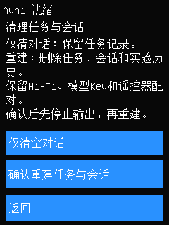

# ESP32 触屏 Wi-Fi 语音实验

当前只保留 Wi-Fi 版，工程为 experiments/esp32_wifi_chat。USB 桌面端、UART 会话协议、旧探针及兼容构建已删除；电机能力迁入 Wi-Fi 版；串口只用于烧录和脱敏日志。日常操作在触屏完成，Mac 后台只需运行仓库外的 ../asr_tts 服务。

## 对话流程

RC003-MS按住语音键录音，松开后整段上传ASR，识别文字显示并自动提交。提示词只有通用助手身份；设备参数、用法和限制由公开SDK的Schema/能力说明提供，不写入系统提示。用户2026-11-13增加可选自动语音模式：在“语音回复”应用中开启，跨重启保留；旧设备缺少偏好时关闭。开启后每轮最终答复保存并显示，再自动朗读；本轮已显式调用扬声器也仍朗读最终文字。

同一个真实内置ToolLoop决定直接回答或使用当前请求预置的完整注册定义调用设备。单个工具结果预算为4096个估算token，包括回复封装及完整机器Schema；这是上下文中的限额，不是内部RAM预留。模型直接给出最终文字时只需一次模型请求；自动朗读另用Rules调用原speaker能力，不增加模型请求。关闭自动语音不影响模型显式调用。屏幕、扬声器、电机都是已注册能力，用户需求触发的设备工具流程由原ToolLoop处理其真实结果。显式屏幕文档本轮保留，聊天记录仍可切换查看。

上下文预算128 × 1024个估算token，包含预留1800输出token；摘要目标4096，满时仍使用原ToolLoop压缩。HTTP请求正文和投影JSON各最多768 KiB，经24字节BodyRef加4字节模式传递；普通队列32 KiB。worker按实长分配，投影后清零释放原正文；共享FileBodies按预算清退已持久缓存而不删仍引用的磁盘正文，PCM只在能力调用期间分配。

128K是配置预算，不是完整长上下文硬件验收。估算token、字节长度、PSRAM峰值和Flash余量分别限制部署。旧usb.chat等私有身份仅为现有数据/取消收尾保留；未知结果不授权透明重试。

## 设置与操作

1. 首页九个应用图标分别进入聊天、语音回复、网络、模型、遥控器、电机、屏幕、状态和清理；子页左上角返回主页。网络页选择 2.4 GHz 网络、填写密码，保存并重启。首次可不填模型 Key。
2. 网络和模型页可配置相应字段；同一局域网浏览器也可打开 http://设备IP，粘贴模型 HTTPS 根地址、名称、Key 和语音 API 地址。密码/Key 不回显，留空保留。接口快照在当前开机期间冻结；空闲、保存完成且正常关闭后重启生效。自动语音开关独立保存，不需重启。
3. 当前语音 API 为 http://192.168.31.162:8000，模型为 https://api.deepseek.com / deepseek-flash。用户选择局域网 HTTP 无密钥语音，Web 配置无需验证码。请勿提交真实凭据。
4. 遥控器页面显式扫描、选择 RC003-MS 并连接；不会盲选首个广播。完成加密、GATT 和 ATVV 协商后才录音。聊天页可看转写/回答、翻页及取消；清理应用提供会话清空。

取消同步使录音及API代次失效，取消中不受理新请求；保存期间取消仍保留已生成的历史，但不发布晚到答复。扬声器的取消等待真实I²S停钟/排空，不伪造完成；自动语音取消还等待Goal及Task终态持久。主页“清理 → 仅清空对话”只重置对话上下文，不擦 Core 分区；完整任务清理见下文。存储异常保留公开原因码，继续公开 shutdown 到排空关闭，提示复位而不自动擦卷。

## 电机迁移

原有 TA6586 驱动、PHYSICAL Call、Scene、Grant、独占 actuator、ExecutionBinding、PermitGate 和控制 worker 迁入 Wi-Fi 版；Core 不改。D0..D3 对应 GPIO38/39/40/41，PWM 上限90%，单次累计输出50–60000毫秒、5毫秒步进。PWM不代表实测转速、方向或位置。独立硬件超时和复位失能仍未验收。

2026-11-13按用户选择仅反转电机2：电机1正/负值分别输出GPIO38/39，电机2正/负值分别输出GPIO41/40。固定D0..D3身份和计数顺序不变，规划与实际输出共用板端极性映射；此前记录中的GPIO40正向自检属于历史版本，不改写为新方向证据。

主页“电机”进入控制页。资源开机自动初始化、会话就绪后默认启用，GPIO初始化保持低电平；不再需要“准备电机”。普通“停用”停止输出并拒绝此前challenge的旧许可，可在状态健康时重新启用。独立“停止”通过原子标志绕过普通队列并锁存至重启；取消、断网、关闭会话和重启也请求停止。控制worker检查3秒心跳、许可及本地输出事实；初始化失败不能由按钮掩盖。模型启用后直接执行受许可约束的动作，不逐动作弹窗。用户2026-11-14明确取消刷写前驱动断电要求，正常OTA不再需要此人工确认；继续先软件停止、排空并正常关闭，再写备用应用槽。自动初始化不测量电源，也不等于发出运动指令；硬件复位失能和独立硬件超时仍未验证。

普通聊天和设备操作共用同一个 USER 入口、真实内置 ToolLoop、GoalType 及历史。模型直接回答时完成其任务，应用显示聊天记录；需要设备时用当前预置的完整能力定义调用。屏幕、扬声器和电机都由公开 SDK 注册；提示词不指定设备或输出媒介，模型按用户需求选择能力。清空重置这一套上下文。聊天页显示最近3个真实阶段及模型轮次，状态页保留最近8个阶段；协议身份提议与实际Provider派发/播放/保存分别显示。进度只披露固定函数名、有效根binding_id和固定operation枚举，不包含业务参数正文、语音或模型内部思考。显式扬声器完成后若ToolLoop仍处理工具结果，继续显示该阶段；可选最终朗读另显示自动语音阶段，收尾前不开放新输入。

电机接口升级到实验能力 v2，单次60秒上限由Schema、授权域、Provider与驱动共同约束；PermitGate过程上限65秒、Call期限90秒，留出有限准备时间。RMT保持1kHz及5毫秒波形，IDF 6.0.3将超过单硬件计数的有限循环拆成批次，中间有ISR重启间隙；duration_ms表示累计PWM输出时间，端到端墙钟稍长。PCNT使用溢出累加和高低限事件验证最多60000个正沿，不把“已接受”当完成。

新v2不冒充旧v1的5秒/人工确认语义；本轮已检查的现有Wi-Fi纯聊天卷保留。旧电机v1卷的完整重开不在本次兼容验收内，不自动迁移、删除授权或擦卷；可用本机旧应用备份回退。Grant容量20给旧根授权及新版本留余量。最初迁移未连接电机；后续用户授权的两路50%/5秒台架自检见下文，不代表60秒带电动作或停止链验收。

2026-11-09按用户要求再次对照原USB版核对：TA6586驱动、独立控制worker和四个v2能力均已在本版编译/链接，Grant、按需工具引用、Scene、Executor、ExecutionBinding与PermitGate链路保留。`motor.status / plan / stop`为UNARY，使用`invoke`或省略operation；`motor.run`为PHYSICAL ACTION，`invoke`等待完成，`start`返回受管操作引用，后续用read/wait/cancel管理。上述调用方式已明确写入能力说明，仍由模型发现并选择，通用提示词和Core不改。stop结果只确认请求提交，不证明轮轴静止或驱动断电。当前两项相关Native检查、ESP-IDF编译、最终符号链接核对及独立停止/授权说明审查通过；更新固件写入校验后已到“Ayni就绪”、遥控器自动重连。日志保存在本机忽略目录，本轮未进行带电试转。

### 触屏电机自检

用户此前要求增加按钮自行测试。当前自动初始化完成、会话就绪并启用后，点“测试1 50% 5秒”或“测试2 50% 5秒”只运行对应一路，另一通道为0；独立“停止”随时可用。自检应保持轮子架空、断电开关就手；操作者PWM上限低于50%时拒绝固定自检，不提高上限。初始化失败或停止锁定后仍须重启。下述旧截图及准备阶段分配记录保留为历史证据，当前页面见文末预览。

`MotorCheck`只拥有触屏固定流程和可靠终态通知，注册两个ONCE GoalType及一个公开SDK内置Rules策略，复用原`motor.run`v2、精确Scope、Grant、Scene、Executor和PermitGate，不增加模型工具或自写执行器。普通聊天仍由原ToolLoop处理；自检期间不并发聊天、录音、配置重启或另一自检。取消、关闭和失败请求独立停止；恢复时先取消遗留自检Goal，不重放历史物理命令，也不自动重试失败或未知结果。屏幕保留真实status/reason，模型/语音正文和Key不入诊断日志。


上图使用固件字体和布局尺寸生成，非实机照片，不作为转动或停止证据。

GoalType容量由1增至3，策略容量由1增至2；Goal/Task/Call/Grant等运行容量不变。实机Core arena从2485104增至2508160字节（增加23056），workspace仍为668568字节；这是实验配置变化，没有Core、公开ABI或存储schema变化。首版自检固件启动正常，但用户点准备时初始化失败、未进入转动。修正版在Wi-Fi/BLE线程启动前预留24KiB内部控制栈及原扬声器空闲worker，只把8槽消息队列payload移到PSRAM；TCB、PermitGate及RMT源缓冲仍在内部RAM，队列payload不由ISR使用。实机诊断确认准备时内部空闲44243字节，但最大连续块只有15360字节，无法取得24576字节栈；仅调整准备时分配顺序仍失败，因此改为启动早期预留；仅移到Host前仍挤占扬声器连续块，最终在无线线程启动前预留两者。预留电机栈不启动电机worker或取得外设，未准备就关闭时同样释放；扬声器worker空闲等待，播放时才取得I2S。初始化输出固定阶段、原始SDK错误及堆余量，失败清理在worker创建前完成。 最终启动日志确认电机栈预留成功、扬声器注册和Ayni初始化通过，全部启动就绪后内部空闲19703字节、PSRAM1883256字节；准备成功后内部空闲17155字节，最大连续块7680字节，24KiB控制栈已包含在占用中。新增自检GoalType写入后，回退旧应用的完整重开兼容性尚未验证，不自动清理数据来掩盖不兼容。 随后ASR上传部分失败，内部最低空闲1464字节；正常关闭实测控制栈剩余18420/24576字节，即峰值6156字节。最终控制栈调整为12288字节，较该峰值保留6132字节余量，释放12288字节内部RAM供联网使用；不缩减其他线程栈，也不把控制栈移到PSRAM。12KiB栈候选ASR已成功（该次1.52秒），但后续第4次模型HTTPS上传仍失败、内部最低空闲696字节。进一步启用IDF6.0.3的SPIRAM_TRY_ALLOCATE_WIFI_LWIP，让SDK支持的Wi-Fi/lwIP缓冲优先放PSRAM；硬件DMA和控制栈保留内部。配套固定static TX=4、cache TX=8，保留static RX=4、dynamic RX=8、BA window=6和乱序队列上限4，避免新配置默认提高数量或变成无界。TLS本已使用外部内存分配。BA窗口保留原值6，低于SDK在PSRAM模式下建议的16；这是有限内存配置，本轮只验证当前局域网正常交互，不声明通用吞吐或网络兼容性验收。该网络配置实机复验ASR成功（1.77秒），连续模型HTTPS请求及TTS流式接口成功，无该次上传失败；但模型两次inspect motor.run返回-7，未派发motor.run，而调用plan/stop后请求朗读。因此模型驱动电机仍未完成，不能把本地自检成功等同于模型动作成功；随后读取最新保存会话并用公开SDK校验解码，确认模型因inspect失败拿不到Schema；当时motor.status已报告motion_enabled=true，没有motor.run业务调用。已定位ToolLoop单工具结果预算1024估算token过小：完整motor.run说明1636字节，普通调用ID时估1357 token，最大128字节转义ID时估1920 token。用户指定提高到4096；保留完整Schema和真实状态，通过原ToolLoop处理，不修改Core、系统提示或授权规则。该预算的渲染缓冲上限25952字节，使用临时堆内存，仍受128K剩余上下文预算约束。4096预算版已实机复验通过，见下述记录。

## 构建与部署

先检查主机内存、swap、CPU 和其他任务，明确设置正数并行度。本轮固件两任务、Native 一任务，总计不超过三。

```sh
CMAKE_BUILD_PARALLEL_LEVEL=2 CTEST_PARALLEL_LEVEL=1 bash build.sh
# 已安装 ESP-IDF 环境的 Python：
python device.py deploy
```

固定使用 ESP-IDF 6.0.3、yyjson 0.10.0、GoogleTest 1.17.0 与锁版 LittleFS。输出为 build/wifi-firmware/ayni_wifi_chat.bin。部署工具只写已验证的应用/分区表，保留 Wi-Fi、BLE 配对和 Ayni 数据；恢复备份也保留在本机忽略目录。不会自动烧录 bootloader、格式化非空卷或擦除旧数据。

## 资源与边界

- 本轮应用图标、自动语音及电机启用改动仅在独立实验，Core、公开ABI0.54/schema9及内置ToolLoop未修改。Core不等待网络、模型或播放。电机启动自动分配资源，GPIO38/39/40/41初始保持低电平；历史自检只覆盖当时已授权的两路50%/5秒台架操作。
- Host 固定 16 槽共享存储队列，外部文件最多 8 个在途请求，为日志/维护留余量。Core Call 32 槽、Task Step 64；不以 Flash 是否写满判断队列容量。
- API 单 worker、3 个作业槽。模型、ASR及健康检查总期限70秒，流式TTS为330秒，均包含排队和正文冷读；连接/单次上传最多 5 秒，读取按 1 秒轮询取消。无重定向、代理或请求自动重放。owner 和 API worker 均有 pthread 身份，满足 SDK FileBodies 的线程检查。
- 录音最长 30 秒、ATVV 压缩记录最多 256 KiB；整段完成后解码上传 WAV。超限、取消或异常结束整段拒绝，不提交半段录音。录音不落盘。
- speaker.speak_text接收1–1024 UTF-8字节，使用原生24 kHz mono signed-16 PCM流，最多300秒；首段到达后边接收边播放。超限或中断停止本次输出，已发声部分不自动重试，不把部分播放记为成功。模型显式调用限额保持；自动语音按完整UTF-8字符分段、每段不超过1024字节，失败或Context变化即停止剩余段。最终模型文字最多8 KiB，屏幕文档能力另有4 KiB限制。
- 中文字体为 GNU Unifont 16.0.04，SIL OFL 许可见 fonts/；未覆盖字符显示替代符。

## 验证记录

此前实机已确认触摸正常、触摸噪声消失、Wi-Fi/Web 保存与重启正常、RC003-MS 就绪、松键结束、识别文字可见，用户确认过模型回复与 TTS 成功。这些是当时的正常交互证据，不替代本版新的单次回答和 128K 验收。

实际存储事件捕获为 FENCED / STORAGE_REJECTED（lifecycle=7、restriction=1、durable=162），不是旧 schema 或 Flash 满的证据；共享队列预留和真实错误码已修复。用户此前授权过一次旧 not_a_log 卷重建，11-09另授权触屏确认的任务/会话重建；两者均未授权自动擦卷。

本机 TTS API 测试：14 字短句完整 WAV 约 1.18–1.33 秒，音频约 3.5 秒；69 字短故事约 5.71 秒，音频 15.68 秒。均为 Mac 回环 API 耗时，不含云端模型、板端下载或 I²S 启播。

本版已通过21项Native正常检查、3项部署脚本检查、clang-format18及契约/diff检查。工具链为ESP-IDF6.0.3/GCC15.2.0、Native AppleClang21.0.0、CMake4.0.3；本地Native保留已知系统头shadow告警豁免。最终应用约2.57MB，应用分区余量38%；已写入并校验、启动到“Ayni就绪”、RC003-MS自动重连就绪，设备Web及语音readyz均HTTP200。此前自动朗读过渡版用户已确认普通回答和朗读正常、完成后能继续说话；其脱敏日志显示连续3轮各只有1次模型请求，ASR约1.18–2.20秒、模型约1.49–1.92秒、完整TTS下载约3.41–10.84秒（随回答长度变化）。这些本机忽略目录中的脱敏日志是仓库外证据，不包含语音/正文/Key。最新通用设备调用也已实机完成；一次扬声器请求记录4轮模型、模型HTTP各约1.36–1.89秒，最终历史保存约0.38秒，完整回合约30.1秒含发现/检查/持久化及播放。直接文字回答仍可一轮完成。

用户报告处理时亮度闪烁；仅启动后关闭Modem-sleep的候选仍闪。已查阅仓库外10-23的full-ps-none-touchfix-v2/RECOVERY.md：当时用户验收无闪，启动后、连接前及IP_READY均set/get PS_NONE。现按原流程补齐三点和扫描前检查，IP回调只发布pending，由UI读回成功后才发布ready，断开胜过晚到的成功；不改发射功率、背光引脚或供电。完整移植后用户仍报告闪烁；断开遥控器连接也仍闪，尚未做关闭控制器对照。最终保持原40MHz总线，采用8行DMA并增加153600B PSRAM shadow；只传变化条带、DMA确认后更新shadow，固定日志记录navigation_stripes以确认静态按钮未重写。整帧40MHz理论传输约30.7ms，状态更新通常只改少数条带。局部刷新日志显示模型交互时navigation_stripes=0；当时仍有整屏亮度闪动，不能归因为按钮重画或仅凭PS_NONE读回判为已修复。

按用户要求继续集中排查共存：实际配置已关闭BT_CTRL_MODEM_SLEEP、ESP_COEX_POWER_MANAGEMENT和PM，Wi-Fi/BT已分核。优先级切换候选已实机确认无效，已从代码移除。当前候选使用公开esp_wifi_force_wakeup_acquire，在IP_READY后持有一次额外RF引用；断开、Core关闭或重启前配对release。关闭后晚到IP不重获引用，释放失败保留failed并报告，不反复10ms重试。保留Wi-Fi/BLE与原40MHz，不改发射功率。申请日志status=0。用户随后分别确认空闲亮度稳定，以及识别、模型、播放全程稳定、执行步骤可见；这是本轮正常交互的目测验收，不是电气波形或耐久测量。待机功耗代价未测量。官方依据：[RF共存](https://docs.espressif.com/projects/esp-idf/en/v6.0.3/esp32s3/api-guides/coexist.html)、[RF唤醒引用接口](https://docs.espressif.com/projects/esp-idf/en/v6.0.3/esp32s3/api-reference/network/esp_wifi.html#_CPPv429esp_wifi_force_wakeup_acquirev)。

未开展新的故障、掉电、恢复、变异或耐久专项，也没有完整 Core CI/覆盖率结论。

协议参考：[Google Voice over BLE v1.0](https://wangefan.github.io/linux_kernel_driver/resources/Google_Voice_over_BLE_spec_v1.0.pdf)、[MI-AO 协议记录](https://github.com/fanxeon/mi-ao/blob/main/docs/PROTOCOL.md)、IDF 官方 nimble_central_utils。协议资料不替代 RC003-MS 实机证据。

## 2026-11-08 流式 TTS

ESP32 使用 `POST /v1/audio/speech/stream`，请求示例：

```json
{"model":"qwen3-tts","input":"你好","response_format":"pcm","sample_rate":24000}
```

原 `/v1/audio/speech` 完整 WAV 接口保持不变，旧固件可继续使用它。新流式固件要求服务同时提供上述新端点；404、格式不符及断流明确失败，不自动回退或重播。Mac 服务代码和模型位于仓库外 `../asr_tts`。

当前 `speaker.speech` Capability及 `speaker.speak_text` Binding升级为v2，声明300秒音频上限和330秒调用期限；配置、发现、工具视图和Grant查找使用同一版本。Core、ABI及存储schema不变，提示音仍为v1；旧工作按既有会话清理规则取消，不重演旧语音调用。回退须使用旧固件和仍保留的完整WAV端点。

新端点返回 `application/x-ayni-pcm-stream`，HTTP 可分块；帧允许跨任意 TCP 分片。AYTS/1 固定头为16字节：ASCII `AYTS`、u32版本1、u32采样率24000、u32声道1；整数均为little-endian，样本为signed-16 little-endian。每条记录先发u32类型与u32载荷字节数，再发载荷：

| 类型 | 载荷 |
|---|---|
| 1 音频 | 正偶数字节的PCM，每记录最多16384字节，总PCM最多14400000字节（300秒） |
| 2 成功结束 | u32累计PCM字节数，须与已接收量完全相等且非零 |
| 3 失败结束 | u32错误分类；1为推理/格式错误，2为生成token预算耗尽，3为300秒时长上限 |

仅成功结束记录与完整HTTP结束同时成立，才把输入标为完整；之后还须I²S排空才回报能力成功。结束后的额外字节拒绝。部分PCM已送I²S后失败或取消为RESULT_UNKNOWN，不自动重试。生成器按0.32秒音频分块，沿用单MLX Broker；没有新增推理循环或Core接口。

板端使用固定64 KiB PSRAM环形缓冲，不预分配整段300秒音频。生产者在锁内复制并发布，worker在同一锁内复制后消费，避免环绕覆盖正在播放的输入；缓冲满时零字节接收，API worker有界等待并检查取消/期限，通过TCP背压限制接收。接收约0.1秒音频即可开始播放。关闭接收且worker结束后擦除整个缓冲并释放，worker暂存也在完成后清除。48 kHz I²S把每个24 kHz样本重复两次；提示音仍按16 kHz生成。录音保持独立的16 kHz/30秒限制。Wi-Fi额外RF唤醒引用和40 MHz屏幕通信策略保持原值。

提交前重新运行Native实验检查、正常部署脚本检查和ESP-IDF编译；实际结果随提交说明记录。此前仓库外记录的Python接口检查及真实长文本测试属于历史本机HTTP链路证据：完整WAV耗时8.51秒；两次流式首块分别0.68/0.19秒，约15.8秒音频分50块输出，块间最大间隔约0.15秒，拼接音频经ASR核对文字一致。原始资料未随本仓库交付，本次未重跑，不据此声明当前实机验收通过；实机连续出声、取消响应及主观效果仍待确认。

## 2026-11-09 任务清理与失败提示

任务创建失败此前只上报旧 `input error=`，UI 未结束忙碌状态，因此看起来一直“处理中”。现在输入存储、任务创建等错误通过可靠终态通道报告阶段和状态码，收到后恢复输入；旧错误文本也识别为失败。准备阶段会显示保存输入、创建任务或等待资源收尾。日志仅增加固定阶段、耗时、公开原因码及 Goal/Task/Call 数量和身份，不记录语音、转写正文或 Key。

`goal creation status=-7` 表示有界容量不足，不能仅据此判定 Flash 已满。取消和仅清对话不会强行删除 Core 为结果未知调用保留的记录。用户已明确允许重建任务和会话：主页“清理 → 确认重建任务与会话”会放弃本实验全部任务、调用、会话和历史，保留 Wi-Fi、模型 Key、遥控器配对、应用及资源。

本轮实际启动日志显示 Goal 4/4、4个已取消 Task，关联调用中有4个 `RESULT_UNKNOWN/effect=UNKNOWN`；符合 Core 保留记录、无槽让位的条件。后续一次真实输入在约296毫秒内明确返回 `GOAL_CREATE/-7/reason=13 (GOAL_CAPACITY)`，模型请求数为0。这是本机忽略目录中的脱敏元数据证据，未随仓库提交；没有据此报告 Flash 空间耗尽。

重建要求当前会话已就绪，允许在处理中发起；先停录音、扬声器和电机，取消并等待 API worker 排空，再公开 shutdown、关闭设备 worker 和 Host，随后由后台分块擦除数据区并重启。只有标签 `ayni`、地址 `0x800000` 和大小 `0x800000` 同时匹配才执行；未确认关闭或擦除失败会明确提示，不自动重试。Web 未增加破坏性入口，开机不会自动清理未知数据。重建期间请勿断电；此路径未做掉电或恢复专项验证。

本轮已通过29项Native正常检查、3项部署脚本检查和ESP-IDF6.0.3编译（单并发）。触屏确认后，实机日志已记录 API idle、关闭后的设备/Host栈指标、擦除成功及自动重启；重开 Goal 从4/4变为0/4，遥控器加密重连就绪。Web公开配置及密码/Key存在标志与重建前一致，未读取或记录真实凭据；随后一次遥控器输入经ASR成功、模型请求及回答保存正常完成。以上日志为本机忽略目录证据，不替代掉电/恢复验收或用户听感确认。

清理页布局预览（相同字体与布局规则本机渲染，非实机照片）：



## 2026-11-09 扬声器调用方式澄清

清理后一次短句实际经历两次 `operation=start` 拒绝（本地工具错误 `-1`），改为 `invoke` 后 TTS 请求和播放成功，用户确认听到声音。脱敏日志中该轮共8次模型请求、约36.7秒；成功的TTS接口约2.57秒，服务生成3.2秒音频。这些是本机忽略目录中的证据，说明本次无声发生在工具调用被拒绝阶段，不能归因于TTS网络或300秒播放期限。

扬声器一直注册为UNARY，Core仅允许ACTION/SUBSCRIPTION采用受管 `start`。现在在扬声器公开能力的使用说明中明确：使用 `invoke` 或省略operation，等播放结束返回；不支持 `start`。描述仍按需发现，不放进系统提示，不改Core、ToolLoop、机器Schema或能力版本，也不在适配器里把错误调用改写为另一种调用。执行步骤显示提议的固定调用模式；日志保留同一元数据及最后工具错误状态，临时参数节点诊断已删除。30项Native正常检查、隐私边界检查和ESP-IDF编译已通过。

说明修复后，用户清对话再请求约40秒故事：模型按发现→查看→`invoke`直接调用，无此前两次拒绝。服务实际输出2791680字节24 kHz PCM，即58.16秒音频、182块；板端语音请求约57.57秒成功，最终回答保存完成，本轮共4次模型请求、约79.04秒。用户确认连续播放及收尾正常。这是超过旧30秒上限的正常实机验证，未执行完整300秒或耐久验证；不把服务器流式响应总耗时当首声等待。

2026-11-10触屏自检本地验证：Native正常检查36/36（包含实际motor.run机器Schema归一化、精确Scope及通知状态），部署脚本3/3；ESP-IDF6.0.3/GCC15.2.0最终双任务编译通过，应用0x2771e0字节、分区余量37%。clang-format18、契约及diff检查通过，独立停止/生命周期审查发现的问题已修复复核。写入校验及最终固件正常启动、遥控器重连通过；准备及两路50%/5秒台架自检实际通过：许可取得、PWM启动、PCNT分别记录GPIO38或GPIO40的5000个正沿、另一通道为0，execution-end及自检终态status/reason均为0，用户确认正常。日志为本机忽略目录证据，不据此声明60秒动作、反向/转速标定或独立停止链验收。

4096预算版实际完成模型驱动：遥控器ASR后，原ToolLoop完成motor.run检查并使用start/wait管理动作；日志记录三次动作（第一路、第二路、双路），许可及execution-end均status=0，PCNT分别为10000/0/0/0、0/0/10000/0及10000/0/10000/0，最终回答均已保存。用户确认转动和自动停止正常；这些是用户现场正常操作观察，不是助手自动发出的动作或独立停止链验收。普通纯文本回合仍一次模型请求完成。相关脱敏日志保留在本机忽略目录，私密聊天导出未提交。

## 2026-11-11 共用模型协议

模型API/工具参数/SSE由Ayni::ModelProtocol统一处理，Native使用同一实现。Web设置和触屏“设置→模型选项”可选Chat Completions或Responses、生成时预览、Chat输出预算字段；保存后正常关闭并重启。旧NVS配置仍按Chat/非流式读取，Key不会回显。预览标为暂定文字，取消/换轮/清空立即清理；完整成功响应才交给原ToolLoop，语音仍由模型调用扬声器能力。

完整Schema和说明来自当前Task可见目录，模型只得到一个通用ayni_call_capability的完整分支工具，不需list/inspect往返。每请求一份tools，不写入历史；invoke/start/read/wait/cancel/close与原授权/许可语义保持。Responses续传包含有序Items和encrypted reasoning，绑定API/模型/目的地；更换选择时明确拒绝旧续传，用户显式建立新会话，绝不自动擦卷。主请求/工具结果/摘要预算使用真实API投影，服务usage独立报告。

软件验证使用本地合成HTTP/SSE与公开SDK，兼容决定见[ADR-0098](../../docs/adr/0098-shared-model-protocol-and-preloaded-tools.md)。当前屏幕设置预览见[截图](screenshots/model-settings-preview.png)。本轮只编译与软件验证，没有烧录、串口、线上模型或电机运行，未完成128K峰值、60秒动作或硬件停止链验收。

## 2026-11-11 拉取后实机复核

用户随后要求拉取最新代码并测试独立固件，确认驱动断电、USB已连接。本次基线为已合并#132的main `bf9811e`。原有数据启动受限，日志为restriction=5（LOG_CORRUPT）、durable=396；换回保存的旧应用后同样受限，不能据此认定为新协议格式不兼容或Flash已满。用户另行授权重建任务与会话后，仅擦除既有ayni数据区，配置及配对保留。新卷启动、通过Web启用模型流式后的正常关闭重开均成功；旧日志的具体重放失败原因未查明，重建不代表修复旧卷或完成恢复验收。

首次流式模型回合在HTTP200后解析失败并挂起。定向检查发现共用Chat SSE累计器把后续delta中显式null的可选role、tool_calls及工具身份/参数字段当作错误。现在这些null与省略字段一样，不增加或覆盖已有片段；非null错误类型和最终缺失工具身份仍拒绝，完整协议终态及HTTP完成前仍不交付执行。新增正常分片、预览及不完整身份检查；实验日志区分模型流/语音流，并只增加SDK固定数值状态与parser_status，不记录正文、参数、Key或音频。不修改Core、授权、自动重试或电机执行机制。

修正版已写入并校验，启动就绪、RC003-MS加密重连成功；重启后在触屏重新准备电机。用户操作的五次语音输入均转写成功，ASR接口约1.05–1.59秒。四轮模型电机调用使用预置工具的invoke，许可、PWM启动及execution-end均status=0；PCNT依次记录GPIO38/39/40/41为3000/0/3000/0、5000/0/0/5000、3000/0/0/3000及10000/0/0/10000。四轮均保存最终回答，模型请求分别3、2、2、2次，回合约23.34–31.16秒；另一次纯文字回合为1次模型请求、约10.25秒。回合耗时不含ASR，包含动作等待与持久化，不能当作模型HTTP延时。此次驱动保持断电，上述计数只证明控制信号及正常收尾，不证明车轮转动。没有观察到扬声器调用，本版朗读听感仍未确认；串口随后断开，未自动重连或重放动作。

本地共用协议/帧检查28/28（AppleClang、ASan/UBSan）、Wi-Fi正常检查40/40、未修改的部署脚本检查3/3通过；ESP-IDF6.0.3/GCC15.2.0单任务编译通过，应用2620720字节、分区余量37%。clang-format18、readability、契约和diff检查通过；Darwin保留已有shadow告警豁免，未修改Core消警。独立定向只读复核未发现阻断项。原始脱敏指标位于本机忽略的build日志中，属于仓库外证据；线上模型仅验证DeepSeek Chat流式，Responses仍只有软件协议证据。未执行完整300秒播放、128K峰值、60秒动作、硬件停止链或新的故障/恢复/变异/耐久专项。

## 2026-11-11 Wi-Fi实时诊断与容量探针

用户随后报告多次操作后仍有间歇性held/-17/-7，本次未取得同一次新失败的完整现场，不能宣布间歇问题已解决。重新接串口时只读到旧的UNKNOWN调用，占1/4个Goal槽位；-17表示结果未知，-7表示容量不足，各自原因不能仅凭代码推定。任务暂停现在同时记录关联Goal/Task/Call状态；模型编码记录正文/JSON字节数、估算量及内存余量，以便后续直接通过Wi-Fi取证。

在同一局域网打开设备地址的`/logs`，或`GET /api/logs?after=0`读取。服务沿用数字IP与同源检查、无验证码、禁止缓存。每次最多12条，`log.next`是下次after游标的十进制字符串；boot改变或reset表示应重置游标，lost明确报告64条环形记录覆盖的缺口，dropped报告捕获竞争或超长记录拒绝。浏览器每秒读取，最多保留2000条，可下载当前已收到的记录。板端只保留RAM，不写Flash；断电后清空，启动后重新捕获。HTTP先编码快照再发送，发送期间不持有日志锁；生产者try-lock失败只丢诊断。电机控制线程只复制预格式化状态，不新增UART或网络等待。采集点是明确选择的状态码、阶段和数值，不转发任意printf、UI文字、模型/用户正文、工具参数、Key或媒体。

`POST /api/diagnostics/context-test`（空正文）排队测三种合成文本的发送编码边界。HTTP202仅确认排队，最终完成/拒绝见wifi probe日志；忙碌返回409，配置保存和测试均由UI再次检查就绪与空闲。模板通过单独的合成Goal从实际预置目录获得，使用原ToolLoop；消息kind显式区分本地诊断与普通HTTP模型调用。固定本地诊断回复只完成此Goal，不交给设备能力、不保存为用户回答；真实会话的历史轮数在前后记录并保持相同。普通模型请求不经过此本地回复路径。

加`?characters=N`测N个合成中文字符的完整样本：生成独立历史正文，走同一FileBodies缓存/持久值、Goal、原ToolLoop、真实请求编码及本地回复收尾；当前会话不变。范围1–262144字符，仍受部署字节/估算token预算及内存限制。失败的诊断Task按正常取消收尾，不擦卷、不重试未知动作。它测板端路径，不包含真实模型、TLS、语音并发、所有历史/工具分布或耐久；上下文满时策略仍可额外摘要，因此完成样本须结合model_requests和实际发出的上下文大小判断是否保留了原始文本。

代码自查后为完整样本增加保守资源预检：按六份历史工作副本、128 KiB编码余量与至少16 KiB内部空闲量决定是否尝试，不足时在创建Goal前返回容量错误。此项只限制诊断任务，避免资源不足时仍盲目进入SDK的STL分配；它不是普通会话的上下文上限，也不保证任意运行负载都不会分配失败。预检版尚未烧录。

首版发送编码实机结果：latin与Han均可到129272个估算输入token，另预留1800个输出token，总计131072；下一字符因context_budget返回-7。Han合成文本160020字，内部帧491461字节、JSON492584字节，两个发送工作区约987110字节，记录时PSRAM剩694684字节。控制字符样本受JSON转义估算影响，27049个换行已到129271估算token。它们证明这一发送路径达到配置预算，不能单独当作完整历史峰值验收。

完整路径已实际通过32768、65536个合成中文字符，分别一轮本地模型结果完成、未摘要，JSON为109693/209005字节，完整wire估算33045/58377 token；编码记录时PSRAM分别剩1171032/670592字节。诊断前后真实历史轮数均为0；不从这个数值推断或重建此前用户聊天。Wi-Fi页面实际显示已连接、游标日志与内存统计。用户随后断开USB改为充电宝：Mac枚举中目标USB串口已消失，同一设备IP的日志HTTP200且boot改变，证明脱离USB仍能读取。98304字样本没有取得同一次完整终态，观察期间boot变化，不能据此判断是OOM或最大边界；随后按用户要求停止启动新实测，转为代码排查。不把当前通过值称为最大值。

最终完整路径候选使用ESP-IDF6.0.3/GCC15.2.0，应用0x283200字节、分区余量36%，已写入校验并启动。新增环形游标/转义/模板隐私/协议与容量边界检查后，Wi-Fi正常检查44/44通过；共用协议28项与部署3项沿用同一未改实现的已有结果。资源预算为每个构建1任务；未修改Core、ABI或schema。读取旧应用备份曾在串口传输中断，未写入新应用；改为分块只读备份完成后部署，既有配置、配对和数据区未擦除。容量结果与脱敏日志位于本机忽略的build目录，是仓库外证据。

### 内部内存与传输失败的代码排查

无线日志实际捕获到一次新失败：ASR成功，电机许可、PWM及5秒终态成功；第三次模型请求内部帧11806字节、JSON12415字节、完整wire估算9127 token，随后HTTP200、已接收18212字节、parser_status=0，但读阶段失败并进入held/-17。该次不是128K上下文耗尽；现有证据不能确定底层断流原因。错误瞬间internal_free=9763，internal_min=6380是启动以来的历史最低值，不是当前剩余量；PSRAM在此前编码记录中仍剩约1.6 MB。用户提供的同一次脱敏文本与Wi-Fi记录相符，原文未提交。

代码确认主控线程继承11-01旧USB实验的96 KiB内部栈；已记录正常高水位空闲72472/98304字节，即观察到峰值使用25832字节。源码候选改为64 KiB，为该观察保留39704字节余量，返还32 KiB内部RAM。其他线程栈、DMA和停止链未改变。交叉编译器-fstack-usage检查主控入口、Chat、ToolLoop和Stream：最大单函数帧分别为464、3136、3184、144字节；这是部分翻译单元的单帧静态报告，不是完整调用链或64 KiB实机验收。96 KiB版固定的主控/存储/API/扬声器/电机/I/O/Web栈合计172 KiB，此外还有射频、驱动、控制块和DMA开销。

配置已令Wi-Fi/LwIP优先PSRAM、TLS显式使用PSRAM，但普通malloc在<=2048字节时仍优先内部RAM。FileBodies的std::string正文缓存、map/list元数据和模型流的行/事件/文本缓冲走普通分配；正文缓存保留到释放或下一轮reset_idle，因而一轮内的多个模型/工具调用会增加同时存活的中小对象。HTTP及响应的显式关闭/清除路径已检查，未发现足以证明永久泄漏的证据，也没有逐分配堆追踪来把全部下降精确归账。

另一个确定缺陷是流式读取的负返回值未写入transport_code，使真实读错误被显示成0/0。候选现在保留read返回值、HTTP完整标志与TLS状态/子码/flags，分两条有调用ID的有界数值记录输出；不把正常EAGAIN当断流，不放宽完整响应要求或增加重试。主控栈整改、资源预检与这些诊断仅完成本机编译/检查，未再次烧录；不能据此宣布间歇问题已修复。后续是否需要进一步的缓冲放置或释放整改，须结合实际错误码或堆归因决定，不靠反复烧录猜测。


### 2026-11-11 Web OTA 与内存修复部署

用户确认USB连接、驱动断电，并选择先完成OTA与内存修复再一起安装。布局和兼容边界见[ADR-0099](../../docs/adr/0099-esp32-web-ota.md)。旧3 MiB音频区改为ota_0；原factory地址保留为ota_1；NVS、配对及8 MiB Ayni区不移动、不擦除。首装先完整备份旧bootloader/表/空白元数据区/音频/应用；后续从设备设置中的“固件更新”选择应用bin即可。正常升级不再需要串口。

初次引导（仅本次已授权的已知旧布局）：使用已安装ESP-IDF Python运行 `ota_install.py prepare`，完整备份成功后运行 `ota_install.py install`。后续访问 `http://设备IP/update`；原始接口为 `POST /api/firmware`，Content-Type为application/octet-stream，body为完整的ayni_wifi_chat.bin，最大3145728字节。GET同一路径查询版本、槽位、启动确认、进度和错误码。忙碌时先结束/取消；上传或应答中断后读取状态，不自动再次上传。局域网入口沿用无验证码方式，只用于可信LAN；SDK镜像哈希校验不代表固件签名认证。

HTTP只写备用槽；UI沿用维护停止、所有API借用退出、Core与Host关闭、STOPPED确认，随后才允许写入。Wi-Fi与RF唤醒引用在应答前保持。完整SDK镜像校验后才切换；应答尝试后留1秒再重启。新启动先禁止对话/设备操作，配置、触摸、Web、Wi-Fi、会话稳定5秒后确认；60秒不能就绪请求SDK软件回退。未来ABI/schema变化仍须单独兼容决策；当前不改变ABI0.54/schema9。未执行断电、镜像破坏或回退专项。

本机资源检查16 GiB、10逻辑CPU、可用内存比例46%，swap用量约1.1 GiB；每个构建/测试显式1任务。ESP-IDF6.0.3/GCC15.2.0编译通过，应用初版0x287750字节，小槽余量16%；Wi-Fi相关Native检查47/47、Python安装/部署6/6、页面JS语法及契约/diff/机械可读性检查通过。64 KiB主控栈与读错误诊断沿用前一提交，实际安装及Wi-Fi更新结果稍后记录；不将编译当作实机验证。

设计自查：删除的维护注释已改为同时说明重建/OTA的STOPPED屏障；Core及Kernel字段未变化（仅实验目录）。进度与重启屏障归UpdatePlan，SDK校验/选择归OtaUpdate，UI/停止生命周期归Runtime，无HTTP回调直接调用Core。OTA选择CRC公式只在安装器selection实现，出处为固定SDK otatool.py；分区/大小/时限均有命名常量，安装器比较完整冻结布局；无新的Core裸数字或公共状态码。正常检查不替代故障回退证据。


实际部署版本为`bebffbe`，最终应用0x287790（2652048）字节，小槽余量16%。旧布局完整备份保存在本机忽略的`artifacts/recovery/pre-ota-20261111/`，包括32768字节bootloader、4096字节表、8192字节空白区、3145728字节音频和4128768字节旧应用；原应用最后一个只读块曾串口中断，保留已完成块并续读成功后才开始写入。USB仅写0/0x8000/0x9000/0x100000四个区域，esptool逐项校验成功，原应用槽保留。NVS和Ayni卷未读写/擦除，正常应用的日志维护仍会按原行为写入数据卷。

USB首启动从ota_0运行，pending_verify由true变false；随后经真实HTTP上传同一个有效应用，20.58秒收到200及updated/restarting=true。串口证据为正常STOPPED、接收2652048/2652048、OTA status=0；重启后从ota_1运行、启动确认status=0。配置password_set/model_key_set及接口/流式选项与安装前一致，旧Goal/Task/Call元数据重放且会话就绪，未清空历史挂起记录。配对区域保持，启动仍从保存的peer发起连接，但遥控器此次自动连接status=13失败；未做唤醒重连或新语音回合，不声称朗读/遥控器本轮已验通。

同一空闲阶段内部空闲从安装前26787增至新版本约58879–59503字节，符合主控栈返还32768字节并扣除OTA新增开销的预期；实际正常关闭时owner_free=39448/65536，storage worker_free=14048/24576、speaker_free=11596/12288。历史最低内部空闲本轮约51 KiB。此为启动/正常OTA路径的观测，不是所有模型/电机/长语音峰值保证；原约9K wire token的间歇读失败仍需结合新传输错误码归因，不能宣称已根治。

自查复核补充：OTA拒绝应答已移到metadata mutex之外，HTTP慢客户端不会持锁阻塞UI；明确未成功排入关闭命令的路径可以拒绝，已在关闭中的超时仍等待STOPPED才重启。相关3项UpdatePlan检查在修正后重跑通过。部署与诊断日志在本机build目录，是仓库外证据；不开展无效镜像、断电、回退、额外擦卷或带电电机专项。


### 2026-11-11 HTTPS 校时前置条件与已知未发出分类

新一次Wi-Fi记录表明ASR在1396ms成功；首个模型请求完整wire估算7708 token，在本地70ms返回“等待网络校时后重试”，没有进入HTTPS客户端。内部空闲55435、PSRAM1645480字节，不能归因于上下文或RAM耗尽。API在进入http()之前清除了已知失败包，而校时早退没有恢复包，使UI提交空model_error，原Core按UNKNOWN(-17)暂停。旧版仅一个pool.ntp.org，Wi-Fi初始化时便启动SNTP；界面未把模型网络校时作为对话准入条件。实际DNS/UDP未成功的原因仍无抓包证据，不将启动时序问题说成唯一网络原因。

本次只改实验：三个SNTP源，在IP_READY和射频策略确认后启动，重连后重启SNTP；SDK负责后续重试，不重发模型请求。首选ntp.aliyun.com及备用time.cloudflare.com的地址分别依据[阿里云](https://www.alibabacloud.com/help/en/ecs/user-guide/cloud-marketplace-mirror-specification)和[Cloudflare](https://developers.cloudflare.com/time-services/ntp/usage/)官方文档，保留pool.ntp.org。对话/录音在HTTPS时间前置条件未就绪时拒绝，触屏显示等待校时且不创建Goal；配置和OTA保持可用，启动确认仍不依赖公共NTP可用性。TLS证书与日期校验不关闭。网络时钟阈值只在network_time.h定义，HTTP、Station、UI和日志共同使用。

API校时拒绝明确返回NOT_READY/FAILED/EFFECT_NONE，客户端分配失败同样标为已知未发出；已进入网络后的不确定结果仍保守处理，不重试。GET /api/logs新增clock.ready及clock.epoch_seconds，页面显示状态，设备RAM记录包括启动/就绪/等待；不记录语音、正文、Key或SSID。此修复避免冷启动创建本次这种无效对话及错误UNKNOWN，不把所有其他失败Task改为自动完成。旧UNKNOWN记录不改写、不清空。

本次资源预算沿用16 GiB主机可用比例46%、swap约1.1 GiB，每个构建/测试显式1任务。ESP-IDF6.0.3/GCC15.2.0编译通过；Wi-Fi Native49/49、部署/安装Python6/6、页面JS、契约、diff和机械可读性通过。完整CI/线上Responses/断电或回退专项未运行。

自查四项：
- 删除注释：station.cpp:71保留并补充联网后启动原因；api.cpp保留传输后UNKNOWN的边界，前置拒绝补充完整无副作用结果。
- Kernel字段：git diff仅实验目录及相关记录，没有Core或公共ABI字段；Clock状态归Station，UI的was_clock_ready_仅供重绘，不复制系统时间。
- 重复公式：network_time.h:8/11拥有唯一时钟阈值与HTTPS准入判断，Station/API/Runtime/Web共用；SDK负责SNTP和TLS，不另写协议。
- 裸数字：network_time.h命名epoch阈值及HTTPS前缀；station.cpp命名源数量、轮询和日志间隔；不新增Core记录或线格式数字。


本次实际OTA为3805453，应用0x287d90（2653584）字节。用户确认驱动断电，触屏取消后日志已见turn failed/cancelled终态；经Wi-Fi上传32.55秒得到200及updated/restarting=true，从ota_1切换到ota_0。新启动wifi clock start status=0 servers=3，开机2771ms即记录clock ready；GET clock.ready=true且与Mac时间差小于1秒。Core旧卷正常重放并就绪，OTA启动确认status=0/pending_verify=false；password_set/model_key_set和原接口/流式选项一致。旧UNKNOWN记录保留，未清理或重放；未修改bootloader/分区表，未使用USB。实机只验证正常OTA、启动、校时及配置保留，本轮尚未重新进行语音/模型/电机对话。

最终头文件命名常量整理后，相关2项WifiClock检查重跑通过；无Core/ABI/schema改动。完整设备脱敏证据在本机忽略的build/clock-ota-update.log与clock-ota-evidence.json，属于仓库外证据。


### 2026-11-11 模型SSE累计流量限制修复

后续多轮语音记录中，校时正常、ASR和此前普通对话/扬声器调用成功；失败模型请求wire估算23565输入token，HTTP200、完整上传38351字节、收到133120字节时解析器仍为OK，read=2048/complete=0。代码按32768×4=131072限制整个SSE累计响应，因而被本地总量上限终止，不是本次网络读错误或已证明的内存不足。内部最低33476字节，读取日志时内部空闲52447、PSRAM1553280。该记录的环形日志已有282条覆盖，不声称重建了更早的完整会话。

用户明确要求去掉128 KiB累计限制、保留内存保护并OTA更新，确认驱动断电及回合已结束。只改独立ESP HTTP适配：模型流的Content-Length检查和逐块计数都不再有累计字节上限；ResponseLimit仅拥有HTTP字节边界和计数溢出保护，缺省总量表示模型流。原共享ModelProtocol::Stream继续限制每条行/事件/输出字段和完整组装响应（本实验传入128 KiB），消费完的元数据被释放。未扩大解析器缓存，非流式JSON32 KiB、语音帧/300秒预算、输出token及请求期限均保留。流解析/保留数据容量错误明确记录具体原因，网络后未知副作用仍保守处理，不自动重试或重放旧指令。成功HTTP模型流增加wire_bytes/buffer_limit元数据，不记录正文或Key。

资源检查16 GiB主机、10逻辑CPU、当前可用比例74%、swap约3.1 GiB，无其他编译任务；每个构建/测试显式1任务。ESP-IDF6.0.3/GCC15.2.0候选编译通过；Wi-Fi Native52/52通过，包括累计超过128 KiB且组装结果小于4 KiB的完整正常Chat流、已声明Content-Length与逐块使用同一边界、单事件/组装输出内存上限和计数溢出；共享协议已有的完整元数据流及缓冲边界2/2通过，部署Python6/6通过。不开展新的存储故障、断电/回退或带电动作活动。

自查四项：
- 删除注释：api.cpp:377保留并改写原JSON/语音分配说明，补充模型流消费事件与保留内存的区别；传输不确定与无重试说明仍在。
- Kernel字段：git diff仅实验目录和工作流记录，没有Core/ABI/schema字段；Job继续拥有接收字节计数，ResponseLimit不复制计数或正文。
- 重复公式：response_limit.h:11/12统一HTTP声明长度及逐块计数的总量检查，Api调用同一规则；实际SSE解析/保留大小继续由公开共享解析器拥有，没有另写协议。
- 裸数字：旧阈值只作为测试回归常量old_wire_limit；生产保留stream_buffer_limit命名常量，计数用numeric_limits防溢出，无新的Core记录偏移或阈值。


本次部署实际遇阻，不能报告OTA后正常就绪：最终修复版本0fed423，应用0x287f80（2654080）字节、小槽余量16%。第一次HTTP409在写入前明确拒绝，随后用户实际取消，日志出现turn failed/cancelled终态，才再次发起更新。第二次31.64秒得到HTTP200及updated/restarting=true，轮询先观察到新版本0fed423/ota_1/pending_verify=true，之后回到3805453/ota_0/pending_verify=false。新版本没有通过就绪确认，正常更新中自然触发回退；没有主动制造故障或启动回退测试专项。

只读日志显示已有卷重放进入RESTRICTED：lifecycle=4、restriction=5（公开常量LOG_CORRUPT）、boot=0、durable=434；旧版本回退后也报告相同错误。这不证明物理Flash损坏，也不把durable=434说成具体损坏记录。Core/ABI/schema没有改动，模型流尚未调用，因此不能将此次重放问题归因于新SSE解析。任务/会话、NVS及配对未擦除，旧记录不改写。固件声明长度/写入校验成功与应用正常就绪分别记录，修复代码已推送，不声称新版本已驻留运行。

当前固件在会话受限时editable=false，会拒绝OTA；现有Web只有元数据日志，没有数据卷导出。USB枚举未发现目标板，因此已请求用户保持驱动断电并连接USB，准备只读备份/分析实际卷；未据早先的一次清空授权再次删除数据。脱敏证据在本机build/stream-limit-ota-update-after-cancel.log、stream-limit-storage-restriction.json及stream-limit-rollback-state.json，为仓库外记录。待卷重放原因解决后再完成OTA与实机长模型流验证。


用户随后明确“数据不用了，清空就行”，并确认USB接好、驱动断电。本次额外授权仅执行一次Ayni任务/会话区重建，不延续为未来自动擦卷权限。通过已知VID/PID/序列号核对目标，读取分区表并逐项匹配ADR-0099布局后，仅erase-region 0x800000/0x800000，23.6秒完成；未擦应用、OTA元数据、NVS、demo_cfg或配对。串口工具的XMC启动警告在之前正常备份/安装中也存在，擦除报告成功；没有据此确认Flash物理损坏，也未开展新硬件故障专项。

擦除后旧固件先正常初始化空卷、goals=0/4、会话就绪；再经Wi-Fi上传同一个0fed423应用，31.65秒得到200。最终运行ota_1、version=0fed423、pending_verify=false，校时启动约2781ms就绪，Core旧卷正常重开且session=2/goals=0/4，OTA verification status=0。配置password_set/model_key_set及原Chat/流式选项保持，内部空闲58887、PSRAM1663924字节。此次仅通过USB执行授权清空，应用安装仍走Wi-Fi OTA。

最终修复与部署完成，保留内存边界的累计大模型流已在本机回归通过；本轮未再发真实长模型对话，不声称实机长流验收。旧卷重放限制的根因仍未确认，用户选择清空恢复，不能把清空当作存储根因修复。追加证据位于本机build/stream-limit-authorized-reset.log、stream-limit-after-clear-evidence.json、stream-limit-ota-after-authorized-clear.log、stream-limit-ota-evidence.json，为仓库外记录。


### 2026-11-12 存储重放根因排查阶段记录（用户要求暂停）

用户要求从代码继续排查，不以清空恢复代替根因、不反复刷固件；随后要求先停止排查并提交推送。本轮仅检查源码和本机已有备份，未访问开发板、未清空、未烧录、未改Core或生产实现。根因仍未确定。

已查调用链：Host单工作线程排队写入FileLog、LittleFS显式sync与正常关闭；Core BootSequence发现/重放批次、WorkReplay逐记录配对及跨表一致性；Task/Goal回收、Call的UNKNOWN保留与取消。LOG_CORRUPT既可能来自批次/记录校验，也可能来自语义配对或跨表一致性，现有restriction/durable元数据没有具体失败分支，不能单凭它断言Flash损坏或某条记录有错。

找到本机2026-11-10的8 MiB只读卷备份，使用固定LittleFS源码以LFS_READONLY编译的工具只读导出commit_log，未输出聊天或参数内容。它不是此前清空的durable=434故障卷。该历史日志125916字节、117个完整批次、schema9，Host外层和Core批次头/正文CRC全部通过；不据此证明后来卷的CRC也正常。

实际离线结果：
- 当前Core正常读取上述历史批次，进入RUNNING/restriction=0，启动后durable=120/boot=5；未注册完整实验设备目录，不能称为整个实验应用的重放验收。
- 历史61条Call记录可由当前记录reader解码，无需恢复或打印正文。
- 复用现有Sim/public ABI夹具：模型返回UNKNOWN、用户取消Goal、正常关闭重开，进入RUNNING/restriction=0/durable=15。
- 4 Goal/4 Task/32 Call配置下，保留三个已取消但UNKNOWN的Call，连续24个正常完成回合复用第四个槽；每轮用现有日志检查新Kernel重开，最后再UNKNOWN/取消并正常关闭重开，进入RUNNING/restriction=0/durable=207。没有修改存储字节或注入存储故障。

本机资源检查16 GiB、10逻辑CPU、可用比例67%、swap约3.1 GiB，独立Debug诊断目标显式单任务构建，使用当前Core/Sim及现有单测夹具；合计四个临时检查通过。这些检查尚未复现durable=434失败，不等于根因修复；完整实验ToolLoop、按需能力绑定、实际文件值与压缩组合仍未覆盖，停止前尚未展开该部分。没有执行断电、变异或新的实机恢复专项。

诊断源码、构建及结果保存在本机忽略目录build/replay-investigation-20261112/，包括probe/、native/、old-batch-metadata.json、probe.log和tight-probe.log；原历史备份仍在build/dialogue-inspect-20261110/。这些均为仓库外证据，不提交原始卷、commit_log、正文或导出的文件值。后续先用完整实验条件继续本机复现，并细分重放拒绝位置；不要把未复现的候选当作此次根因，也不要再以擦卷替代诊断。

## 2026-11-12 共享交互运行时

实验删除本地History、BodyCache和ValueQueue，复用Session的取消、终态、发布/ACK和清空；正常聊天使用Core上下文锚点，容量诊断独立且不写真实历史。旧独立历史按用户决定不迁移；不擦Core卷、不改变配置和配对。缓存清退、正文请求配额和命令客户端由共享组件实现，关闭前先quiesce排空文件/ACK，再停止Core及Host。

本轮软件正常检查、隔离Native完整程序及正常重开、独立实验和共同消费者的ESP-IDF编译通过；独立审查由用户后续安排。没有烧录、OTA、线上模型或运动，也不替代128K实机峰值、独立停止链或故障/恢复验收。具体检查和资源查询集中在统一提交说明，设计见[ADR-0100](../../docs/adr/0100-shared-interactive-runtime.md)。

## 2026-11-13 共享会话部署配置与OTA

用户要求拉取最新main并OTA升级，确认电机驱动断电。main `877c9c1` 的应用完整上传并从ota_0启动，但CONTEXT_OPEN返回UNSUPPORTED(-4)，未通过就绪确认，随后自动回退至原0fed423/ota_1，原会话再次就绪。此次是正常升级中自然观测到的启动失败，没有制造故障、擦卷或重试未知动作。

根因是独立实验的chat_config未设置memory_capacity；Core按该值是否非零决定是否分配每Agent一个上下文。ADR-0100已迁移到共享Session，启动必须打开Core锚点；只验证配置可分配内存不足以发现上下文被禁用。修复在实验部署中设置memory_capacity=1，沿用现有单Agent及默认正文/依赖边界，不改变Core、C ABI0.54或schema9。新正常测试用实际chat_config、Sim Host和公开API完成启动、打开管理会话、创建并等待可用上下文及正常关闭，不调用模型或执行设备。

Wi-Fi Native检查53/53、clang-format18、契约及diff检查通过，ESP-IDF6.0.3编译和镜像校验通过。修复版本e3a379f的应用为2659808字节，小槽余量约15%；正常Wi-Fi上传31.73秒返回HTTP200。设备从ota_0启动，约10.58秒会话就绪，15.62秒OTA启动确认status=0，随后查询pending_verify=false；原两组Goal/Task/Call元数据仍在，未清空Core卷。password_set/model_key_set及接口、流式、输出限制选项保持，网络校时就绪；配对区未写入，不声称本轮遥控器重连或语音/模型已实测。

实机Core arena从未修复main的2530976增至2539200字节（增加8224），workspace仍为668568字节；最终只读查询内部空闲58879、PSRAM空闲1630996字节，不作为对话/媒体峰值保证。首轮及最终脱敏记录保存于本机忽略目录build/ota-main-20261113/，属于仓库外证据。新增上下文需要兼容的部署容量，不能从ABI/schema相同推定memory_capacity=0旧应用可读新卷；本轮未开展新的回退、掉电或恢复专项。两路方向映射未修改，GPIO脉冲不能证明实际轮轴方向。

## 2026-11-13 电机2方向修正

用户报告方向相反并明确只反转电机2，决定见ADR-0097。motor_plan.h拥有本机极性规则，motor.plan、RMT选脚和PCNT预期及结束效果判断共用；电机1正/负仍为GPIO38/39，电机2正/负改为GPIO41/40。能力说明同步更新，PWM幅度/持续时间、零值滑行、PHYSICAL许可和停止路径沿用原机制。旧物理指令不会因升级重放，历史结果不重算，不修改Core/ABI/schema或存储布局。

新增正常检查逐项验证两路正负、混合符号、最大幅度和全零滑行；最终Wi-Fi检查54/54、clang-format18、契约及diff检查通过，ESP-IDF6.0.3编译及镜像校验通过。版本e3f805e的应用2660032字节，经正常Wi-Fi上传31.58秒得到HTTP200，从ota_0切换到ota_1；启动约10.55秒会话就绪、15.59秒OTA确认status=0，查询pending_verify=false。原两组Goal/Task/Call元数据及配置标记保持，网络校时就绪，数据卷未清空。

沿用本次会话已确认的驱动断电与正常OTA流程，未重连串口或发出电机转动指令；遥控器、模型与实际轮轴方向本轮未实测。回退旧应用会恢复其旧方向映射，不能把历史GPIO40正向结果当作本版物理方向证据。构建、Native结果、镜像元数据及最终脱敏状态保存在本机忽略目录build/motor2-direction-20261113/，属于仓库外证据；不扩展新的故障、掉电或恢复专项。

## 2026-11-13 应用图标、自动语音与电机默认启用

用户选择九个应用图标入口，随后要求配置页美化并减少说明文字；页面统一为深色卡片、字段分组、圆角按钮与开关，保留失败提示及状态详情。语音回复由按钮控制并跨重启保存；开启后每轮最终文字均朗读，即使模型本轮已显式调用扬声器。显式speaker能力不受自动开关限制。用户最终明确电机默认启用，覆盖讨论中的默认停用；资源自动初始化，普通停用／启用与锁存至重启的独立停止分开。产品、兼容及安全边界见[ADR-0101](../../docs/adr/0101-touch-apps-and-automatic-reply-voice.md)。

自动语音复用公开SDK的Rules、speaker v2及原24字节正文引用，按1024字节UTF-8边界分段，不增加模型请求。暂存正文使用本组合独占的scope 0；每段固定原Context及版本基线，删除或变化后停止剩余段。关闭语音先取消并排空真实播放，等待Goal及Task终态持久，再释放正文和开放输入；失败保留文字并显示原因，不重播。语音偏好独立存入版本化NVS，不重写网络/模型快照。电机状态由控制worker可靠发送，普通停用拒绝之前challenge的nonce，重新启用不复活旧许可。

Native正常检查68/68通过，覆盖完整长答复、零额外模型请求、缺授权、同文正文隔离、Context删除、异步正文准备与播放取消、最终Task持久收尾、偏好保存、图标触区及电机停用水位。ESP-IDF6.0.3/GCC15.2.0候选编译通过；Native为AppleClang21.0.0/CMake4.0.3，固件两任务、Native一任务。最终提交对应镜像及OTA状态另记于下文。

作者自查及独立只读复查已完成，重要发现均在本次范围修复；复查不等同执行硬件测试。四项结论分别为：

- 删除注释：chat.cpp:1624改写了已被可选自动语音取代的“仅模型决定发声”说明；原保存后呈现和不重放约束保留。
- Kernel字段：搜索本次core/及include/差异为空；UI模式属MotorSwitch，朗读正文及异步借用属ReplyVoice，未新增Kernel状态副本。
- 重复机制：reply_voice.cpp:10、:195复用SpeechProfile限额及现有正文编码；runtime.cpp:35共享网络／模型字段索引，绘制和触摸使用同一表，未新增TTS执行通道。
- 裸数字：preferences.cpp:8命名两字节偏好记录，ReplyVoice复用body_reference_bytes；没有新的Core记录布局或ABI数字。图标几何为本地像素布局。

预览使用同一Canvas、字体和实际页面绘图代码生成，非实机照片：[应用首页](screenshots/app-launcher-preview.png)、[语音开关](screenshots/voice-reply-preview.png)、[电机控制](screenshots/motor-controls-preview.png)、[网络](screenshots/network-settings-preview.png)、[模型与语音](screenshots/endpoint-settings-preview.png)、[模型选项](screenshots/model-options-preview.png)。预览使用合成配置值，不含凭据。本轮尚未实际试听、触摸操作、调用线上模型或驱动轮轴，也未验证独立硬件停止链、长动作或掉电恢复；本机build/app-ui-20261113/日志属于仓库外证据。

最终固件为`198be0b`，应用0x28bae0（2669280）字节，最小3 MiB槽余量15%；镜像checksum及validation hash有效，固定分区布局、项目身份及软件回退配置检查通过。clang-format18、契约与diff检查通过。界面美化后追加只读定向复查，确认启用／停用、自检间隙、底部及全局停止触区与绘图一致，语音保存失败有独立可见提示；不重复无关全面审查。最终六张预览已用当前renderer重建并目检。

沿用本次会话已确认的驱动断电条件，一次正常Wi-Fi上传37.39秒，HTTP200及updated/restarting=true，从ota_1切到ota_0。新启动约3.46秒电机自动初始化stage=ready/status=0，18.44秒会话就绪，23.47秒OTA验证status=0；查询version=198be0b、pending_verify=false、error=0，网络校时就绪。password_set/model_key_set及接口、流式、输出字段与升级前一致，保留配置、配对及Core卷；无USB、擦卷、模型请求或电机动作测试。实际语音开关操作、听感及轮轴运动留待用户使用确认，正常OTA不作为这些功能的硬件验收。

## 2026-11-14 Markdown自动朗读修复

用户报告自动语音将加粗、列表等Markdown符号直接交给TTS，确认先转换朗读文本、再按句子分段，保留原始聊天及显式语音能力；随后要求正常OTA并提交推送。转换只发生在ReplyVoice入口，不改模型提示、Core、原speaker契约或仓库外语音服务。开关持久化、Context基线、授权、取消及真实终态排空保持；不额外请求模型。

用户随后明确驱动不断电也直接OTA，取消刷写前驱动断电要求，ADR-0101第7项及当前操作说明同步修订。驱动供电不参与镜像写入或软件准入；继续验证已有软件停止、真实worker关闭及备用槽屏障，保留硬件复位失能未验证的边界。此前日期记录中的断电确认保留为当时事实，不再作为现行操作要求。

SpeechText使用SHA256锁定的MD4C 0.5.2及其实体表，替代简单符号删除：保留正文、代码字面符号、链接标签及图片替代文字；列表／标题分隔为段落，表格逐行按单元格分隔，任务列表保留完成状态。原始HTML按字面文本保留。输出缓冲明确限定32 KiB、分配失败或超限拒绝，不截断或回退到原始Markdown；纯格式回复不请求TTS。分段优先句末／段末，其次词语或分句边界，最后以完整UTF-8前缀满足原1024字节限额。显式speaker文本不被二次解释。

正常检查新增Markdown结构、代码和负数、实体、未闭合语法、容量拒绝、句末／词语／四字节UTF-8分段，以及公开Core/Sim的转换后调用、原文保留和纯格式回复；相关Wi-Fi检查74/74通过。ESP-IDF6.0.3/GCC15.2.0候选编译通过，最小3 MiB应用槽仍有13%余量。第三方解析器在Xtensa GCC15 -Os下的一项已核对的maybe-uninitialized告警保持可见、仅不提升为错误；其余源码警告策略保持。最终镜像、OTA和检查结果随后补记；尚未以实际试听替代软件检查，也不扩展新的运动、掉电或恢复专项。
